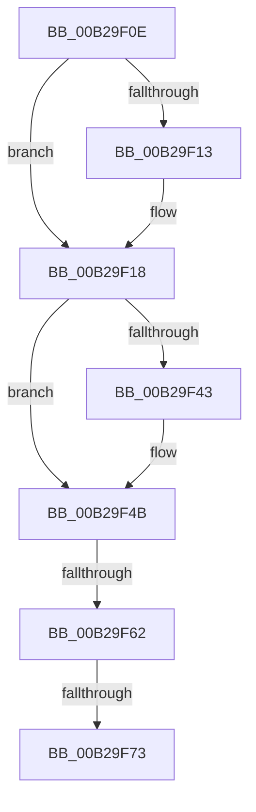

# sub_00B29F0E

- RVA: `0x00B29F0E`–`0x00B29F7E` (길이 `112` bytes)
- VA: `0x0000000140B29F0E`
- 실행 섹션: `PAGE`
- PDB 이름 있음: `아니요`; PDB Function 태그: `아니요`
- unwind 정보 RVA: `0x00097534`
- 디코드: `28`개 명령, `112/112` bytes 표시
- 미해석 바이트: `0` (있으면 어셈블리에 `.byte`로 보존)

> 이 문서는 커널 이미지의 기계어와 PDB 기호를 분석해 생성했습니다. 4번과 5번은 함수 원형과 자료형을 바이너리 사용 방식에서 추정한 C 해석이며 원본 소스 복구 결과는 아닙니다.

## 1. Dependencies

- 직접 호출 지점: **3**; 고유 호출 대상: **3**
- 직접 호출자로 확인된 함수: **0**
- RIP 상대 이미지 참조: **1**

### Outgoing calls
- `0x00B29F46` → [ExfTryToWakePushLock](../../text/26/ExfTryToWakePushLock_function_00265DD0.md) (function, `0x00265DD0`)
- `0x00B29F4E` → [KeAbPostRelease](../../text/2E/KeAbPostRelease_function_002E1600.md) (function, `0x002E1600`)
- `0x00B29F73` → [KiCheckForKernelApcDelivery](../../text/2E/KiCheckForKernelApcDelivery_function_002E2C80.md) (function, `0x002E2C80`)

### Direct callers
- 이 함수 시작 RVA로 연결되는 직접 call은 확인되지 않았습니다. 간접 호출은 완전히 역산할 수 없습니다.

### Static image references
- `0x00B29F34` → RVA `0x00E2CD10` (`.data`; read/write)

## 2. Other-region calls and transfers

- 다른 실행 섹션으로 향하는 call: **3**
  - `0x00B29F46` → [ExfTryToWakePushLock](../../text/26/ExfTryToWakePushLock_function_00265DD0.md) (`PAGE` → `.text`)
  - `0x00B29F4E` → [KeAbPostRelease](../../text/2E/KeAbPostRelease_function_002E1600.md) (`PAGE` → `.text`)
  - `0x00B29F73` → [KiCheckForKernelApcDelivery](../../text/2E/KiCheckForKernelApcDelivery_function_002E2C80.md) (`PAGE` → `.text`)
- call이 아닌 외부 분기/꼬리 이동: **3**
  - `0x00B29F5C` → [MiInsertChildVads + 0xAA](../97/MiInsertChildVads_function_0097DBB0.md) (`tail-transfer`)
  - `0x00B29F6D` → [MiInsertChildVads + 0xAA](../97/MiInsertChildVads_function_0097DBB0.md) (`tail-transfer`)
  - `0x00B29F79` → [MiInsertChildVads + 0xAA](../97/MiInsertChildVads_function_0097DBB0.md) (`tail-transfer`)

## 3. Assembly (complete function range)

```asm
00B29F0E  4D 85 F6                        test r14, r14
00B29F11  74 05                           je 0x140b29f18
00B29F13  41 C6 46 0A 01                  mov byte ptr [r14 + 0xa], 1
00B29F18  48 8B 46 48                     mov rax, qword ptr [rsi + 0x48]
00B29F1C  41 BE 01 00 00 00               mov r14d, 1
00B29F22  48 8B 08                        mov rcx, qword ptr [rax]
00B29F25  48 8B 01                        mov rax, qword ptr [rcx]
00B29F28  48 8B 48 20                     mov rcx, qword ptr [rax + 0x20]
00B29F2C  44 01 71 08                     add dword ptr [rcx + 8], r14d
00B29F30  48 83 C8 FF                     or rax, 0xffffffffffffffff
00B29F34  F0 48 0F C1 05 D3 2D 30 00      lock xadd qword ptr [rip + 0x302dd3], rax
00B29F3D  24 06                           and al, 6
00B29F3F  3C 02                           cmp al, 2
00B29F41  75 08                           jne 0x140b29f4b
00B29F43  49 8B CC                        mov rcx, r12
00B29F46  E8 85 BE 73 FF                  call 0x140265dd0
00B29F4B  49 8B CC                        mov rcx, r12
00B29F4E  E8 AD 76 7B FF                  call 0x1402e1600
00B29F53  90                              nop
00B29F54  66 44 01 B5 E6 01 00 00         add word ptr [rbp + 0x1e6], r14w
00B29F5C  0F 85 F8 3C E5 FF               jne 0x14097dc5a
00B29F62  48 8D 85 98 00 00 00            lea rax, [rbp + 0x98]
00B29F69  90                              nop
00B29F6A  48 39 00                        cmp qword ptr [rax], rax
00B29F6D  0F 84 E7 3C E5 FF               je 0x14097dc5a
00B29F73  E8 08 8D 7B FF                  call 0x1402e2c80
00B29F78  90                              nop
00B29F79  E9 DC 3C E5 FF                  jmp 0x14097dc5a
```

## 4. C-style interpretation (structured pseudocode)

```c
__int64 __fastcall sub_00B29F0E(void)
{
    __int64 result;

    if (v_r14 != 0) {
        *(unsigned __int8 *)(v_r14 + 10) = 1;
    }
    result = (*(unsigned __int64 *)(*(unsigned __int64 *)(*(unsigned __int64 *)(v_rsi + 72)))) | (-1);
    result = (unsigned __int8)((result) & (6));
    if (((unsigned __int8)(result)) == 2) {
        a1 = v_r12;
        result = ExfTryToWakePushLock(a1, a2, a3, a4);
    }
    result = KeAbPostRelease(v_r12, a2, a3, a4);
    result = KiCheckForKernelApcDelivery(v_r12, a2, a3, a4);
}
```

## 5. (Beta) C Style

```c
void sub_00B29F0E(void)
{
    int64_t result;

    if (local_r14 != 0) {
        *(uint8_t *)(local_r14 + 0xA) = 1;
    }
    result = (*(uint64_t *)(*(uint64_t *)(*(uint64_t *)(local_rsi + 0x48)))) | (-1);
    result = (uint8_t)((result) & (6));
    if (((uint8_t)(result)) == 2) {
        a1 = local_r12;
        result = ExfTryToWakePushLock(a1, a2, a3, a4);
    }
    result = KeAbPostRelease(local_r12, a2, a3, a4);
    result = KiCheckForKernelApcDelivery(local_r12, a2, a3, a4);
}
```

## 6. Execution-region graph

[열기: 2D/3D 그래프와 함수 탐색 컨트롤 패널](../../../control-panel.html?section=page&rva=0x00B29F0E&view=graph)

- 2D 그래프는 위에서 아래로 흐르고, 3D 그래프는 빈 공간을 드래그해 회전합니다. Shift+드래그는 이동, 휠은 확대·축소, 함수 노드 선택은 대상 보고서 이동입니다.

### Static fallback


