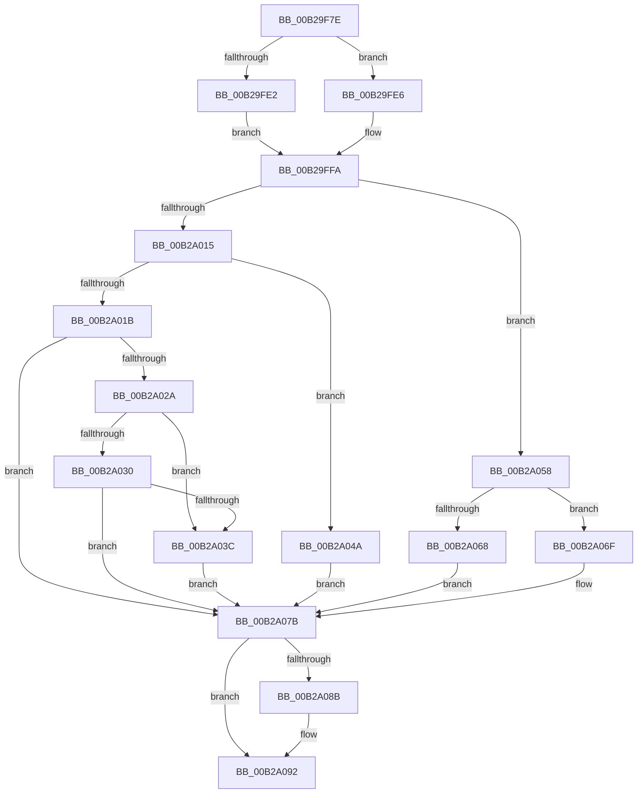

# sub_00B29F7E

- RVA: `0x00B29F7E`–`0x00B2A0A2` (길이 `292` bytes)
- VA: `0x0000000140B29F7E`
- 실행 섹션: `PAGE`
- PDB 이름 있음: `아니요`; PDB Function 태그: `아니요`
- unwind 정보 RVA: `0x0009756C`
- 디코드: `73`개 명령, `292/292` bytes 표시
- 미해석 바이트: `0` (있으면 어셈블리에 `.byte`로 보존)

> 이 문서는 커널 이미지의 기계어와 PDB 기호를 분석해 생성했습니다. 4번과 5번은 함수 원형과 자료형을 바이너리 사용 방식에서 추정한 C 해석이며 원본 소스 복구 결과는 아닙니다.

## 1. Dependencies

- 직접 호출 지점: **0**; 고유 호출 대상: **0**
- 직접 호출자로 확인된 함수: **0**
- RIP 상대 이미지 참조: **0**

### Outgoing calls
- 직접 디코드된 call 명령이 없습니다.

### Direct callers
- 이 함수 시작 RVA로 연결되는 직접 call은 확인되지 않았습니다. 간접 호출은 완전히 역산할 수 없습니다.

### Static image references
- 디코드된 RIP-relative 메모리 참조가 없습니다.

## 2. Other-region calls and transfers

- 다른 실행 섹션으로 향하는 call: **0**
- call이 아닌 외부 분기/꼬리 이동: **1**
  - `0x00B2A09D` → [MmEnumerateAddressSpaceAndReferenceImages + 0x351](../97/MmEnumerateAddressSpaceAndReferenceImages_function_0097DD50.md) (`tail-transfer`)

## 3. Assembly (complete function range)

```asm
00B29F7E  41 8B 46 18                     mov eax, dword ptr [r14 + 0x18]
00B29F82  41 0F B6 4E 20                  movzx ecx, byte ptr [r14 + 0x20]
00B29F87  48 C1 E1 20                     shl rcx, 0x20
00B29F8B  48 0B C8                        or rcx, rax
00B29F8E  48 C1 E1 0C                     shl rcx, 0xc
00B29F92  48 89 0F                        mov qword ptr [rdi], rcx
00B29F95  41 8B 46 1C                     mov eax, dword ptr [r14 + 0x1c]
00B29F99  41 0F B6 56 21                  movzx edx, byte ptr [r14 + 0x21]
00B29F9E  41 0F B6 4E 20                  movzx ecx, byte ptr [r14 + 0x20]
00B29FA3  48 C1 E2 20                     shl rdx, 0x20
00B29FA7  48 0B D0                        or rdx, rax
00B29FAA  48 C1 E1 20                     shl rcx, 0x20
00B29FAE  41 8B 46 18                     mov eax, dword ptr [r14 + 0x18]
00B29FB2  48 0B C8                        or rcx, rax
00B29FB5  48 B8 FD FF FF FF 07 00 00 00   movabs rax, 0x7fffffffd
00B29FBF  48 2B D1                        sub rdx, rcx
00B29FC2  48 FF C2                        inc rdx
00B29FC5  48 C1 E2 0C                     shl rdx, 0xc
00B29FC9  48 89 57 08                     mov qword ptr [rdi + 8], rdx
00B29FCD  41 8B 56 34                     mov edx, dword ptr [r14 + 0x34]
00B29FD1  41 0F B6 4E 22                  movzx ecx, byte ptr [r14 + 0x22]
00B29FD6  48 C1 E1 20                     shl rcx, 0x20
00B29FDA  48 0B CA                        or rcx, rdx
00B29FDD  48 3B C8                        cmp rcx, rax
00B29FE0  72 04                           jb 0x140b29fe6
00B29FE2  33 D2                           xor edx, edx
00B29FE4  EB 14                           jmp 0x140b29ffa
00B29FE6  41 8B 4E 34                     mov ecx, dword ptr [r14 + 0x34]
00B29FEA  41 0F B6 56 22                  movzx edx, byte ptr [r14 + 0x22]
00B29FEF  48 C1 E2 20                     shl rdx, 0x20
00B29FF3  48 0B D1                        or rdx, rcx
00B29FF6  48 C1 E2 0C                     shl rdx, 0xc
00B29FFA  48 89 57 18                     mov qword ptr [rdi + 0x18], rdx
00B29FFE  41 8B 85 D0 01 00 00            mov eax, dword ptr [r13 + 0x1d0]
00B2A005  89 47 10                        mov dword ptr [rdi + 0x10], eax
00B2A008  C7 47 14 00 20 00 00            mov dword ptr [rdi + 0x14], 0x2000
00B2A00F  41 83 E8 03                     sub r8d, 3
00B2A013  74 43                           je 0x140b2a058
00B2A015  41 83 F8 01                     cmp r8d, 1
00B2A019  74 2F                           je 0x140b2a04a
00B2A01B  41 8B 46 30                     mov eax, dword ptr [r14 + 0x30]
00B2A01F  B9 00 20 00 00                  mov ecx, 0x2000
00B2A024  0F BA E0 15                     bt eax, 0x15
00B2A028  73 51                           jae 0x140b2a07b
00B2A02A  0F BA E0 17                     bt eax, 0x17
00B2A02E  72 0C                           jb 0x140b2a03c
00B2A030  25 00 00 18 00                  and eax, 0x180000
00B2A035  3D 00 00 10 00                  cmp eax, 0x100000
00B2A03A  72 3F                           jb 0x140b2a07b
00B2A03C  C7 47 14 00 20 00 20            mov dword ptr [rdi + 0x14], 0x20002000
00B2A043  B9 00 20 00 20                  mov ecx, 0x20002000
00B2A048  EB 31                           jmp 0x140b2a07b
00B2A04A  C7 47 14 00 20 80 00            mov dword ptr [rdi + 0x14], 0x802000
00B2A051  B9 00 20 80 00                  mov ecx, 0x802000
00B2A056  EB 23                           jmp 0x140b2a07b
00B2A058  41 8B 46 30                     mov eax, dword ptr [r14 + 0x30]
00B2A05C  25 00 00 20 0C                  and eax, 0xc200000
00B2A061  3D 00 00 20 08                  cmp eax, 0x8200000
00B2A066  75 07                           jne 0x140b2a06f
00B2A068  B9 00 20 00 00                  mov ecx, 0x2000
00B2A06D  EB 0C                           jmp 0x140b2a07b
00B2A06F  C7 47 14 00 20 40 00            mov dword ptr [rdi + 0x14], 0x402000
00B2A076  B9 00 20 40 00                  mov ecx, 0x402000
00B2A07B  41 8B 46 30                     mov eax, dword ptr [r14 + 0x30]
00B2A07F  25 00 00 60 00                  and eax, 0x600000
00B2A084  3D 00 00 60 00                  cmp eax, 0x600000
00B2A089  75 07                           jne 0x140b2a092
00B2A08B  0F BA E9 15                     bts ecx, 0x15
00B2A08F  89 4F 14                        mov dword ptr [rdi + 0x14], ecx
00B2A092  48 8B 07                        mov rax, qword ptr [rdi]
00B2A095  48 83 E0 FE                     and rax, 0xfffffffffffffffe
00B2A099  48 83 C8 02                     or rax, 2
00B2A09D  E9 FF 3F E5 FF                  jmp 0x14097e0a1
```

## 4. C-style interpretation (structured pseudocode)

```c
__int64 __fastcall sub_00B29F7E(__int64 a1, __int64 a2, int a3)
{
    __int64 result;

    a1 = (*(unsigned __int8 *)(v_r14 + 32)) << (32);
    a1 = (a1) | ((unsigned int)(*(unsigned int *)(v_r14 + 24)));
    a1 = (a1) << (12);
    *(unsigned __int64 *)(v_rdi) = a1;
    a2 = (*(unsigned __int8 *)(v_r14 + 33)) << (32);
    a2 = (a2) | ((unsigned int)(*(unsigned int *)(v_r14 + 28)));
    a1 = (*(unsigned __int8 *)(v_r14 + 32)) << (32);
    a1 = (a1) | ((unsigned int)(*(unsigned int *)(v_r14 + 24)));
    a2 = (a2) - (a1);
    a2 = (a2) + 1;
    a2 = (a2) << (12);
    *(unsigned __int64 *)(v_rdi + 8) = a2;
    a1 = (*(unsigned __int8 *)(v_r14 + 34)) << (32);
    a1 = (a1) | ((unsigned int)(*(unsigned int *)(v_r14 + 52)));
    if (a1 < ((unsigned int)(*(unsigned int *)(v_r14 + 24)))) goto loc_00B29FE6;
    a2 = 0;
    goto loc_00B29FFA;
loc_00B29FE6:
    a2 = (*(unsigned __int8 *)(v_r14 + 34)) << (32);
    a2 = (a2) | ((unsigned int)(*(unsigned int *)(v_r14 + 52)));
    a2 = (a2) << (12);
loc_00B29FFA:
    *(unsigned __int64 *)(v_rdi + 24) = a2;
    *(unsigned int *)(v_rdi + 16) = (unsigned int)((unsigned int)(*(unsigned int *)(v_r13 + 464)));
    *(unsigned int *)(v_rdi + 20) = 0x2000ULL;
    a3 = (unsigned int)((a3) - (3));
    if (condition_is_equal) goto loc_00B2A058;
    if (a3 == 1) goto loc_00B2A04A;
    if (a3 >= 1) goto loc_00B2A07B;
    if (a3 < 1) goto loc_00B2A03C;
    result = (unsigned int)(((unsigned int)(*(unsigned int *)(v_r14 + 48))) & (0x180000ULL));
    if (((unsigned int)(result)) < 0x100000ULL) goto loc_00B2A07B;
loc_00B2A03C:
    *(unsigned int *)(v_rdi + 20) = 0x20002000ULL;
    goto loc_00B2A07B;
loc_00B2A04A:
    *(unsigned int *)(v_rdi + 20) = 0x802000ULL;
    goto loc_00B2A07B;
loc_00B2A058:
    result = (unsigned int)(((unsigned int)(*(unsigned int *)(v_r14 + 48))) & (0xC200000ULL));
    if (((unsigned int)(result)) != 0x8200000ULL) goto loc_00B2A06F;
    goto loc_00B2A07B;
loc_00B2A06F:
    *(unsigned int *)(v_rdi + 20) = 0x402000ULL;
loc_00B2A07B:
    result = (unsigned int)(((unsigned int)(*(unsigned int *)(v_r14 + 48))) & (0x600000ULL));
    if (((unsigned int)(result)) == 0x600000ULL) {
        *(unsigned int *)(v_rdi + 20) = (unsigned int)((unsigned int)(0x402000ULL));
    }
    result = (*(unsigned __int64 *)(v_rdi)) & (-2);
    result = (result) | (2);
}
```

## 5. (Beta) C Style

```c
int64_t sub_00B29F7E(int64_t Arg1, int64_t Arg2, int32_t Arg3)
{
    int64_t result;

    Arg1 = (*(uint8_t *)(local_r14 + 0x20)) << (32);
    Arg1 = (Arg1) | ((uint32_t)(*(uint32_t *)(local_r14 + 0x18)));
    Arg1 = (Arg1) << (12);
    *(uint64_t *)(local_rdi) = Arg1;
    Arg2 = (*(uint8_t *)(local_r14 + 0x21)) << (32);
    Arg2 = (Arg2) | ((uint32_t)(*(uint32_t *)(local_r14 + 0x1C)));
    Arg1 = (*(uint8_t *)(local_r14 + 0x20)) << (32);
    Arg1 = (Arg1) | ((uint32_t)(*(uint32_t *)(local_r14 + 0x18)));
    Arg2 = (Arg2) - (Arg1);
    Arg2 = (Arg2) + 1;
    Arg2 = (Arg2) << (12);
    *(uint64_t *)(local_rdi + 0x8) = Arg2;
    Arg1 = (*(uint8_t *)(local_r14 + 0x22)) << (32);
    Arg1 = (Arg1) | ((uint32_t)(*(uint32_t *)(local_r14 + 0x34)));
    if (Arg1 < ((uint32_t)(*(uint32_t *)(local_r14 + 0x18)))) goto loc_00B29FE6;
    Arg2 = 0;
    goto loc_00B29FFA;
loc_00B29FE6:
    Arg2 = (*(uint8_t *)(local_r14 + 0x22)) << (32);
    Arg2 = (Arg2) | ((uint32_t)(*(uint32_t *)(local_r14 + 0x34)));
    Arg2 = (Arg2) << (12);
loc_00B29FFA:
    *(uint64_t *)(local_rdi + 0x18) = Arg2;
    *(uint32_t *)(local_rdi + 0x10) = (uint32_t)((uint32_t)(*(uint32_t *)(local_r13 + 0x1D0)));
    *(uint32_t *)(local_rdi + 0x14) = 0x2000ULL;
    Arg3 = (uint32_t)((Arg3) - (3));
    if (condition_is_equal) goto loc_00B2A058;
    if (Arg3 == 1) goto loc_00B2A04A;
    if (Arg3 >= 1) goto loc_00B2A07B;
    if (Arg3 < 1) goto loc_00B2A03C;
    result = (uint32_t)(((uint32_t)(*(uint32_t *)(local_r14 + 0x30))) & (0x180000ULL));
    if (((uint32_t)(result)) < 0x100000ULL) goto loc_00B2A07B;
loc_00B2A03C:
    *(uint32_t *)(local_rdi + 0x14) = 0x20002000ULL;
    goto loc_00B2A07B;
loc_00B2A04A:
    *(uint32_t *)(local_rdi + 0x14) = 0x802000ULL;
    goto loc_00B2A07B;
loc_00B2A058:
    result = (uint32_t)(((uint32_t)(*(uint32_t *)(local_r14 + 0x30))) & (0xC200000ULL));
    if (((uint32_t)(result)) != 0x8200000ULL) goto loc_00B2A06F;
    goto loc_00B2A07B;
loc_00B2A06F:
    *(uint32_t *)(local_rdi + 0x14) = 0x402000ULL;
loc_00B2A07B:
    result = (uint32_t)(((uint32_t)(*(uint32_t *)(local_r14 + 0x30))) & (0x600000ULL));
    if (((uint32_t)(result)) == 0x600000ULL) {
        *(uint32_t *)(local_rdi + 0x14) = (uint32_t)((uint32_t)(0x402000ULL));
    }
    result = (*(uint64_t *)(local_rdi)) & (-2);
    result = (result) | (2);
}
```

## 6. Execution-region graph

[열기: 2D/3D 그래프와 함수 탐색 컨트롤 패널](../../../control-panel.html?section=page&rva=0x00B29F7E&view=graph)

- 2D 그래프는 위에서 아래로 흐르고, 3D 그래프는 빈 공간을 드래그해 회전합니다. Shift+드래그는 이동, 휠은 확대·축소, 함수 노드 선택은 대상 보고서 이동입니다.

### Static fallback


