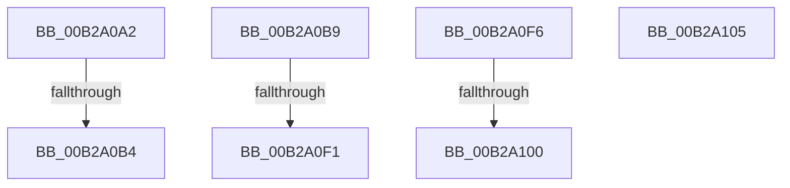

# sub_00B2A0A2

- RVA: `0x00B2A0A2`–`0x00B2A13E` (길이 `156` bytes)
- VA: `0x0000000140B2A0A2`
- 실행 섹션: `PAGE`
- PDB 이름 있음: `아니요`; PDB Function 태그: `아니요`
- unwind 정보 RVA: `0x000975CC`
- 디코드: `42`개 명령, `156/156` bytes 표시
- 미해석 바이트: `0` (있으면 어셈블리에 `.byte`로 보존)

> 이 문서는 커널 이미지의 기계어와 PDB 기호를 분석해 생성했습니다. 4번과 5번은 함수 원형과 자료형을 바이너리 사용 방식에서 추정한 C 해석이며 원본 소스 복구 결과는 아닙니다.

## 1. Dependencies

- 직접 호출 지점: **7**; 고유 호출 대상: **7**
- 직접 호출자로 확인된 함수: **0**
- RIP 상대 이미지 참조: **0**

### Outgoing calls
- `0x00B2A0A5` → [MiCreatePlaceholderStorage](../8C/MiCreatePlaceholderStorage_function_008CF330.md) (function, `0x008CF330`)
- `0x00B2A0E2` → [MiCreateWriteWatchView](../98/MiCreateWriteWatchView_function_0098039C.md) (function, `0x0098039C`)
- `0x00B2A108` → [MiCloneDiscardVadCommit](../AB/MiCloneDiscardVadCommit_function_00AB0CD8.md) (function, `0x00AB0CD8`)
- `0x00B2A119` → [MiFreeVadEventBitmap](../AD/MiFreeVadEventBitmap_function_00ADB6B8.md) (function, `0x00ADB6B8`)
- `0x00B2A121` → [MiFreePlaceholderStorage](../AA/MiFreePlaceholderStorage_function_00AAC868.md) (function, `0x00AAC868`)
- `0x00B2A129` → [MiFreeVadEvents](../../text/67/MiFreeVadEvents_function_0067E3EC.md) (function, `0x0067E3EC`)
- `0x00B2A133` → [ExFreePoolWithTag](../../poolcode/B8/ExFreePoolWithTag_function_00B82870.md) (function, `0x00B82870`)

### Direct callers
- 이 함수 시작 RVA로 연결되는 직접 call은 확인되지 않았습니다. 간접 호출은 완전히 역산할 수 없습니다.

### Static image references
- 디코드된 RIP-relative 메모리 참조가 없습니다.

## 2. Other-region calls and transfers

- 다른 실행 섹션으로 향하는 call: **2**
  - `0x00B2A129` → [MiFreeVadEvents](../../text/67/MiFreeVadEvents_function_0067E3EC.md) (`PAGE` → `.text`)
  - `0x00B2A133` → [ExFreePoolWithTag](../../poolcode/B8/ExFreePoolWithTag_function_00B82870.md) (`PAGE` → `POOLCODE`)
- call이 아닌 외부 분기/꼬리 이동: **7**
  - `0x00B2A0AE` → [MiAllocateChildVads + 0x439](../97/MiAllocateChildVads_function_0097E380.md) (`tail-transfer`)
  - `0x00B2A0B4` → [MiAllocateChildVads + 0x19B](../97/MiAllocateChildVads_function_0097E380.md) (`tail-transfer`)
  - `0x00B2A0EB` → [MiAllocateChildVads + 0x439](../97/MiAllocateChildVads_function_0097E380.md) (`tail-transfer`)
  - `0x00B2A0F1` → [MiAllocateChildVads + 0x1AD](../97/MiAllocateChildVads_function_0097E380.md) (`tail-transfer`)
  - `0x00B2A0FA` → [MiAllocateChildVads + 0x264](../97/MiAllocateChildVads_function_0097E380.md) (`tail-transfer`)
  - `0x00B2A100` → [MiAllocateChildVads + 0x1D5](../97/MiAllocateChildVads_function_0097E380.md) (`tail-transfer`)
  - `0x00B2A139` → [MiAllocateChildVads + 0x276](../97/MiAllocateChildVads_function_0097E380.md) (`tail-transfer`)

## 3. Assembly (complete function range)

```asm
00B2A0A2  48 8B CB                        mov rcx, rbx
00B2A0A5  E8 86 52 DA FF                  call 0x1408cf330
00B2A0AA  8B F8                           mov edi, eax
00B2A0AC  85 C0                           test eax, eax
00B2A0AE  0F 88 05 47 E5 FF               js 0x14097e7b9
00B2A0B4  E9 62 44 E5 FF                  jmp 0x14097e51b
00B2A0B9  8B 43 1C                        mov eax, dword ptr [rbx + 0x1c]
00B2A0BC  48 8B D3                        mov rdx, rbx
00B2A0BF  44 0F B6 43 21                  movzx r8d, byte ptr [rbx + 0x21]
00B2A0C4  0F B6 4B 20                     movzx ecx, byte ptr [rbx + 0x20]
00B2A0C8  49 C1 E0 20                     shl r8, 0x20
00B2A0CC  4C 0B C0                        or r8, rax
00B2A0CF  48 C1 E1 20                     shl rcx, 0x20
00B2A0D3  8B 43 18                        mov eax, dword ptr [rbx + 0x18]
00B2A0D6  48 0B C8                        or rcx, rax
00B2A0D9  4C 2B C1                        sub r8, rcx
00B2A0DC  49 8B CE                        mov rcx, r14
00B2A0DF  49 FF C0                        inc r8
00B2A0E2  E8 B5 62 E5 FF                  call 0x14098039c
00B2A0E7  8B F8                           mov edi, eax
00B2A0E9  85 C0                           test eax, eax
00B2A0EB  0F 88 C8 46 E5 FF               js 0x14097e7b9
00B2A0F1  E9 37 44 E5 FF                  jmp 0x14097e52d
00B2A0F6  8B F8                           mov edi, eax
00B2A0F8  85 C0                           test eax, eax
00B2A0FA  0F 88 E4 44 E5 FF               js 0x14097e5e4
00B2A100  E9 50 44 E5 FF                  jmp 0x14097e555
00B2A105  48 8B CB                        mov rcx, rbx
00B2A108  E8 CB 6B F8 FF                  call 0x140ab0cd8
00B2A10D  41 B8 04 00 00 00               mov r8d, 4
00B2A113  48 8B D3                        mov rdx, rbx
00B2A116  49 8B CE                        mov rcx, r14
00B2A119  E8 9A 15 FB FF                  call 0x140adb6b8
00B2A11E  48 8B CB                        mov rcx, rbx
00B2A121  E8 42 27 F8 FF                  call 0x140aac868
00B2A126  48 8B CB                        mov rcx, rbx
00B2A129  E8 BE 42 B5 FF                  call 0x14067e3ec
00B2A12E  33 D2                           xor edx, edx
00B2A130  48 8B CB                        mov rcx, rbx
00B2A133  E8 38 87 05 00                  call 0x140b82870
00B2A138  90                              nop
00B2A139  E9 B8 44 E5 FF                  jmp 0x14097e5f6
```

## 4. C-style interpretation (structured pseudocode)

```c
__int64 __fastcall sub_00B2A0A2(void)
{
    __int64 result;

    result = MiCreatePlaceholderStorage(v_rbx, a2, a3, a4);
}
```

## 5. (Beta) C Style

```c
void sub_00B2A0A2(void)
{
    int64_t result;

    result = MiCreatePlaceholderStorage(local_rbx, a2, a3, a4);
}
```

## 6. Execution-region graph

[열기: 2D/3D 그래프와 함수 탐색 컨트롤 패널](../../../control-panel.html?section=page&rva=0x00B2A0A2&view=graph)

- 2D 그래프는 위에서 아래로 흐르고, 3D 그래프는 빈 공간을 드래그해 회전합니다. Shift+드래그는 이동, 휠은 확대·축소, 함수 노드 선택은 대상 보고서 이동입니다.

### Static fallback


