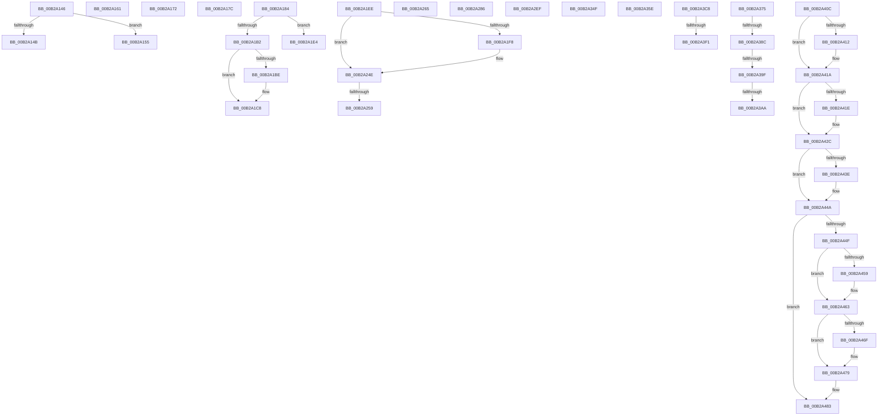

# sub_00B2A146

- RVA: `0x00B2A146`–`0x00B2A491` (길이 `843` bytes)
- VA: `0x0000000140B2A146`
- 실행 섹션: `PAGE`
- PDB 이름 있음: `아니요`; PDB Function 태그: `아니요`
- unwind 정보 RVA: `0x00097608`
- 디코드: `208`개 명령, `843/843` bytes 표시
- 미해석 바이트: `0` (있으면 어셈블리에 `.byte`로 보존)

> 이 문서는 커널 이미지의 기계어와 PDB 기호를 분석해 생성했습니다. 4번과 5번은 함수 원형과 자료형을 바이너리 사용 방식에서 추정한 C 해석이며 원본 소스 복구 결과는 아닙니다.

## 1. Dependencies

- 직접 호출 지점: **20**; 고유 호출 대상: **16**
- 직접 호출자로 확인된 함수: **0**
- RIP 상대 이미지 참조: **1**

### Outgoing calls
- `0x00B2A1A7` → [MiCreateLargePageVad](../A9/MiCreateLargePageVad_function_00A99B50.md) (function, `0x00A99B50`)
- `0x00B2A1C3` → [ObfDereferenceObjectWithTag](../../text/2F/ObfDereferenceObjectWithTag_function_002F78E0.md) (function, `0x002F78E0`)
- `0x00B2A1CF` → [MiDereferenceControlArea](../../text/47/MiDereferenceControlArea_function_00479A20.md) (function, `0x00479A20`)
- `0x00B2A1D9` → [ExFreePoolWithTag](../../poolcode/B8/ExFreePoolWithTag_function_00B82870.md) (function, `0x00B82870`)
- `0x00B2A23D` → [MiSelectUserAddress](../88/MiSelectUserAddress_function_00885C40.md) (function, `0x00885C40`)
- `0x00B2A26D` → [MiLocateLockedVadEvent](../../text/2A/MiLocateLockedVadEvent_function_002A7A0C.md) (function, `0x002A7A0C`)
- `0x00B2A2DF` → [ExFreePoolWithTag](../../poolcode/B8/ExFreePoolWithTag_function_00B82870.md) (function, `0x00B82870`)
- `0x00B2A301` → [MiUpdatePrivateDemandZeroView](../../text/4C/MiUpdatePrivateDemandZeroView_function_004CCC2C.md) (function, `0x004CCC2C`)
- `0x00B2A331` → [MiInsertVadEvent](../../text/43/MiInsertVadEvent_function_00430E74.md) (function, `0x00430E74`)
- `0x00B2A352` → [MiUnlockVad](../../text/2A/MiUnlockVad_function_002A59C8.md) (function, `0x002A59C8`)
- `0x00B2A3BD` → [MiLoadUserSymbols](../AC/MiLoadUserSymbols_function_00AC91D0.md) (function, `0x00AC91D0`)
- `0x00B2A3E2` → [MiSecureVad](../9F/MiSecureVad_function_009F5788.md) (function, `0x009F5788`)
- `0x00B2A415` → [MiReturnCrossPartitionControlAreaCharges](../../text/4D/MiReturnCrossPartitionControlAreaCharges_function_004D6184.md) (function, `0x004D6184`)
- `0x00B2A427` → [MiRemoveSharedCommitNode](../88/MiRemoveSharedCommitNode_function_008889A0.md) (function, `0x008889A0`)
- `0x00B2A434` → [UNLOCK_ADDRESS_SPACE](../../text/2A/UNLOCK_ADDRESS_SPACE_function_002A4844.md) (function, `0x002A4844`)
- `0x00B2A445` → [MiRemoveVadEvent](../../text/67/MiRemoveVadEvent_function_0067E41C.md) (function, `0x0067E41C`)
- `0x00B2A45E` → [MiReleaseVadEventBlocks](../9B/MiReleaseVadEventBlocks_function_009BB0A0.md) (function, `0x009BB0A0`)
- `0x00B2A474` → [ObfDereferenceObjectWithTag](../../text/2F/ObfDereferenceObjectWithTag_function_002F78E0.md) (function, `0x002F78E0`)
- `0x00B2A47E` → [ExFreePoolWithTag](../../poolcode/B8/ExFreePoolWithTag_function_00B82870.md) (function, `0x00B82870`)
- `0x00B2A486` → [MiDereferenceControlArea](../../text/47/MiDereferenceControlArea_function_00479A20.md) (function, `0x00479A20`)

### Direct callers
- 이 함수 시작 RVA로 연결되는 직접 call은 확인되지 않았습니다. 간접 호출은 완전히 역산할 수 없습니다.

### Static image references
- `0x00B2A3FD` → RVA `0x00E2DB80` (`.data`; read)

## 2. Other-region calls and transfers

- 다른 실행 섹션으로 향하는 call: **14**
  - `0x00B2A1C3` → [ObfDereferenceObjectWithTag](../../text/2F/ObfDereferenceObjectWithTag_function_002F78E0.md) (`PAGE` → `.text`)
  - `0x00B2A1CF` → [MiDereferenceControlArea](../../text/47/MiDereferenceControlArea_function_00479A20.md) (`PAGE` → `.text`)
  - `0x00B2A1D9` → [ExFreePoolWithTag](../../poolcode/B8/ExFreePoolWithTag_function_00B82870.md) (`PAGE` → `POOLCODE`)
  - `0x00B2A26D` → [MiLocateLockedVadEvent](../../text/2A/MiLocateLockedVadEvent_function_002A7A0C.md) (`PAGE` → `.text`)
  - `0x00B2A2DF` → [ExFreePoolWithTag](../../poolcode/B8/ExFreePoolWithTag_function_00B82870.md) (`PAGE` → `POOLCODE`)
  - `0x00B2A301` → [MiUpdatePrivateDemandZeroView](../../text/4C/MiUpdatePrivateDemandZeroView_function_004CCC2C.md) (`PAGE` → `.text`)
  - `0x00B2A331` → [MiInsertVadEvent](../../text/43/MiInsertVadEvent_function_00430E74.md) (`PAGE` → `.text`)
  - `0x00B2A352` → [MiUnlockVad](../../text/2A/MiUnlockVad_function_002A59C8.md) (`PAGE` → `.text`)
  - `0x00B2A415` → [MiReturnCrossPartitionControlAreaCharges](../../text/4D/MiReturnCrossPartitionControlAreaCharges_function_004D6184.md) (`PAGE` → `.text`)
  - `0x00B2A434` → [UNLOCK_ADDRESS_SPACE](../../text/2A/UNLOCK_ADDRESS_SPACE_function_002A4844.md) (`PAGE` → `.text`)
  - `0x00B2A445` → [MiRemoveVadEvent](../../text/67/MiRemoveVadEvent_function_0067E41C.md) (`PAGE` → `.text`)
  - `0x00B2A474` → [ObfDereferenceObjectWithTag](../../text/2F/ObfDereferenceObjectWithTag_function_002F78E0.md) (`PAGE` → `.text`)
  - `0x00B2A47E` → [ExFreePoolWithTag](../../poolcode/B8/ExFreePoolWithTag_function_00B82870.md) (`PAGE` → `POOLCODE`)
  - `0x00B2A486` → [MiDereferenceControlArea](../../text/47/MiDereferenceControlArea_function_00479A20.md) (`PAGE` → `.text`)
- call이 아닌 외부 분기/꼬리 이동: **21**
  - `0x00B2A150` → [MiMapViewOfImageSection + 0x650](../97/MiMapViewOfImageSection_function_0097E92C.md) (`tail-transfer`)
  - `0x00B2A15C` → [MiMapViewOfImageSection + 0x102](../97/MiMapViewOfImageSection_function_0097E92C.md) (`tail-transfer`)
  - `0x00B2A16D` → [MiMapViewOfImageSection + 0x204](../97/MiMapViewOfImageSection_function_0097E92C.md) (`tail-transfer`)
  - `0x00B2A177` → [MiMapViewOfImageSection + 0x650](../97/MiMapViewOfImageSection_function_0097E92C.md) (`tail-transfer`)
  - `0x00B2A17F` → [MiMapViewOfImageSection + 0x925](../97/MiMapViewOfImageSection_function_0097E92C.md) (`tail-transfer`)
  - `0x00B2A1DF` → [MiMapViewOfImageSection + 0xA88](../97/MiMapViewOfImageSection_function_0097E92C.md) (`tail-transfer`)
  - `0x00B2A1E9` → [MiMapViewOfImageSection + 0x38D](../97/MiMapViewOfImageSection_function_0097E92C.md) (`tail-transfer`)
  - `0x00B2A253` → [MiMapViewOfImageSection + 0x9CA](../97/MiMapViewOfImageSection_function_0097E92C.md) (`tail-transfer`)
  - `0x00B2A260` → [MiMapViewOfImageSection + 0xEFD](../97/MiMapViewOfImageSection_function_0097E92C.md) (`tail-transfer`)
  - `0x00B2A281` → [MiMapViewOfImageSection + 0x412](../97/MiMapViewOfImageSection_function_0097E92C.md) (`tail-transfer`)
  - `0x00B2A2EA` → [MiMapViewOfImageSection + 0xC64](../97/MiMapViewOfImageSection_function_0097E92C.md) (`tail-transfer`)
  - `0x00B2A34A` → [MiMapViewOfImageSection + 0x4E0](../97/MiMapViewOfImageSection_function_0097E92C.md) (`tail-transfer`)
  - `0x00B2A359` → [MiMapViewOfImageSection + 0x566](../97/MiMapViewOfImageSection_function_0097E92C.md) (`tail-transfer`)
  - `0x00B2A370` → [MiMapViewOfImageSection + 0x5A5](../97/MiMapViewOfImageSection_function_0097E92C.md) (`tail-transfer`)
  - `0x00B2A386` → [MiMapViewOfImageSection + 0x5E8](../97/MiMapViewOfImageSection_function_0097E92C.md) (`tail-transfer`)
  - `0x00B2A399` → [MiMapViewOfImageSection + 0x5E8](../97/MiMapViewOfImageSection_function_0097E92C.md) (`tail-transfer`)
  - `0x00B2A3A4` → [MiMapViewOfImageSection + 0x5E8](../97/MiMapViewOfImageSection_function_0097E92C.md) (`tail-transfer`)
  - `0x00B2A3C3` → [MiMapViewOfImageSection + 0x5E3](../97/MiMapViewOfImageSection_function_0097E92C.md) (`tail-transfer`)
  - `0x00B2A3EB` → [MiMapViewOfImageSection + 0xA5C](../97/MiMapViewOfImageSection_function_0097E92C.md) (`tail-transfer`)
  - `0x00B2A407` → [MiMapViewOfImageSection + 0x725](../97/MiMapViewOfImageSection_function_0097E92C.md) (`tail-transfer`)
  - `0x00B2A48C` → [MiMapViewOfImageSection + 0xA88](../97/MiMapViewOfImageSection_function_0097E92C.md) (`tail-transfer`)

## 3. Assembly (complete function range)

```asm
00B2A146  66 85 D2                        test dx, dx
00B2A149  74 0A                           je 0x140b2a155
00B2A14B  B8 BB 00 00 C0                  mov eax, 0xc00000bb
00B2A150  E9 27 4E E5 FF                  jmp 0x14097ef7c
00B2A155  66 89 8D C8 00 00 00            mov word ptr [rbp + 0xc8], cx
00B2A15C  E9 CD 48 E5 FF                  jmp 0x14097ea2e
00B2A161  83 CB 04                        or ebx, 4
00B2A164  41 83 CF 01                     or r15d, 1
00B2A168  44 89 7C 24 50                  mov dword ptr [rsp + 0x50], r15d
00B2A16D  E9 BE 49 E5 FF                  jmp 0x14097eb30
00B2A172  B8 69 02 00 C0                  mov eax, 0xc0000269
00B2A177  E9 00 4E E5 FF                  jmp 0x14097ef7c
00B2A17C  83 CB 01                        or ebx, 1
00B2A17F  E9 CD 50 E5 FF                  jmp 0x14097f251
00B2A184  48 8B 45 88                     mov rax, qword ptr [rbp - 0x78]
00B2A188  45 33 C9                        xor r9d, r9d
00B2A18B  48 C1 E8 0C                     shr rax, 0xc
00B2A18F  45 33 C0                        xor r8d, r8d
00B2A192  41 89 46 34                     mov dword ptr [r14 + 0x34], eax
00B2A196  49 8B D6                        mov rdx, r14
00B2A199  48 C1 E8 20                     shr rax, 0x20
00B2A19D  49 8B CD                        mov rcx, r13
00B2A1A0  41 88 46 22                     mov byte ptr [r14 + 0x22], al
00B2A1A4  83 CF 01                        or edi, 1
00B2A1A7  E8 A4 F9 F6 FF                  call 0x140a99b50
00B2A1AC  8B F0                           mov esi, eax
00B2A1AE  85 C0                           test eax, eax
00B2A1B0  79 32                           jns 0x140b2a1e4
00B2A1B2  49 8B 8E 80 00 00 00            mov rcx, qword ptr [r14 + 0x80]
00B2A1B9  48 85 C9                        test rcx, rcx
00B2A1BC  74 0A                           je 0x140b2a1c8
00B2A1BE  BA 4D 6D 53 63                  mov edx, 0x63536d4d
00B2A1C3  E8 18 D7 7C FF                  call 0x1402f78e0
00B2A1C8  48 8B 8D C0 00 00 00            mov rcx, qword ptr [rbp + 0xc0]
00B2A1CF  E8 4C F8 94 FF                  call 0x140479a20
00B2A1D4  33 D2                           xor edx, edx
00B2A1D6  49 8B CE                        mov rcx, r14
00B2A1D9  E8 92 86 05 00                  call 0x140b82870
00B2A1DE  90                              nop
00B2A1DF  E9 D0 51 E5 FF                  jmp 0x14097f3b4
00B2A1E4  48 8B 74 24 78                  mov rsi, qword ptr [rsp + 0x78]
00B2A1E9  E9 CB 4A E5 FF                  jmp 0x14097ecb9
00B2A1EE  4D 8B 44 24 08                  mov r8, qword ptr [r12 + 8]
00B2A1F3  4D 3B F8                        cmp r15, r8
00B2A1F6  74 56                           je 0x140b2a24e
00B2A1F8  41 8B 46 30                     mov eax, dword ptr [r14 + 0x30]
00B2A1FC  48 8D 4C 24 70                  lea rcx, [rsp + 0x70]
00B2A201  49 8B 14 24                     mov rdx, qword ptr [r12]
00B2A205  48 89 4C 24 48                  mov qword ptr [rsp + 0x48], rcx
00B2A20A  48 8D 4D A8                     lea rcx, [rbp - 0x58]
00B2A20E  48 89 4C 24 40                  mov qword ptr [rsp + 0x40], rcx
00B2A213  41 8B 4C 24 28                  mov ecx, dword ptr [r12 + 0x28]
00B2A218  44 89 4C 24 38                  mov dword ptr [rsp + 0x38], r9d
00B2A21D  4C 8B 4D 88                     mov r9, qword ptr [rbp - 0x78]
00B2A221  C1 E8 07                        shr eax, 7
00B2A224  83 E0 1F                        and eax, 0x1f
00B2A227  89 44 24 30                     mov dword ptr [rsp + 0x30], eax
00B2A22B  48 8B 45 98                     mov rax, qword ptr [rbp - 0x68]
00B2A22F  48 89 44 24 28                  mov qword ptr [rsp + 0x28], rax
00B2A234  48 8B 45 80                     mov rax, qword ptr [rbp - 0x80]
00B2A238  48 89 44 24 20                  mov qword ptr [rsp + 0x20], rax
00B2A23D  E8 FE B9 D5 FF                  call 0x140885c40
00B2A242  8B F0                           mov esi, eax
00B2A244  48 8B 44 24 70                  mov rax, qword ptr [rsp + 0x70]
00B2A249  48 89 44 24 58                  mov qword ptr [rsp + 0x58], rax
00B2A24E  4D 8B FE                        mov r15, r14
00B2A251  85 F6                           test esi, esi
00B2A253  0F 89 9D 50 E5 FF               jns 0x14097f2f6
00B2A259  4C 8B B5 C0 00 00 00            mov r14, qword ptr [rbp + 0xc0]
00B2A260  E9 C4 55 E5 FF                  jmp 0x14097f829
00B2A265  BA 10 00 00 00                  mov edx, 0x10
00B2A26A  49 8B CE                        mov rcx, r14
00B2A26D  E8 9A D7 77 FF                  call 0x1402a7a0c
00B2A272  48 8B 4D B0                     mov rcx, qword ptr [rbp - 0x50]
00B2A276  49 C1 E8 0C                     shr r8, 0xc
00B2A27A  4C 89 40 10                     mov qword ptr [rax + 0x10], r8
00B2A27E  88 48 08                        mov byte ptr [rax + 8], cl
00B2A281  E9 B8 4A E5 FF                  jmp 0x14097ed3e
00B2A286  41 0F 10 06                     movups xmm0, xmmword ptr [r14]
00B2A28A  BA 80 00 00 00                  mov edx, 0x80
00B2A28F  49 8B CE                        mov rcx, r14
00B2A292  0F 11 06                        movups xmmword ptr [rsi], xmm0
00B2A295  41 0F 10 4E 10                  movups xmm1, xmmword ptr [r14 + 0x10]
00B2A29A  0F 11 4E 10                     movups xmmword ptr [rsi + 0x10], xmm1
00B2A29E  41 0F 10 46 20                  movups xmm0, xmmword ptr [r14 + 0x20]
00B2A2A3  0F 11 46 20                     movups xmmword ptr [rsi + 0x20], xmm0
00B2A2A7  41 0F 10 4E 30                  movups xmm1, xmmword ptr [r14 + 0x30]
00B2A2AC  0F 11 4E 30                     movups xmmword ptr [rsi + 0x30], xmm1
00B2A2B0  41 0F 10 46 40                  movups xmm0, xmmword ptr [r14 + 0x40]
00B2A2B5  0F 11 46 40                     movups xmmword ptr [rsi + 0x40], xmm0
00B2A2B9  41 0F 10 4E 50                  movups xmm1, xmmword ptr [r14 + 0x50]
00B2A2BE  0F 11 4E 50                     movups xmmword ptr [rsi + 0x50], xmm1
00B2A2C2  41 0F 10 46 60                  movups xmm0, xmmword ptr [r14 + 0x60]
00B2A2C7  0F 11 46 60                     movups xmmword ptr [rsi + 0x60], xmm0
00B2A2CB  41 0F 10 4E 70                  movups xmm1, xmmword ptr [r14 + 0x70]
00B2A2D0  0F 11 4C 16 F0                  movups xmmword ptr [rsi + rdx - 0x10], xmm1
00B2A2D5  49 8B 04 16                     mov rax, qword ptr [r14 + rdx]
00B2A2D9  48 89 04 16                     mov qword ptr [rsi + rdx], rax
00B2A2DD  33 D2                           xor edx, edx
00B2A2DF  E8 8C 85 05 00                  call 0x140b82870
00B2A2E4  83 CB 08                        or ebx, 8
00B2A2E7  4C 8B FE                        mov r15, rsi
00B2A2EA  E9 A1 52 E5 FF                  jmp 0x14097f590
00B2A2EF  45 8B 77 34                     mov r14d, dword ptr [r15 + 0x34]
00B2A2F3  45 33 C0                        xor r8d, r8d
00B2A2F6  41 0F B6 77 22                  movzx esi, byte ptr [r15 + 0x22]
00B2A2FB  49 8B D7                        mov rdx, r15
00B2A2FE  49 8B CD                        mov rcx, r13
00B2A301  E8 26 29 9A FF                  call 0x1404ccc2c
00B2A306  8B D6                           mov edx, esi
00B2A308  45 33 C0                        xor r8d, r8d
00B2A30B  48 C1 E2 20                     shl rdx, 0x20
00B2A30F  49 8B CF                        mov rcx, r15
00B2A312  49 0B D6                        or rdx, r14
00B2A315  48 03 C2                        add rax, rdx
00B2A318  48 8D 55 10                     lea rdx, [rbp + 0x10]
00B2A31C  41 89 47 34                     mov dword ptr [r15 + 0x34], eax
00B2A320  48 C1 E8 20                     shr rax, 0x20
00B2A324  41 88 47 22                     mov byte ptr [r15 + 0x22], al
00B2A328  48 8B 44 24 78                  mov rax, qword ptr [rsp + 0x78]
00B2A32D  48 89 45 18                     mov qword ptr [rbp + 0x18], rax
00B2A331  E8 3E 6B 90 FF                  call 0x140430e74
00B2A336  48 8B 44 24 70                  mov rax, qword ptr [rsp + 0x70]
00B2A33B  83 CB 40                        or ebx, 0x40
00B2A33E  4C 8B B5 C0 00 00 00            mov r14, qword ptr [rbp + 0xc0]
00B2A345  48 89 44 24 58                  mov qword ptr [rsp + 0x58], rax
00B2A34A  E9 BD 4A E5 FF                  jmp 0x14097ee0c
00B2A34F  49 8B D7                        mov rdx, r15
00B2A352  E8 71 B6 77 FF                  call 0x1402a59c8
00B2A357  33 F6                           xor esi, esi
00B2A359  E9 34 4B E5 FF                  jmp 0x14097ee92
00B2A35E  8B 44 24 60                     mov eax, dword ptr [rsp + 0x60]
00B2A362  85 DA                           test edx, ebx
00B2A364  B9 0E 00 00 40                  mov ecx, 0x4000000e
00B2A369  0F 45 C1                        cmovne eax, ecx
00B2A36C  89 44 24 60                     mov dword ptr [rsp + 0x60], eax
00B2A370  E9 5C 4B E5 FF                  jmp 0x14097eed1
00B2A375  48 8B 44 24 78                  mov rax, qword ptr [rsp + 0x78]
00B2A37A  4C 8B 44 24 68                  mov r8, qword ptr [rsp + 0x68]
00B2A37F  F6 80 A8 05 00 00 20            test byte ptr [rax + 0x5a8], 0x20
00B2A386  0F 85 88 4B E5 FF               jne 0x14097ef14
00B2A38C  41 0F B7 48 0C                  movzx ecx, word ptr [r8 + 0xc]
00B2A391  BF 00 08 00 00                  mov edi, 0x800
00B2A396  66 85 CF                        test di, cx
00B2A399  0F 85 75 4B E5 FF               jne 0x14097ef14
00B2A39F  41 F6 40 0E 20                  test byte ptr [r8 + 0xe], 0x20
00B2A3A4  0F 84 6A 4B E5 FF               je 0x14097ef14
00B2A3AA  48 8B 54 24 58                  mov rdx, qword ptr [rsp + 0x58]
00B2A3AF  66 0B CF                        or cx, di
00B2A3B2  66 41 89 48 0C                  mov word ptr [r8 + 0xc], cx
00B2A3B7  4D 8B C5                        mov r8, r13
00B2A3BA  48 8B CE                        mov rcx, rsi
00B2A3BD  E8 0E EE F9 FF                  call 0x140ac91d0
00B2A3C2  90                              nop
00B2A3C3  E9 47 4B E5 FF                  jmp 0x14097ef0f
00B2A3C8  4D 8B 44 24 18                  mov r8, qword ptr [r12 + 0x18]
00B2A3CD  48 8D 45 C0                     lea rax, [rbp - 0x40]
00B2A3D1  48 8B 54 24 58                  mov rdx, qword ptr [rsp + 0x58]
00B2A3D6  49 8B CF                        mov rcx, r15
00B2A3D9  48 89 44 24 28                  mov qword ptr [rsp + 0x28], rax
00B2A3DE  89 7C 24 20                     mov dword ptr [rsp + 0x20], edi
00B2A3E2  E8 A1 B3 EC FF                  call 0x1409f5788
00B2A3E7  8B F0                           mov esi, eax
00B2A3E9  85 C0                           test eax, eax
00B2A3EB  0F 88 97 4F E5 FF               js 0x14097f388
00B2A3F1  49 8B 44 24 48                  mov rax, qword ptr [r12 + 0x48]
00B2A3F6  49 8B CD                        mov rcx, r13
00B2A3F9  48 33 4D C0                     xor rcx, qword ptr [rbp - 0x40]
00B2A3FD  48 33 0D 7C 37 30 00            xor rcx, qword ptr [rip + 0x30377c]
00B2A404  48 89 08                        mov qword ptr [rax], rcx
00B2A407  E9 45 4C E5 FF                  jmp 0x14097f051
00B2A40C  0F BA E3 09                     bt ebx, 9
00B2A410  73 08                           jae 0x140b2a41a
00B2A412  49 8B CE                        mov rcx, r14
00B2A415  E8 6A BD 9A FF                  call 0x1404d6184
00B2A41A  84 DB                           test bl, bl
00B2A41C  79 0E                           jns 0x140b2a42c
00B2A41E  45 33 C0                        xor r8d, r8d
00B2A421  49 8B D5                        mov rdx, r13
00B2A424  49 8B CE                        mov rcx, r14
00B2A427  E8 74 E5 D5 FF                  call 0x1408889a0
00B2A42C  48 8B 4C 24 78                  mov rcx, qword ptr [rsp + 0x78]
00B2A431  49 8B D5                        mov rdx, r13
00B2A434  E8 0B A4 77 FF                  call 0x1402a4844
00B2A439  F6 C3 40                        test bl, 0x40
00B2A43C  74 0C                           je 0x140b2a44a
00B2A43E  48 8D 55 10                     lea rdx, [rbp + 0x10]
00B2A442  49 8B CF                        mov rcx, r15
00B2A445  E8 D2 3F B5 FF                  call 0x14067e41c
00B2A44A  4D 85 FF                        test r15, r15
00B2A44D  74 34                           je 0x140b2a483
00B2A44F  48 81 7D 80 00 00 20 00         cmp qword ptr [rbp - 0x80], 0x200000
00B2A457  75 0A                           jne 0x140b2a463
00B2A459  33 D2                           xor edx, edx
00B2A45B  49 8B CF                        mov rcx, r15
00B2A45E  E8 3D 0C E9 FF                  call 0x1409bb0a0
00B2A463  49 8B 8F 80 00 00 00            mov rcx, qword ptr [r15 + 0x80]
00B2A46A  48 85 C9                        test rcx, rcx
00B2A46D  74 0A                           je 0x140b2a479
00B2A46F  BA 4D 6D 53 63                  mov edx, 0x63536d4d
00B2A474  E8 67 D4 7C FF                  call 0x1402f78e0
00B2A479  33 D2                           xor edx, edx
00B2A47B  49 8B CF                        mov rcx, r15
00B2A47E  E8 ED 83 05 00                  call 0x140b82870
00B2A483  49 8B CE                        mov rcx, r14
00B2A486  E8 95 F5 94 FF                  call 0x140479a20
00B2A48B  90                              nop
00B2A48C  E9 23 4F E5 FF                  jmp 0x14097f3b4
```

## 4. C-style interpretation (structured pseudocode)

```c
__int64 __fastcall sub_00B2A146(unsigned __int16 a1, unsigned __int16 a2, int a3, int a4)
{
    unsigned __int64 v_stack_p20;
    unsigned __int64 v_stack_p28;
    unsigned int v_stack_p30;
    unsigned int v_stack_p38;
    unsigned __int64 v_stack_p40;
    unsigned __int64 v_stack_p48;
    unsigned int v_stack_p50;
    unsigned __int64 v_stack_p58;
    unsigned int v_stack_p60;
    unsigned __int64 v_stack_p68;
    unsigned __int64 v_stack_p70;
    unsigned __int64 v_stack_p78;

    if (a2 == 0) goto loc_00B2A155;
loc_00B2A155:
    *(unsigned __int16 *)(v_rbp + 200) = a1;
}
```

## 5. (Beta) C Style

```c
int64_t sub_00B2A146(uint16_t Arg1, uint16_t Arg2, int32_t Arg3, int32_t Arg4)
{
    uint64_t v_stack_p20;
    uint64_t v_stack_p28;
    uint32_t v_stack_p30;
    uint32_t v_stack_p38;
    uint64_t v_stack_p40;
    uint64_t v_stack_p48;
    uint32_t v_stack_p50;
    uint64_t v_stack_p58;
    uint32_t v_stack_p60;
    uint64_t v_stack_p68;
    uint64_t v_stack_p70;
    uint64_t v_stack_p78;

    if (Arg2 == 0) goto loc_00B2A155;
loc_00B2A155:
    *(uint16_t *)(local_rbp + 0xC8) = Arg1;
}
```

## 6. Execution-region graph

[열기: 2D/3D 그래프와 함수 탐색 컨트롤 패널](../../../control-panel.html?section=page&rva=0x00B2A146&view=graph)

- 2D 그래프는 위에서 아래로 흐르고, 3D 그래프는 빈 공간을 드래그해 회전합니다. Shift+드래그는 이동, 휠은 확대·축소, 함수 노드 선택은 대상 보고서 이동입니다.

### Static fallback


