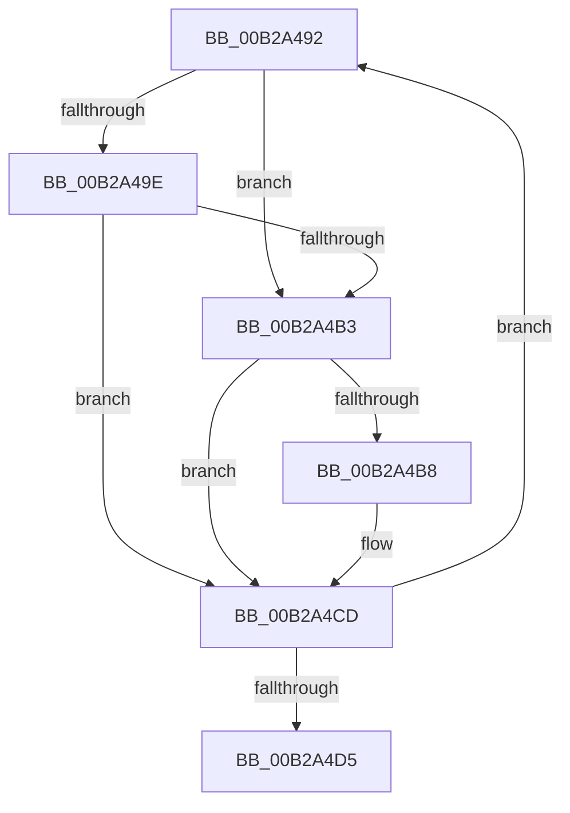

# sub_00B2A492

- RVA: `0x00B2A492`–`0x00B2A4DA` (길이 `72` bytes)
- VA: `0x0000000140B2A492`
- 실행 섹션: `PAGE`
- PDB 이름 있음: `아니요`; PDB Function 태그: `아니요`
- unwind 정보 RVA: `0x00097638`
- 디코드: `23`개 명령, `72/72` bytes 표시
- 미해석 바이트: `0` (있으면 어셈블리에 `.byte`로 보존)

> 이 문서는 커널 이미지의 기계어와 PDB 기호를 분석해 생성했습니다. 4번과 5번은 함수 원형과 자료형을 바이너리 사용 방식에서 추정한 C 해석이며 원본 소스 복구 결과는 아닙니다.

## 1. Dependencies

- 직접 호출 지점: **2**; 고유 호출 대상: **2**
- 직접 호출자로 확인된 함수: **0**
- RIP 상대 이미지 참조: **0**

### Outgoing calls
- `0x00B2A495` → [MiIsPfn](../../text/46/MiIsPfn_function_00462450.md) (function, `0x00462450`)
- `0x00B2A4C3` → [MiDereferenceIoPages](../../text/2A/MiDereferenceIoPages_function_002AB1B0.md) (function, `0x002AB1B0`)

### Direct callers
- 이 함수 시작 RVA로 연결되는 직접 call은 확인되지 않았습니다. 간접 호출은 완전히 역산할 수 없습니다.

### Static image references
- 디코드된 RIP-relative 메모리 참조가 없습니다.

## 2. Other-region calls and transfers

- 다른 실행 섹션으로 향하는 call: **2**
  - `0x00B2A495` → [MiIsPfn](../../text/46/MiIsPfn_function_00462450.md) (`PAGE` → `.text`)
  - `0x00B2A4C3` → [MiDereferenceIoPages](../../text/2A/MiDereferenceIoPages_function_002AB1B0.md) (`PAGE` → `.text`)
- call이 아닌 외부 분기/꼬리 이동: **1**
  - `0x00B2A4D5` → [MiMapViewOfPhysicalSection + 0x29E](../97/MiMapViewOfPhysicalSection_function_0097F984.md) (`tail-transfer`)

## 3. Assembly (complete function range)

```asm
00B2A492  48 8B CE                        mov rcx, rsi
00B2A495  E8 B6 7F 93 FF                  call 0x140462450
00B2A49A  85 C0                           test eax, eax
00B2A49C  75 15                           jne 0x140b2a4b3
00B2A49E  48 85 FF                        test rdi, rdi
00B2A4A1  48 8B C6                        mov rax, rsi
00B2A4A4  49 0F 45 C6                     cmovne rax, r14
00B2A4A8  48 FF C7                        inc rdi
00B2A4AB  4C 8B F0                        mov r14, rax
00B2A4AE  49 3B F7                        cmp rsi, r15
00B2A4B1  75 1A                           jne 0x140b2a4cd
00B2A4B3  48 85 FF                        test rdi, rdi
00B2A4B6  74 15                           je 0x140b2a4cd
00B2A4B8  4C 8B C7                        mov r8, rdi
00B2A4BB  49 8B D6                        mov rdx, r14
00B2A4BE  B9 01 00 00 00                  mov ecx, 1
00B2A4C3  E8 E8 0C 78 FF                  call 0x1402ab1b0
00B2A4C8  33 FF                           xor edi, edi
00B2A4CA  4D 8B F4                        mov r14, r12
00B2A4CD  48 FF C6                        inc rsi
00B2A4D0  49 3B F7                        cmp rsi, r15
00B2A4D3  76 BD                           jbe 0x140b2a492
00B2A4D5  E9 48 57 E5 FF                  jmp 0x14097fc22
```

## 4. C-style interpretation (structured pseudocode)

```c
__int64 __fastcall sub_00B2A492(void)
{
    __int64 result;
    __int64 v_r14;
    __int64 v_rdi;
    __int64 v_rsi;

    result = MiIsPfn(v_rsi, a2, a3, a4);
    if ((unsigned int)(result) != 0) goto loc_00B2A4B3;
    result = v_rsi;
    if (v_rdi != 0) { result = v_r14; }
    v_rdi = (v_rdi) + 1;
    if (v_rsi != v_r15) goto loc_00B2A4CD;
loc_00B2A4B3:
    v_r14 = result;
    if (v_rdi != 0) {
        a3 = v_rdi;
        a2 = result;
        a1 = 1;
        result = MiDereferenceIoPages(a1, a2, a3, a4);
        v_rdi = 0;
        v_r14 = v_r12;
    }
    v_rsi = (v_rsi) + 1;
    if (v_rsi <= v_r15) goto loc_00B2A492;
}
```

## 5. (Beta) C Style

```c
void sub_00B2A492(void)
{
    int64_t result;
    int64_t local_r14;
    int64_t local_rdi;
    int64_t local_rsi;

    result = MiIsPfn(local_rsi, a2, a3, a4);
    if ((uint32_t)(result) != 0) goto loc_00B2A4B3;
    result = local_rsi;
    if (local_rdi != 0) { result = local_r14; }
    local_rdi = (local_rdi) + 1;
    if (local_rsi != local_r15) goto loc_00B2A4CD;
loc_00B2A4B3:
    local_r14 = result;
    if (local_rdi != 0) {
        a3 = local_rdi;
        a2 = result;
        a1 = 1;
        result = MiDereferenceIoPages(a1, a2, a3, a4);
        local_rdi = 0;
        local_r14 = local_r12;
    }
    local_rsi = (local_rsi) + 1;
    if (local_rsi <= local_r15) goto loc_00B2A492;
}
```

## 6. Execution-region graph

[열기: 2D/3D 그래프와 함수 탐색 컨트롤 패널](../../../control-panel.html?section=page&rva=0x00B2A492&view=graph)

- 2D 그래프는 위에서 아래로 흐르고, 3D 그래프는 빈 공간을 드래그해 회전합니다. Shift+드래그는 이동, 휠은 확대·축소, 함수 노드 선택은 대상 보고서 이동입니다.

### Static fallback


