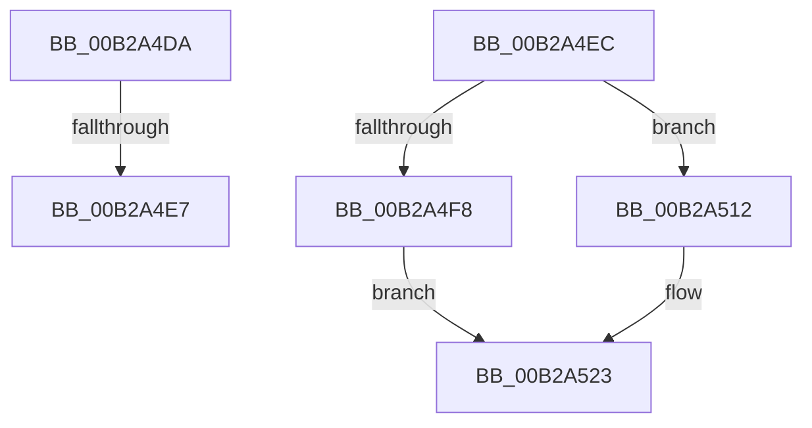

# sub_00B2A4DA

- RVA: `0x00B2A4DA`–`0x00B2A52C` (길이 `82` bytes)
- VA: `0x0000000140B2A4DA`
- 실행 섹션: `PAGE`
- PDB 이름 있음: `아니요`; PDB Function 태그: `아니요`
- unwind 정보 RVA: `0x00097668`
- 디코드: `22`개 명령, `82/82` bytes 표시
- 미해석 바이트: `0` (있으면 어셈블리에 `.byte`로 보존)

> 이 문서는 커널 이미지의 기계어와 PDB 기호를 분석해 생성했습니다. 4번과 5번은 함수 원형과 자료형을 바이너리 사용 방식에서 추정한 C 해석이며 원본 소스 복구 결과는 아닙니다.

## 1. Dependencies

- 직접 호출 지점: **3**; 고유 호출 대상: **3**
- 직접 호출자로 확인된 함수: **0**
- RIP 상대 이미지 참조: **0**

### Outgoing calls
- `0x00B2A4EF` → [MiIsPfn](../../text/46/MiIsPfn_function_00462450.md) (function, `0x00462450`)
- `0x00B2A50B` → [MiDoubleUnlockMdlPage](../../text/41/MiDoubleUnlockMdlPage_function_0041F43C.md) (function, `0x0041F43C`)
- `0x00B2A51E` → [MiDereferenceIoPages](../../text/2A/MiDereferenceIoPages_function_002AB1B0.md) (function, `0x002AB1B0`)

### Direct callers
- 이 함수 시작 RVA로 연결되는 직접 call은 확인되지 않았습니다. 간접 호출은 완전히 역산할 수 없습니다.

### Static image references
- 디코드된 RIP-relative 메모리 참조가 없습니다.

## 2. Other-region calls and transfers

- 다른 실행 섹션으로 향하는 call: **3**
  - `0x00B2A4EF` → [MiIsPfn](../../text/46/MiIsPfn_function_00462450.md) (`PAGE` → `.text`)
  - `0x00B2A50B` → [MiDoubleUnlockMdlPage](../../text/41/MiDoubleUnlockMdlPage_function_0041F43C.md) (`PAGE` → `.text`)
  - `0x00B2A51E` → [MiDereferenceIoPages](../../text/2A/MiDereferenceIoPages_function_002AB1B0.md) (`PAGE` → `.text`)
- call이 아닌 외부 분기/꼬리 이동: **3**
  - `0x00B2A4E1` → [MiMapLockedPagesInUserSpace + 0x3E5](../97/MiMapLockedPagesInUserSpace_function_0097FE04.md) (`tail-transfer`)
  - `0x00B2A4E7` → [MiMapLockedPagesInUserSpace + 0x6C](../97/MiMapLockedPagesInUserSpace_function_0097FE04.md) (`tail-transfer`)
  - `0x00B2A527` → [MiMapLockedPagesInUserSpace + 0x42D](../97/MiMapLockedPagesInUserSpace_function_0097FE04.md) (`tail-transfer`)

## 3. Assembly (complete function range)

```asm
00B2A4DA  4D 8D 77 02                     lea r14, [r15 + 2]
00B2A4DE  4D 3B F7                        cmp r14, r15
00B2A4E1  0F 86 02 5D E5 FF               jbe 0x1409801e9
00B2A4E7  E9 84 59 E5 FF                  jmp 0x14097fe70
00B2A4EC  48 8B 0F                        mov rcx, qword ptr [rdi]
00B2A4EF  E8 5C 7F 93 FF                  call 0x140462450
00B2A4F4  85 C0                           test eax, eax
00B2A4F6  74 1A                           je 0x140b2a512
00B2A4F8  48 8B 07                        mov rax, qword ptr [rdi]
00B2A4FB  48 8D 0C 40                     lea rcx, [rax + rax*2]
00B2A4FF  48 C1 E1 04                     shl rcx, 4
00B2A503  48 8B C5                        mov rax, rbp
00B2A506  48 03 C8                        add rcx, rax
00B2A509  33 D2                           xor edx, edx
00B2A50B  E8 2C 4F 8F FF                  call 0x14041f43c
00B2A510  EB 11                           jmp 0x140b2a523
00B2A512  48 8B 17                        mov rdx, qword ptr [rdi]
00B2A515  41 B8 01 00 00 00               mov r8d, 1
00B2A51B  41 8B C8                        mov ecx, r8d
00B2A51E  E8 8D 0C 78 FF                  call 0x1402ab1b0
00B2A523  48 83 C7 08                     add rdi, 8
00B2A527  E9 05 5D E5 FF                  jmp 0x140980231
```

## 4. C-style interpretation (structured pseudocode)

```c
__int64 __fastcall sub_00B2A4DA(__int64 a1, int a2)
{
}
```

## 5. (Beta) C Style

```c
int64_t sub_00B2A4DA(int64_t Arg1, int32_t Arg2)
{
}
```

## 6. Execution-region graph

[열기: 2D/3D 그래프와 함수 탐색 컨트롤 패널](../../../control-panel.html?section=page&rva=0x00B2A4DA&view=graph)

- 2D 그래프는 위에서 아래로 흐르고, 3D 그래프는 빈 공간을 드래그해 회전합니다. Shift+드래그는 이동, 휠은 확대·축소, 함수 노드 선택은 대상 보고서 이동입니다.

### Static fallback


