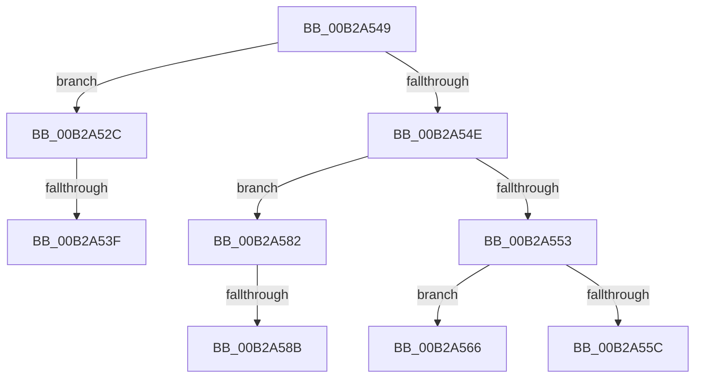

# sub_00B2A52C

- RVA: `0x00B2A52C`–`0x00B2A599` (길이 `109` bytes)
- VA: `0x0000000140B2A52C`
- 실행 섹션: `PAGE`
- PDB 이름 있음: `아니요`; PDB Function 태그: `아니요`
- unwind 정보 RVA: `0x00097698`
- 디코드: `29`개 명령, `109/109` bytes 표시
- 미해석 바이트: `0` (있으면 어셈블리에 `.byte`로 보존)

> 이 문서는 커널 이미지의 기계어와 PDB 기호를 분석해 생성했습니다. 4번과 5번은 함수 원형과 자료형을 바이너리 사용 방식에서 추정한 C 해석이며 원본 소스 복구 결과는 아닙니다.

## 1. Dependencies

- 직접 호출 지점: **4**; 고유 호출 대상: **4**
- 직접 호출자로 확인된 함수: **0**
- RIP 상대 이미지 참조: **0**

### Outgoing calls
- `0x00B2A532` → [EtwpCoverageResetCP](../7B/EtwpCoverageResetCP_function_007BA154.md) (function, `0x007BA154`)
- `0x00B2A553` → [EtwpCoverageUserIsAdmin](../9F/EtwpCoverageUserIsAdmin_function_009FE548.md) (function, `0x009FE548`)
- `0x00B2A56E` → [EtwpCoverageReset](../7B/EtwpCoverageReset_function_007B9F4C.md) (function, `0x007B9F4C`)
- `0x00B2A58E` → [EtwpCoverageRecordAtHighIrql](../../text/65/EtwpCoverageRecordAtHighIrql_function_00651C70.md) (function, `0x00651C70`)

### Direct callers
- 이 함수 시작 RVA로 연결되는 직접 call은 확인되지 않았습니다. 간접 호출은 완전히 역산할 수 없습니다.

### Static image references
- 디코드된 RIP-relative 메모리 참조가 없습니다.

## 2. Other-region calls and transfers

- 다른 실행 섹션으로 향하는 call: **1**
  - `0x00B2A58E` → [EtwpCoverageRecordAtHighIrql](../../text/65/EtwpCoverageRecordAtHighIrql_function_00651C70.md) (`PAGE` → `.text`)
- call이 아닌 외부 분기/꼬리 이동: **6**
  - `0x00B2A539` → [EtwSetProcessTelemetryCoverage + 0x58](../98/EtwSetProcessTelemetryCoverage_function_009804E0.md) (`tail-transfer`)
  - `0x00B2A544` → [EtwSetProcessTelemetryCoverage + 0x5A](../98/EtwSetProcessTelemetryCoverage_function_009804E0.md) (`tail-transfer`)
  - `0x00B2A561` → [EtwSetProcessTelemetryCoverage + 0x5A](../98/EtwSetProcessTelemetryCoverage_function_009804E0.md) (`tail-transfer`)
  - `0x00B2A57D` → [EtwSetProcessTelemetryCoverage + 0x58](../98/EtwSetProcessTelemetryCoverage_function_009804E0.md) (`tail-transfer`)
  - `0x00B2A585` → [EtwSetProcessTelemetryCoverage + 0x75](../98/EtwSetProcessTelemetryCoverage_function_009804E0.md) (`tail-transfer`)
  - `0x00B2A594` → [EtwSetProcessTelemetryCoverage + 0x58](../98/EtwSetProcessTelemetryCoverage_function_009804E0.md) (`tail-transfer`)

## 3. Assembly (complete function range)

```asm
00B2A52C  48 8B D3                        mov rdx, rbx
00B2A52F  48 8B CF                        mov rcx, rdi
00B2A532  E8 1D FC C8 FF                  call 0x1407ba154
00B2A537  85 C0                           test eax, eax
00B2A539  0F 85 F9 5F E5 FF               jne 0x140980538
00B2A53F  B8 25 02 00 C0                  mov eax, 0xc0000225
00B2A544  E9 F1 5F E5 FF                  jmp 0x14098053a
00B2A549  83 F8 FD                        cmp eax, -3
00B2A54C  74 DE                           je 0x140b2a52c
00B2A54E  83 F8 FC                        cmp eax, -4
00B2A551  75 2F                           jne 0x140b2a582
00B2A553  E8 F0 3F ED FF                  call 0x1409fe548
00B2A558  84 C0                           test al, al
00B2A55A  75 0A                           jne 0x140b2a566
00B2A55C  B8 22 00 00 C0                  mov eax, 0xc0000022
00B2A561  E9 D4 5F E5 FF                  jmp 0x14098053a
00B2A566  BA 01 00 00 00                  mov edx, 1
00B2A56B  48 8B CF                        mov rcx, rdi
00B2A56E  E8 D9 F9 C8 FF                  call 0x1407b9f4c
00B2A573  48 8B 47 10                     mov rax, qword ptr [rdi + 0x10]
00B2A577  8B 48 18                        mov ecx, dword ptr [rax + 0x18]
00B2A57A  89 4B 0C                        mov dword ptr [rbx + 0xc], ecx
00B2A57D  E9 B6 5F E5 FF                  jmp 0x140980538
00B2A582  83 F8 FB                        cmp eax, -5
00B2A585  0F 85 CA 5F E5 FF               jne 0x140980555
00B2A58B  48 8B CB                        mov rcx, rbx
00B2A58E  E8 DD 76 B2 FF                  call 0x140651c70
00B2A593  90                              nop
00B2A594  E9 9F 5F E5 FF                  jmp 0x140980538
```

## 4. C-style interpretation (structured pseudocode)

```c
__int64 __fastcall sub_00B2A52C(void)
{
    __int64 result;

    result = EtwpCoverageResetCP(v_rdi, v_rbx, a3, a4);
}
```

## 5. (Beta) C Style

```c
void sub_00B2A52C(void)
{
    int64_t result;

    result = EtwpCoverageResetCP(local_rdi, local_rbx, a3, a4);
}
```

## 6. Execution-region graph

[열기: 2D/3D 그래프와 함수 탐색 컨트롤 패널](../../../control-panel.html?section=page&rva=0x00B2A52C&view=graph)

- 2D 그래프는 위에서 아래로 흐르고, 3D 그래프는 빈 공간을 드래그해 회전합니다. Shift+드래그는 이동, 휠은 확대·축소, 함수 노드 선택은 대상 보고서 이동입니다.

### Static fallback


