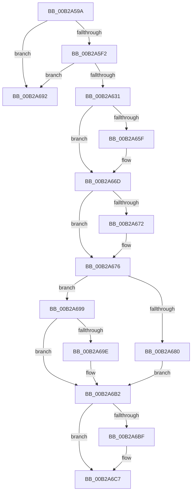

# sub_00B2A59A

- RVA: `0x00B2A59A`–`0x00B2A6DD` (길이 `323` bytes)
- VA: `0x0000000140B2A59A`
- 실행 섹션: `PAGE`
- PDB 이름 있음: `아니요`; PDB Function 태그: `아니요`
- unwind 정보 RVA: `0x000977A8`
- 디코드: `82`개 명령, `323/323` bytes 표시
- 미해석 바이트: `0` (있으면 어셈블리에 `.byte`로 보존)

> 이 문서는 커널 이미지의 기계어와 PDB 기호를 분석해 생성했습니다. 4번과 5번은 함수 원형과 자료형을 바이너리 사용 방식에서 추정한 C 해석이며 원본 소스 복구 결과는 아닙니다.

## 1. Dependencies

- 직접 호출 지점: **12**; 고유 호출 대상: **10**
- 직접 호출자로 확인된 함수: **0**
- RIP 상대 이미지 참조: **1**

### Outgoing calls
- `0x00B2A5DA` → [ZwCreateSection](../../text/6A/ZwCreateSection_function_006ADA10.md) (function, `0x006ADA10`)
- `0x00B2A5E5` → [ZwClose](../../text/6A/ZwClose_function_006AD2B0.md) (function, `0x006AD2B0`)
- `0x00B2A619` → [ObReferenceObjectByHandle](../86/ObReferenceObjectByHandle_function_00868DB0.md) (function, `0x00868DB0`)
- `0x00B2A628` → [ZwClose](../../text/6A/ZwClose_function_006AD2B0.md) (function, `0x006AD2B0`)
- `0x00B2A64F` → [KeAbPreAcquire](../../text/21/KeAbPreAcquire_function_00210230.md) (function, `0x00210230`)
- `0x00B2A668` → [ExfAcquirePushLockExclusiveEx](../../text/20/ExfAcquirePushLockExclusiveEx_function_0020FC90.md) (function, `0x0020FC90`)
- `0x00B2A687` → [ObfReferenceObject](../../text/20/ObfReferenceObject_function_0020FA20.md) (function, `0x0020FA20`)
- `0x00B2A6A2` → [ObfDereferenceObject](../../text/2F/ObfDereferenceObject_function_002F9350.md) (function, `0x002F9350`)
- `0x00B2A6AD` → [ObfReferenceObject](../../text/20/ObfReferenceObject_function_0020FA20.md) (function, `0x0020FA20`)
- `0x00B2A6C2` → [ExfTryToWakePushLock](../../text/26/ExfTryToWakePushLock_function_00265DD0.md) (function, `0x00265DD0`)
- `0x00B2A6CA` → [KeAbPostRelease](../../text/2E/KeAbPostRelease_function_002E1600.md) (function, `0x002E1600`)
- `0x00B2A6D2` → [KiLeaveCriticalRegionUnsafe](../../text/25/KiLeaveCriticalRegionUnsafe_function_0025F010.md) (function, `0x0025F010`)

### Direct callers
- 이 함수 시작 RVA로 연결되는 직접 call은 확인되지 않았습니다. 간접 호출은 완전히 역산할 수 없습니다.

### Static image references
- `0x00B2A5F2` → RVA `0x00FC6BD8` (`ALMOSTRO`; read)

## 2. Other-region calls and transfers

- 다른 실행 섹션으로 향하는 call: **11**
  - `0x00B2A5DA` → [ZwCreateSection](../../text/6A/ZwCreateSection_function_006ADA10.md) (`PAGE` → `.text`)
  - `0x00B2A5E5` → [ZwClose](../../text/6A/ZwClose_function_006AD2B0.md) (`PAGE` → `.text`)
  - `0x00B2A628` → [ZwClose](../../text/6A/ZwClose_function_006AD2B0.md) (`PAGE` → `.text`)
  - `0x00B2A64F` → [KeAbPreAcquire](../../text/21/KeAbPreAcquire_function_00210230.md) (`PAGE` → `.text`)
  - `0x00B2A668` → [ExfAcquirePushLockExclusiveEx](../../text/20/ExfAcquirePushLockExclusiveEx_function_0020FC90.md) (`PAGE` → `.text`)
  - `0x00B2A687` → [ObfReferenceObject](../../text/20/ObfReferenceObject_function_0020FA20.md) (`PAGE` → `.text`)
  - `0x00B2A6A2` → [ObfDereferenceObject](../../text/2F/ObfDereferenceObject_function_002F9350.md) (`PAGE` → `.text`)
  - `0x00B2A6AD` → [ObfReferenceObject](../../text/20/ObfReferenceObject_function_0020FA20.md) (`PAGE` → `.text`)
  - `0x00B2A6C2` → [ExfTryToWakePushLock](../../text/26/ExfTryToWakePushLock_function_00265DD0.md) (`PAGE` → `.text`)
  - `0x00B2A6CA` → [KeAbPostRelease](../../text/2E/KeAbPostRelease_function_002E1600.md) (`PAGE` → `.text`)
  - `0x00B2A6D2` → [KiLeaveCriticalRegionUnsafe](../../text/25/KiLeaveCriticalRegionUnsafe_function_0025F010.md) (`PAGE` → `.text`)
- call이 아닌 외부 분기/꼬리 이동: **2**
  - `0x00B2A694` → [ExpGetGlobalLocaleSection + 0x5A](../98/ExpGetGlobalLocaleSection_function_00980DD4.md) (`tail-transfer`)
  - `0x00B2A6D8` → [ExpGetGlobalLocaleSection + 0x54](../98/ExpGetGlobalLocaleSection_function_00980DD4.md) (`tail-transfer`)

## 3. Assembly (complete function range)

```asm
00B2A59A  48 8B 45 50                     mov rax, qword ptr [rbp + 0x50]
00B2A59E  4C 8D 45 D0                     lea r8, [rbp - 0x30]
00B2A5A2  48 83 65 D8 00                  and qword ptr [rbp - 0x28], 0
00B2A5A7  48 8D 4D 58                     lea rcx, [rbp + 0x58]
00B2A5AB  48 83 65 E0 00                  and qword ptr [rbp - 0x20], 0
00B2A5B0  45 33 C9                        xor r9d, r9d
00B2A5B3  48 89 44 24 30                  mov qword ptr [rsp + 0x30], rax
00B2A5B8  0F 57 C0                        xorps xmm0, xmm0
00B2A5BB  C7 44 24 28 00 00 00 08         mov dword ptr [rsp + 0x28], 0x8000000
00B2A5C3  89 5D D0                        mov dword ptr [rbp - 0x30], ebx
00B2A5C6  41 8D 51 04                     lea edx, [r9 + 4]
00B2A5CA  89 7D E8                        mov dword ptr [rbp - 0x18], edi
00B2A5CD  F3 0F 7F 45 F0                  movdqu xmmword ptr [rbp - 0x10], xmm0
00B2A5D2  C7 44 24 20 02 00 00 00         mov dword ptr [rsp + 0x20], 2
00B2A5DA  E8 31 34 B8 FF                  call 0x1406ada10
00B2A5DF  48 8B 4D 50                     mov rcx, qword ptr [rbp + 0x50]
00B2A5E3  8B D8                           mov ebx, eax
00B2A5E5  E8 C6 2C B8 FF                  call 0x1406ad2b0
00B2A5EA  85 DB                           test ebx, ebx
00B2A5EC  0F 88 A0 00 00 00               js 0x140b2a692
00B2A5F2  4C 8B 05 DF C5 49 00            mov r8, qword ptr [rip + 0x49c5df]
00B2A5F9  48 8D 45 48                     lea rax, [rbp + 0x48]
00B2A5FD  48 83 64 24 28 00               and qword ptr [rsp + 0x28], 0
00B2A603  45 33 C9                        xor r9d, r9d
00B2A606  48 8B 4D 58                     mov rcx, qword ptr [rbp + 0x58]
00B2A60A  BA 1F 00 0F 00                  mov edx, 0xf001f
00B2A60F  48 83 65 48 00                  and qword ptr [rbp + 0x48], 0
00B2A614  48 89 44 24 20                  mov qword ptr [rsp + 0x20], rax
00B2A619  E8 92 E7 D3 FF                  call 0x140868db0
00B2A61E  48 8B 4D 58                     mov rcx, qword ptr [rbp + 0x58]
00B2A622  8B D8                           mov ebx, eax
00B2A624  4C 8B 75 48                     mov r14, qword ptr [rbp + 0x48]
00B2A628  E8 83 2C B8 FF                  call 0x1406ad2b0
00B2A62D  85 DB                           test ebx, ebx
00B2A62F  78 61                           js 0x140b2a692
00B2A631  65 4C 8B 3C 25 88 01 00 00      mov r15, qword ptr gs:[0x188]
00B2A63A  48 83 CB FF                     or rbx, 0xffffffffffffffff
00B2A63E  45 33 C0                        xor r8d, r8d
00B2A641  33 D2                           xor edx, edx
00B2A643  48 8B CE                        mov rcx, rsi
00B2A646  66 41 01 9F E4 01 00 00         add word ptr [r15 + 0x1e4], bx
00B2A64E  90                              nop
00B2A64F  E8 DC 5B 6E FF                  call 0x140210230
00B2A654  F0 48 0F BA 2E 00               lock bts qword ptr [rsi], 0
00B2A65A  48 8B F8                        mov rdi, rax
00B2A65D  73 0E                           jae 0x140b2a66d
00B2A65F  4C 8B C6                        mov r8, rsi
00B2A662  48 8B D0                        mov rdx, rax
00B2A665  48 8B CE                        mov rcx, rsi
00B2A668  E8 23 56 6E FF                  call 0x14020fc90
00B2A66D  48 85 FF                        test rdi, rdi
00B2A670  74 04                           je 0x140b2a676
00B2A672  C6 47 0A 01                     mov byte ptr [rdi + 0xa], 1
00B2A676  48 8B 7E 08                     mov rdi, qword ptr [rsi + 8]
00B2A67A  48 83 FF 01                     cmp rdi, 1
00B2A67E  75 19                           jne 0x140b2a699
00B2A680  48 8B 7D 48                     mov rdi, qword ptr [rbp + 0x48]
00B2A684  48 8B CF                        mov rcx, rdi
00B2A687  E8 94 53 6E FF                  call 0x14020fa20
00B2A68C  48 89 7E 08                     mov qword ptr [rsi + 8], rdi
00B2A690  EB 20                           jmp 0x140b2a6b2
00B2A692  8B C3                           mov eax, ebx
00B2A694  E9 95 67 E5 FF                  jmp 0x140980e2e
00B2A699  48 85 FF                        test rdi, rdi
00B2A69C  74 14                           je 0x140b2a6b2
00B2A69E  48 8B 4D 48                     mov rcx, qword ptr [rbp + 0x48]
00B2A6A2  E8 A9 EC 7C FF                  call 0x1402f9350
00B2A6A7  48 8B CF                        mov rcx, rdi
00B2A6AA  4C 8B F7                        mov r14, rdi
00B2A6AD  E8 6E 53 6E FF                  call 0x14020fa20
00B2A6B2  F0 48 0F C1 1E                  lock xadd qword ptr [rsi], rbx
00B2A6B7  80 E3 06                        and bl, 6
00B2A6BA  80 FB 02                        cmp bl, 2
00B2A6BD  75 08                           jne 0x140b2a6c7
00B2A6BF  48 8B CE                        mov rcx, rsi
00B2A6C2  E8 09 B7 73 FF                  call 0x140265dd0
00B2A6C7  48 8B CE                        mov rcx, rsi
00B2A6CA  E8 31 6F 7B FF                  call 0x1402e1600
00B2A6CF  49 8B CF                        mov rcx, r15
00B2A6D2  E8 39 49 73 FF                  call 0x14025f010
00B2A6D7  90                              nop
00B2A6D8  E9 4B 67 E5 FF                  jmp 0x140980e28
```

## 4. C-style interpretation (structured pseudocode)

```c
__int64 __fastcall sub_00B2A59A(__int64 a1, __int64 a2, __int64 a3, int a4, __int64 a5)
{
    __int64 result;
    __int64 v_r14;
    __int64 v_rbx;
    unsigned int v_stack_p20;
    unsigned int v_stack_p28;
    unsigned __int64 v_stack_p30;

    a4 = 0;
    v_stack_p30 = *(unsigned __int64 *)(v_rbp + 80);
    v_stack_p28 = 0x8000000ULL;
    *(unsigned int *)(v_rbp - 48) = (unsigned int)(v_rbx);
    *(unsigned int *)(v_rbp - 24) = (unsigned int)(v_rdi);
    *(unsigned __int64 *)(v_rbp - 16) = v_xmm0;
    v_stack_p20 = 2;
    result = ZwCreateSection(v_rbp + 88, a4 + 4, v_rbp - 48, a4);
    result = ZwClose(*(unsigned __int64 *)(v_rbp + 80), a4 + 4, v_rbp - 48, a4);
    if (sign_flag) goto loc_00B2A692;
    a4 = 0;
    v_stack_p20 = v_rbp + 72;
    result = ObReferenceObjectByHandle(*(unsigned __int64 *)(v_rbp + 88), (unsigned int)(0xF001FULL), *(unsigned __int64 *)(v_rip + 4834783), a4);
    result = ZwClose(*(unsigned __int64 *)(v_rbp + 88), (unsigned int)(0xF001FULL), *(unsigned __int64 *)(v_rip + 4834783), a4);
    if (sign_flag) goto loc_00B2A692;
    v_rbx = ((unsigned int)((unsigned int)(result))) | (-1);
    a3 = 0;
    a2 = 0;
    result = KeAbPreAcquire(v_rsi, a2, a3, a4);
    if (!(condition_is_above_or_equal)) {
        a3 = v_rsi;
        a2 = result;
        a1 = v_rsi;
        result = ExfAcquirePushLockExclusiveEx(a1, a2, a3, a4);
    }
    if (result != 0) {
        *(unsigned __int8 *)(result + 10) = 1;
    }
    if ((*(unsigned __int64 *)(v_rsi + 8)) != 1) goto loc_00B2A699;
    result = ObfReferenceObject(*(unsigned __int64 *)(v_rbp + 72), a2, a3, a4);
    *(unsigned __int64 *)(v_rsi + 8) = *(unsigned __int64 *)(v_rbp + 72);
    goto loc_00B2A6B2;
loc_00B2A692:
loc_00B2A699:
    result = (unsigned int)((unsigned int)(v_rbx));
    v_r14 = *(unsigned __int64 *)(v_rbp + 72);
    if (*(unsigned __int64 *)(v_rbp + 72) != 0) {
        a1 = *(unsigned __int64 *)(v_rbp + 72);
        result = ObfDereferenceObject(a1, a2, a3, a4);
        a1 = *(unsigned __int64 *)(v_rbp + 72);
        v_r14 = *(unsigned __int64 *)(v_rbp + 72);
        result = ObfReferenceObject(a1, a2, a3, a4);
    }
    v_rbx = (unsigned __int8)((v_rbx) & (6));
    if (((unsigned __int8)(v_rbx)) == 2) {
        a1 = v_rsi;
        result = ExfTryToWakePushLock(a1, a2, a3, a4);
    }
    result = KeAbPostRelease(v_rsi, a2, a3, a4);
    result = KiLeaveCriticalRegionUnsafe(*(unsigned __int64 *)(gs_base + (0 + 392)), a2, a3, a4);
}
```

## 5. (Beta) C Style

```c
int64_t sub_00B2A59A(int64_t Arg1, int64_t Arg2, int64_t Arg3, int32_t Arg4, int64_t Arg5)
{
    int64_t result;
    int64_t local_r14;
    int64_t local_rbx;
    uint32_t v_stack_p20;
    uint32_t v_stack_p28;
    uint64_t v_stack_p30;

    Arg4 = 0;
    v_stack_p30 = *(uint64_t *)(local_rbp + 0x50);
    v_stack_p28 = 0x8000000ULL;
    *(uint32_t *)(local_rbp - 0x30) = (uint32_t)(local_rbx);
    *(uint32_t *)(local_rbp - 0x18) = (uint32_t)(local_rdi);
    *(uint64_t *)(local_rbp - 0x10) = v_xmm0;
    v_stack_p20 = 2;
    result = ZwCreateSection(local_rbp + 88, Arg4 + 4, local_rbp - 48, Arg4);
    result = ZwClose(*(uint64_t *)(local_rbp + 0x50), Arg4 + 4, local_rbp - 48, Arg4);
    if (sign_flag) goto loc_00B2A692;
    Arg4 = 0;
    v_stack_p20 = local_rbp + 72;
    result = ObReferenceObjectByHandle(*(uint64_t *)(local_rbp + 0x58), (uint32_t)(0xF001FULL), *(uint64_t *)(v_rip + 0x49C5DF), Arg4);
    result = ZwClose(*(uint64_t *)(local_rbp + 0x58), (uint32_t)(0xF001FULL), *(uint64_t *)(v_rip + 0x49C5DF), Arg4);
    if (sign_flag) goto loc_00B2A692;
    local_rbx = ((uint32_t)((uint32_t)(result))) | (-1);
    Arg3 = 0;
    Arg2 = 0;
    result = KeAbPreAcquire(local_rsi, Arg2, Arg3, Arg4);
    if (!(condition_is_above_or_equal)) {
        Arg3 = local_rsi;
        Arg2 = result;
        Arg1 = local_rsi;
        result = ExfAcquirePushLockExclusiveEx(Arg1, Arg2, Arg3, Arg4);
    }
    if (result != 0) {
        *(uint8_t *)(result + 0xA) = 1;
    }
    if ((*(uint64_t *)(local_rsi + 0x8)) != 1) goto loc_00B2A699;
    result = ObfReferenceObject(*(uint64_t *)(local_rbp + 0x48), Arg2, Arg3, Arg4);
    *(uint64_t *)(local_rsi + 0x8) = *(uint64_t *)(local_rbp + 0x48);
    goto loc_00B2A6B2;
loc_00B2A692:
loc_00B2A699:
    result = (uint32_t)((uint32_t)(local_rbx));
    local_r14 = *(uint64_t *)(local_rbp + 0x48);
    if (*(uint64_t *)(local_rbp + 0x48) != 0) {
        Arg1 = *(uint64_t *)(local_rbp + 0x48);
        result = ObfDereferenceObject(Arg1, Arg2, Arg3, Arg4);
        Arg1 = *(uint64_t *)(local_rbp + 0x48);
        local_r14 = *(uint64_t *)(local_rbp + 0x48);
        result = ObfReferenceObject(Arg1, Arg2, Arg3, Arg4);
    }
    local_rbx = (uint8_t)((local_rbx) & (6));
    if (((uint8_t)(local_rbx)) == 2) {
        Arg1 = local_rsi;
        result = ExfTryToWakePushLock(Arg1, Arg2, Arg3, Arg4);
    }
    result = KeAbPostRelease(local_rsi, Arg2, Arg3, Arg4);
    result = KiLeaveCriticalRegionUnsafe(*(uint64_t *)(gs_base + (0 + 0x188)), Arg2, Arg3, Arg4);
}
```

## 6. Execution-region graph

[열기: 2D/3D 그래프와 함수 탐색 컨트롤 패널](../../../control-panel.html?section=page&rva=0x00B2A59A&view=graph)

- 2D 그래프는 위에서 아래로 흐르고, 3D 그래프는 빈 공간을 드래그해 회전합니다. Shift+드래그는 이동, 휠은 확대·축소, 함수 노드 선택은 대상 보고서 이동입니다.

### Static fallback


