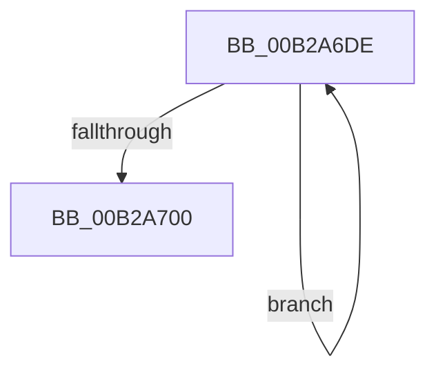

# sub_00B2A6DE

- RVA: `0x00B2A6DE`–`0x00B2A724` (길이 `70` bytes)
- VA: `0x0000000140B2A6DE`
- 실행 섹션: `PAGE`
- PDB 이름 있음: `아니요`; PDB Function 태그: `아니요`
- unwind 정보 RVA: `0x00097838`
- 디코드: `16`개 명령, `70/70` bytes 표시
- 미해석 바이트: `0` (있으면 어셈블리에 `.byte`로 보존)

> 이 문서는 커널 이미지의 기계어와 PDB 기호를 분석해 생성했습니다. 4번과 5번은 함수 원형과 자료형을 바이너리 사용 방식에서 추정한 C 해석이며 원본 소스 복구 결과는 아닙니다.

## 1. Dependencies

- 직접 호출 지점: **1**; 고유 호출 대상: **1**
- 직접 호출자로 확인된 함수: **0**
- RIP 상대 이미지 참조: **0**

### Outgoing calls
- `0x00B2A6F6` → [KeQueryGroupAffinity](../../text/47/KeQueryGroupAffinity_function_00471A60.md) (function, `0x00471A60`)

### Direct callers
- 이 함수 시작 RVA로 연결되는 직접 call은 확인되지 않았습니다. 간접 호출은 완전히 역산할 수 없습니다.

### Static image references
- 디코드된 RIP-relative 메모리 참조가 없습니다.

## 2. Other-region calls and transfers

- 다른 실행 섹션으로 향하는 call: **1**
  - `0x00B2A6F6` → [KeQueryGroupAffinity](../../text/47/KeQueryGroupAffinity_function_00471A60.md) (`PAGE` → `.text`)
- call이 아닌 외부 분기/꼬리 이동: **1**
  - `0x00B2A71F` → [MmCreatePeb + 0x433](../98/MmCreatePeb_function_00980FB4.md) (`tail-transfer`)

## 3. Assembly (complete function range)

```asm
00B2A6DE  83 E7 3F                        and edi, 0x3f
00B2A6E1  8B CF                           mov ecx, edi
00B2A6E3  BB 01 00 00 00                  mov ebx, 1
00B2A6E8  48 D3 E3                        shl rbx, cl
00B2A6EB  49 89 5D 00                     mov qword ptr [r13], rbx
00B2A6EF  FF C7                           inc edi
00B2A6F1  0F B7 4C 24 58                  movzx ecx, word ptr [rsp + 0x58]
00B2A6F6  E8 65 73 94 FF                  call 0x140471a60
00B2A6FB  48 85 C3                        test rbx, rax
00B2A6FE  74 DE                           je 0x140b2a6de
00B2A700  48 8B 7C 24 68                  mov rdi, qword ptr [rsp + 0x68]
00B2A705  44 0F B7 B4 24 8A 00 00 00      movzx r14d, word ptr [rsp + 0x8a]
00B2A70E  44 8B 7C 24 74                  mov r15d, dword ptr [rsp + 0x74]
00B2A713  8B 74 24 70                     mov esi, dword ptr [rsp + 0x70]
00B2A717  4C 8B AC 24 30 01 00 00         mov r13, qword ptr [rsp + 0x130]
00B2A71F  E9 C3 6C E5 FF                  jmp 0x1409813e7
```

## 4. C-style interpretation (structured pseudocode)

```c
__int64 __fastcall sub_00B2A6DE(__int64 a1, __int64 a2, __int64 a3, __int64 a4, __int64 a5, __int64 a6, __int64 a7, __int64 a8, __int64 a9, __int64 a10, unsigned __int16 a11, __int64 a12, __int64 a13, unsigned int a14, __int64 a15, __int64 a16, __int64 a17, __int64 a18, __int64 a19, __int64 a20, __int64 a21, __int64 a22, __int64 a23, __int64 a24, __int64 a25, __int64 a26, __int64 a27, __int64 a28, __int64 a29, __int64 a30, __int64 a31, __int64 a32, __int64 a33, __int64 a34, __int64 a35, __int64 a36, __int64 a37, __int64 a38)
{
    __int64 result;
    __int64 v_rbx;
    __int64 v_rdi;
    unsigned int v_stack_p74;
    unsigned __int16 v_stack_p8A;

    v_rdi = (unsigned int)((v_rdi) & (63));
    v_rbx = (1) << ((unsigned __int8)((unsigned int)((unsigned int)(v_rdi))));
    *(unsigned __int64 *)(v_r13) = v_rbx;
    v_rdi = (unsigned int)((v_rdi) + 1);
    result = KeQueryGroupAffinity(a11, a2, a3, a4);
    if (((v_rbx) & (result)) == 0) goto loc_00B2A6DE;
}
```

## 5. (Beta) C Style

```c
int64_t sub_00B2A6DE(int64_t Arg1, int64_t Arg2, int64_t Arg3, int64_t Arg4, uint64_t Arg5, uint64_t Arg6, uint64_t Arg7, uint64_t Arg8, uint64_t Arg9, uint64_t Arg10, uint16_t Arg11, uint64_t Arg12, int64_t Arg13, uint32_t Arg14, uint64_t Arg15, uint64_t Arg16, uint64_t Arg17, uint64_t Arg18, uint64_t Arg19, uint64_t Arg20, uint64_t Arg21, uint64_t Arg22, uint64_t Arg23, uint64_t Arg24, uint64_t Arg25, uint64_t Arg26, uint64_t Arg27, uint64_t Arg28, uint64_t Arg29, uint64_t Arg30, uint64_t Arg31, uint64_t Arg32, uint64_t Arg33, uint64_t Arg34, uint64_t Arg35, uint64_t Arg36, uint64_t Arg37, int64_t Arg38)
{
    int64_t result;
    int64_t local_rbx;
    int64_t local_rdi;
    uint32_t v_stack_p74;
    uint16_t v_stack_p8A;

    local_rdi = (uint32_t)((local_rdi) & (63));
    local_rbx = (1) << ((uint8_t)((uint32_t)((uint32_t)(local_rdi))));
    *(uint64_t *)(local_r13) = local_rbx;
    local_rdi = (uint32_t)((local_rdi) + 1);
    result = KeQueryGroupAffinity(Arg11, Arg2, Arg3, Arg4);
    if (((local_rbx) & (result)) == 0) goto loc_00B2A6DE;
}
```

## 6. Execution-region graph

[열기: 2D/3D 그래프와 함수 탐색 컨트롤 패널](../../../control-panel.html?section=page&rva=0x00B2A6DE&view=graph)

- 2D 그래프는 위에서 아래로 흐르고, 3D 그래프는 빈 공간을 드래그해 회전합니다. Shift+드래그는 이동, 휠은 확대·축소, 함수 노드 선택은 대상 보고서 이동입니다.

### Static fallback


