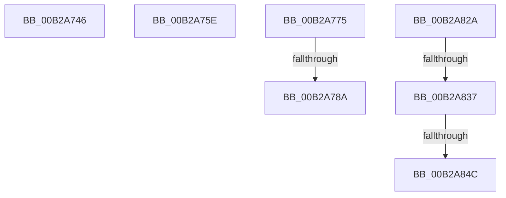

# sub_00B2A746

- RVA: `0x00B2A746`–`0x00B2A916` (길이 `464` bytes)
- VA: `0x0000000140B2A746`
- 실행 섹션: `PAGE`
- PDB 이름 있음: `아니요`; PDB Function 태그: `아니요`
- unwind 정보 RVA: `0x00097924`
- 디코드: `102`개 명령, `464/464` bytes 표시
- 미해석 바이트: `0` (있으면 어셈블리에 `.byte`로 보존)

> 이 문서는 커널 이미지의 기계어와 PDB 기호를 분석해 생성했습니다. 4번과 5번은 함수 원형과 자료형을 바이너리 사용 방식에서 추정한 C 해석이며 원본 소스 복구 결과는 아닙니다.

## 1. Dependencies

- 직접 호출 지점: **9**; 고유 호출 대상: **6**
- 직접 호출자로 확인된 함수: **0**
- RIP 상대 이미지 참조: **4**

### Outgoing calls
- `0x00B2A752` → [EtwpCoverageAddToStringBuffer](../../text/46/EtwpCoverageAddToStringBuffer_function_004605E8.md) (function, `0x004605E8`)
- `0x00B2A765` → [KeAbPostRelease](../../text/2E/KeAbPostRelease_function_002E1600.md) (function, `0x002E1600`)
- `0x00B2A76A` → [KeLeaveCriticalRegion](../../text/25/KeLeaveCriticalRegion_function_0025D8B0.md) (function, `0x0025D8B0`)
- `0x00B2A77D` → [tlgKeywordOn](../../text/42/tlgKeywordOn_function_0042EAA0.md) (function, `0x0042EAA0`)
- `0x00B2A7F9` → [tlgCreate1Sz_char](../../text/42/tlgCreate1Sz_char_function_00427304.md) (function, `0x00427304`)
- `0x00B2A81F` → [tlgWriteTransfer_EtwWriteTransfer](../../text/42/tlgWriteTransfer_EtwWriteTransfer_function_004260E0.md) (function, `0x004260E0`)
- `0x00B2A83F` → [tlgKeywordOn](../../text/42/tlgKeywordOn_function_0042EAA0.md) (function, `0x0042EAA0`)
- `0x00B2A8E5` → [tlgCreate1Sz_char](../../text/42/tlgCreate1Sz_char_function_00427304.md) (function, `0x00427304`)
- `0x00B2A90B` → [tlgWriteTransfer_EtwWriteTransfer](../../text/42/tlgWriteTransfer_EtwWriteTransfer_function_004260E0.md) (function, `0x004260E0`)

### Direct callers
- 이 함수 시작 RVA로 연결되는 직접 call은 확인되지 않았습니다. 간접 호출은 완전히 역산할 수 없습니다.

### Static image references
- `0x00B2A75E` → RVA `0x00EFF1B8` (`.data`; read)
- `0x00B2A80A` → RVA `0x00054C1A` (`.rdata`; read)
- `0x00B2A82A` → RVA `0x00E091D8` (`.data`; read)
- `0x00B2A8F6` → RVA `0x00054BA6` (`.rdata`; read)

## 2. Other-region calls and transfers

- 다른 실행 섹션으로 향하는 call: **9**
  - `0x00B2A752` → [EtwpCoverageAddToStringBuffer](../../text/46/EtwpCoverageAddToStringBuffer_function_004605E8.md) (`PAGE` → `.text`)
  - `0x00B2A765` → [KeAbPostRelease](../../text/2E/KeAbPostRelease_function_002E1600.md) (`PAGE` → `.text`)
  - `0x00B2A76A` → [KeLeaveCriticalRegion](../../text/25/KeLeaveCriticalRegion_function_0025D8B0.md) (`PAGE` → `.text`)
  - `0x00B2A77D` → [tlgKeywordOn](../../text/42/tlgKeywordOn_function_0042EAA0.md) (`PAGE` → `.text`)
  - `0x00B2A7F9` → [tlgCreate1Sz_char](../../text/42/tlgCreate1Sz_char_function_00427304.md) (`PAGE` → `.text`)
  - `0x00B2A81F` → [tlgWriteTransfer_EtwWriteTransfer](../../text/42/tlgWriteTransfer_EtwWriteTransfer_function_004260E0.md) (`PAGE` → `.text`)
  - `0x00B2A83F` → [tlgKeywordOn](../../text/42/tlgKeywordOn_function_0042EAA0.md) (`PAGE` → `.text`)
  - `0x00B2A8E5` → [tlgCreate1Sz_char](../../text/42/tlgCreate1Sz_char_function_00427304.md) (`PAGE` → `.text`)
  - `0x00B2A90B` → [tlgWriteTransfer_EtwWriteTransfer](../../text/42/tlgWriteTransfer_EtwWriteTransfer_function_004260E0.md) (`PAGE` → `.text`)
- call이 아닌 외부 분기/꼬리 이동: **7**
  - `0x00B2A759` → [EtwpCoverageRecord + 0x196](../98/EtwpCoverageRecord_function_009821BC.md) (`tail-transfer`)
  - `0x00B2A770` → [EtwpCoverageRecord + 0x113](../98/EtwpCoverageRecord_function_009821BC.md) (`tail-transfer`)
  - `0x00B2A784` → [EtwpCoverageRecord + 0x123](../98/EtwpCoverageRecord_function_009821BC.md) (`tail-transfer`)
  - `0x00B2A825` → [EtwpCoverageRecord + 0x123](../98/EtwpCoverageRecord_function_009821BC.md) (`tail-transfer`)
  - `0x00B2A831` → [EtwpCoverageRecord + 0x130](../98/EtwpCoverageRecord_function_009821BC.md) (`tail-transfer`)
  - `0x00B2A846` → [EtwpCoverageRecord + 0x130](../98/EtwpCoverageRecord_function_009821BC.md) (`tail-transfer`)
  - `0x00B2A911` → [EtwpCoverageRecord + 0x130](../98/EtwpCoverageRecord_function_009821BC.md) (`tail-transfer`)

## 3. Assembly (complete function range)

```asm
00B2A746  44 8B 44 24 34                  mov r8d, dword ptr [rsp + 0x34]
00B2A74B  49 8B 16                        mov rdx, qword ptr [r14]
00B2A74E  48 8B 4F 28                     mov rcx, qword ptr [rdi + 0x28]
00B2A752  E8 91 5E 93 FF                  call 0x1404605e8
00B2A757  8B F0                           mov esi, eax
00B2A759  E9 F4 7B E5 FF                  jmp 0x140982352
00B2A75E  48 8D 0D 53 4A 3D 00            lea rcx, [rip + 0x3d4a53]
00B2A765  E8 96 6E 7B FF                  call 0x1402e1600
00B2A76A  E8 41 31 73 FF                  call 0x14025d8b0
00B2A76F  90                              nop
00B2A770  E9 5A 7B E5 FF                  jmp 0x1409822cf
00B2A775  BA 02 00 00 00                  mov edx, 2
00B2A77A  48 8B CB                        mov rcx, rbx
00B2A77D  E8 1E 43 90 FF                  call 0x14042eaa0
00B2A782  84 C0                           test al, al
00B2A784  0F 84 55 7B E5 FF               je 0x1409822df
00B2A78A  48 8B 0F                        mov rcx, qword ptr [rdi]
00B2A78D  49 8B 16                        mov rdx, qword ptr [r14]
00B2A790  8B 01                           mov eax, dword ptr [rcx]
00B2A792  89 44 24 40                     mov dword ptr [rsp + 0x40], eax
00B2A796  48 8D 44 24 40                  lea rax, [rsp + 0x40]
00B2A79B  48 89 45 A0                     mov qword ptr [rbp - 0x60], rax
00B2A79F  48 C7 45 A8 04 00 00 00         mov qword ptr [rbp - 0x58], 4
00B2A7A7  8B 41 04                        mov eax, dword ptr [rcx + 4]
00B2A7AA  89 44 24 44                     mov dword ptr [rsp + 0x44], eax
00B2A7AE  48 8D 44 24 44                  lea rax, [rsp + 0x44]
00B2A7B3  48 89 45 B0                     mov qword ptr [rbp - 0x50], rax
00B2A7B7  41 8B C7                        mov eax, r15d
00B2A7BA  48 C7 45 B8 04 00 00 00         mov qword ptr [rbp - 0x48], 4
00B2A7C2  2B 41 10                        sub eax, dword ptr [rcx + 0x10]
00B2A7C5  89 44 24 48                     mov dword ptr [rsp + 0x48], eax
00B2A7C9  48 8D 44 24 48                  lea rax, [rsp + 0x48]
00B2A7CE  48 89 45 C0                     mov qword ptr [rbp - 0x40], rax
00B2A7D2  41 8B C7                        mov eax, r15d
00B2A7D5  48 C7 45 C8 04 00 00 00         mov qword ptr [rbp - 0x38], 4
00B2A7DD  2B 41 14                        sub eax, dword ptr [rcx + 0x14]
00B2A7E0  48 8D 4D E0                     lea rcx, [rbp - 0x20]
00B2A7E4  89 44 24 4C                     mov dword ptr [rsp + 0x4c], eax
00B2A7E8  48 8D 44 24 4C                  lea rax, [rsp + 0x4c]
00B2A7ED  48 89 45 D0                     mov qword ptr [rbp - 0x30], rax
00B2A7F1  48 C7 45 D8 04 00 00 00         mov qword ptr [rbp - 0x28], 4
00B2A7F9  E8 06 CB 8F FF                  call 0x140427304
00B2A7FE  48 8D 4D 80                     lea rcx, [rbp - 0x80]
00B2A802  45 33 C9                        xor r9d, r9d
00B2A805  48 89 4C 24 28                  mov qword ptr [rsp + 0x28], rcx
00B2A80A  48 8D 15 09 A4 52 FF            lea rdx, [rip - 0xad5bf7]
00B2A811  48 8B CB                        mov rcx, rbx
00B2A814  C7 44 24 20 07 00 00 00         mov dword ptr [rsp + 0x20], 7
00B2A81C  45 33 C0                        xor r8d, r8d
00B2A81F  E8 BC B8 8F FF                  call 0x1404260e0
00B2A824  90                              nop
00B2A825  E9 B5 7A E5 FF                  jmp 0x1409822df
00B2A82A  83 3D A7 E9 2D 00 05            cmp dword ptr [rip + 0x2de9a7], 5
00B2A831  0F 86 B5 7A E5 FF               jbe 0x1409822ec
00B2A837  BA 01 00 00 00                  mov edx, 1
00B2A83C  48 8B CB                        mov rcx, rbx
00B2A83F  E8 5C 42 90 FF                  call 0x14042eaa0
00B2A844  84 C0                           test al, al
00B2A846  0F 84 A0 7A E5 FF               je 0x1409822ec
00B2A84C  48 8B 0F                        mov rcx, qword ptr [rdi]
00B2A84F  49 8B 16                        mov rdx, qword ptr [r14]
00B2A852  8B 01                           mov eax, dword ptr [rcx]
00B2A854  89 44 24 50                     mov dword ptr [rsp + 0x50], eax
00B2A858  48 8D 44 24 50                  lea rax, [rsp + 0x50]
00B2A85D  48 89 45 A0                     mov qword ptr [rbp - 0x60], rax
00B2A861  48 C7 45 A8 04 00 00 00         mov qword ptr [rbp - 0x58], 4
00B2A869  8B 41 04                        mov eax, dword ptr [rcx + 4]
00B2A86C  89 44 24 54                     mov dword ptr [rsp + 0x54], eax
00B2A870  48 8D 44 24 54                  lea rax, [rsp + 0x54]
00B2A875  48 89 45 B0                     mov qword ptr [rbp - 0x50], rax
00B2A879  41 8B C7                        mov eax, r15d
00B2A87C  48 C7 45 B8 04 00 00 00         mov qword ptr [rbp - 0x48], 4
00B2A884  2B 41 10                        sub eax, dword ptr [rcx + 0x10]
00B2A887  89 44 24 58                     mov dword ptr [rsp + 0x58], eax
00B2A88B  48 8D 44 24 58                  lea rax, [rsp + 0x58]
00B2A890  48 89 45 C0                     mov qword ptr [rbp - 0x40], rax
00B2A894  48 8D 44 24 5C                  lea rax, [rsp + 0x5c]
00B2A899  48 C7 45 C8 04 00 00 00         mov qword ptr [rbp - 0x38], 4
00B2A8A1  44 2B 79 14                     sub r15d, dword ptr [rcx + 0x14]
00B2A8A5  48 8D 4D 00                     lea rcx, [rbp]
00B2A8A9  48 89 45 D0                     mov qword ptr [rbp - 0x30], rax
00B2A8AD  48 8D 44 24 60                  lea rax, [rsp + 0x60]
00B2A8B2  48 89 45 E0                     mov qword ptr [rbp - 0x20], rax
00B2A8B6  48 8D 44 24 64                  lea rax, [rsp + 0x64]
00B2A8BB  48 89 45 F0                     mov qword ptr [rbp - 0x10], rax
00B2A8BF  44 89 7C 24 5C                  mov dword ptr [rsp + 0x5c], r15d
00B2A8C4  48 C7 45 D8 04 00 00 00         mov qword ptr [rbp - 0x28], 4
00B2A8CC  89 74 24 60                     mov dword ptr [rsp + 0x60], esi
00B2A8D0  48 C7 45 E8 04 00 00 00         mov qword ptr [rbp - 0x18], 4
00B2A8D8  44 89 64 24 64                  mov dword ptr [rsp + 0x64], r12d
00B2A8DD  48 C7 45 F8 04 00 00 00         mov qword ptr [rbp - 8], 4
00B2A8E5  E8 1A CA 8F FF                  call 0x140427304
00B2A8EA  4C 8D 45 80                     lea r8, [rbp - 0x80]
00B2A8EE  45 33 C9                        xor r9d, r9d
00B2A8F1  4C 89 44 24 28                  mov qword ptr [rsp + 0x28], r8
00B2A8F6  48 8D 15 A9 A2 52 FF            lea rdx, [rip - 0xad5d57]
00B2A8FD  45 33 C0                        xor r8d, r8d
00B2A900  C7 44 24 20 09 00 00 00         mov dword ptr [rsp + 0x20], 9
00B2A908  48 8B CB                        mov rcx, rbx
00B2A90B  E8 D0 B7 8F FF                  call 0x1404260e0
00B2A910  90                              nop
00B2A911  E9 D6 79 E5 FF                  jmp 0x1409822ec
```

## 4. C-style interpretation (structured pseudocode)

```c
__int64 __fastcall sub_00B2A746(__int64 a1, __int64 a2, __int64 a3, int a4)
{
    __int64 result;
    unsigned int v_stack_p20;
    unsigned __int64 v_stack_p28;
    unsigned int v_stack_p34;
    unsigned int v_stack_p40;
    unsigned int v_stack_p44;
    unsigned int v_stack_p48;
    unsigned int v_stack_p4C;
    unsigned int v_stack_p50;
    unsigned int v_stack_p54;
    unsigned int v_stack_p58;
    unsigned __int64 v_stack_p5C;
    unsigned __int64 v_stack_p60;
    unsigned __int64 v_stack_p64;

    result = EtwpCoverageAddToStringBuffer(*(unsigned __int64 *)(v_rdi + 40), *(unsigned __int64 *)(v_r14), (unsigned int)(v_stack_p34), a4);
}
```

## 5. (Beta) C Style

```c
int64_t sub_00B2A746(int64_t Arg1, int64_t Arg2, int64_t Arg3, int32_t Arg4)
{
    int64_t result;
    uint32_t v_stack_p20;
    uint64_t v_stack_p28;
    uint32_t v_stack_p34;
    uint32_t v_stack_p40;
    uint32_t v_stack_p44;
    uint32_t v_stack_p48;
    uint32_t v_stack_p4C;
    uint32_t v_stack_p50;
    uint32_t v_stack_p54;
    uint32_t v_stack_p58;
    uint64_t v_stack_p5C;
    uint64_t v_stack_p60;
    uint64_t v_stack_p64;

    result = EtwpCoverageAddToStringBuffer(*(uint64_t *)(local_rdi + 0x28), *(uint64_t *)(local_r14), (uint32_t)(v_stack_p34), Arg4);
}
```

## 6. Execution-region graph

[열기: 2D/3D 그래프와 함수 탐색 컨트롤 패널](../../../control-panel.html?section=page&rva=0x00B2A746&view=graph)

- 2D 그래프는 위에서 아래로 흐르고, 3D 그래프는 빈 공간을 드래그해 회전합니다. Shift+드래그는 이동, 휠은 확대·축소, 함수 노드 선택은 대상 보고서 이동입니다.

### Static fallback


