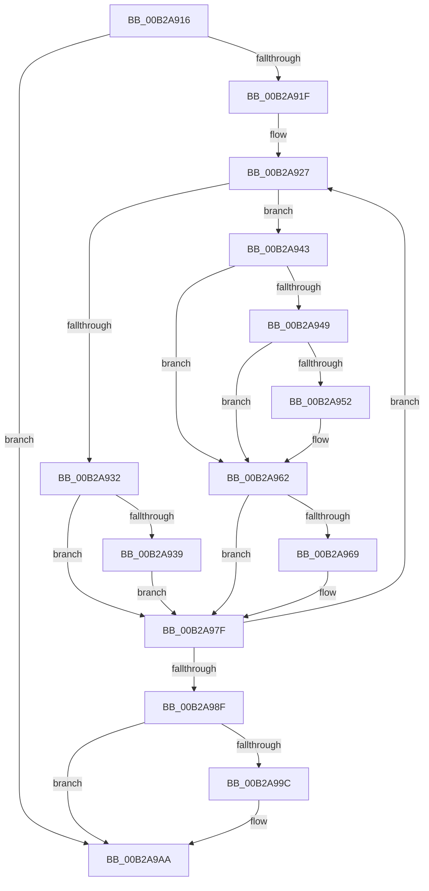

# sub_00B2A916

- RVA: `0x00B2A916`–`0x00B2A9B1` (길이 `155` bytes)
- VA: `0x0000000140B2A916`
- 실행 섹션: `PAGE`
- PDB 이름 있음: `아니요`; PDB Function 태그: `아니요`
- unwind 정보 RVA: `0x000979E8`
- 디코드: `41`개 명령, `155/155` bytes 표시
- 미해석 바이트: `0` (있으면 어셈블리에 `.byte`로 보존)

> 이 문서는 커널 이미지의 기계어와 PDB 기호를 분석해 생성했습니다. 4번과 5번은 함수 원형과 자료형을 바이너리 사용 방식에서 추정한 C 해석이며 원본 소스 복구 결과는 아닙니다.

## 1. Dependencies

- 직접 호출 지점: **6**; 고유 호출 대상: **6**
- 직접 호출자로 확인된 함수: **0**
- RIP 상대 이미지 참조: **0**

### Outgoing calls
- `0x00B2A93C` → [MiDeleteSubsectionPages](../../text/32/MiDeleteSubsectionPages_function_00326340.md) (function, `0x00326340`)
- `0x00B2A95A` → [MiDecrementSubsectionViewCount](../../text/29/MiDecrementSubsectionViewCount_function_00298E90.md) (function, `0x00298E90`)
- `0x00B2A96F` → [MiUpdateSystemProtoPtesTree](../../text/29/MiUpdateSystemProtoPtesTree_function_00295F0C.md) (function, `0x00295F0C`)
- `0x00B2A97A` → [ExFreePoolWithTag](../../poolcode/B8/ExFreePoolWithTag_function_00B82870.md) (function, `0x00B82870`)
- `0x00B2A982` → [MiDeleteSubsection](../../text/36/MiDeleteSubsection_function_003693C8.md) (function, `0x003693C8`)
- `0x00B2A9A5` → [MiReturnCrossPartitionSectionCharges](../../text/4B/MiReturnCrossPartitionSectionCharges_function_004BA61C.md) (function, `0x004BA61C`)

### Direct callers
- 이 함수 시작 RVA로 연결되는 직접 call은 확인되지 않았습니다. 간접 호출은 완전히 역산할 수 없습니다.

### Static image references
- 디코드된 RIP-relative 메모리 참조가 없습니다.

## 2. Other-region calls and transfers

- 다른 실행 섹션으로 향하는 call: **6**
  - `0x00B2A93C` → [MiDeleteSubsectionPages](../../text/32/MiDeleteSubsectionPages_function_00326340.md) (`PAGE` → `.text`)
  - `0x00B2A95A` → [MiDecrementSubsectionViewCount](../../text/29/MiDecrementSubsectionViewCount_function_00298E90.md) (`PAGE` → `.text`)
  - `0x00B2A96F` → [MiUpdateSystemProtoPtesTree](../../text/29/MiUpdateSystemProtoPtesTree_function_00295F0C.md) (`PAGE` → `.text`)
  - `0x00B2A97A` → [ExFreePoolWithTag](../../poolcode/B8/ExFreePoolWithTag_function_00B82870.md) (`PAGE` → `POOLCODE`)
  - `0x00B2A982` → [MiDeleteSubsection](../../text/36/MiDeleteSubsection_function_003693C8.md) (`PAGE` → `.text`)
  - `0x00B2A9A5` → [MiReturnCrossPartitionSectionCharges](../../text/4B/MiReturnCrossPartitionSectionCharges_function_004BA61C.md) (`PAGE` → `.text`)
- call이 아닌 외부 분기/꼬리 이동: **1**
  - `0x00B2A9AC` → [MiExtendSection + 0x298](../98/MiExtendSection_function_00982FDC.md) (`tail-transfer`)

## 3. Assembly (complete function range)

```asm
00B2A916  48 85 DB                        test rbx, rbx
00B2A919  0F 84 8B 00 00 00               je 0x140b2a9aa
00B2A91F  4C 8B B4 24 30 01 00 00         mov r14, qword ptr [rsp + 0x130]
00B2A927  41 F6 46 3E 0C                  test byte ptr [r14 + 0x3e], 0xc
00B2A92C  48 8B 6B 10                     mov rbp, qword ptr [rbx + 0x10]
00B2A930  74 11                           je 0x140b2a943
00B2A932  48 83 7B 08 00                  cmp qword ptr [rbx + 8], 0
00B2A937  74 46                           je 0x140b2a97f
00B2A939  48 8B CB                        mov rcx, rbx
00B2A93C  E8 FF B9 7F FF                  call 0x140326340
00B2A941  EB 3C                           jmp 0x140b2a97f
00B2A943  41 F6 C5 02                     test r13b, 2
00B2A947  74 19                           je 0x140b2a962
00B2A949  F7 43 30 FF FF FF 3F            test dword ptr [rbx + 0x30], 0x3fffffff
00B2A950  74 10                           je 0x140b2a962
00B2A952  BA 18 00 00 00                  mov edx, 0x18
00B2A957  48 8B CB                        mov rcx, rbx
00B2A95A  E8 31 E5 76 FF                  call 0x140298e90
00B2A95F  48 03 F0                        add rsi, rax
00B2A962  48 83 7B 08 00                  cmp qword ptr [rbx + 8], 0
00B2A967  74 16                           je 0x140b2a97f
00B2A969  48 8D 4B 78                     lea rcx, [rbx + 0x78]
00B2A96D  33 D2                           xor edx, edx
00B2A96F  E8 98 B5 76 FF                  call 0x140295f0c
00B2A974  48 8B 4B 08                     mov rcx, qword ptr [rbx + 8]
00B2A978  33 D2                           xor edx, edx
00B2A97A  E8 F1 7E 05 00                  call 0x140b82870
00B2A97F  48 8B CB                        mov rcx, rbx
00B2A982  E8 41 EA 83 FF                  call 0x1403693c8
00B2A987  48 8B DD                        mov rbx, rbp
00B2A98A  48 85 ED                        test rbp, rbp
00B2A98D  75 98                           jne 0x140b2a927
00B2A98F  4C 8B B4 24 50 01 00 00         mov r14, qword ptr [rsp + 0x150]
00B2A997  48 85 F6                        test rsi, rsi
00B2A99A  74 0E                           je 0x140b2a9aa
00B2A99C  4C 8B C6                        mov r8, rsi
00B2A99F  8D 55 01                        lea edx, [rbp + 1]
00B2A9A2  49 8B CE                        mov rcx, r14
00B2A9A5  E8 72 FC 98 FF                  call 0x1404ba61c
00B2A9AA  8B C7                           mov eax, edi
00B2A9AC  E9 C3 88 E5 FF                  jmp 0x140983274
```

## 4. C-style interpretation (structured pseudocode)

```c
__int64 __fastcall sub_00B2A916(__int64 a1, __int64 a2, __int64 a3, __int64 a4, __int64 a5, __int64 a6, __int64 a7, __int64 a8, __int64 a9, __int64 a10, __int64 a11, __int64 a12, __int64 a13, __int64 a14, __int64 a15, __int64 a16, __int64 a17, __int64 a18, __int64 a19, __int64 a20, __int64 a21, __int64 a22, __int64 a23, __int64 a24, __int64 a25, __int64 a26, __int64 a27, __int64 a28, __int64 a29, __int64 a30, __int64 a31, __int64 a32, __int64 a33, __int64 a34, __int64 a35, __int64 a36, __int64 a37, __int64 a38, __int64 a39, __int64 a40, __int64 a41, __int64 a42)
{
    __int64 result;
    __int64 v_rsi;

    if (v_rbx == 0) goto loc_00B2A9AA;
loc_00B2A927:
    if (((*(unsigned __int8 *)(a38 + 62)) & (12)) == 0) goto loc_00B2A943;
    if ((*(unsigned __int64 *)(v_rbx + 8)) == 0) goto loc_00B2A97F;
    result = MiDeleteSubsectionPages(v_rbx, a2, a3, a4);
    goto loc_00B2A97F;
loc_00B2A943:
    if ((((unsigned __int8)(v_r13)) & (2)) == 0) goto loc_00B2A962;
    if (((*(unsigned int *)(v_rbx + 48)) & (0x3FFFFFFFULL)) != 0) {
        a2 = 24;
        a1 = v_rbx;
        result = MiDecrementSubsectionViewCount(a1, a2, a3, a4);
        v_rsi = (v_rsi) + (result);
    }
    if ((*(unsigned __int64 *)(v_rbx + 8)) != 0) {
        a1 = v_rbx + 120;
        a2 = 0;
        result = MiUpdateSystemProtoPtesTree(a1, a2, a3, a4);
        a1 = *(unsigned __int64 *)(v_rbx + 8);
        a2 = 0;
        result = ExFreePoolWithTag(a1, a2, a3, a4);
    }
    result = MiDeleteSubsection(v_rbx, a2, a3, a4);
    if (*(unsigned __int64 *)(v_rbx + 16) != 0) goto loc_00B2A927;
    if (v_rsi != 0) {
        a3 = v_rsi;
        a2 = *(unsigned __int64 *)(v_rbx + 16) + 1;
        a1 = a42;
        result = MiReturnCrossPartitionSectionCharges(a1, a2, a3, a4);
    }
}
```

## 5. (Beta) C Style

```c
int64_t sub_00B2A916(int64_t Arg1, int64_t Arg2, int64_t Arg3, int64_t Arg4, uint64_t Arg5, uint64_t Arg6, uint64_t Arg7, uint64_t Arg8, uint64_t Arg9, uint64_t Arg10, uint64_t Arg11, uint64_t Arg12, uint64_t Arg13, uint64_t Arg14, uint64_t Arg15, uint64_t Arg16, uint64_t Arg17, uint64_t Arg18, uint64_t Arg19, uint64_t Arg20, uint64_t Arg21, uint64_t Arg22, uint64_t Arg23, uint64_t Arg24, uint64_t Arg25, uint64_t Arg26, uint64_t Arg27, uint64_t Arg28, uint64_t Arg29, uint64_t Arg30, uint64_t Arg31, uint64_t Arg32, uint64_t Arg33, uint64_t Arg34, uint64_t Arg35, uint64_t Arg36, uint64_t Arg37, void *Arg38, uint64_t Arg39, uint64_t Arg40, uint64_t Arg41, int64_t Arg42)
{
    uint8_t *arg38 = (uint8_t *)Arg38;

    int64_t result;
    int64_t local_rsi;

    if (local_rbx == 0) goto loc_00B2A9AA;
loc_00B2A927:
    if (((*(uint8_t *)(arg38 + 0x3E)) & (12)) == 0) goto loc_00B2A943;
    if ((*(uint64_t *)(local_rbx + 0x8)) == 0) goto loc_00B2A97F;
    result = MiDeleteSubsectionPages(local_rbx, Arg2, Arg3, Arg4);
    goto loc_00B2A97F;
loc_00B2A943:
    if ((((uint8_t)(local_r13)) & (2)) == 0) goto loc_00B2A962;
    if (((*(uint32_t *)(local_rbx + 0x30)) & (0x3FFFFFFFULL)) != 0) {
        Arg2 = 24;
        Arg1 = local_rbx;
        result = MiDecrementSubsectionViewCount(Arg1, Arg2, Arg3, Arg4);
        local_rsi = (local_rsi) + (result);
    }
    if ((*(uint64_t *)(local_rbx + 0x8)) != 0) {
        Arg1 = local_rbx + 120;
        Arg2 = 0;
        result = MiUpdateSystemProtoPtesTree(Arg1, Arg2, Arg3, Arg4);
        Arg1 = *(uint64_t *)(local_rbx + 0x8);
        Arg2 = 0;
        result = ExFreePoolWithTag(Arg1, Arg2, Arg3, Arg4);
    }
    result = MiDeleteSubsection(local_rbx, Arg2, Arg3, Arg4);
    if (*(uint64_t *)(local_rbx + 0x10) != 0) goto loc_00B2A927;
    if (local_rsi != 0) {
        Arg3 = local_rsi;
        Arg2 = *(uint64_t *)(local_rbx + 0x10) + 1;
        Arg1 = Arg42;
        result = MiReturnCrossPartitionSectionCharges(Arg1, Arg2, Arg3, Arg4);
    }
}
```

### 관측된 메모리 오프셋

구조체 형식이 확인되지 않은 접근은 인자 기준의 오프셋으로만 기록했습니다.

| 기준 인자 | 오프셋 표현 | 폭 (bit) | 접근 |
|---|---:|---:|---|
| `Arg38` | `+ 0x3E` | `8` | `R` |

## 6. Execution-region graph

[열기: 2D/3D 그래프와 함수 탐색 컨트롤 패널](../../../control-panel.html?section=page&rva=0x00B2A916&view=graph)

- 2D 그래프는 위에서 아래로 흐르고, 3D 그래프는 빈 공간을 드래그해 회전합니다. Shift+드래그는 이동, 휠은 확대·축소, 함수 노드 선택은 대상 보고서 이동입니다.

### Static fallback


