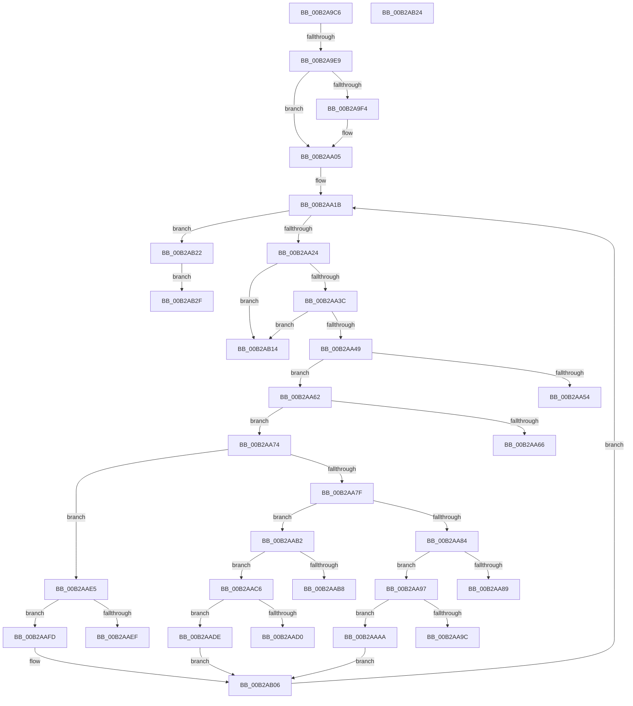

# sub_00B2A9C6

- RVA: `0x00B2A9C6`–`0x00B2AB39` (길이 `371` bytes)
- VA: `0x0000000140B2A9C6`
- 실행 섹션: `PAGE`
- PDB 이름 있음: `아니요`; PDB Function 태그: `아니요`
- unwind 정보 RVA: `0x00097A70`
- 디코드: `99`개 명령, `371/371` bytes 표시
- 미해석 바이트: `0` (있으면 어셈블리에 `.byte`로 보존)

> 이 문서는 커널 이미지의 기계어와 PDB 기호를 분석해 생성했습니다. 4번과 5번은 함수 원형과 자료형을 바이너리 사용 방식에서 추정한 C 해석이며 원본 소스 복구 결과는 아닙니다.

## 1. Dependencies

- 직접 호출 지점: **2**; 고유 호출 대상: **2**
- 직접 호출자로 확인된 함수: **0**
- RIP 상대 이미지 참조: **0**

### Outgoing calls
- `0x00B2A9D6` → [RtlULongLongMult](../../text/43/RtlULongLongMult_function_0043E530.md) (function, `0x0043E530`)
- `0x00B2AA00` → [ProbeForWrite](../8E/ProbeForWrite_function_008E91C0.md) (function, `0x008E91C0`)

### Direct callers
- 이 함수 시작 RVA로 연결되는 직접 call은 확인되지 않았습니다. 간접 호출은 완전히 역산할 수 없습니다.

### Static image references
- 디코드된 RIP-relative 메모리 참조가 없습니다.

## 2. Other-region calls and transfers

- 다른 실행 섹션으로 향하는 call: **1**
  - `0x00B2A9D6` → [RtlULongLongMult](../../text/43/RtlULongLongMult_function_0043E530.md) (`PAGE` → `.text`)
- call이 아닌 외부 분기/꼬리 이동: **11**
  - `0x00B2A9E3` → [MiCaptureSectionCreateExtendedParameters + 0x47](../98/MiCaptureSectionCreateExtendedParameters_function_00983958.md) (`tail-transfer`)
  - `0x00B2AA5D` → [MiCaptureSectionCreateExtendedParameters + 0x47](../98/MiCaptureSectionCreateExtendedParameters_function_00983958.md) (`tail-transfer`)
  - `0x00B2AA6F` → [MiCaptureSectionCreateExtendedParameters + 0x47](../98/MiCaptureSectionCreateExtendedParameters_function_00983958.md) (`tail-transfer`)
  - `0x00B2AA92` → [MiCaptureSectionCreateExtendedParameters + 0x47](../98/MiCaptureSectionCreateExtendedParameters_function_00983958.md) (`tail-transfer`)
  - `0x00B2AAA5` → [MiCaptureSectionCreateExtendedParameters + 0x47](../98/MiCaptureSectionCreateExtendedParameters_function_00983958.md) (`tail-transfer`)
  - `0x00B2AAC1` → [MiCaptureSectionCreateExtendedParameters + 0x47](../98/MiCaptureSectionCreateExtendedParameters_function_00983958.md) (`tail-transfer`)
  - `0x00B2AAD9` → [MiCaptureSectionCreateExtendedParameters + 0x47](../98/MiCaptureSectionCreateExtendedParameters_function_00983958.md) (`tail-transfer`)
  - `0x00B2AAF8` → [MiCaptureSectionCreateExtendedParameters + 0x47](../98/MiCaptureSectionCreateExtendedParameters_function_00983958.md) (`tail-transfer`)
  - `0x00B2AB1D` → [MiCaptureSectionCreateExtendedParameters + 0x47](../98/MiCaptureSectionCreateExtendedParameters_function_00983958.md) (`tail-transfer`)
  - `0x00B2AB2A` → [MiCaptureSectionCreateExtendedParameters + 0x47](../98/MiCaptureSectionCreateExtendedParameters_function_00983958.md) (`tail-transfer`)
  - `0x00B2AB34` → [MiCaptureSectionCreateExtendedParameters + 0x47](../98/MiCaptureSectionCreateExtendedParameters_function_00983958.md) (`tail-transfer`)

## 3. Assembly (complete function range)

```asm
00B2A9C6  44 8B F2                        mov r14d, edx
00B2A9C9  4C 8D 44 24 30                  lea r8, [rsp + 0x30]
00B2A9CE  BA 10 00 00 00                  mov edx, 0x10
00B2A9D3  41 8B CE                        mov ecx, r14d
00B2A9D6  E8 55 3B 91 FF                  call 0x14043e530
00B2A9DB  8B C8                           mov ecx, eax
00B2A9DD  89 44 24 24                     mov dword ptr [rsp + 0x24], eax
00B2A9E1  85 C0                           test eax, eax
00B2A9E3  0F 88 B6 8F E5 FF               js 0x14098399f
00B2A9E9  33 F6                           xor esi, esi
00B2A9EB  89 74 24 28                     mov dword ptr [rsp + 0x28], esi
00B2A9EF  45 84 FF                        test r15b, r15b
00B2A9F2  74 11                           je 0x140b2aa05
00B2A9F4  44 8D 46 08                     lea r8d, [rsi + 8]
00B2A9F8  48 8B 54 24 30                  mov rdx, qword ptr [rsp + 0x30]
00B2A9FD  48 8B CB                        mov rcx, rbx
00B2AA00  E8 BB E7 DB FF                  call 0x1408e91c0
00B2AA05  48 89 5C 24 38                  mov qword ptr [rsp + 0x38], rbx
00B2AA0A  49 C1 E6 04                     shl r14, 4
00B2AA0E  4C 03 F3                        add r14, rbx
00B2AA11  4C 89 74 24 48                  mov qword ptr [rsp + 0x48], r14
00B2AA16  BA FF FF FF FF                  mov edx, 0xffffffff
00B2AA1B  49 3B DE                        cmp rbx, r14
00B2AA1E  0F 83 FE 00 00 00               jae 0x140b2ab22
00B2AA24  8B 0B                           mov ecx, dword ptr [rbx]
00B2AA26  0F B6 C9                        movzx ecx, cl
00B2AA29  89 8C 24 80 00 00 00            mov dword ptr [rsp + 0x80], ecx
00B2AA30  8D 41 FF                        lea eax, [rcx - 1]
00B2AA33  83 F8 02                        cmp eax, 2
00B2AA36  0F 87 D8 00 00 00               ja 0x140b2ab14
00B2AA3C  48 81 3B 00 01 00 00            cmp qword ptr [rbx], 0x100
00B2AA43  0F 83 CB 00 00 00               jae 0x140b2ab14
00B2AA49  B8 01 00 00 00                  mov eax, 1
00B2AA4E  D3 E0                           shl eax, cl
00B2AA50  A8 0E                           test al, 0xe
00B2AA52  75 0E                           jne 0x140b2aa62
00B2AA54  B9 0D 00 00 C0                  mov ecx, 0xc000000d
00B2AA59  89 4C 24 24                     mov dword ptr [rsp + 0x24], ecx
00B2AA5D  E9 3D 8F E5 FF                  jmp 0x14098399f
00B2AA62  85 C6                           test esi, eax
00B2AA64  74 0E                           je 0x140b2aa74
00B2AA66  B9 0D 00 00 C0                  mov ecx, 0xc000000d
00B2AA6B  89 4C 24 24                     mov dword ptr [rsp + 0x24], ecx
00B2AA6F  E9 2B 8F E5 FF                  jmp 0x14098399f
00B2AA74  0B F0                           or esi, eax
00B2AA76  89 74 24 28                     mov dword ptr [rsp + 0x28], esi
00B2AA7A  83 E9 01                        sub ecx, 1
00B2AA7D  74 66                           je 0x140b2aae5
00B2AA7F  83 E9 01                        sub ecx, 1
00B2AA82  74 2E                           je 0x140b2aab2
00B2AA84  83 F9 01                        cmp ecx, 1
00B2AA87  74 0E                           je 0x140b2aa97
00B2AA89  B9 0D 00 00 C0                  mov ecx, 0xc000000d
00B2AA8E  89 4C 24 24                     mov dword ptr [rsp + 0x24], ecx
00B2AA92  E9 08 8F E5 FF                  jmp 0x14098399f
00B2AA97  45 84 FF                        test r15b, r15b
00B2AA9A  74 0E                           je 0x140b2aaaa
00B2AA9C  B9 0D 00 00 C0                  mov ecx, 0xc000000d
00B2AAA1  89 4C 24 24                     mov dword ptr [rsp + 0x24], ecx
00B2AAA5  E9 F5 8E E5 FF                  jmp 0x14098399f
00B2AAAA  8A 43 08                        mov al, byte ptr [rbx + 8]
00B2AAAD  88 47 0C                        mov byte ptr [rdi + 0xc], al
00B2AAB0  EB 54                           jmp 0x140b2ab06
00B2AAB2  48 39 53 08                     cmp qword ptr [rbx + 8], rdx
00B2AAB6  76 0E                           jbe 0x140b2aac6
00B2AAB8  B9 0D 00 00 C0                  mov ecx, 0xc000000d
00B2AABD  89 4C 24 24                     mov dword ptr [rsp + 0x24], ecx
00B2AAC1  E9 D9 8E E5 FF                  jmp 0x14098399f
00B2AAC6  8B 43 08                        mov eax, dword ptr [rbx + 8]
00B2AAC9  89 47 08                        mov dword ptr [rdi + 8], eax
00B2AACC  3B C2                           cmp eax, edx
00B2AACE  75 0E                           jne 0x140b2aade
00B2AAD0  B9 0D 00 00 C0                  mov ecx, 0xc000000d
00B2AAD5  89 4C 24 24                     mov dword ptr [rsp + 0x24], ecx
00B2AAD9  E9 C1 8E E5 FF                  jmp 0x14098399f
00B2AADE  FF C0                           inc eax
00B2AAE0  89 47 08                        mov dword ptr [rdi + 8], eax
00B2AAE3  EB 21                           jmp 0x140b2ab06
00B2AAE5  48 F7 43 08 FE FF FF FF         test qword ptr [rbx + 8], -2
00B2AAED  74 0E                           je 0x140b2aafd
00B2AAEF  B9 0D 00 00 C0                  mov ecx, 0xc000000d
00B2AAF4  89 4C 24 24                     mov dword ptr [rsp + 0x24], ecx
00B2AAF8  E9 A2 8E E5 FF                  jmp 0x14098399f
00B2AAFD  C6 07 01                        mov byte ptr [rdi], 1
00B2AB00  8B 43 08                        mov eax, dword ptr [rbx + 8]
00B2AB03  89 47 04                        mov dword ptr [rdi + 4], eax
00B2AB06  48 83 C3 10                     add rbx, 0x10
00B2AB0A  48 89 5C 24 38                  mov qword ptr [rsp + 0x38], rbx
00B2AB0F  E9 07 FF FF FF                  jmp 0x140b2aa1b
00B2AB14  B9 0D 00 00 C0                  mov ecx, 0xc000000d
00B2AB19  89 4C 24 24                     mov dword ptr [rsp + 0x24], ecx
00B2AB1D  E9 7D 8E E5 FF                  jmp 0x14098399f
00B2AB22  EB 0B                           jmp 0x140b2ab2f
00B2AB24  8B C8                           mov ecx, eax
00B2AB26  89 44 24 24                     mov dword ptr [rsp + 0x24], eax
00B2AB2A  E9 70 8E E5 FF                  jmp 0x14098399f
00B2AB2F  89 77 10                        mov dword ptr [rdi + 0x10], esi
00B2AB32  33 C9                           xor ecx, ecx
00B2AB34  E9 66 8E E5 FF                  jmp 0x14098399f
```

## 4. C-style interpretation (structured pseudocode)

```c
__int64 __fastcall sub_00B2A9C6(__int64 a1, int a2, __int64 a3, __int64 a4, __int64 a5, __int64 a6)
{
    __int64 result;
    __int64 v_r14;
    __int64 v_rbx;
    __int64 v_rsi;
    unsigned int v_stack_p24;
    unsigned int v_stack_p28;
    unsigned __int64 v_stack_p38;
    unsigned __int64 v_stack_p48;
    unsigned int v_stack_p80;

    result = RtlULongLongMult((unsigned int)((unsigned int)((unsigned int)(a2))), 16, a6, a4);
    v_stack_p24 = (unsigned int)(result);
    v_rsi = 0;
    v_stack_p28 = 0;
    if ((unsigned __int8)(v_r15) != 0) {
        a3 = v_rsi + 8;
        a2 = a6;
        a1 = v_rbx;
        result = ProbeForWrite(a1, a2, a3, a4);
    }
    v_stack_p38 = v_rbx;
    v_r14 = ((unsigned int)(a2)) << (4);
    v_r14 = (v_r14) + (v_rbx);
    v_stack_p48 = v_r14;
loc_00B2AA1B:
    if (v_rbx >= v_r14) goto loc_00B2AB22;
    v_stack_p80 = (unsigned int)((unsigned __int8)((unsigned int)(*(unsigned int *)(v_rbx))));
    if (((unsigned int)((unsigned __int8)((unsigned int)(*(unsigned int *)(v_rbx))) - 1)) > 2) goto loc_00B2AB14;
    if ((*(unsigned __int64 *)(v_rbx)) >= 256) goto loc_00B2AB14;
    result = (unsigned int)((1) << ((unsigned __int8)((unsigned __int8)((unsigned int)(*(unsigned int *)(v_rbx))))));
    if ((((unsigned __int8)(result)) & (14)) != 0) goto loc_00B2AA62;
    v_stack_p24 = (unsigned int)((unsigned int)(0xC000000DULL));
loc_00B2AA62:
    if (((0) & ((unsigned int)(result))) == 0) goto loc_00B2AA74;
    v_stack_p24 = (unsigned int)((unsigned int)(0xC000000DULL));
loc_00B2AA74:
    v_rsi = (unsigned int)((v_rsi) | ((unsigned int)(result)));
    v_stack_p28 = (unsigned int)(v_rsi);
    a1 = (unsigned int)(((unsigned int)(0xC000000DULL)) - (1));
    if (condition_is_equal) goto loc_00B2AAE5;
    a1 = (unsigned int)((a1) - (1));
    if (condition_is_equal) goto loc_00B2AAB2;
    if (((unsigned int)(a1)) == 1) goto loc_00B2AA97;
    v_stack_p24 = (unsigned int)((unsigned int)(0xC000000DULL));
loc_00B2AA97:
    if ((unsigned __int8)(v_r15) == 0) goto loc_00B2AAAA;
    v_stack_p24 = (unsigned int)((unsigned int)(0xC000000DULL));
loc_00B2AAAA:
    *(unsigned __int8 *)(v_rdi + 12) = (unsigned __int8)(*(unsigned __int8 *)(v_rbx + 8));
    goto loc_00B2AB06;
loc_00B2AAB2:
    if ((*(unsigned __int64 *)(v_rbx + 8)) <= ((unsigned int)(0xFFFFFFFFULL))) goto loc_00B2AAC6;
    v_stack_p24 = (unsigned int)((unsigned int)(0xC000000DULL));
loc_00B2AAC6:
    *(unsigned int *)(v_rdi + 8) = (unsigned int)((unsigned int)(*(unsigned int *)(v_rbx + 8)));
    if (((unsigned int)((unsigned int)(*(unsigned int *)(v_rbx + 8)))) != ((unsigned int)((unsigned int)(0xFFFFFFFFULL)))) goto loc_00B2AADE;
    v_stack_p24 = (unsigned int)((unsigned int)(0xC000000DULL));
loc_00B2AADE:
    result = (unsigned int)(((unsigned int)(*(unsigned int *)(v_rbx + 8))) + 1);
    *(unsigned int *)(v_rdi + 8) = (unsigned int)(result);
    goto loc_00B2AB06;
loc_00B2AAE5:
    if (((*(unsigned __int64 *)(v_rbx + 8)) & (-2)) == 0) goto loc_00B2AAFD;
    v_stack_p24 = (unsigned int)((unsigned int)(0xC000000DULL));
loc_00B2AAFD:
    *(unsigned __int8 *)(v_rdi) = 1;
    *(unsigned int *)(v_rdi + 4) = (unsigned int)((unsigned int)(*(unsigned int *)(v_rbx + 8)));
loc_00B2AB06:
    v_rbx = (v_rbx) + (16);
    v_stack_p38 = v_rbx;
    goto loc_00B2AA1B;
loc_00B2AB14:
    v_stack_p24 = (unsigned int)((unsigned int)(0xC000000DULL));
loc_00B2AB22:
    goto loc_00B2AB2F;
loc_00B2AB2F:
    *(unsigned int *)(v_rdi + 16) = (unsigned int)(v_rsi);
    a1 = 0;
}
```

## 5. (Beta) C Style

```c
int64_t sub_00B2A9C6(int64_t Arg1, int32_t Arg2, int64_t Arg3, int64_t Arg4, uint64_t Arg5, int64_t Arg6)
{
    int64_t result;
    int64_t local_r14;
    int64_t local_rbx;
    int64_t local_rsi;
    uint32_t v_stack_p24;
    uint32_t v_stack_p28;
    uint64_t v_stack_p38;
    uint64_t v_stack_p48;
    uint32_t v_stack_p80;

    result = RtlULongLongMult((uint32_t)((uint32_t)((uint32_t)(Arg2))), 16, Arg6, Arg4);
    v_stack_p24 = (uint32_t)(result);
    local_rsi = 0;
    v_stack_p28 = 0;
    if ((uint8_t)(local_r15) != 0) {
        Arg3 = local_rsi + 8;
        Arg2 = Arg6;
        Arg1 = local_rbx;
        result = ProbeForWrite(Arg1, Arg2, Arg3, Arg4);
    }
    v_stack_p38 = local_rbx;
    local_r14 = ((uint32_t)(Arg2)) << (4);
    local_r14 = (local_r14) + (local_rbx);
    v_stack_p48 = local_r14;
loc_00B2AA1B:
    if (local_rbx >= local_r14) goto loc_00B2AB22;
    v_stack_p80 = (uint32_t)((uint8_t)((uint32_t)(*(uint32_t *)(local_rbx))));
    if (((uint32_t)((uint8_t)((uint32_t)(*(uint32_t *)(local_rbx))) - 1)) > 2) goto loc_00B2AB14;
    if ((*(uint64_t *)(local_rbx)) >= 256) goto loc_00B2AB14;
    result = (uint32_t)((1) << ((uint8_t)((uint8_t)((uint32_t)(*(uint32_t *)(local_rbx))))));
    if ((((uint8_t)(result)) & (14)) != 0) goto loc_00B2AA62;
    v_stack_p24 = (uint32_t)((uint32_t)(0xC000000DULL));
loc_00B2AA62:
    if (((0) & ((uint32_t)(result))) == 0) goto loc_00B2AA74;
    v_stack_p24 = (uint32_t)((uint32_t)(0xC000000DULL));
loc_00B2AA74:
    local_rsi = (uint32_t)((local_rsi) | ((uint32_t)(result)));
    v_stack_p28 = (uint32_t)(local_rsi);
    Arg1 = (uint32_t)(((uint32_t)(0xC000000DULL)) - (1));
    if (condition_is_equal) goto loc_00B2AAE5;
    Arg1 = (uint32_t)((Arg1) - (1));
    if (condition_is_equal) goto loc_00B2AAB2;
    if (((uint32_t)(Arg1)) == 1) goto loc_00B2AA97;
    v_stack_p24 = (uint32_t)((uint32_t)(0xC000000DULL));
loc_00B2AA97:
    if ((uint8_t)(local_r15) == 0) goto loc_00B2AAAA;
    v_stack_p24 = (uint32_t)((uint32_t)(0xC000000DULL));
loc_00B2AAAA:
    *(uint8_t *)(local_rdi + 0xC) = (uint8_t)(*(uint8_t *)(local_rbx + 0x8));
    goto loc_00B2AB06;
loc_00B2AAB2:
    if ((*(uint64_t *)(local_rbx + 0x8)) <= ((uint32_t)(0xFFFFFFFFULL))) goto loc_00B2AAC6;
    v_stack_p24 = (uint32_t)((uint32_t)(0xC000000DULL));
loc_00B2AAC6:
    *(uint32_t *)(local_rdi + 0x8) = (uint32_t)((uint32_t)(*(uint32_t *)(local_rbx + 0x8)));
    if (((uint32_t)((uint32_t)(*(uint32_t *)(local_rbx + 0x8)))) != ((uint32_t)((uint32_t)(0xFFFFFFFFULL)))) goto loc_00B2AADE;
    v_stack_p24 = (uint32_t)((uint32_t)(0xC000000DULL));
loc_00B2AADE:
    result = (uint32_t)(((uint32_t)(*(uint32_t *)(local_rbx + 0x8))) + 1);
    *(uint32_t *)(local_rdi + 0x8) = (uint32_t)(result);
    goto loc_00B2AB06;
loc_00B2AAE5:
    if (((*(uint64_t *)(local_rbx + 0x8)) & (-2)) == 0) goto loc_00B2AAFD;
    v_stack_p24 = (uint32_t)((uint32_t)(0xC000000DULL));
loc_00B2AAFD:
    *(uint8_t *)(local_rdi) = 1;
    *(uint32_t *)(local_rdi + 0x4) = (uint32_t)((uint32_t)(*(uint32_t *)(local_rbx + 0x8)));
loc_00B2AB06:
    local_rbx = (local_rbx) + (16);
    v_stack_p38 = local_rbx;
    goto loc_00B2AA1B;
loc_00B2AB14:
    v_stack_p24 = (uint32_t)((uint32_t)(0xC000000DULL));
loc_00B2AB22:
    goto loc_00B2AB2F;
loc_00B2AB2F:
    *(uint32_t *)(local_rdi + 0x10) = (uint32_t)(local_rsi);
    Arg1 = 0;
}
```

## 6. Execution-region graph

[열기: 2D/3D 그래프와 함수 탐색 컨트롤 패널](../../../control-panel.html?section=page&rva=0x00B2A9C6&view=graph)

- 2D 그래프는 위에서 아래로 흐르고, 3D 그래프는 빈 공간을 드래그해 회전합니다. Shift+드래그는 이동, 휠은 확대·축소, 함수 노드 선택은 대상 보고서 이동입니다.

### Static fallback


