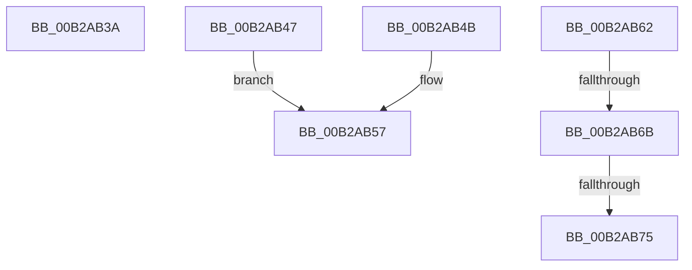

# sub_00B2AB3A

- RVA: `0x00B2AB3A`–`0x00B2AB7A` (길이 `64` bytes)
- VA: `0x0000000140B2AB3A`
- 실행 섹션: `PAGE`
- PDB 이름 있음: `아니요`; PDB Function 태그: `아니요`
- unwind 정보 RVA: `0x00097B04`
- 디코드: `18`개 명령, `64/64` bytes 표시
- 미해석 바이트: `0` (있으면 어셈블리에 `.byte`로 보존)

> 이 문서는 커널 이미지의 기계어와 PDB 기호를 분석해 생성했습니다. 4번과 5번은 함수 원형과 자료형을 바이너리 사용 방식에서 추정한 C 해석이며 원본 소스 복구 결과는 아닙니다.

## 1. Dependencies

- 직접 호출 지점: **0**; 고유 호출 대상: **0**
- 직접 호출자로 확인된 함수: **0**
- RIP 상대 이미지 참조: **0**

### Outgoing calls
- 직접 디코드된 call 명령이 없습니다.

### Direct callers
- 이 함수 시작 RVA로 연결되는 직접 call은 확인되지 않았습니다. 간접 호출은 완전히 역산할 수 없습니다.

### Static image references
- 디코드된 RIP-relative 메모리 참조가 없습니다.

## 2. Other-region calls and transfers

- 다른 실행 섹션으로 향하는 call: **0**
- call이 아닌 외부 분기/꼬리 이동: **5**
  - `0x00B2AB42` → [MiInitializeCreateSectionPacket + 0x87](../98/MiInitializeCreateSectionPacket_function_00984130.md) (`tail-transfer`)
  - `0x00B2AB5D` → [MiInitializeCreateSectionPacket + 0x106](../98/MiInitializeCreateSectionPacket_function_00984130.md) (`tail-transfer`)
  - `0x00B2AB65` → [MiInitializeCreateSectionPacket + 0x2BF](../98/MiInitializeCreateSectionPacket_function_00984130.md) (`tail-transfer`)
  - `0x00B2AB6F` → [MiInitializeCreateSectionPacket + 0x2BF](../98/MiInitializeCreateSectionPacket_function_00984130.md) (`tail-transfer`)
  - `0x00B2AB75` → [MiInitializeCreateSectionPacket + 0x141](../98/MiInitializeCreateSectionPacket_function_00984130.md) (`tail-transfer`)

## 3. Assembly (complete function range)

```asm
00B2AB3A  81 C9 01 40 00 00               or ecx, 0x4001
00B2AB40  89 0B                           mov dword ptr [rbx], ecx
00B2AB42  E9 70 96 E5 FF                  jmp 0x1409841b7
00B2AB47  B0 01                           mov al, 1
00B2AB49  EB 0C                           jmp 0x140b2ab57
00B2AB4B  F7 D8                           neg eax
00B2AB4D  1A C0                           sbb al, al
00B2AB4F  24 08                           and al, 8
00B2AB51  04 04                           add al, 4
00B2AB53  0F BA F7 19                     btr edi, 0x19
00B2AB57  41 0B FD                        or edi, r13d
00B2AB5A  88 43 18                        mov byte ptr [rbx + 0x18], al
00B2AB5D  E9 D4 96 E5 FF                  jmp 0x140984236
00B2AB62  4D 85 C0                        test r8, r8
00B2AB65  0F 84 84 98 E5 FF               je 0x1409843ef
00B2AB6B  41 80 38 00                     cmp byte ptr [r8], 0
00B2AB6F  0F 84 7A 98 E5 FF               je 0x1409843ef
00B2AB75  E9 F7 96 E5 FF                  jmp 0x140984271
```

## 4. C-style interpretation (structured pseudocode)

```c
__int64 __fastcall sub_00B2AB3A(int a1, __int64 a2, __int64 a3)
{
    a1 = (unsigned int)((a1) | (0x4001ULL));
    *(unsigned int *)(v_rbx) = a1;
}
```

## 5. (Beta) C Style

```c
int64_t sub_00B2AB3A(int32_t Arg1, int64_t Arg2, int64_t Arg3)
{
    Arg1 = (uint32_t)((Arg1) | (0x4001ULL));
    *(uint32_t *)(local_rbx) = Arg1;
}
```

## 6. Execution-region graph

[열기: 2D/3D 그래프와 함수 탐색 컨트롤 패널](../../../control-panel.html?section=page&rva=0x00B2AB3A&view=graph)

- 2D 그래프는 위에서 아래로 흐르고, 3D 그래프는 빈 공간을 드래그해 회전합니다. Shift+드래그는 이동, 휠은 확대·축소, 함수 노드 선택은 대상 보고서 이동입니다.

### Static fallback


