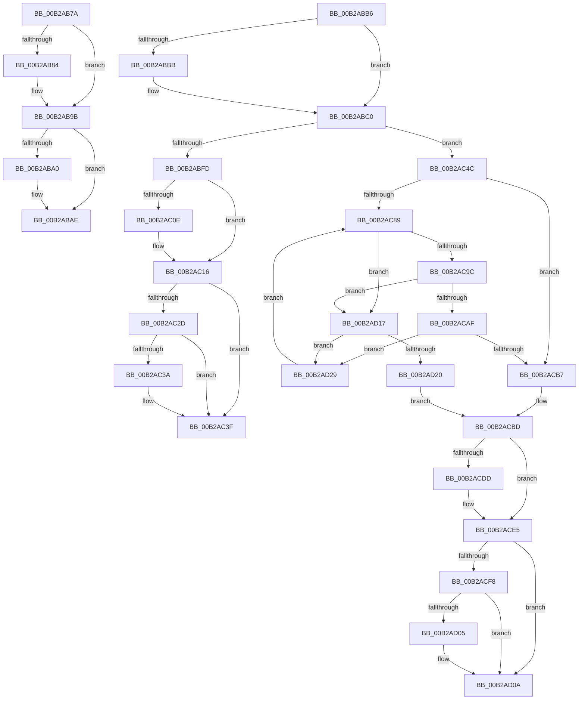

# sub_00B2AB7A

- RVA: `0x00B2AB7A`–`0x00B2AD31` (길이 `439` bytes)
- VA: `0x0000000140B2AB7A`
- 실행 섹션: `PAGE`
- PDB 이름 있음: `아니요`; PDB Function 태그: `아니요`
- unwind 정보 RVA: `0x00097B30`
- 디코드: `107`개 명령, `439/439` bytes 표시
- 미해석 바이트: `0` (있으면 어셈블리에 `.byte`로 보존)

> 이 문서는 커널 이미지의 기계어와 PDB 기호를 분석해 생성했습니다. 4번과 5번은 함수 원형과 자료형을 바이너리 사용 방식에서 추정한 C 해석이며 원본 소스 복구 결과는 아닙니다.

## 1. Dependencies

- 직접 호출 지점: **10**; 고유 호출 대상: **7**
- 직접 호출자로 확인된 함수: **0**
- RIP 상대 이미지 참조: **3**

### Outgoing calls
- `0x00B2AB96` → [MiDereferencePerSessionProtos](../A2/MiDereferencePerSessionProtos_function_00A2EDE8.md) (function, `0x00A2EDE8`)
- `0x00B2ABA9` → [ObfDereferenceObjectWithTag](../../text/2F/ObfDereferenceObjectWithTag_function_002F78E0.md) (function, `0x002F78E0`)
- `0x00B2ABF1` → [MiFindEmptyAddressRangeDownTree](../88/MiFindEmptyAddressRangeDownTree_function_008867B0.md) (function, `0x008867B0`)
- `0x00B2AC11` → [ExfTryToWakePushLock](../../text/26/ExfTryToWakePushLock_function_00265DD0.md) (function, `0x00265DD0`)
- `0x00B2AC19` → [KeAbPostRelease](../../text/2E/KeAbPostRelease_function_002E1600.md) (function, `0x002E1600`)
- `0x00B2AC3A` → [KiCheckForKernelApcDelivery](../../text/2E/KiCheckForKernelApcDelivery_function_002E2C80.md) (function, `0x002E2C80`)
- `0x00B2ACC7` → [RtlAvlInsertNodeEx](../../text/26/RtlAvlInsertNodeEx_function_00265790.md) (function, `0x00265790`)
- `0x00B2ACE0` → [ExfTryToWakePushLock](../../text/26/ExfTryToWakePushLock_function_00265DD0.md) (function, `0x00265DD0`)
- `0x00B2ACE8` → [KeAbPostRelease](../../text/2E/KeAbPostRelease_function_002E1600.md) (function, `0x002E1600`)
- `0x00B2AD05` → [KiCheckForKernelApcDelivery](../../text/2E/KiCheckForKernelApcDelivery_function_002E2C80.md) (function, `0x002E2C80`)

### Direct callers
- 이 함수 시작 RVA로 연결되는 직접 call은 확인되지 않았습니다. 간접 호출은 완전히 역산할 수 없습니다.

### Static image references
- `0x00B2ABD3` → RVA `0x00E2CD08` (`.data`; read)
- `0x00B2ABDA` → RVA `0x00E2D530` (`.data`; read)
- `0x00B2ABFD` → RVA `0x00E2CD10` (`.data`; read/write)

## 2. Other-region calls and transfers

- 다른 실행 섹션으로 향하는 call: **8**
  - `0x00B2ABA9` → [ObfDereferenceObjectWithTag](../../text/2F/ObfDereferenceObjectWithTag_function_002F78E0.md) (`PAGE` → `.text`)
  - `0x00B2AC11` → [ExfTryToWakePushLock](../../text/26/ExfTryToWakePushLock_function_00265DD0.md) (`PAGE` → `.text`)
  - `0x00B2AC19` → [KeAbPostRelease](../../text/2E/KeAbPostRelease_function_002E1600.md) (`PAGE` → `.text`)
  - `0x00B2AC3A` → [KiCheckForKernelApcDelivery](../../text/2E/KiCheckForKernelApcDelivery_function_002E2C80.md) (`PAGE` → `.text`)
  - `0x00B2ACC7` → [RtlAvlInsertNodeEx](../../text/26/RtlAvlInsertNodeEx_function_00265790.md) (`PAGE` → `.text`)
  - `0x00B2ACE0` → [ExfTryToWakePushLock](../../text/26/ExfTryToWakePushLock_function_00265DD0.md) (`PAGE` → `.text`)
  - `0x00B2ACE8` → [KeAbPostRelease](../../text/2E/KeAbPostRelease_function_002E1600.md) (`PAGE` → `.text`)
  - `0x00B2AD05` → [KiCheckForKernelApcDelivery](../../text/2E/KiCheckForKernelApcDelivery_function_002E2C80.md) (`PAGE` → `.text`)
- call이 아닌 외부 분기/꼬리 이동: **3**
  - `0x00B2ABB1` → [MiFinishCreateSection + 0x2A4](../98/MiFinishCreateSection_function_009844FC.md) (`tail-transfer`)
  - `0x00B2AC47` → [MiFinishCreateSection + 0x1F0](../98/MiFinishCreateSection_function_009844FC.md) (`tail-transfer`)
  - `0x00B2AD12` → [MiFinishCreateSection + 0x190](../98/MiFinishCreateSection_function_009844FC.md) (`tail-transfer`)

## 3. Assembly (complete function range)

```asm
00B2AB7A  41 F7 46 38 00 00 00 08         test dword ptr [r14 + 0x38], 0x8000000
00B2AB82  74 17                           je 0x140b2ab9b
00B2AB84  8B 97 8C 00 00 00               mov edx, dword ptr [rdi + 0x8c]
00B2AB8A  49 8B CE                        mov rcx, r14
00B2AB8D  C1 EA 0C                        shr edx, 0xc
00B2AB90  81 E2 FF FF 07 00               and edx, 0x7ffff
00B2AB96  E8 4D 42 F0 FF                  call 0x140a2ede8
00B2AB9B  40 84 ED                        test bpl, bpl
00B2AB9E  74 0E                           je 0x140b2abae
00B2ABA0  48 8B 4F 38                     mov rcx, qword ptr [rdi + 0x38]
00B2ABA4  BA 4D 6D 53 43                  mov edx, 0x43536d4d
00B2ABA9  E8 32 CD 7C FF                  call 0x1402f78e0
00B2ABAE  41 8B DC                        mov ebx, r12d
00B2ABB1  E9 EA 9B E5 FF                  jmp 0x1409847a0
00B2ABB6  4D 85 F6                        test r14, r14
00B2ABB9  74 05                           je 0x140b2abc0
00B2ABBB  41 C6 46 0A 01                  mov byte ptr [r14 + 0xa], 1
00B2ABC0  48 8D 84 24 98 00 00 00         lea rax, [rsp + 0x98]
00B2ABC8  41 B8 00 00 01 00               mov r8d, 0x10000
00B2ABCE  48 89 44 24 30                  mov qword ptr [rsp + 0x30], rax
00B2ABD3  48 8D 0D 2E 21 30 00            lea rcx, [rip + 0x30212e]
00B2ABDA  48 8B 05 4F 29 30 00            mov rax, qword ptr [rip + 0x30294f]
00B2ABE1  45 33 C9                        xor r9d, r9d
00B2ABE4  48 89 44 24 28                  mov qword ptr [rsp + 0x28], rax
00B2ABE9  49 8B D7                        mov rdx, r15
00B2ABEC  4C 89 44 24 20                  mov qword ptr [rsp + 0x20], r8
00B2ABF1  E8 BA BB D5 FF                  call 0x1408867b0
00B2ABF6  44 8B F0                        mov r14d, eax
00B2ABF9  85 C0                           test eax, eax
00B2ABFB  79 4F                           jns 0x140b2ac4c
00B2ABFD  F0 48 0F C1 1D 0A 21 30 00      lock xadd qword ptr [rip + 0x30210a], rbx
00B2AC06  80 E3 06                        and bl, 6
00B2AC09  80 FB 02                        cmp bl, 2
00B2AC0C  75 08                           jne 0x140b2ac16
00B2AC0E  49 8B CD                        mov rcx, r13
00B2AC11  E8 BA B1 73 FF                  call 0x140265dd0
00B2AC16  49 8B CD                        mov rcx, r13
00B2AC19  E8 E2 69 7B FF                  call 0x1402e1600
00B2AC1E  B9 01 00 00 00                  mov ecx, 1
00B2AC23  90                              nop
00B2AC24  66 01 8D E6 01 00 00            add word ptr [rbp + 0x1e6], cx
00B2AC2B  75 12                           jne 0x140b2ac3f
00B2AC2D  48 8D 85 98 00 00 00            lea rax, [rbp + 0x98]
00B2AC34  90                              nop
00B2AC35  48 39 00                        cmp qword ptr [rax], rax
00B2AC38  74 05                           je 0x140b2ac3f
00B2AC3A  E8 41 80 7B FF                  call 0x1402e2c80
00B2AC3F  48 8B 8C 24 90 00 00 00         mov rcx, qword ptr [rsp + 0x90]
00B2AC47  E9 A0 9A E5 FF                  jmp 0x1409846ec
00B2AC4C  4C 8B 8C 24 90 00 00 00         mov r9, qword ptr [rsp + 0x90]
00B2AC54  49 8D 87 FF 0F 00 00            lea rax, [r15 + 0xfff]
00B2AC5B  48 8B 8C 24 98 00 00 00         mov rcx, qword ptr [rsp + 0x98]
00B2AC63  48 C1 E8 0C                     shr rax, 0xc
00B2AC67  48 C1 E9 0C                     shr rcx, 0xc
00B2AC6B  48 FF C8                        dec rax
00B2AC6E  49 89 49 18                     mov qword ptr [r9 + 0x18], rcx
00B2AC72  48 03 C1                        add rax, rcx
00B2AC75  49 89 41 20                     mov qword ptr [r9 + 0x20], rax
00B2AC79  48 8B 15 88 20 30 00            mov rdx, qword ptr [rip + 0x302088]
00B2AC80  4D 8B 41 18                     mov r8, qword ptr [r9 + 0x18]
00B2AC84  48 85 D2                        test rdx, rdx
00B2AC87  74 2E                           je 0x140b2acb7
00B2AC89  0F B6 4A 21                     movzx ecx, byte ptr [rdx + 0x21]
00B2AC8D  8B 42 1C                        mov eax, dword ptr [rdx + 0x1c]
00B2AC90  48 C1 E1 20                     shl rcx, 0x20
00B2AC94  48 0B C8                        or rcx, rax
00B2AC97  4C 3B C1                        cmp r8, rcx
00B2AC9A  77 7B                           ja 0x140b2ad17
00B2AC9C  0F B6 4A 20                     movzx ecx, byte ptr [rdx + 0x20]
00B2ACA0  8B 42 18                        mov eax, dword ptr [rdx + 0x18]
00B2ACA3  48 C1 E1 20                     shl rcx, 0x20
00B2ACA7  48 0B C8                        or rcx, rax
00B2ACAA  4C 3B C1                        cmp r8, rcx
00B2ACAD  73 68                           jae 0x140b2ad17
00B2ACAF  48 8B 02                        mov rax, qword ptr [rdx]
00B2ACB2  48 85 C0                        test rax, rax
00B2ACB5  75 72                           jne 0x140b2ad29
00B2ACB7  41 BE 01 00 00 00               mov r14d, 1
00B2ACBD  44 8A C6                        mov r8b, sil
00B2ACC0  48 8D 0D 41 20 30 00            lea rcx, [rip + 0x302041]
00B2ACC7  E8 C4 AA 73 FF                  call 0x140265790
00B2ACCC  F0 48 0F C1 1D 3B 20 30 00      lock xadd qword ptr [rip + 0x30203b], rbx
00B2ACD5  80 E3 06                        and bl, 6
00B2ACD8  80 FB 02                        cmp bl, 2
00B2ACDB  75 08                           jne 0x140b2ace5
00B2ACDD  49 8B CD                        mov rcx, r13
00B2ACE0  E8 EB B0 73 FF                  call 0x140265dd0
00B2ACE5  49 8B CD                        mov rcx, r13
00B2ACE8  E8 13 69 7B FF                  call 0x1402e1600
00B2ACED  90                              nop
00B2ACEE  66 44 01 B5 E6 01 00 00         add word ptr [rbp + 0x1e6], r14w
00B2ACF6  75 12                           jne 0x140b2ad0a
00B2ACF8  48 8D 85 98 00 00 00            lea rax, [rbp + 0x98]
00B2ACFF  90                              nop
00B2AD00  48 39 00                        cmp qword ptr [rax], rax
00B2AD03  74 05                           je 0x140b2ad0a
00B2AD05  E8 76 7F 7B FF                  call 0x1402e2c80
00B2AD0A  48 8B 8C 24 90 00 00 00         mov rcx, qword ptr [rsp + 0x90]
00B2AD12  E9 75 99 E5 FF                  jmp 0x14098468c
00B2AD17  48 8B 42 08                     mov rax, qword ptr [rdx + 8]
00B2AD1B  48 85 C0                        test rax, rax
00B2AD1E  75 09                           jne 0x140b2ad29
00B2AD20  44 8D 70 01                     lea r14d, [rax + 1]
00B2AD24  41 8A F6                        mov sil, r14b
00B2AD27  EB 94                           jmp 0x140b2acbd
00B2AD29  48 8B D0                        mov rdx, rax
00B2AD2C  E9 58 FF FF FF                  jmp 0x140b2ac89
```

## 4. C-style interpretation (structured pseudocode)

```c
__int64 __fastcall sub_00B2AB7A(__int64 a1, __int64 a2, __int64 a3, int a4)
{
    __int64 result;
    unsigned __int64 v_stack_p20;
    unsigned __int64 v_stack_p28;
    unsigned __int64 v_stack_p30;
    unsigned __int64 v_stack_p90;
    unsigned __int64 v_stack_p98;

    if (((*(unsigned int *)(v_r14 + 56)) & (0x8000000ULL)) != 0) {
        a2 = *(unsigned int *)(v_rdi + 140);
        a1 = v_r14;
        a2 = (unsigned int)((a2) >> (12));
        a2 = (unsigned int)((a2) & (0x7FFFFULL));
        result = MiDereferencePerSessionProtos(a1, a2, a3, a4);
    }
    if ((unsigned __int8)(v_rbp) != 0) {
        a1 = *(unsigned __int64 *)(v_rdi + 56);
        a2 = 0x43536D4DULL;
        result = ObfDereferenceObjectWithTag(a1, a2, a3, a4);
    }
}
```

## 5. (Beta) C Style

```c
int64_t sub_00B2AB7A(int64_t Arg1, int64_t Arg2, int64_t Arg3, int32_t Arg4)
{
    int64_t result;
    uint64_t v_stack_p20;
    uint64_t v_stack_p28;
    uint64_t v_stack_p30;
    uint64_t v_stack_p90;
    uint64_t v_stack_p98;

    if (((*(uint32_t *)(local_r14 + 0x38)) & (0x8000000ULL)) != 0) {
        Arg2 = *(uint32_t *)(local_rdi + 0x8C);
        Arg1 = local_r14;
        Arg2 = (uint32_t)((Arg2) >> (12));
        Arg2 = (uint32_t)((Arg2) & (0x7FFFFULL));
        result = MiDereferencePerSessionProtos(Arg1, Arg2, Arg3, Arg4);
    }
    if ((uint8_t)(local_rbp) != 0) {
        Arg1 = *(uint64_t *)(local_rdi + 0x38);
        Arg2 = 0x43536D4DULL;
        result = ObfDereferenceObjectWithTag(Arg1, Arg2, Arg3, Arg4);
    }
}
```

## 6. Execution-region graph

[열기: 2D/3D 그래프와 함수 탐색 컨트롤 패널](../../../control-panel.html?section=page&rva=0x00B2AB7A&view=graph)

- 2D 그래프는 위에서 아래로 흐르고, 3D 그래프는 빈 공간을 드래그해 회전합니다. Shift+드래그는 이동, 휠은 확대·축소, 함수 노드 선택은 대상 보고서 이동입니다.

### Static fallback


