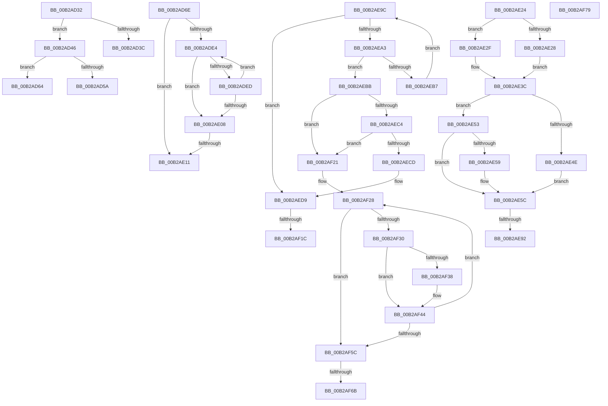

# sub_00B2AD32

- RVA: `0x00B2AD32`–`0x00B2AF8D` (길이 `603` bytes)
- VA: `0x0000000140B2AD32`
- 실행 섹션: `PAGE`
- PDB 이름 있음: `아니요`; PDB Function 태그: `아니요`
- unwind 정보 RVA: `0x00097C38`
- 디코드: `162`개 명령, `603/603` bytes 표시
- 미해석 바이트: `0` (있으면 어셈블리에 `.byte`로 보존)

> 이 문서는 커널 이미지의 기계어와 PDB 기호를 분석해 생성했습니다. 4번과 5번은 함수 원형과 자료형을 바이너리 사용 방식에서 추정한 C 해석이며 원본 소스 복구 결과는 아닙니다.

## 1. Dependencies

- 직접 호출 지점: **10**; 고유 호출 대상: **9**
- 직접 호출자로 확인된 함수: **0**
- RIP 상대 이미지 참조: **4**

### Outgoing calls
- `0x00B2AD51` → [SeSinglePrivilegeCheck](../87/SeSinglePrivilegeCheck_function_00871E20.md) (function, `0x00871E20`)
- `0x00B2ADC1` → [MiInitializeDemandCoalesceContext](../../text/3D/MiInitializeDemandCoalesceContext_function_003D3350.md) (function, `0x003D3350`)
- `0x00B2ADD2` → [MiAllocateLargeZeroPages](../../text/3B/MiAllocateLargeZeroPages_function_003B743C.md) (function, `0x003B743C`)
- `0x00B2ADF6` → [MiAllocateLargeZeroPages](../../text/3B/MiAllocateLargeZeroPages_function_003B743C.md) (function, `0x003B743C`)
- `0x00B2AE85` → [MiAllocateAweInfo](../80/MiAllocateAweInfo_function_00809518.md) (function, `0x00809518`)
- `0x00B2AEF0` → [MiUpdateLargePageSectionPfns](../../text/67/MiUpdateLargePageSectionPfns_function_00678F8C.md) (function, `0x00678F8C`)
- `0x00B2AF3F` → [MmReturnChargesToLockPagedPool](../AD/MmReturnChargesToLockPagedPool_function_00AD3A00.md) (function, `0x00AD3A00`)
- `0x00B2AF49` → [ExFreePoolWithTag](../../poolcode/B8/ExFreePoolWithTag_function_00B82870.md) (function, `0x00B82870`)
- `0x00B2AF6E` → [MiDeleteSectionAwe](../../text/68/MiDeleteSectionAwe_function_006887A8.md) (function, `0x006887A8`)
- `0x00B2AF82` → [MiReturnCommit](../../text/24/MiReturnCommit_function_00248410.md) (function, `0x00248410`)

### Direct callers
- 이 함수 시작 RVA로 연결되는 직접 call은 확인되지 않았습니다. 간접 호출은 완전히 역산할 수 없습니다.

### Static image references
- `0x00B2AD4A` → RVA `0x00FD9AD0` (`PAGEDATA`; read)
- `0x00B2AD70` → RVA `0x00FC5000` (`ALMOSTRO`; read)
- `0x00B2AD7A` → RVA `0x00E2DBD0` (`.data`; read)
- `0x00B2AEDD` → RVA `0x00011C60` (`.rdata`; read)

## 2. Other-region calls and transfers

- 다른 실행 섹션으로 향하는 call: **7**
  - `0x00B2ADC1` → [MiInitializeDemandCoalesceContext](../../text/3D/MiInitializeDemandCoalesceContext_function_003D3350.md) (`PAGE` → `.text`)
  - `0x00B2ADD2` → [MiAllocateLargeZeroPages](../../text/3B/MiAllocateLargeZeroPages_function_003B743C.md) (`PAGE` → `.text`)
  - `0x00B2ADF6` → [MiAllocateLargeZeroPages](../../text/3B/MiAllocateLargeZeroPages_function_003B743C.md) (`PAGE` → `.text`)
  - `0x00B2AEF0` → [MiUpdateLargePageSectionPfns](../../text/67/MiUpdateLargePageSectionPfns_function_00678F8C.md) (`PAGE` → `.text`)
  - `0x00B2AF49` → [ExFreePoolWithTag](../../poolcode/B8/ExFreePoolWithTag_function_00B82870.md) (`PAGE` → `POOLCODE`)
  - `0x00B2AF6E` → [MiDeleteSectionAwe](../../text/68/MiDeleteSectionAwe_function_006887A8.md) (`PAGE` → `.text`)
  - `0x00B2AF82` → [MiReturnCommit](../../text/24/MiReturnCommit_function_00248410.md) (`PAGE` → `.text`)
- call이 아닌 외부 분기/꼬리 이동: **12**
  - `0x00B2AD41` → [MiCreatePagingFileMap + 0x461](../98/MiCreatePagingFileMap_function_009852F8.md) (`tail-transfer`)
  - `0x00B2AD5F` → [MiCreatePagingFileMap + 0x461](../98/MiCreatePagingFileMap_function_009852F8.md) (`tail-transfer`)
  - `0x00B2AD69` → [MiCreatePagingFileMap + 0xB4](../98/MiCreatePagingFileMap_function_009852F8.md) (`tail-transfer`)
  - `0x00B2AE0B` → [MiCreatePagingFileMap + 0x5BB](../98/MiCreatePagingFileMap_function_009852F8.md) (`tail-transfer`)
  - `0x00B2AE1F` → [MiCreatePagingFileMap + 0x16F](../98/MiCreatePagingFileMap_function_009852F8.md) (`tail-transfer`)
  - `0x00B2AE8C` → [MiCreatePagingFileMap + 0x812](../98/MiCreatePagingFileMap_function_009852F8.md) (`tail-transfer`)
  - `0x00B2AE97` → [MiCreatePagingFileMap + 0x2FF](../98/MiCreatePagingFileMap_function_009852F8.md) (`tail-transfer`)
  - `0x00B2AF16` → [MiCreatePagingFileMap + 0x84A](../98/MiCreatePagingFileMap_function_009852F8.md) (`tail-transfer`)
  - `0x00B2AF1C` → [MiCreatePagingFileMap + 0x660](../98/MiCreatePagingFileMap_function_009852F8.md) (`tail-transfer`)
  - `0x00B2AF65` → [MiCreatePagingFileMap + 0x6B7](../98/MiCreatePagingFileMap_function_009852F8.md) (`tail-transfer`)
  - `0x00B2AF74` → [MiCreatePagingFileMap + 0x6B7](../98/MiCreatePagingFileMap_function_009852F8.md) (`tail-transfer`)
  - `0x00B2AF88` → [MiCreatePagingFileMap + 0x6D4](../98/MiCreatePagingFileMap_function_009852F8.md) (`tail-transfer`)

## 3. Assembly (complete function range)

```asm
00B2AD32  41 8B 46 20                     mov eax, dword ptr [r14 + 0x20]
00B2AD36  24 07                           and al, 7
00B2AD38  3C 04                           cmp al, 4
00B2AD3A  74 0A                           je 0x140b2ad46
00B2AD3C  B8 0D 00 00 C0                  mov eax, 0xc000000d
00B2AD41  E9 13 AA E5 FF                  jmp 0x140985759
00B2AD46  41 8A 56 48                     mov dl, byte ptr [r14 + 0x48]
00B2AD4A  48 8B 0D 7F ED 4A 00            mov rcx, qword ptr [rip + 0x4aed7f]
00B2AD51  E8 CA 70 D4 FF                  call 0x140871e20
00B2AD56  84 C0                           test al, al
00B2AD58  75 0A                           jne 0x140b2ad64
00B2AD5A  B8 61 00 00 C0                  mov eax, 0xc0000061
00B2AD5F  E9 F5 A9 E5 FF                  jmp 0x140985759
00B2AD64  B9 00 00 00 08                  mov ecx, 0x8000000
00B2AD69  E9 3E A6 E5 FF                  jmp 0x1409853ac
00B2AD6E  FF C8                           dec eax
00B2AD70  0F B7 3D 89 A2 49 00            movzx edi, word ptr [rip + 0x49a289]
00B2AD77  4D 8B C4                        mov r8, r12
00B2AD7A  48 8B 0D 4F 2E 30 00            mov rcx, qword ptr [rip + 0x302e4f]
00B2AD81  8B D7                           mov edx, edi
00B2AD83  48 83 4D C8 FF                  or qword ptr [rbp - 0x38], 0xffffffffffffffff
00B2AD88  45 33 C9                        xor r9d, r9d
00B2AD8B  0F AF D0                        imul edx, eax
00B2AD8E  89 45 C0                        mov dword ptr [rbp - 0x40], eax
00B2AD91  41 8B 46 20                     mov eax, dword ptr [r14 + 0x20]
00B2AD95  89 45 C4                        mov dword ptr [rbp - 0x3c], eax
00B2AD98  48 8D 45 40                     lea rax, [rbp + 0x40]
00B2AD9C  49 C1 E8 09                     shr r8, 9
00B2ADA0  4C 89 6D A8                     mov qword ptr [rbp - 0x58], r13
00B2ADA4  4C 89 65 B0                     mov qword ptr [rbp - 0x50], r12
00B2ADA8  48 89 45 F0                     mov qword ptr [rbp - 0x10], rax
00B2ADAC  48 8D 34 91                     lea rsi, [rcx + rdx*4]
00B2ADB0  BA 00 02 00 00                  mov edx, 0x200
00B2ADB5  48 8D 4D 00                     lea rcx, [rbp]
00B2ADB9  48 89 55 B8                     mov qword ptr [rbp - 0x48], rdx
00B2ADBD  48 8D 3C BE                     lea rdi, [rsi + rdi*4]
00B2ADC1  E8 8A 85 8A FF                  call 0x1403d3350
00B2ADC6  4C 8D 45 00                     lea r8, [rbp]
00B2ADCA  48 8D 4D A0                     lea rcx, [rbp - 0x60]
00B2ADCE  4C 89 45 E0                     mov qword ptr [rbp - 0x20], r8
00B2ADD2  E8 65 C6 88 FF                  call 0x1403b743c
00B2ADD7  48 8B 45 E8                     mov rax, qword ptr [rbp - 0x18]
00B2ADDB  48 8B 4D B0                     mov rcx, qword ptr [rbp - 0x50]
00B2ADDF  48 3B C1                        cmp rax, rcx
00B2ADE2  74 2D                           je 0x140b2ae11
00B2ADE4  48 83 C6 04                     add rsi, 4
00B2ADE8  48 3B F7                        cmp rsi, rdi
00B2ADEB  74 1B                           je 0x140b2ae08
00B2ADED  8B 06                           mov eax, dword ptr [rsi]
00B2ADEF  48 8D 4D A0                     lea rcx, [rbp - 0x60]
00B2ADF3  89 45 C0                        mov dword ptr [rbp - 0x40], eax
00B2ADF6  E8 41 C6 88 FF                  call 0x1403b743c
00B2ADFB  48 8B 45 E8                     mov rax, qword ptr [rbp - 0x18]
00B2ADFF  48 8B 4D B0                     mov rcx, qword ptr [rbp - 0x50]
00B2AE03  48 3B C1                        cmp rax, rcx
00B2AE06  75 DC                           jne 0x140b2ade4
00B2AE08  48 3B C1                        cmp rax, rcx
00B2AE0B  0F 85 A2 AA E5 FF               jne 0x1409858b3
00B2AE11  48 8B 45 50                     mov rax, qword ptr [rbp + 0x50]
00B2AE15  BE 01 00 00 00                  mov esi, 1
00B2AE1A  48 89 44 24 68                  mov qword ptr [rsp + 0x68], rax
00B2AE1F  E9 43 A6 E5 FF                  jmp 0x140985467
00B2AE24  85 FF                           test edi, edi
00B2AE26  79 07                           jns 0x140b2ae2f
00B2AE28  BA 02 00 00 00                  mov edx, 2
00B2AE2D  EB 0D                           jmp 0x140b2ae3c
00B2AE2F  0F BA E7 13                     bt edi, 0x13
00B2AE33  BA 00 00 00 00                  mov edx, 0
00B2AE38  41 0F 42 D0                     cmovb edx, r8d
00B2AE3C  8B CA                           mov ecx, edx
00B2AE3E  83 C9 40                        or ecx, 0x40
00B2AE41  0F BA E7 10                     bt edi, 0x10
00B2AE45  0F 43 CA                        cmovae ecx, edx
00B2AE48  0F BA E7 1C                     bt edi, 0x1c
00B2AE4C  73 05                           jae 0x140b2ae53
00B2AE4E  83 C9 20                        or ecx, 0x20
00B2AE51  EB 09                           jmp 0x140b2ae5c
00B2AE53  0F BA E7 1E                     bt edi, 0x1e
00B2AE57  73 03                           jae 0x140b2ae5c
00B2AE59  83 C9 10                        or ecx, 0x10
00B2AE5C  41 8B 86 C4 00 00 00            mov eax, dword ptr [r14 + 0xc4]
00B2AE63  45 8A 4E 48                     mov r9b, byte ptr [r14 + 0x48]
00B2AE67  41 22 C0                        and al, r8b
00B2AE6A  44 8B C1                        mov r8d, ecx
00B2AE6D  41 83 C8 08                     or r8d, 8
00B2AE71  84 C0                           test al, al
00B2AE73  48 8D 45 90                     lea rax, [rbp - 0x70]
00B2AE77  48 89 44 24 20                  mov qword ptr [rsp + 0x20], rax
00B2AE7C  44 0F 44 C1                     cmove r8d, ecx
00B2AE80  33 D2                           xor edx, edx
00B2AE82  48 8B CE                        mov rcx, rsi
00B2AE85  E8 8E E6 CD FF                  call 0x140809518
00B2AE8A  85 C0                           test eax, eax
00B2AE8C  0F 88 78 AC E5 FF               js 0x140985b0a
00B2AE92  48 8B 7C 24 38                  mov rdi, qword ptr [rsp + 0x38]
00B2AE97  E9 5B A7 E5 FF                  jmp 0x1409855f7
00B2AE9C  8B F8                           mov edi, eax
00B2AE9E  83 F8 04                        cmp eax, 4
00B2AEA1  73 36                           jae 0x140b2aed9
00B2AEA3  48 8D 14 40                     lea rdx, [rax + rax*2]
00B2AEA7  48 8D 4D 40                     lea rcx, [rbp + 0x40]
00B2AEAB  48 8D 0C D1                     lea rcx, [rcx + rdx*8]
00B2AEAF  4C 8B 01                        mov r8, qword ptr [rcx]
00B2AEB2  4C 3B C1                        cmp r8, rcx
00B2AEB5  75 04                           jne 0x140b2aebb
00B2AEB7  FF C0                           inc eax
00B2AEB9  EB E1                           jmp 0x140b2ae9c
00B2AEBB  4D 8B E0                        mov r12, r8
00B2AEBE  49 39 48 08                     cmp qword ptr [r8 + 8], rcx
00B2AEC2  75 5D                           jne 0x140b2af21
00B2AEC4  49 8B 00                        mov rax, qword ptr [r8]
00B2AEC7  4C 39 40 08                     cmp qword ptr [rax + 8], r8
00B2AECB  75 54                           jne 0x140b2af21
00B2AECD  48 89 01                        mov qword ptr [rcx], rax
00B2AED0  48 89 48 08                     mov qword ptr [rax + 8], rcx
00B2AED4  48 FF 4C D5 50                  dec qword ptr [rbp + rdx*8 + 0x50]
00B2AED9  45 8B 46 20                     mov r8d, dword ptr [r14 + 0x20]
00B2AEDD  48 8D 05 7C 6D 4E FF            lea rax, [rip - 0xb19284]
00B2AEE4  48 8B 54 24 40                  mov rdx, qword ptr [rsp + 0x40]
00B2AEE9  49 8B CC                        mov rcx, r12
00B2AEEC  48 8B 3C F8                     mov rdi, qword ptr [rax + rdi*8]
00B2AEF0  E8 97 E0 B4 FF                  call 0x140678f8c
00B2AEF5  48 8B 44 24 40                  mov rax, qword ptr [rsp + 0x40]
00B2AEFA  48 8B 4C 24 50                  mov rcx, qword ptr [rsp + 0x50]
00B2AEFF  48 03 CF                        add rcx, rdi
00B2AF02  48 89 4C 24 50                  mov qword ptr [rsp + 0x50], rcx
00B2AF07  48 8D 04 F8                     lea rax, [rax + rdi*8]
00B2AF0B  48 89 44 24 40                  mov qword ptr [rsp + 0x40], rax
00B2AF10  8B 43 FC                        mov eax, dword ptr [rbx - 4]
00B2AF13  48 3B C8                        cmp rcx, rax
00B2AF16  0F 85 26 AC E5 FF               jne 0x140985b42
00B2AF1C  E9 37 AA E5 FF                  jmp 0x140985958
00B2AF21  B9 03 00 00 00                  mov ecx, 3
00B2AF26  CD 29                           int 0x29
00B2AF28  48 8B 0F                        mov rcx, qword ptr [rdi]
00B2AF2B  48 85 C9                        test rcx, rcx
00B2AF2E  74 2C                           je 0x140b2af5c
00B2AF30  81 FB 00 00 00 88               cmp ebx, 0x88000000
00B2AF36  75 0C                           jne 0x140b2af44
00B2AF38  8B 57 24                        mov edx, dword ptr [rdi + 0x24]
00B2AF3B  48 C1 E2 03                     shl rdx, 3
00B2AF3F  E8 BC 8A FA FF                  call 0x140ad3a00
00B2AF44  48 8B 0F                        mov rcx, qword ptr [rdi]
00B2AF47  33 D2                           xor edx, edx
00B2AF49  E8 22 79 05 00                  call 0x140b82870
00B2AF4E  48 83 C7 58                     add rdi, 0x58
00B2AF52  49 FF C6                        inc r14
00B2AF55  4C 3B 74 24 38                  cmp r14, qword ptr [rsp + 0x38]
00B2AF5A  72 CC                           jb 0x140b2af28
00B2AF5C  8B 5C 24 58                     mov ebx, dword ptr [rsp + 0x58]
00B2AF60  48 83 7D 90 00                  cmp qword ptr [rbp - 0x70], 0
00B2AF65  0F 84 44 AA E5 FF               je 0x1409859af
00B2AF6B  48 8B CE                        mov rcx, rsi
00B2AF6E  E8 35 D8 B5 FF                  call 0x1406887a8
00B2AF73  90                              nop
00B2AF74  E9 36 AA E5 FF                  jmp 0x1409859af
00B2AF79  45 33 C0                        xor r8d, r8d
00B2AF7C  49 8B D4                        mov rdx, r12
00B2AF7F  49 8B CD                        mov rcx, r13
00B2AF82  E8 89 D4 71 FF                  call 0x140248410
00B2AF87  90                              nop
00B2AF88  E9 3F AA E5 FF                  jmp 0x1409859cc
```

## 4. C-style interpretation (structured pseudocode)

```c
__int64 __fastcall sub_00B2AD32(__int64 a1, __int64 a2, __int64 a3, int a4)
{
    __int64 result;
    unsigned __int64 v_stack_p20;
    unsigned __int64 v_stack_p38;
    unsigned __int64 v_stack_p40;
    unsigned __int64 v_stack_p50;
    unsigned int v_stack_p58;
    unsigned __int64 v_stack_p68;

    result = (unsigned __int8)(((unsigned int)(*(unsigned int *)(v_r14 + 32))) & (7));
    if (((unsigned __int8)(result)) == 4) goto loc_00B2AD46;
loc_00B2AD46:
    result = SeSinglePrivilegeCheck(*(unsigned __int64 *)(v_rip + 4910463), *(unsigned __int8 *)(v_r14 + 72), a3, a4);
    if ((unsigned __int8)(result) != 0) goto loc_00B2AD64;
loc_00B2AD64:
}
```

## 5. (Beta) C Style

```c
int64_t sub_00B2AD32(int64_t Arg1, int64_t Arg2, int64_t Arg3, int32_t Arg4)
{
    int64_t result;
    uint64_t v_stack_p20;
    uint64_t v_stack_p38;
    uint64_t v_stack_p40;
    uint64_t v_stack_p50;
    uint32_t v_stack_p58;
    uint64_t v_stack_p68;

    result = (uint8_t)(((uint32_t)(*(uint32_t *)(local_r14 + 0x20))) & (7));
    if (((uint8_t)(result)) == 4) goto loc_00B2AD46;
loc_00B2AD46:
    result = SeSinglePrivilegeCheck(*(uint64_t *)(v_rip + 0x4AED7F), *(uint8_t *)(local_r14 + 0x48), Arg3, Arg4);
    if ((uint8_t)(result) != 0) goto loc_00B2AD64;
loc_00B2AD64:
}
```

## 6. Execution-region graph

[열기: 2D/3D 그래프와 함수 탐색 컨트롤 패널](../../../control-panel.html?section=page&rva=0x00B2AD32&view=graph)

- 2D 그래프는 위에서 아래로 흐르고, 3D 그래프는 빈 공간을 드래그해 회전합니다. Shift+드래그는 이동, 휠은 확대·축소, 함수 노드 선택은 대상 보고서 이동입니다.

### Static fallback


