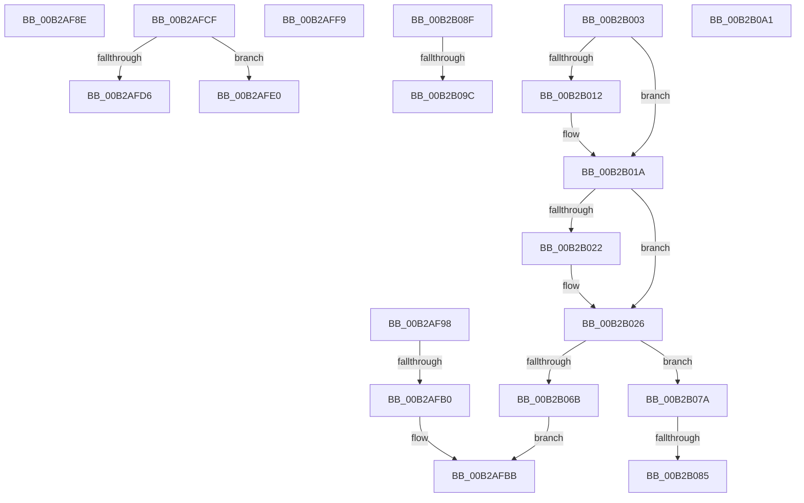

# sub_00B2AF8E

- RVA: `0x00B2AF8E`–`0x00B2B0A8` (길이 `282` bytes)
- VA: `0x0000000140B2AF8E`
- 실행 섹션: `PAGE`
- PDB 이름 있음: `아니요`; PDB Function 태그: `아니요`
- unwind 정보 RVA: `0x00097C9C`
- 디코드: `64`개 명령, `282/282` bytes 표시
- 미해석 바이트: `0` (있으면 어셈블리에 `.byte`로 보존)

> 이 문서는 커널 이미지의 기계어와 PDB 기호를 분석해 생성했습니다. 4번과 5번은 함수 원형과 자료형을 바이너리 사용 방식에서 추정한 C 해석이며 원본 소스 복구 결과는 아닙니다.

## 1. Dependencies

- 직접 호출 지점: **4**; 고유 호출 대상: **4**
- 직접 호출자로 확인된 함수: **0**
- RIP 상대 이미지 참조: **1**

### Outgoing calls
- `0x00B2AFA1` → [MiSetPagesModified](../../text/49/MiSetPagesModified_function_0049DC2C.md) (function, `0x0049DC2C`)
- `0x00B2AFC4` → [MiDeleteImageCreationMdls](../98/MiDeleteImageCreationMdls_function_009884FC.md) (function, `0x009884FC`)
- `0x00B2B015` → [MiMakeImageReadOnly](../../text/49/MiMakeImageReadOnly_function_0049CB74.md) (function, `0x0049CB74`)
- `0x00B2B060` → [MiValidateSectionSigningPolicy](../93/MiValidateSectionSigningPolicy_function_0093FF40.md) (function, `0x0093FF40`)

### Direct callers
- 이 함수 시작 RVA로 연결되는 직접 call은 확인되지 않았습니다. 간접 호출은 완전히 역산할 수 없습니다.

### Static image references
- `0x00B2AFB5` → RVA `0x00E2D7F8` (`.data`; write)

## 2. Other-region calls and transfers

- 다른 실행 섹션으로 향하는 call: **2**
  - `0x00B2AFA1` → [MiSetPagesModified](../../text/49/MiSetPagesModified_function_0049DC2C.md) (`PAGE` → `.text`)
  - `0x00B2B015` → [MiMakeImageReadOnly](../../text/49/MiMakeImageReadOnly_function_0049CB74.md) (`PAGE` → `.text`)
- call이 아닌 외부 분기/꼬리 이동: **11**
  - `0x00B2AF93` → [MiCreateNewSection + 0x188](../98/MiCreateNewSection_function_00985DB0.md) (`tail-transfer`)
  - `0x00B2AFAA` → [MiCreateNewSection + 0x25B](../98/MiCreateNewSection_function_00985DB0.md) (`tail-transfer`)
  - `0x00B2AFCA` → [MiCreateNewSection + 0x186](../98/MiCreateNewSection_function_00985DB0.md) (`tail-transfer`)
  - `0x00B2AFDB` → [MiCreateNewSection + 0x309](../98/MiCreateNewSection_function_00985DB0.md) (`tail-transfer`)
  - `0x00B2AFF4` → [MiCreateNewSection + 0x309](../98/MiCreateNewSection_function_00985DB0.md) (`tail-transfer`)
  - `0x00B2AFFE` → [MiCreateNewSection + 0x3A8](../98/MiCreateNewSection_function_00985DB0.md) (`tail-transfer`)
  - `0x00B2B07F` → [MiCreateNewSection + 0x3EF](../98/MiCreateNewSection_function_00985DB0.md) (`tail-transfer`)
  - `0x00B2B08A` → [MiCreateNewSection + 0x3BB](../98/MiCreateNewSection_function_00985DB0.md) (`tail-transfer`)
  - `0x00B2B096` → [MiCreateNewSection + 0x6C0](../98/MiCreateNewSection_function_00985DB0.md) (`tail-transfer`)
  - `0x00B2B09C` → [MiCreateNewSection + 0x416](../98/MiCreateNewSection_function_00985DB0.md) (`tail-transfer`)
  - `0x00B2B0A3` → [MiCreateNewSection + 0x188](../98/MiCreateNewSection_function_00985DB0.md) (`tail-transfer`)

## 3. Assembly (complete function range)

```asm
00B2AF8E  B8 BB 00 00 C0                  mov eax, 0xc00000bb
00B2AF93  E9 A0 AF E5 FF                  jmp 0x140985f38
00B2AF98  8B 93 A8 00 00 00               mov edx, dword ptr [rbx + 0xa8]
00B2AF9E  49 8B CE                        mov rcx, r14
00B2AFA1  E8 86 2C 97 FF                  call 0x14049dc2c
00B2AFA6  8B F8                           mov edi, eax
00B2AFA8  85 C0                           test eax, eax
00B2AFAA  0F 89 5B B0 E5 FF               jns 0x14098600b
00B2AFB0  B9 06 00 00 00                  mov ecx, 6
00B2AFB5  89 0D 3D 28 30 00               mov dword ptr [rip + 0x30283d], ecx
00B2AFBB  48 8B 4D 80                     mov rcx, qword ptr [rbp - 0x80]
00B2AFBF  BA 01 00 00 00                  mov edx, 1
00B2AFC4  E8 33 D5 E5 FF                  call 0x1409884fc
00B2AFC9  90                              nop
00B2AFCA  E9 67 AF E5 FF                  jmp 0x140985f36
00B2AFCF  41 0F BA E7 18                  bt r15d, 0x18
00B2AFD4  73 0A                           jae 0x140b2afe0
00B2AFD6  C6 44 24 54 08                  mov byte ptr [rsp + 0x54], 8
00B2AFDB  E9 D9 B0 E5 FF                  jmp 0x1409860b9
00B2AFE0  8B 44 24 54                     mov eax, dword ptr [rsp + 0x54]
00B2AFE4  41 0F BA E7 19                  bt r15d, 0x19
00B2AFE9  0F B6 C0                        movzx eax, al
00B2AFEC  41 0F 42 C4                     cmovb eax, r12d
00B2AFF0  89 44 24 54                     mov dword ptr [rsp + 0x54], eax
00B2AFF4  E9 C0 B0 E5 FF                  jmp 0x1409860b9
00B2AFF9  48 8B 44 24 78                  mov rax, qword ptr [rsp + 0x78]
00B2AFFE  E9 55 B1 E5 FF                  jmp 0x140986158
00B2B003  80 7C 24 51 00                  cmp byte ptr [rsp + 0x51], 0
00B2B008  C7 44 24 68 01 00 00 00         mov dword ptr [rsp + 0x68], 1
00B2B010  74 08                           je 0x140b2b01a
00B2B012  49 8B CE                        mov rcx, r14
00B2B015  E8 5A 1B 97 FF                  call 0x14049cb74
00B2B01A  F7 03 00 00 00 04               test dword ptr [rbx], 0x4000000
00B2B020  74 04                           je 0x140b2b026
00B2B022  41 83 CD 08                     or r13d, 8
00B2B026  8B 44 24 54                     mov eax, dword ptr [rsp + 0x54]
00B2B02A  4D 8B C6                        mov r8, r14
00B2B02D  44 8B 8B A8 00 00 00            mov r9d, dword ptr [rbx + 0xa8]
00B2B034  33 C9                           xor ecx, ecx
00B2B036  88 44 24 40                     mov byte ptr [rsp + 0x40], al
00B2B03A  8A 44 24 50                     mov al, byte ptr [rsp + 0x50]
00B2B03E  88 44 24 38                     mov byte ptr [rsp + 0x38], al
00B2B042  48 8B 83 A0 00 00 00            mov rax, qword ptr [rbx + 0xa0]
00B2B049  44 89 6C 24 30                  mov dword ptr [rsp + 0x30], r13d
00B2B04E  4C 8B 6C 24 70                  mov r13, qword ptr [rsp + 0x70]
00B2B053  49 8B D5                        mov rdx, r13
00B2B056  44 89 7C 24 28                  mov dword ptr [rsp + 0x28], r15d
00B2B05B  48 89 44 24 20                  mov qword ptr [rsp + 0x20], rax
00B2B060  E8 DB 4E E1 FF                  call 0x14093ff40
00B2B065  8B F8                           mov edi, eax
00B2B067  85 C0                           test eax, eax
00B2B069  79 0F                           jns 0x140b2b07a
00B2B06B  C7 05 83 27 30 00 0A 00 00 00   mov dword ptr [rip + 0x302783], 0xa
00B2B075  E9 41 FF FF FF                  jmp 0x140b2afbb
00B2B07A  83 7C 24 68 00                  cmp dword ptr [rsp + 0x68], 0
00B2B07F  0F 85 1A B1 E5 FF               jne 0x14098619f
00B2B085  48 8B 44 24 78                  mov rax, qword ptr [rsp + 0x78]
00B2B08A  E9 DC B0 E5 FF                  jmp 0x14098616b
00B2B08F  49 83 C7 08                     add r15, 8
00B2B093  83 C6 FF                        add esi, -1
00B2B096  0F 85 D4 B3 E5 FF               jne 0x140986470
00B2B09C  E9 25 B1 E5 FF                  jmp 0x1409861c6
00B2B0A1  8B C6                           mov eax, esi
00B2B0A3  E9 90 AE E5 FF                  jmp 0x140985f38
```

## 4. C-style interpretation (structured pseudocode)

```c
__int64 __fastcall sub_00B2AF8E(void)
{
    unsigned __int64 v_stack_p20;
    unsigned int v_stack_p28;
    unsigned int v_stack_p30;
    unsigned __int8 v_stack_p38;
    unsigned __int8 v_stack_p40;
    unsigned __int8 v_stack_p50;
    unsigned __int8 v_stack_p51;
    unsigned __int8 v_stack_p54;
    unsigned int v_stack_p68;
    unsigned __int64 v_stack_p70;
    unsigned __int64 v_stack_p78;
}
```

## 5. (Beta) C Style

```c
void sub_00B2AF8E(void)
{
    uint64_t v_stack_p20;
    uint32_t v_stack_p28;
    uint32_t v_stack_p30;
    uint8_t v_stack_p38;
    uint8_t v_stack_p40;
    uint8_t v_stack_p50;
    uint8_t v_stack_p51;
    uint8_t v_stack_p54;
    uint32_t v_stack_p68;
    uint64_t v_stack_p70;
    uint64_t v_stack_p78;
}
```

## 6. Execution-region graph

[열기: 2D/3D 그래프와 함수 탐색 컨트롤 패널](../../../control-panel.html?section=page&rva=0x00B2AF8E&view=graph)

- 2D 그래프는 위에서 아래로 흐르고, 3D 그래프는 빈 공간을 드래그해 회전합니다. Shift+드래그는 이동, 휠은 확대·축소, 함수 노드 선택은 대상 보고서 이동입니다.

### Static fallback


