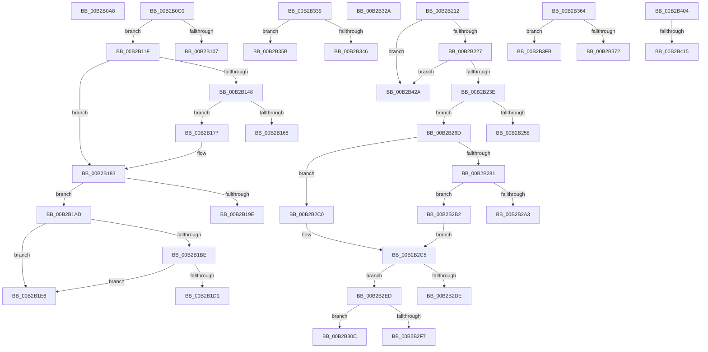

# sub_00B2B0A8

- RVA: `0x00B2B0A8`–`0x00B2B43F` (길이 `919` bytes)
- VA: `0x0000000140B2B0A8`
- 실행 섹션: `PAGE`
- PDB 이름 있음: `아니요`; PDB Function 태그: `아니요`
- unwind 정보 RVA: `0x00097CEC`
- 디코드: `215`개 명령, `919/919` bytes 표시
- 미해석 바이트: `0` (있으면 어셈블리에 `.byte`로 보존)

> 이 문서는 커널 이미지의 기계어와 PDB 기호를 분석해 생성했습니다. 4번과 5번은 함수 원형과 자료형을 바이너리 사용 방식에서 추정한 C 해석이며 원본 소스 복구 결과는 아닙니다.

## 1. Dependencies

- 직접 호출 지점: **10**; 고유 호출 대상: **7**
- 직접 호출자로 확인된 함수: **0**
- RIP 상대 이미지 참조: **2**

### Outgoing calls
- `0x00B2B0FA` → [MiCreateMdl](../98/MiCreateMdl_function_009883A8.md) (function, `0x009883A8`)
- `0x00B2B15C` → [MiAllocateEntireImageFileExtents](../80/MiAllocateEntireImageFileExtents_function_008008DC.md) (function, `0x008008DC`)
- `0x00B2B192` → [MiReadImageHeaders](../98/MiReadImageHeaders_function_00987DAC.md) (function, `0x00987DAC`)
- `0x00B2B24E` → [MiCreateMdl](../98/MiCreateMdl_function_009883A8.md) (function, `0x009883A8`)
- `0x00B2B297` → [MiAllocateEntireImageFileExtents](../80/MiAllocateEntireImageFileExtents_function_008008DC.md) (function, `0x008008DC`)
- `0x00B2B2D2` → [MiReadImageHeaders](../98/MiReadImageHeaders_function_00987DAC.md) (function, `0x00987DAC`)
- `0x00B2B33D` → [MiLegacyImageArchitecture](../../text/49/MiLegacyImageArchitecture_function_00494454.md) (function, `0x00494454`)
- `0x00B2B389` → [IoIsDeviceEjectable](../../text/49/IoIsDeviceEjectable_function_0049C644.md) (function, `0x0049C644`)
- `0x00B2B3E8` → [EtwTraceKernelEvent](../../text/23/EtwTraceKernelEvent_function_00235350.md) (function, `0x00235350`)
- `0x00B2B41D` → [MiDeleteImageCreationMdls](../98/MiDeleteImageCreationMdls_function_009884FC.md) (function, `0x009884FC`)

### Direct callers
- 이 함수 시작 RVA로 연결되는 직접 call은 확인되지 않았습니다. 간접 호출은 완전히 역산할 수 없습니다.

### Static image references
- `0x00B2B0A8` → RVA `0x00E2D7F8` (`.data`; write)
- `0x00B2B364` → RVA `0x00FC6B00` (`ALMOSTRO`; read)

## 2. Other-region calls and transfers

- 다른 실행 섹션으로 향하는 call: **3**
  - `0x00B2B33D` → [MiLegacyImageArchitecture](../../text/49/MiLegacyImageArchitecture_function_00494454.md) (`PAGE` → `.text`)
  - `0x00B2B389` → [IoIsDeviceEjectable](../../text/49/IoIsDeviceEjectable_function_0049C644.md) (`PAGE` → `.text`)
  - `0x00B2B3E8` → [EtwTraceKernelEvent](../../text/23/EtwTraceKernelEvent_function_00235350.md) (`PAGE` → `.text`)
- call이 아닌 외부 분기/꼬리 이동: **19**
  - `0x00B2B0BB` → [MiCreateImageFileMap + 0x5F7](../98/MiCreateImageFileMap_function_00986830.md) (`tail-transfer`)
  - `0x00B2B11A` → [MiCreateImageFileMap + 0x5FC](../98/MiCreateImageFileMap_function_00986830.md) (`tail-transfer`)
  - `0x00B2B172` → [MiCreateImageFileMap + 0x666](../98/MiCreateImageFileMap_function_00986830.md) (`tail-transfer`)
  - `0x00B2B1A8` → [MiCreateImageFileMap + 0x666](../98/MiCreateImageFileMap_function_00986830.md) (`tail-transfer`)
  - `0x00B2B1E1` → [MiCreateImageFileMap + 0x666](../98/MiCreateImageFileMap_function_00986830.md) (`tail-transfer`)
  - `0x00B2B20D` → [MiCreateImageFileMap + 0x1E6](../98/MiCreateImageFileMap_function_00986830.md) (`tail-transfer`)
  - `0x00B2B268` → [MiCreateImageFileMap + 0x666](../98/MiCreateImageFileMap_function_00986830.md) (`tail-transfer`)
  - `0x00B2B2AD` → [MiCreateImageFileMap + 0x666](../98/MiCreateImageFileMap_function_00986830.md) (`tail-transfer`)
  - `0x00B2B2E8` → [MiCreateImageFileMap + 0x666](../98/MiCreateImageFileMap_function_00986830.md) (`tail-transfer`)
  - `0x00B2B307` → [MiCreateImageFileMap + 0x666](../98/MiCreateImageFileMap_function_00986830.md) (`tail-transfer`)
  - `0x00B2B325` → [MiCreateImageFileMap + 0x2B0](../98/MiCreateImageFileMap_function_00986830.md) (`tail-transfer`)
  - `0x00B2B334` → [MiCreateImageFileMap + 0x666](../98/MiCreateImageFileMap_function_00986830.md) (`tail-transfer`)
  - `0x00B2B356` → [MiCreateImageFileMap + 0x666](../98/MiCreateImageFileMap_function_00986830.md) (`tail-transfer`)
  - `0x00B2B35F` → [MiCreateImageFileMap + 0x2BF](../98/MiCreateImageFileMap_function_00986830.md) (`tail-transfer`)
  - `0x00B2B3F6` → [MiCreateImageFileMap + 0x42B](../98/MiCreateImageFileMap_function_00986830.md) (`tail-transfer`)
  - `0x00B2B3FF` → [MiCreateImageFileMap + 0x425](../98/MiCreateImageFileMap_function_00986830.md) (`tail-transfer`)
  - `0x00B2B40F` → [MiCreateImageFileMap + 0x435](../98/MiCreateImageFileMap_function_00986830.md) (`tail-transfer`)
  - `0x00B2B425` → [MiCreateImageFileMap + 0x435](../98/MiCreateImageFileMap_function_00986830.md) (`tail-transfer`)
  - `0x00B2B43A` → [MiCreateImageFileMap + 0x666](../98/MiCreateImageFileMap_function_00986830.md) (`tail-transfer`)

## 3. Assembly (complete function range)

```asm
00B2B0A8  C7 05 46 27 30 00 25 00 00 00   mov dword ptr [rip + 0x302746], 0x25
00B2B0B2  41 BE 33 04 00 C0               mov r14d, 0xc0000433
00B2B0B8  49 8B DC                        mov rbx, r12
00B2B0BB  E9 67 BD E5 FF                  jmp 0x140986e27
00B2B0C0  48 8B 7C 24 48                  mov rdi, qword ptr [rsp + 0x48]
00B2B0C5  49 8B C6                        mov rax, r14
00B2B0C8  49 23 C0                        and rax, r8
00B2B0CB  41 B9 01 00 00 00               mov r9d, 1
00B2B0D1  48 2B C8                        sub rcx, rax
00B2B0D4  8B D6                           mov edx, esi
00B2B0D6  48 81 C1 FF 0F 00 00            add rcx, 0xfff
00B2B0DD  B8 00 20 00 00                  mov eax, 0x2000
00B2B0E2  49 23 C8                        and rcx, r8
00B2B0E5  48 3B C8                        cmp rcx, rax
00B2B0E8  48 89 4D B8                     mov qword ptr [rbp - 0x48], rcx
00B2B0EC  48 0F 42 C1                     cmovb rax, rcx
00B2B0F0  48 8B CF                        mov rcx, rdi
00B2B0F3  4C 8B C0                        mov r8, rax
00B2B0F6  48 89 45 C8                     mov qword ptr [rbp - 0x38], rax
00B2B0FA  E8 A9 D2 E5 FF                  call 0x1409883a8
00B2B0FF  48 8B C8                        mov rcx, rax
00B2B102  48 85 C0                        test rax, rax
00B2B105  75 18                           jne 0x140b2b11f
00B2B107  41 BE 9A 00 00 C0               mov r14d, 0xc000009a
00B2B10D  C7 05 E1 26 30 00 2C 00 00 00   mov dword ptr [rip + 0x3026e1], 0x2c
00B2B117  49 8B DF                        mov rbx, r15
00B2B11A  E9 0D BD E5 FF                  jmp 0x140986e2c
00B2B11F  B8 00 F0 FF FF                  mov eax, 0xfffff000
00B2B124  4C 89 29                        mov qword ptr [rcx], r13
00B2B127  49 8B FE                        mov rdi, r14
00B2B12A  41 B8 00 10 00 00               mov r8d, 0x1000
00B2B130  48 23 F8                        and rdi, rax
00B2B133  4C 8B E9                        mov r13, rcx
00B2B136  48 8B C7                        mov rax, rdi
00B2B139  48 99                           cqo
00B2B13B  49 F7 F8                        idiv r8
00B2B13E  48 89 41 10                     mov qword ptr [rcx + 0x10], rax
00B2B142  0F BA E3 11                     bt ebx, 0x11
00B2B146  73 3B                           jae 0x140b2b183
00B2B148  48 8B 55 B8                     mov rdx, qword ptr [rbp - 0x48]
00B2B14C  4C 8D 4D E8                     lea r9, [rbp - 0x18]
00B2B150  48 8B 4C 24 58                  mov rcx, qword ptr [rsp + 0x58]
00B2B155  4D 8B C4                        mov r8, r12
00B2B158  4C 21 7D E8                     and qword ptr [rbp - 0x18], r15
00B2B15C  E8 7B 57 CD FF                  call 0x1408008dc
00B2B161  44 8B F0                        mov r14d, eax
00B2B164  85 C0                           test eax, eax
00B2B166  79 0F                           jns 0x140b2b177
00B2B168  C7 05 86 26 30 00 80 00 00 00   mov dword ptr [rip + 0x302686], 0x80
00B2B172  E9 1F BD E5 FF                  jmp 0x140986e96
00B2B177  4C 8B 65 E8                     mov r12, qword ptr [rbp - 0x18]
00B2B17B  49 8B CD                        mov rcx, r13
00B2B17E  4C 89 64 24 68                  mov qword ptr [rsp + 0x68], r12
00B2B183  4C 8B C1                        mov r8, rcx
00B2B186  4C 8D 4D A0                     lea r9, [rbp - 0x60]
00B2B18A  48 8B 4C 24 58                  mov rcx, qword ptr [rsp + 0x58]
00B2B18F  49 8B D4                        mov rdx, r12
00B2B192  E8 15 CC E5 FF                  call 0x140987dac
00B2B197  44 8B F0                        mov r14d, eax
00B2B19A  85 C0                           test eax, eax
00B2B19C  79 0F                           jns 0x140b2b1ad
00B2B19E  C7 05 50 26 30 00 2D 00 00 00   mov dword ptr [rip + 0x302650], 0x2d
00B2B1A8  E9 E9 BC E5 FF                  jmp 0x140986e96
00B2B1AD  8B 45 C8                        mov eax, dword ptr [rbp - 0x38]
00B2B1B0  48 8B 55 A8                     mov rdx, qword ptr [rbp - 0x58]
00B2B1B4  48 8B 4C 24 78                  mov rcx, qword ptr [rsp + 0x78]
00B2B1B9  48 3B D0                        cmp rdx, rax
00B2B1BC  74 28                           je 0x140b2b1e6
00B2B1BE  48 8B C1                        mov rax, rcx
00B2B1C1  25 FF 0F 00 00                  and eax, 0xfff
00B2B1C6  48 05 08 01 00 00               add rax, 0x108
00B2B1CC  48 3B D0                        cmp rdx, rax
00B2B1CF  73 15                           jae 0x140b2b1e6
00B2B1D1  41 BE 30 01 00 C0               mov r14d, 0xc0000130
00B2B1D7  C7 05 17 26 30 00 2E 00 00 00   mov dword ptr [rip + 0x302617], 0x2e
00B2B1E1  E9 B0 BC E5 FF                  jmp 0x140986e96
00B2B1E6  4D 8B 45 18                     mov r8, qword ptr [r13 + 0x18]
00B2B1EA  81 E1 FF 0F 00 00               and ecx, 0xfff
00B2B1F0  4C 8B CA                        mov r9, rdx
00B2B1F3  8B C7                           mov eax, edi
00B2B1F5  4C 03 C1                        add r8, rcx
00B2B1F8  4C 2B C9                        sub r9, rcx
00B2B1FB  48 03 D0                        add rdx, rax
00B2B1FE  4C 89 45 C8                     mov qword ptr [rbp - 0x38], r8
00B2B202  48 89 55 A8                     mov qword ptr [rbp - 0x58], rdx
00B2B206  49 8B F8                        mov rdi, r8
00B2B209  48 8B 55 98                     mov rdx, qword ptr [rbp - 0x68]
00B2B20D  E9 04 B8 E5 FF                  jmp 0x140986a16
00B2B212  8D 04 17                        lea eax, [rdi + rdx]
00B2B215  25 FF 0F 00 00                  and eax, 0xfff
00B2B21A  49 03 C1                        add rax, r9
00B2B21D  48 89 45 18                     mov qword ptr [rbp + 0x18], rax
00B2B221  0F 84 03 02 00 00               je 0x140b2b42a
00B2B227  48 8D B8 FF 0F 00 00            lea rdi, [rax + 0xfff]
00B2B22E  48 81 E7 00 F0 FF FF            and rdi, 0xfffffffffffff000
00B2B235  48 3B C7                        cmp rax, rdi
00B2B238  0F 87 EC 01 00 00               ja 0x140b2b42a
00B2B23E  48 8B 4C 24 48                  mov rcx, qword ptr [rsp + 0x48]
00B2B243  41 B9 01 00 00 00               mov r9d, 1
00B2B249  4C 8B C7                        mov r8, rdi
00B2B24C  8B D6                           mov edx, esi
00B2B24E  E8 55 D1 E5 FF                  call 0x1409883a8
00B2B253  48 85 C0                        test rax, rax
00B2B256  75 15                           jne 0x140b2b26d
00B2B258  41 BE 9A 00 00 C0               mov r14d, 0xc000009a
00B2B25E  C7 05 90 25 30 00 34 00 00 00   mov dword ptr [rip + 0x302590], 0x34
00B2B268  E9 29 BC E5 FF                  jmp 0x140986e96
00B2B26D  49 C1 EE 0C                     shr r14, 0xc
00B2B271  4C 89 28                        mov qword ptr [rax], r13
00B2B274  4C 8B E8                        mov r13, rax
00B2B277  4C 89 70 10                     mov qword ptr [rax + 0x10], r14
00B2B27B  0F BA E3 11                     bt ebx, 0x11
00B2B27F  73 3F                           jae 0x140b2b2c0
00B2B281  4C 21 7D 98                     and qword ptr [rbp - 0x68], r15
00B2B285  4C 8D 4D 98                     lea r9, [rbp - 0x68]
00B2B289  48 8B D7                        mov rdx, rdi
00B2B28C  4D 8B C4                        mov r8, r12
00B2B28F  48 8B 7C 24 58                  mov rdi, qword ptr [rsp + 0x58]
00B2B294  48 8B CF                        mov rcx, rdi
00B2B297  E8 40 56 CD FF                  call 0x1408008dc
00B2B29C  44 8B F0                        mov r14d, eax
00B2B29F  85 C0                           test eax, eax
00B2B2A1  79 0F                           jns 0x140b2b2b2
00B2B2A3  C7 05 4B 25 30 00 81 00 00 00   mov dword ptr [rip + 0x30254b], 0x81
00B2B2AD  E9 E4 BB E5 FF                  jmp 0x140986e96
00B2B2B2  4C 8B 65 98                     mov r12, qword ptr [rbp - 0x68]
00B2B2B6  49 8B C5                        mov rax, r13
00B2B2B9  4C 89 64 24 68                  mov qword ptr [rsp + 0x68], r12
00B2B2BE  EB 05                           jmp 0x140b2b2c5
00B2B2C0  48 8B 7C 24 58                  mov rdi, qword ptr [rsp + 0x58]
00B2B2C5  4C 8D 4D A0                     lea r9, [rbp - 0x60]
00B2B2C9  4C 8B C0                        mov r8, rax
00B2B2CC  49 8B D4                        mov rdx, r12
00B2B2CF  48 8B CF                        mov rcx, rdi
00B2B2D2  E8 D5 CA E5 FF                  call 0x140987dac
00B2B2D7  44 8B F0                        mov r14d, eax
00B2B2DA  85 C0                           test eax, eax
00B2B2DC  79 0F                           jns 0x140b2b2ed
00B2B2DE  C7 05 10 25 30 00 35 00 00 00   mov dword ptr [rip + 0x302510], 0x35
00B2B2E8  E9 A9 BB E5 FF                  jmp 0x140986e96
00B2B2ED  48 8B 45 18                     mov rax, qword ptr [rbp + 0x18]
00B2B2F1  48 39 45 A8                     cmp qword ptr [rbp - 0x58], rax
00B2B2F5  73 15                           jae 0x140b2b30c
00B2B2F7  41 BE 7B 00 00 C0               mov r14d, 0xc000007b
00B2B2FD  C7 05 F1 24 30 00 36 00 00 00   mov dword ptr [rip + 0x3024f1], 0x36
00B2B307  E9 8A BB E5 FF                  jmp 0x140986e96
00B2B30C  44 8B 55 B0                     mov r10d, dword ptr [rbp - 0x50]
00B2B310  44 03 54 24 74                  add r10d, dword ptr [rsp + 0x74]
00B2B315  4C 8B 5C 24 60                  mov r11, qword ptr [rsp + 0x60]
00B2B31A  41 81 E2 FF 0F 00 00            and r10d, 0xfff
00B2B321  4D 03 55 18                     add r10, qword ptr [r13 + 0x18]
00B2B325  E9 B6 B7 E5 FF                  jmp 0x140986ae0
00B2B32A  C7 05 C4 24 30 00 37 00 00 00   mov dword ptr [rip + 0x3024c4], 0x37
00B2B334  E9 5D BB E5 FF                  jmp 0x140986e96
00B2B339  0F B7 4D D0                     movzx ecx, word ptr [rbp - 0x30]
00B2B33D  E8 12 91 96 FF                  call 0x140494454
00B2B342  85 C0                           test eax, eax
00B2B344  75 15                           jne 0x140b2b35b
00B2B346  41 BE 7B 00 00 C0               mov r14d, 0xc000007b
00B2B34C  C7 05 A2 24 30 00 38 00 00 00   mov dword ptr [rip + 0x3024a2], 0x38
00B2B356  E9 3B BB E5 FF                  jmp 0x140986e96
00B2B35B  0F BA EB 14                     bts ebx, 0x14
00B2B35F  E9 8B B7 E5 FF                  jmp 0x140986aef
00B2B364  8B 05 96 B7 49 00               mov eax, dword ptr [rip + 0x49b796]
00B2B36A  A8 04                           test al, 4
00B2B36C  0F 84 89 00 00 00               je 0x140b2b3fb
00B2B372  48 8B 46 18                     mov rax, qword ptr [rsi + 0x18]
00B2B376  48 8B 4E 08                     mov rcx, qword ptr [rsi + 8]
00B2B37A  48 89 45 F8                     mov qword ptr [rbp - 8], rax
00B2B37E  66 44 89 75 04                  mov word ptr [rbp + 4], r14w
00B2B383  8B 41 34                        mov eax, dword ptr [rcx + 0x34]
00B2B386  89 45 00                        mov dword ptr [rbp], eax
00B2B389  E8 B6 12 97 FF                  call 0x14049c644
00B2B38E  83 65 24 00                     and dword ptr [rbp + 0x24], 0
00B2B392  41 BE 01 00 00 00               mov r14d, 1
00B2B398  41 22 C6                        and al, r14b
00B2B39B  C7 45 20 10 00 00 00            mov dword ptr [rbp + 0x20], 0x10
00B2B3A2  0F B6 C8                        movzx ecx, al
00B2B3A5  41 B9 69 02 00 00               mov r9d, 0x269
00B2B3AB  8B C3                           mov eax, ebx
00B2B3AD  C7 44 24 20 02 18 50 00         mov dword ptr [rsp + 0x20], 0x501802
00B2B3B5  C1 E8 06                        shr eax, 6
00B2B3B8  45 8D 46 03                     lea r8d, [r14 + 3]
00B2B3BC  66 41 23 C6                     and ax, r14w
00B2B3C0  41 8B D6                        mov edx, r14d
00B2B3C3  66 03 C0                        add ax, ax
00B2B3C6  66 0B C8                        or cx, ax
00B2B3C9  8B C3                           mov eax, ebx
00B2B3CB  C1 E8 13                        shr eax, 0x13
00B2B3CE  66 03 C9                        add cx, cx
00B2B3D1  66 41 23 C6                     and ax, r14w
00B2B3D5  66 0B C8                        or cx, ax
00B2B3D8  48 8D 45 F8                     lea rax, [rbp - 8]
00B2B3DC  66 89 4D 06                     mov word ptr [rbp + 6], cx
00B2B3E0  48 8D 4D 18                     lea rcx, [rbp + 0x18]
00B2B3E4  48 89 45 18                     mov qword ptr [rbp + 0x18], rax
00B2B3E8  E8 63 9F 70 FF                  call 0x140235350
00B2B3ED  48 8B 54 24 60                  mov rdx, qword ptr [rsp + 0x60]
00B2B3F2  8A 44 24 40                     mov al, byte ptr [rsp + 0x40]
00B2B3F6  E9 60 B8 E5 FF                  jmp 0x140986c5b
00B2B3FB  8A 44 24 40                     mov al, byte ptr [rsp + 0x40]
00B2B3FF  E9 51 B8 E5 FF                  jmp 0x140986c55
00B2B404  41 8A 47 3E                     mov al, byte ptr [r15 + 0x3e]
00B2B408  45 33 E4                        xor r12d, r12d
00B2B40B  24 0C                           and al, 0xc
00B2B40D  3C 04                           cmp al, 4
00B2B40F  0F 85 50 B8 E5 FF               jne 0x140986c65
00B2B415  41 8D 54 24 01                  lea edx, [r12 + 1]
00B2B41A  49 8B CD                        mov rcx, r13
00B2B41D  E8 DA D0 E5 FF                  call 0x1409884fc
00B2B422  45 33 ED                        xor r13d, r13d
00B2B425  E9 3B B8 E5 FF                  jmp 0x140986c65
00B2B42A  41 BE 7B 00 00 C0               mov r14d, 0xc000007b
00B2B430  C7 05 BE 23 30 00 33 00 00 00   mov dword ptr [rip + 0x3023be], 0x33
00B2B43A  E9 57 BA E5 FF                  jmp 0x140986e96
```

## 4. C-style interpretation (structured pseudocode)

```c
__int64 __fastcall sub_00B2B0A8(__int64 a1, __int64 a2, __int64 a3)
{
    unsigned int v_stack_p20;
    unsigned __int8 v_stack_p40;
    unsigned __int64 v_stack_p48;
    unsigned __int64 v_stack_p58;
    unsigned __int64 v_stack_p60;
    unsigned __int64 v_stack_p68;
    unsigned int v_stack_p74;
    unsigned __int64 v_stack_p78;

    *(unsigned int *)(v_rip + 3155782) = 37;
}
```

## 5. (Beta) C Style

```c
int64_t sub_00B2B0A8(int64_t Arg1, int64_t Arg2, int64_t Arg3)
{
    uint32_t v_stack_p20;
    uint8_t v_stack_p40;
    uint64_t v_stack_p48;
    uint64_t v_stack_p58;
    uint64_t v_stack_p60;
    uint64_t v_stack_p68;
    uint32_t v_stack_p74;
    uint64_t v_stack_p78;

    *(uint32_t *)(v_rip + 0x302746) = 37;
}
```

## 6. Execution-region graph

[열기: 2D/3D 그래프와 함수 탐색 컨트롤 패널](../../../control-panel.html?section=page&rva=0x00B2B0A8&view=graph)

- 2D 그래프는 위에서 아래로 흐르고, 3D 그래프는 빈 공간을 드래그해 회전합니다. Shift+드래그는 이동, 휠은 확대·축소, 함수 노드 선택은 대상 보고서 이동입니다.

### Static fallback


