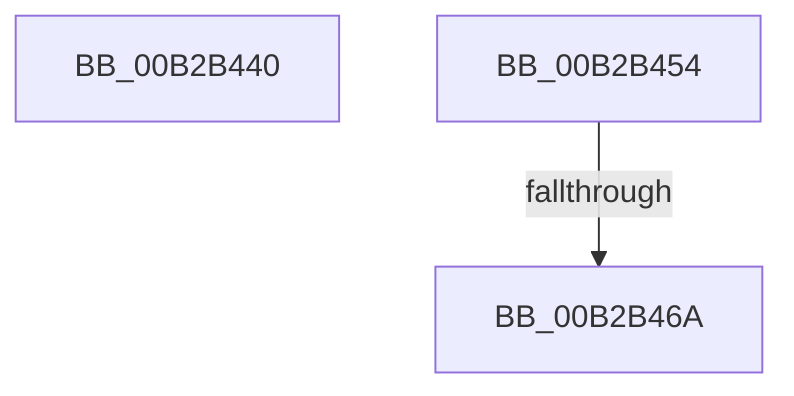

# sub_00B2B440

- RVA: `0x00B2B440`–`0x00B2B479` (길이 `57` bytes)
- VA: `0x0000000140B2B440`
- 실행 섹션: `PAGE`
- PDB 이름 있음: `아니요`; PDB Function 태그: `아니요`
- unwind 정보 RVA: `0x00097D10`
- 디코드: `10`개 명령, `57/57` bytes 표시
- 미해석 바이트: `0` (있으면 어셈블리에 `.byte`로 보존)

> 이 문서는 커널 이미지의 기계어와 PDB 기호를 분석해 생성했습니다. 4번과 5번은 함수 원형과 자료형을 바이너리 사용 방식에서 추정한 C 해석이며 원본 소스 복구 결과는 아닙니다.

## 1. Dependencies

- 직접 호출 지점: **0**; 고유 호출 대상: **0**
- 직접 호출자로 확인된 함수: **0**
- RIP 상대 이미지 참조: **1**

### Outgoing calls
- 직접 디코드된 call 명령이 없습니다.

### Direct callers
- 이 함수 시작 RVA로 연결되는 직접 call은 확인되지 않았습니다. 간접 호출은 완전히 역산할 수 없습니다.

### Static image references
- `0x00B2B440` → RVA `0x00E2D7F8` (`.data`; write)

## 2. Other-region calls and transfers

- 다른 실행 섹션으로 향하는 call: **0**
- call이 아닌 외부 분기/꼬리 이동: **3**
  - `0x00B2B44F` → [MiVerifyImageHeader + 0x280](../98/MiVerifyImageHeader_function_009870DC.md) (`tail-transfer`)
  - `0x00B2B464` → [MiVerifyImageHeader + 0x27E](../98/MiVerifyImageHeader_function_009870DC.md) (`tail-transfer`)
  - `0x00B2B474` → [MiVerifyImageHeader + 0x40B](../98/MiVerifyImageHeader_function_009870DC.md) (`tail-transfer`)

## 3. Assembly (complete function range)

```asm
00B2B440  C7 05 AE 23 30 00 46 00 00 00   mov dword ptr [rip + 0x3023ae], 0x46
00B2B44A  B8 30 01 00 C0                  mov eax, 0xc0000130
00B2B44F  E9 08 BF E5 FF                  jmp 0x14098735c
00B2B454  41 0F B7 43 3C                  movzx eax, word ptr [r11 + 0x3c]
00B2B459  B9 40 01 00 00                  mov ecx, 0x140
00B2B45E  66 23 C1                        and ax, cx
00B2B461  66 3B C1                        cmp ax, cx
00B2B464  0F 84 F0 BE E5 FF               je 0x14098735a
00B2B46A  C7 05 84 23 30 00 59 00 00 00   mov dword ptr [rip + 0x302384], 0x59
00B2B474  E9 6E C0 E5 FF                  jmp 0x1409874e7
```

## 4. C-style interpretation (structured pseudocode)

```c
__int64 __fastcall sub_00B2B440(void)
{
    *(unsigned int *)(v_rip + 3154862) = 70;
}
```

## 5. (Beta) C Style

```c
void sub_00B2B440(void)
{
    *(uint32_t *)(v_rip + 0x3023AE) = 70;
}
```

## 6. Execution-region graph

[열기: 2D/3D 그래프와 함수 탐색 컨트롤 패널](../../../control-panel.html?section=page&rva=0x00B2B440&view=graph)

- 2D 그래프는 위에서 아래로 흐르고, 3D 그래프는 빈 공간을 드래그해 회전합니다. Shift+드래그는 이동, 휠은 확대·축소, 함수 노드 선택은 대상 보고서 이동입니다.

### Static fallback


