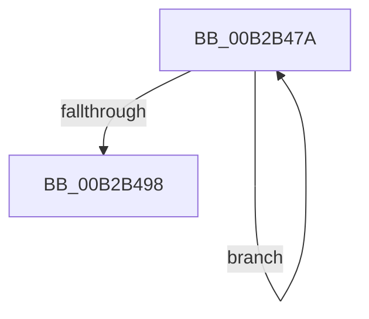

# sub_00B2B47A

- RVA: `0x00B2B47A`–`0x00B2B49D` (길이 `35` bytes)
- VA: `0x0000000140B2B47A`
- 실행 섹션: `PAGE`
- PDB 이름 있음: `아니요`; PDB Function 태그: `아니요`
- unwind 정보 RVA: `0x00097D3C`
- 디코드: `9`개 명령, `35/35` bytes 표시
- 미해석 바이트: `0` (있으면 어셈블리에 `.byte`로 보존)

> 이 문서는 커널 이미지의 기계어와 PDB 기호를 분석해 생성했습니다. 4번과 5번은 함수 원형과 자료형을 바이너리 사용 방식에서 추정한 C 해석이며 원본 소스 복구 결과는 아닙니다.

## 1. Dependencies

- 직접 호출 지점: **0**; 고유 호출 대상: **0**
- 직접 호출자로 확인된 함수: **0**
- RIP 상대 이미지 참조: **0**

### Outgoing calls
- 직접 디코드된 call 명령이 없습니다.

### Direct callers
- 이 함수 시작 RVA로 연결되는 직접 call은 확인되지 않았습니다. 간접 호출은 완전히 역산할 수 없습니다.

### Static image references
- 디코드된 RIP-relative 메모리 참조가 없습니다.

## 2. Other-region calls and transfers

- 다른 실행 섹션으로 향하는 call: **0**
- call이 아닌 외부 분기/꼬리 이동: **1**
  - `0x00B2B498` → [MiBuildImageControlArea + 0x420](../98/MiBuildImageControlArea_function_009878A4.md) (`tail-transfer`)

## 3. Assembly (complete function range)

```asm
00B2B47A  45 3B 02                        cmp r8d, dword ptr [r10]
00B2B47D  48 8B C8                        mov rcx, rax
00B2B480  48 0F 42 CA                     cmovb rcx, rdx
00B2B484  41 81 C0 00 10 00 00            add r8d, 0x1000
00B2B48B  49 89 0E                        mov qword ptr [r14], rcx
00B2B48E  49 83 C6 08                     add r14, 8
00B2B492  49 83 E9 01                     sub r9, 1
00B2B496  75 E2                           jne 0x140b2b47a
00B2B498  E9 27 C8 E5 FF                  jmp 0x140987cc4
```

## 4. C-style interpretation (structured pseudocode)

```c
void __fastcall sub_00B2B47A(__int64 a1, __int64 a2, int a3, __int64 a4)
{
    __int64 v_r14;

    a1 = result;
    if (a3 < (*(unsigned int *)(v_r10))) { a1 = a2; }
    a3 = (unsigned int)((a3) + (0x1000ULL));
    *(unsigned __int64 *)(v_r14) = a1;
    v_r14 = (v_r14) + (8);
    a4 = (a4) - (1);
    if (condition_is_not_equal) goto loc_00B2B47A;
}
```

## 5. (Beta) C Style

```c
void sub_00B2B47A(int64_t Arg1, int64_t Arg2, int32_t Arg3, int64_t Arg4)
{
    int64_t local_r14;

    Arg1 = result;
    if (Arg3 < (*(uint32_t *)(local_r10))) { Arg1 = Arg2; }
    Arg3 = (uint32_t)((Arg3) + (0x1000ULL));
    *(uint64_t *)(local_r14) = Arg1;
    local_r14 = (local_r14) + (8);
    Arg4 = (Arg4) - (1);
    if (condition_is_not_equal) goto loc_00B2B47A;
}
```

## 6. Execution-region graph

[열기: 2D/3D 그래프와 함수 탐색 컨트롤 패널](../../../control-panel.html?section=page&rva=0x00B2B47A&view=graph)

- 2D 그래프는 위에서 아래로 흐르고, 3D 그래프는 빈 공간을 드래그해 회전합니다. Shift+드래그는 이동, 휠은 확대·축소, 함수 노드 선택은 대상 보고서 이동입니다.

### Static fallback


