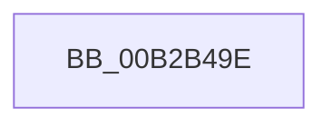

# sub_00B2B49E

- RVA: `0x00B2B49E`–`0x00B2B4CE` (길이 `48` bytes)
- VA: `0x0000000140B2B49E`
- 실행 섹션: `PAGE`
- PDB 이름 있음: `아니요`; PDB Function 태그: `아니요`
- unwind 정보 RVA: `0x00097D64`
- 디코드: `14`개 명령, `48/48` bytes 표시
- 미해석 바이트: `0` (있으면 어셈블리에 `.byte`로 보존)

> 이 문서는 커널 이미지의 기계어와 PDB 기호를 분석해 생성했습니다. 4번과 5번은 함수 원형과 자료형을 바이너리 사용 방식에서 추정한 C 해석이며 원본 소스 복구 결과는 아닙니다.

## 1. Dependencies

- 직접 호출 지점: **1**; 고유 호출 대상: **1**
- 직접 호출자로 확인된 함수: **0**
- RIP 상대 이미지 참조: **0**

### Outgoing calls
- `0x00B2B4C3` → [memcpy](../../text/6C/memcpy_function_006C6840.md) (function, `0x006C6840`)

### Direct callers
- 이 함수 시작 RVA로 연결되는 직접 call은 확인되지 않았습니다. 간접 호출은 완전히 역산할 수 없습니다.

### Static image references
- 디코드된 RIP-relative 메모리 참조가 없습니다.

## 2. Other-region calls and transfers

- 다른 실행 섹션으로 향하는 call: **1**
  - `0x00B2B4C3` → [memcpy](../../text/6C/memcpy_function_006C6840.md) (`PAGE` → `.text`)
- call이 아닌 외부 분기/꼬리 이동: **1**
  - `0x00B2B4C9` → [MiReadImageHeaders + 0x132](../98/MiReadImageHeaders_function_00987DAC.md) (`tail-transfer`)

## 3. Assembly (complete function range)

```asm
00B2B49E  4C 2B CD                        sub r9, rbp
00B2B4A1  49 8B C6                        mov rax, r14
00B2B4A4  49 2B C1                        sub rax, r9
00B2B4A7  48 8B D1                        mov rdx, rcx
00B2B4AA  49 3B C2                        cmp rax, r10
00B2B4AD  4C 0F 46 D0                     cmovbe r10, rax
00B2B4B1  49 C1 E1 0C                     shl r9, 0xc
00B2B4B5  49 C1 E2 0C                     shl r10, 0xc
00B2B4B9  4C 03 4E 18                     add r9, qword ptr [rsi + 0x18]
00B2B4BD  4D 8B C2                        mov r8, r10
00B2B4C0  49 8B C9                        mov rcx, r9
00B2B4C3  E8 78 B3 B9 FF                  call 0x1406c6840
00B2B4C8  90                              nop
00B2B4C9  E9 10 CA E5 FF                  jmp 0x140987ede
```

## 4. C-style interpretation (structured pseudocode)

```c
__int64 __fastcall sub_00B2B49E(__int64 a1, __int64 a2, __int64 a3, __int64 a4)
{
    __int64 result;
    __int64 v_r10;

    a4 = (a4) - (v_rbp);
    result = (v_r14) - (a4);
    if (result <= v_r10) { v_r10 = result; }
    a4 = (a4) << (12);
    v_r10 = (v_r10) << (12);
    a4 = (a4) + (*(unsigned __int64 *)(v_rsi + 24));
    result = memcpy(a4, a1, v_r10, a4);
}
```

## 5. (Beta) C Style

```c
int64_t sub_00B2B49E(int64_t Arg1, int64_t Arg2, int64_t Arg3, int64_t Arg4)
{
    int64_t result;
    int64_t local_r10;

    Arg4 = (Arg4) - (local_rbp);
    result = (local_r14) - (Arg4);
    if (result <= local_r10) { local_r10 = result; }
    Arg4 = (Arg4) << (12);
    local_r10 = (local_r10) << (12);
    Arg4 = (Arg4) + (*(uint64_t *)(local_rsi + 0x18));
    result = memcpy(Arg4, Arg1, local_r10, Arg4);
}
```

## 6. Execution-region graph

[열기: 2D/3D 그래프와 함수 탐색 컨트롤 패널](../../../control-panel.html?section=page&rva=0x00B2B49E&view=graph)

- 2D 그래프는 위에서 아래로 흐르고, 3D 그래프는 빈 공간을 드래그해 회전합니다. Shift+드래그는 이동, 휠은 확대·축소, 함수 노드 선택은 대상 보고서 이동입니다.

### Static fallback


