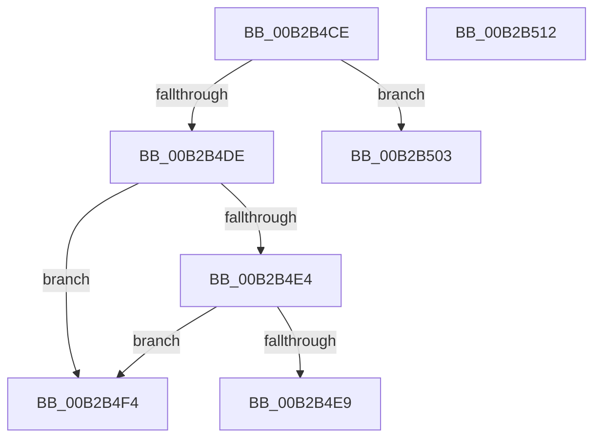

# sub_00B2B4CE

- RVA: `0x00B2B4CE`–`0x00B2B51A` (길이 `76` bytes)
- VA: `0x0000000140B2B4CE`
- 실행 섹션: `PAGE`
- PDB 이름 있음: `아니요`; PDB Function 태그: `아니요`
- unwind 정보 RVA: `0x00097D90`
- 디코드: `18`개 명령, `76/76` bytes 표시
- 미해석 바이트: `0` (있으면 어셈블리에 `.byte`로 보존)

> 이 문서는 커널 이미지의 기계어와 PDB 기호를 분석해 생성했습니다. 4번과 5번은 함수 원형과 자료형을 바이너리 사용 방식에서 추정한 C 해석이며 원본 소스 복구 결과는 아닙니다.

## 1. Dependencies

- 직접 호출 지점: **0**; 고유 호출 대상: **0**
- 직접 호출자로 확인된 함수: **0**
- RIP 상대 이미지 참조: **1**

### Outgoing calls
- 직접 디코드된 call 명령이 없습니다.

### Direct callers
- 이 함수 시작 RVA로 연결되는 직접 call은 확인되지 않았습니다. 간접 호출은 완전히 역산할 수 없습니다.

### Static image references
- `0x00B2B4F4` → RVA `0x00E2D7F8` (`.data`; write)

## 2. Other-region calls and transfers

- 다른 실행 섹션으로 향하는 call: **0**
- call이 아닌 외부 분기/꼬리 이동: **4**
  - `0x00B2B4EF` → [MiParseImageSectionHeaders + 0x363](../98/MiParseImageSectionHeaders_function_00987F70.md) (`tail-transfer`)
  - `0x00B2B4FE` → [MiParseImageSectionHeaders + 0x37A](../98/MiParseImageSectionHeaders_function_00987F70.md) (`tail-transfer`)
  - `0x00B2B50D` → [MiParseImageSectionHeaders + 0x37A](../98/MiParseImageSectionHeaders_function_00987F70.md) (`tail-transfer`)
  - `0x00B2B515` → [MiParseImageSectionHeaders + 0xAB](../98/MiParseImageSectionHeaders_function_00987F70.md) (`tail-transfer`)

## 3. Assembly (complete function range)

```asm
00B2B4CE  44 8B 41 04                     mov r8d, dword ptr [rcx + 4]
00B2B4D2  44 8B 09                        mov r9d, dword ptr [rcx]
00B2B4D5  43 8D 04 08                     lea eax, [r8 + r9]
00B2B4D9  41 3B C0                        cmp eax, r8d
00B2B4DC  72 25                           jb 0x140b2b503
00B2B4DE  44 3B 41 FC                     cmp r8d, dword ptr [rcx - 4]
00B2B4E2  75 10                           jne 0x140b2b4f4
00B2B4E4  41 3B D1                        cmp edx, r9d
00B2B4E7  77 0B                           ja 0x140b2b4f4
00B2B4E9  48 83 C1 28                     add rcx, 0x28
00B2B4ED  FF CE                           dec esi
00B2B4EF  E9 DF CD E5 FF                  jmp 0x1409882d3
00B2B4F4  C7 05 FA 22 30 00 11 00 00 00   mov dword ptr [rip + 0x3022fa], 0x11
00B2B4FE  E9 E7 CD E5 FF                  jmp 0x1409882ea
00B2B503  C7 05 EB 22 30 00 10 00 00 00   mov dword ptr [rip + 0x3022eb], 0x10
00B2B50D  E9 D8 CD E5 FF                  jmp 0x1409882ea
00B2B512  83 23 00                        and dword ptr [rbx], 0
00B2B515  E9 01 CB E5 FF                  jmp 0x14098801b
```

## 4. C-style interpretation (structured pseudocode)

```c
__int64 __fastcall sub_00B2B4CE(__int64 a1, int a2)
{
    __int64 v_rsi;

    if (((unsigned int)((unsigned int)(*(unsigned int *)(a1 + 4)) + (unsigned int)(*(unsigned int *)(a1)) * 1)) < ((unsigned int)((unsigned int)(*(unsigned int *)(a1 + 4))))) goto loc_00B2B503;
    if (((unsigned int)((unsigned int)(*(unsigned int *)(a1 + 4)))) != (*(unsigned int *)(a1 - 4))) goto loc_00B2B4F4;
    if (a2 > ((unsigned int)((unsigned int)(*(unsigned int *)(a1))))) goto loc_00B2B4F4;
    a1 = (a1) + (40);
    v_rsi = (unsigned int)((v_rsi) - 1);
loc_00B2B4F4:
    *(unsigned int *)(v_rip + 3154682) = 17;
loc_00B2B503:
    *(unsigned int *)(v_rip + 3154667) = 16;
}
```

## 5. (Beta) C Style

```c
int64_t sub_00B2B4CE(void *Arg1, int32_t Arg2)
{
    uint8_t *arg1 = (uint8_t *)Arg1;

    int64_t local_rsi;

    if (((uint32_t)((uint32_t)(*(uint32_t *)(arg1 + 0x4)) + (uint32_t)(*(uint32_t *)(arg1)) * 1)) < ((uint32_t)((uint32_t)(*(uint32_t *)(arg1 + 0x4))))) goto loc_00B2B503;
    if (((uint32_t)((uint32_t)(*(uint32_t *)(arg1 + 0x4)))) != (*(uint32_t *)(arg1 - 0x4))) goto loc_00B2B4F4;
    if (Arg2 > ((uint32_t)((uint32_t)(*(uint32_t *)(arg1))))) goto loc_00B2B4F4;
    Arg1 = (Arg1) + (40);
    local_rsi = (uint32_t)((local_rsi) - 1);
loc_00B2B4F4:
    *(uint32_t *)(v_rip + 0x3022FA) = 17;
loc_00B2B503:
    *(uint32_t *)(v_rip + 0x3022EB) = 16;
}
```

### 관측된 메모리 오프셋

구조체 형식이 확인되지 않은 접근은 인자 기준의 오프셋으로만 기록했습니다.

| 기준 인자 | 오프셋 표현 | 폭 (bit) | 접근 |
|---|---:|---:|---|
| `Arg1` | `- 0x4` | `32` | `R` |
| `Arg1` | `+ 0x0` | `32` | `R` |
| `Arg1` | `+ 0x4` | `32` | `R` |

## 6. Execution-region graph

[열기: 2D/3D 그래프와 함수 탐색 컨트롤 패널](../../../control-panel.html?section=page&rva=0x00B2B4CE&view=graph)

- 2D 그래프는 위에서 아래로 흐르고, 3D 그래프는 빈 공간을 드래그해 회전합니다. Shift+드래그는 이동, 휠은 확대·축소, 함수 노드 선택은 대상 보고서 이동입니다.

### Static fallback


