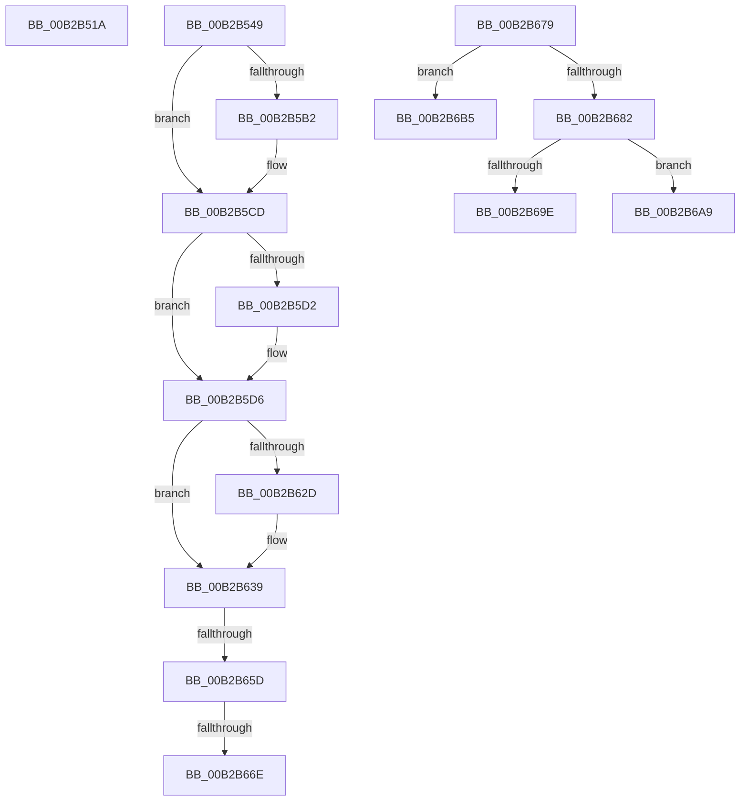

# sub_00B2B51A

- RVA: `0x00B2B51A`–`0x00B2B6D0` (길이 `438` bytes)
- VA: `0x0000000140B2B51A`
- 실행 섹션: `PAGE`
- PDB 이름 있음: `아니요`; PDB Function 태그: `아니요`
- unwind 정보 RVA: `0x00097E10`
- 디코드: `93`개 명령, `438/438` bytes 표시
- 미해석 바이트: `0` (있으면 어셈블리에 `.byte`로 보존)

> 이 문서는 커널 이미지의 기계어와 PDB 기호를 분석해 생성했습니다. 4번과 5번은 함수 원형과 자료형을 바이너리 사용 방식에서 추정한 C 해석이며 원본 소스 복구 결과는 아닙니다.

## 1. Dependencies

- 직접 호출 지점: **11**; 고유 호출 대상: **11**
- 직접 호출자로 확인된 함수: **0**
- RIP 상대 이미지 참조: **6**

### Outgoing calls
- `0x00B2B53E` → [MiSetControlAreaSystemVa](../../text/4B/MiSetControlAreaSystemVa_function_004B7984.md) (function, `0x004B7984`)
- `0x00B2B59C` → [KeAbPreAcquire](../../text/21/KeAbPreAcquire_function_00210230.md) (function, `0x00210230`)
- `0x00B2B5C3` → [ExfAcquirePushLockExclusiveEx](../../text/20/ExfAcquirePushLockExclusiveEx_function_0020FC90.md) (function, `0x0020FC90`)
- `0x00B2B5E7` → [RtlCopyBitMapEx](../../text/41/RtlCopyBitMapEx_function_0041DEF0.md) (function, `0x0041DEF0`)
- `0x00B2B5F6` → [RtlMergeBitMapsEx](../../text/5E/RtlMergeBitMapsEx_function_005E62F0.md) (function, `0x005E62F0`)
- `0x00B2B612` → [RtlFindClearBitsEx](../../text/3F/RtlFindClearBitsEx_function_003FAF30.md) (function, `0x003FAF30`)
- `0x00B2B634` → [ExfTryToWakePushLock](../../text/26/ExfTryToWakePushLock_function_00265DD0.md) (function, `0x00265DD0`)
- `0x00B2B640` → [KeAbPostRelease](../../text/2E/KeAbPostRelease_function_002E1600.md) (function, `0x002E1600`)
- `0x00B2B66E` → [KiCheckForKernelApcDelivery](../../text/2E/KiCheckForKernelApcDelivery_function_002E2C80.md) (function, `0x002E2C80`)
- `0x00B2B689` → [ExGenRandom](../../text/41/ExGenRandom_function_0041B010.md) (function, `0x0041B010`)
- `0x00B2B6BE` → [MiSelectOverflowDllBase](../A9/MiSelectOverflowDllBase_function_00A9E8E0.md) (function, `0x00A9E8E0`)

### Direct callers
- 이 함수 시작 RVA로 연결되는 직접 call은 확인되지 않았습니다. 간접 호출은 완전히 역산할 수 없습니다.

### Static image references
- `0x00B2B552` → RVA `0x00E2D768` (`.data`; read)
- `0x00B2B55E` → RVA `0x00E2D7C0` (`.data`; read)
- `0x00B2B57A` → RVA `0x00E2D7A8` (`.data`; read)
- `0x00B2B590` → RVA `0x00E2D728` (`.data`; read)
- `0x00B2B5A1` → RVA `0x00E2D728` (`.data`; read/write)
- `0x00B2B5D9` → RVA `0x00E2D7B0` (`.data`; read)

## 2. Other-region calls and transfers

- 다른 실행 섹션으로 향하는 call: **10**
  - `0x00B2B53E` → [MiSetControlAreaSystemVa](../../text/4B/MiSetControlAreaSystemVa_function_004B7984.md) (`PAGE` → `.text`)
  - `0x00B2B59C` → [KeAbPreAcquire](../../text/21/KeAbPreAcquire_function_00210230.md) (`PAGE` → `.text`)
  - `0x00B2B5C3` → [ExfAcquirePushLockExclusiveEx](../../text/20/ExfAcquirePushLockExclusiveEx_function_0020FC90.md) (`PAGE` → `.text`)
  - `0x00B2B5E7` → [RtlCopyBitMapEx](../../text/41/RtlCopyBitMapEx_function_0041DEF0.md) (`PAGE` → `.text`)
  - `0x00B2B5F6` → [RtlMergeBitMapsEx](../../text/5E/RtlMergeBitMapsEx_function_005E62F0.md) (`PAGE` → `.text`)
  - `0x00B2B612` → [RtlFindClearBitsEx](../../text/3F/RtlFindClearBitsEx_function_003FAF30.md) (`PAGE` → `.text`)
  - `0x00B2B634` → [ExfTryToWakePushLock](../../text/26/ExfTryToWakePushLock_function_00265DD0.md) (`PAGE` → `.text`)
  - `0x00B2B640` → [KeAbPostRelease](../../text/2E/KeAbPostRelease_function_002E1600.md) (`PAGE` → `.text`)
  - `0x00B2B66E` → [KiCheckForKernelApcDelivery](../../text/2E/KiCheckForKernelApcDelivery_function_002E2C80.md) (`PAGE` → `.text`)
  - `0x00B2B689` → [ExGenRandom](../../text/41/ExGenRandom_function_0041B010.md) (`PAGE` → `.text`)
- call이 아닌 외부 분기/꼬리 이동: **7**
  - `0x00B2B544` → [MiSelectImageBase + 0x1FC](../98/MiSelectImageBase_function_009887B0.md) (`tail-transfer`)
  - `0x00B2B657` → [MiSelectImageBase + 0x195](../98/MiSelectImageBase_function_009887B0.md) (`tail-transfer`)
  - `0x00B2B668` → [MiSelectImageBase + 0x195](../98/MiSelectImageBase_function_009887B0.md) (`tail-transfer`)
  - `0x00B2B674` → [MiSelectImageBase + 0x195](../98/MiSelectImageBase_function_009887B0.md) (`tail-transfer`)
  - `0x00B2B6A4` → [MiSelectImageBase + 0x1D4](../98/MiSelectImageBase_function_009887B0.md) (`tail-transfer`)
  - `0x00B2B6B0` → [MiSelectImageBase + 0x1D4](../98/MiSelectImageBase_function_009887B0.md) (`tail-transfer`)
  - `0x00B2B6CB` → [MiSelectImageBase + 0x1D4](../98/MiSelectImageBase_function_009887B0.md) (`tail-transfer`)

## 3. Assembly (complete function range)

```asm
00B2B51A  8B 94 24 B0 00 00 00            mov edx, dword ptr [rsp + 0xb0]
00B2B521  48 B8 00 00 00 00 00 80 00 00   movabs rax, 0x800000000000
00B2B52B  48 03 C7                        add rax, rdi
00B2B52E  66 45 89 67 5C                  mov word ptr [r15 + 0x5c], r12w
00B2B533  48 C1 E8 10                     shr rax, 0x10
00B2B537  49 8B CF                        mov rcx, r15
00B2B53A  41 89 47 58                     mov dword ptr [r15 + 0x58], eax
00B2B53E  E8 41 C4 98 FF                  call 0x1404b7984
00B2B543  90                              nop
00B2B544  E9 63 D4 E5 FF                  jmp 0x1409889ac
00B2B549  65 48 8B 0C 25 88 01 00 00      mov rcx, qword ptr gs:[0x188]
00B2B552  48 8D 05 0F 22 30 00            lea rax, [rip + 0x30220f]
00B2B559  48 89 44 24 48                  mov qword ptr [rsp + 0x48], rax
00B2B55E  48 8D 2D 5B 22 30 00            lea rbp, [rip + 0x30225b]
00B2B565  B8 00 00 00 78                  mov eax, 0x78000000
00B2B56A  48 89 4C 24 30                  mov qword ptr [rsp + 0x30], rcx
00B2B56F  48 89 84 24 A0 00 00 00         mov qword ptr [rsp + 0xa0], rax
00B2B577  45 33 C0                        xor r8d, r8d
00B2B57A  48 8B 05 27 22 30 00            mov rax, qword ptr [rip + 0x302227]
00B2B581  66 29 91 E6 01 00 00            sub word ptr [rcx + 0x1e6], dx
00B2B588  90                              nop
00B2B589  33 D2                           xor edx, edx
00B2B58B  48 89 6C 24 50                  mov qword ptr [rsp + 0x50], rbp
00B2B590  48 8D 0D 91 21 30 00            lea rcx, [rip + 0x302191]
00B2B597  48 89 44 24 28                  mov qword ptr [rsp + 0x28], rax
00B2B59C  E8 8F 4C 6E FF                  call 0x140210230
00B2B5A1  F0 48 0F BA 2D 7D 21 30 00 00   lock bts qword ptr [rip + 0x30217d], 0
00B2B5AB  48 89 44 24 20                  mov qword ptr [rsp + 0x20], rax
00B2B5B0  73 1B                           jae 0x140b2b5cd
00B2B5B2  4C 8D 05 6F 21 30 00            lea r8, [rip + 0x30216f]
00B2B5B9  48 8B D0                        mov rdx, rax
00B2B5BC  48 8D 0D 65 21 30 00            lea rcx, [rip + 0x302165]
00B2B5C3  E8 C8 46 6E FF                  call 0x14020fc90
00B2B5C8  48 8B 44 24 20                  mov rax, qword ptr [rsp + 0x20]
00B2B5CD  48 85 C0                        test rax, rax
00B2B5D0  74 04                           je 0x140b2b5d6
00B2B5D2  C6 40 0A 01                     mov byte ptr [rax + 0xa], 1
00B2B5D6  45 33 C0                        xor r8d, r8d
00B2B5D9  48 8D 15 D0 21 30 00            lea rdx, [rip + 0x3021d0]
00B2B5E0  48 8D 0D 81 21 30 00            lea rcx, [rip + 0x302181]
00B2B5E7  E8 04 29 8F FF                  call 0x14041def0
00B2B5EC  48 8B D5                        mov rdx, rbp
00B2B5EF  48 8D 0D BA 21 30 00            lea rcx, [rip + 0x3021ba]
00B2B5F6  E8 F5 AC AB FF                  call 0x1405e62f0
00B2B5FB  4C 8B 44 24 28                  mov r8, qword ptr [rsp + 0x28]
00B2B600  48 8D 0D A9 21 30 00            lea rcx, [rip + 0x3021a9]
00B2B607  41 0F B7 C4                     movzx eax, r12w
00B2B60B  8B D0                           mov edx, eax
00B2B60D  48 89 44 24 20                  mov qword ptr [rsp + 0x20], rax
00B2B612  E8 19 F9 8C FF                  call 0x1403faf30
00B2B617  48 8B E8                        mov rbp, rax
00B2B61A  48 83 C8 FF                     or rax, 0xffffffffffffffff
00B2B61E  F0 48 0F C1 05 01 21 30 00      lock xadd qword ptr [rip + 0x302101], rax
00B2B627  24 06                           and al, 6
00B2B629  3C 02                           cmp al, 2
00B2B62B  75 0C                           jne 0x140b2b639
00B2B62D  48 8D 0D F4 20 30 00            lea rcx, [rip + 0x3020f4]
00B2B634  E8 97 A7 73 FF                  call 0x140265dd0
00B2B639  48 8D 0D E8 20 30 00            lea rcx, [rip + 0x3020e8]
00B2B640  E8 BB 5F 7B FF                  call 0x1402e1600
00B2B645  48 8B 4C 24 30                  mov rcx, qword ptr [rsp + 0x30]
00B2B64A  BA 01 00 00 00                  mov edx, 1
00B2B64F  90                              nop
00B2B650  66 01 91 E6 01 00 00            add word ptr [rcx + 0x1e6], dx
00B2B657  0F 85 E8 D2 E5 FF               jne 0x140988945
00B2B65D  48 8D 81 98 00 00 00            lea rax, [rcx + 0x98]
00B2B664  90                              nop
00B2B665  48 39 00                        cmp qword ptr [rax], rax
00B2B668  0F 84 D7 D2 E5 FF               je 0x140988945
00B2B66E  E8 0D 76 7B FF                  call 0x1402e2c80
00B2B673  90                              nop
00B2B674  E9 CC D2 E5 FF                  jmp 0x140988945
00B2B679  66 41 0F BA 63 2C 0D            bt word ptr [r11 + 0x2c], 0xd
00B2B680  72 33                           jb 0x140b2b6b5
00B2B682  BB 01 00 00 00                  mov ebx, 1
00B2B687  8B CB                           mov ecx, ebx
00B2B689  E8 82 F9 8E FF                  call 0x14041b010
00B2B68E  0F B6 C8                        movzx ecx, al
00B2B691  48 C1 E1 10                     shl rcx, 0x10
00B2B695  49 81 FD 00 00 00 01            cmp r13, 0x1000000
00B2B69C  72 0B                           jb 0x140b2b6a9
00B2B69E  49 8B FD                        mov rdi, r13
00B2B6A1  48 2B F9                        sub rdi, rcx
00B2B6A4  E9 DB D2 E5 FF                  jmp 0x140988984
00B2B6A9  48 8D B9 00 00 01 00            lea rdi, [rcx + 0x10000]
00B2B6B0  E9 CF D2 E5 FF                  jmp 0x140988984
00B2B6B5  44 8B C6                        mov r8d, esi
00B2B6B8  49 8B D5                        mov rdx, r13
00B2B6BB  49 8B CE                        mov rcx, r14
00B2B6BE  E8 1D 32 F7 FF                  call 0x140a9e8e0
00B2B6C3  48 8B F8                        mov rdi, rax
00B2B6C6  BB 01 00 00 00                  mov ebx, 1
00B2B6CB  E9 B4 D2 E5 FF                  jmp 0x140988984
```

## 4. C-style interpretation (structured pseudocode)

```c
__int64 __fastcall sub_00B2B51A(__int64 a1, __int64 a2, int a3, __int64 a4, __int64 a5, __int64 a6, __int64 a7, __int64 a8, __int64 a9, __int64 a10, __int64 a11, __int64 a12, __int64 a13, __int64 a14, __int64 a15, __int64 a16, __int64 a17, __int64 a18, __int64 a19, __int64 a20, __int64 a21, unsigned int a22)
{
    __int64 result;
    unsigned __int64 v_stack_p20;
    unsigned __int64 v_stack_p28;
    unsigned __int64 v_stack_p30;
    unsigned __int64 v_stack_p48;
    unsigned __int64 v_stack_p50;
    unsigned __int64 v_stack_pA0;

    result = (result) + (v_rdi);
    *(unsigned __int16 *)(v_r15 + 92) = (unsigned __int16)(v_r12);
    result = (result) >> (16);
    *(unsigned int *)(v_r15 + 88) = (unsigned int)(result);
    result = MiSetControlAreaSystemVa(v_r15, (unsigned int)(a22), a3, a4);
}
```

## 5. (Beta) C Style

```c
int64_t sub_00B2B51A(int64_t Arg1, int64_t Arg2, int32_t Arg3, int64_t Arg4, uint64_t Arg5, uint64_t Arg6, uint64_t Arg7, uint64_t Arg8, uint64_t Arg9, uint64_t Arg10, uint64_t Arg11, uint64_t Arg12, uint64_t Arg13, uint64_t Arg14, uint64_t Arg15, uint64_t Arg16, uint64_t Arg17, uint64_t Arg18, uint64_t Arg19, uint64_t Arg20, uint64_t Arg21, uint32_t Arg22)
{
    int64_t result;
    uint64_t v_stack_p20;
    uint64_t v_stack_p28;
    uint64_t v_stack_p30;
    uint64_t v_stack_p48;
    uint64_t v_stack_p50;
    uint64_t v_stack_pA0;

    result = (result) + (local_rdi);
    *(uint16_t *)(local_r15 + 0x5C) = (uint16_t)(local_r12);
    result = (result) >> (16);
    *(uint32_t *)(local_r15 + 0x58) = (uint32_t)(result);
    result = MiSetControlAreaSystemVa(local_r15, (uint32_t)(Arg22), Arg3, Arg4);
}
```

## 6. Execution-region graph

[열기: 2D/3D 그래프와 함수 탐색 컨트롤 패널](../../../control-panel.html?section=page&rva=0x00B2B51A&view=graph)

- 2D 그래프는 위에서 아래로 흐르고, 3D 그래프는 빈 공간을 드래그해 회전합니다. Shift+드래그는 이동, 휠은 확대·축소, 함수 노드 선택은 대상 보고서 이동입니다.

### Static fallback


