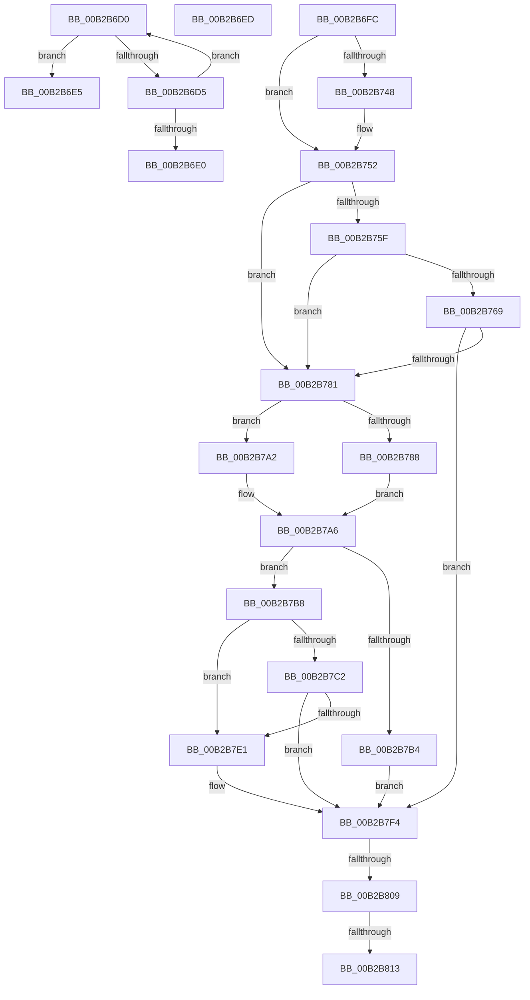

# sub_00B2B6D0

- RVA: `0x00B2B6D0`–`0x00B2B81D` (길이 `333` bytes)
- VA: `0x0000000140B2B6D0`
- 실행 섹션: `PAGE`
- PDB 이름 있음: `아니요`; PDB Function 태그: `아니요`
- unwind 정보 RVA: `0x00097F54`
- 디코드: `81`개 명령, `333/333` bytes 표시
- 미해석 바이트: `0` (있으면 어셈블리에 `.byte`로 보존)

> 이 문서는 커널 이미지의 기계어와 PDB 기호를 분석해 생성했습니다. 4번과 5번은 함수 원형과 자료형을 바이너리 사용 방식에서 추정한 C 해석이며 원본 소스 복구 결과는 아닙니다.

## 1. Dependencies

- 직접 호출 지점: **7**; 고유 호출 대상: **6**
- 직접 호출자로 확인된 함수: **0**
- RIP 상대 이미지 참조: **1**

### Outgoing calls
- `0x00B2B707` → [MI_LOCK_RELOCATIONS_EXCLUSIVE](../../text/46/MI_LOCK_RELOCATIONS_EXCLUSIVE_function_004650F8.md) (function, `0x004650F8`)
- `0x00B2B74D` → [MiSetDeleteOnClose](../../text/4D/MiSetDeleteOnClose_function_004DD8E8.md) (function, `0x004DD8E8`)
- `0x00B2B776` → [SeSetImageBaseAddress](../AA/SeSetImageBaseAddress_function_00AA8898.md) (function, `0x00AA8898`)
- `0x00B2B798` → [PsGetProcessSessionIdEx](../../text/22/PsGetProcessSessionIdEx_function_0022F8F0.md) (function, `0x0022F8F0`)
- `0x00B2B7D6` → [MiWalkEntireImage](../../text/36/MiWalkEntireImage_function_00365D70.md) (function, `0x00365D70`)
- `0x00B2B7ED` → [MiWalkEntireImage](../../text/36/MiWalkEntireImage_function_00365D70.md) (function, `0x00365D70`)
- `0x00B2B7FC` → [MI_UNLOCK_RELOCATIONS_EXCLUSIVE](../../text/46/MI_UNLOCK_RELOCATIONS_EXCLUSIVE_function_0046965C.md) (function, `0x0046965C`)

### Direct callers
- 이 함수 시작 RVA로 연결되는 직접 call은 확인되지 않았습니다. 간접 호출은 완전히 역산할 수 없습니다.

### Static image references
- `0x00B2B752` → RVA `0x00FC6A88` (`ALMOSTRO`; read)

## 2. Other-region calls and transfers

- 다른 실행 섹션으로 향하는 call: **6**
  - `0x00B2B707` → [MI_LOCK_RELOCATIONS_EXCLUSIVE](../../text/46/MI_LOCK_RELOCATIONS_EXCLUSIVE_function_004650F8.md) (`PAGE` → `.text`)
  - `0x00B2B74D` → [MiSetDeleteOnClose](../../text/4D/MiSetDeleteOnClose_function_004DD8E8.md) (`PAGE` → `.text`)
  - `0x00B2B798` → [PsGetProcessSessionIdEx](../../text/22/PsGetProcessSessionIdEx_function_0022F8F0.md) (`PAGE` → `.text`)
  - `0x00B2B7D6` → [MiWalkEntireImage](../../text/36/MiWalkEntireImage_function_00365D70.md) (`PAGE` → `.text`)
  - `0x00B2B7ED` → [MiWalkEntireImage](../../text/36/MiWalkEntireImage_function_00365D70.md) (`PAGE` → `.text`)
  - `0x00B2B7FC` → [MI_UNLOCK_RELOCATIONS_EXCLUSIVE](../../text/46/MI_UNLOCK_RELOCATIONS_EXCLUSIVE_function_0046965C.md) (`PAGE` → `.text`)
- call이 아닌 외부 분기/꼬리 이동: **6**
  - `0x00B2B6E0` → [MiRelocateImage + 0x3D8](../98/MiRelocateImage_function_00988E14.md) (`tail-transfer`)
  - `0x00B2B6E8` → [MiRelocateImage + 0x3D8](../98/MiRelocateImage_function_00988E14.md) (`tail-transfer`)
  - `0x00B2B6F7` → [MiRelocateImage + 0x5B1](../98/MiRelocateImage_function_00988E14.md) (`tail-transfer`)
  - `0x00B2B803` → [MiRelocateImage + 0x5B1](../98/MiRelocateImage_function_00988E14.md) (`tail-transfer`)
  - `0x00B2B80D` → [MiRelocateImage + 0x5B1](../98/MiRelocateImage_function_00988E14.md) (`tail-transfer`)
  - `0x00B2B818` → [MiRelocateImage + 0x5B1](../98/MiRelocateImage_function_00988E14.md) (`tail-transfer`)

## 3. Assembly (complete function range)

```asm
00B2B6D0  45 85 FF                        test r15d, r15d
00B2B6D3  74 10                           je 0x140b2b6e5
00B2B6D5  41 FF CF                        dec r15d
00B2B6D8  4A 83 7C F9 40 00               cmp qword ptr [rcx + r15*8 + 0x40], 0
00B2B6DE  74 F0                           je 0x140b2b6d0
00B2B6E0  E9 07 DB E5 FF                  jmp 0x1409891ec
00B2B6E5  45 33 FF                        xor r15d, r15d
00B2B6E8  E9 FF DA E5 FF                  jmp 0x1409891ec
00B2B6ED  81 FE 7B 00 00 C0               cmp esi, 0xc000007b
00B2B6F3  41 0F 44 F4                     cmove esi, r12d
00B2B6F7  E9 C9 DC E5 FF                  jmp 0x1409893c5
00B2B6FC  83 CB 20                        or ebx, 0x20
00B2B6FF  49 8B D6                        mov rdx, r14
00B2B702  48 8B 4C 24 68                  mov rcx, qword ptr [rsp + 0x68]
00B2B707  E8 EC 99 93 FF                  call 0x1404650f8
00B2B70C  48 8B B4 24 B8 00 00 00         mov rsi, qword ptr [rsp + 0xb8]
00B2B714  4C 89 76 20                     mov qword ptr [rsi + 0x20], r14
00B2B718  48 8B 44 24 58                  mov rax, qword ptr [rsp + 0x58]
00B2B71D  48 8B 8C 24 90 00 00 00         mov rcx, qword ptr [rsp + 0x90]
00B2B725  48 89 41 20                     mov qword ptr [rcx + 0x20], rax
00B2B729  49 8B 46 28                     mov rax, qword ptr [r14 + 0x28]
00B2B72D  4C 8B BC 24 C0 00 00 00         mov r15, qword ptr [rsp + 0xc0]
00B2B735  49 01 07                        add qword ptr [r15], rax
00B2B738  41 0F BA 6D 5C 16               bts dword ptr [r13 + 0x5c], 0x16
00B2B73E  41 F7 45 38 00 08 00 00         test dword ptr [r13 + 0x38], 0x800
00B2B746  74 0A                           je 0x140b2b752
00B2B748  33 D2                           xor edx, edx
00B2B74A  49 8B CD                        mov rcx, r13
00B2B74D  E8 96 21 9B FF                  call 0x1404dd8e8
00B2B752  48 F7 05 2B B3 49 00 00 20 00 00  test qword ptr [rip + 0x49b32b], 0x2000
00B2B75D  74 22                           je 0x140b2b781
00B2B75F  41 F7 45 5C 00 00 0C 00         test dword ptr [r13 + 0x5c], 0xc0000
00B2B767  74 18                           je 0x140b2b781
00B2B769  48 8B 4E 28                     mov rcx, qword ptr [rsi + 0x28]
00B2B76D  48 83 E1 F8                     and rcx, 0xfffffffffffffff8
00B2B771  48 8B 54 24 58                  mov rdx, qword ptr [rsp + 0x58]
00B2B776  E8 1D D1 F7 FF                  call 0x140aa8898
00B2B77B  8B F0                           mov esi, eax
00B2B77D  85 C0                           test eax, eax
00B2B77F  78 73                           js 0x140b2b7f4
00B2B781  83 7C 24 38 00                  cmp dword ptr [rsp + 0x38], 0
00B2B786  75 1A                           jne 0x140b2b7a2
00B2B788  65 48 8B 0C 25 88 01 00 00      mov rcx, qword ptr gs:[0x188]
00B2B791  48 8B 89 B8 00 00 00            mov rcx, qword ptr [rcx + 0xb8]
00B2B798  E8 53 41 70 FF                  call 0x14022f8f0
00B2B79D  44 8B E0                        mov r12d, eax
00B2B7A0  EB 04                           jmp 0x140b2b7a6
00B2B7A2  41 83 CC FF                     or r12d, 0xffffffff
00B2B7A6  8B C3                           mov eax, ebx
00B2B7A8  25 88 01 00 00                  and eax, 0x188
00B2B7AD  3D 00 01 00 00                  cmp eax, 0x100
00B2B7B2  75 04                           jne 0x140b2b7b8
00B2B7B4  33 F6                           xor esi, esi
00B2B7B6  EB 3C                           jmp 0x140b2b7f4
00B2B7B8  41 8A 45 3E                     mov al, byte ptr [r13 + 0x3e]
00B2B7BC  24 0C                           and al, 0xc
00B2B7BE  3C 04                           cmp al, 4
00B2B7C0  75 1F                           jne 0x140b2b7e1
00B2B7C2  45 8B CC                        mov r9d, r12d
00B2B7C5  41 B8 04 00 00 00               mov r8d, 4
00B2B7CB  48 8B 94 24 80 00 00 00         mov rdx, qword ptr [rsp + 0x80]
00B2B7D3  49 8B CD                        mov rcx, r13
00B2B7D6  E8 95 A5 83 FF                  call 0x140365d70
00B2B7DB  8B F0                           mov esi, eax
00B2B7DD  85 C0                           test eax, eax
00B2B7DF  78 13                           js 0x140b2b7f4
00B2B7E1  45 8B CC                        mov r9d, r12d
00B2B7E4  33 D2                           xor edx, edx
00B2B7E6  44 8D 42 02                     lea r8d, [rdx + 2]
00B2B7EA  49 8B CD                        mov rcx, r13
00B2B7ED  E8 7E A5 83 FF                  call 0x140365d70
00B2B7F2  8B F0                           mov esi, eax
00B2B7F4  49 8B D6                        mov rdx, r14
00B2B7F7  48 8B 4C 24 68                  mov rcx, qword ptr [rsp + 0x68]
00B2B7FC  E8 5B DE 93 FF                  call 0x14046965c
00B2B801  85 F6                           test esi, esi
00B2B803  0F 88 BC DB E5 FF               js 0x1409893c5
00B2B809  0F BA E3 08                     bt ebx, 8
00B2B80D  0F 82 B2 DB E5 FF               jb 0x1409893c5
00B2B813  41 80 4F 33 04                  or byte ptr [r15 + 0x33], 4
00B2B818  E9 A8 DB E5 FF                  jmp 0x1409893c5
```

## 4. C-style interpretation (structured pseudocode)

```c
__int64 __fastcall sub_00B2B6D0(__int64 a1)
{
    __int64 v_r15;
    unsigned int v_stack_p38;
    unsigned __int64 v_stack_p58;
    unsigned __int64 v_stack_p68;
    unsigned __int64 v_stack_p80;
    unsigned __int64 v_stack_p90;
    unsigned __int64 v_stack_pB8;
    unsigned __int64 v_stack_pC0;

    if ((unsigned int)(v_r15) == 0) goto loc_00B2B6E5;
    v_r15 = (unsigned int)((v_r15) - 1);
    if ((*(unsigned __int64 *)(a1 + v_r15 * 8 + 64)) == 0) goto loc_00B2B6D0;
loc_00B2B6E5:
    v_r15 = 0;
}
```

## 5. (Beta) C Style

```c
int64_t sub_00B2B6D0(void *Arg1)
{
    uint8_t *arg1 = (uint8_t *)Arg1;

    int64_t local_r15;
    uint32_t v_stack_p38;
    uint64_t v_stack_p58;
    uint64_t v_stack_p68;
    uint64_t v_stack_p80;
    uint64_t v_stack_p90;
    uint64_t v_stack_pB8;
    uint64_t v_stack_pC0;

    if ((uint32_t)(local_r15) == 0) goto loc_00B2B6E5;
    local_r15 = (uint32_t)((local_r15) - 1);
    if ((*(uint64_t *)(arg1 + local_r15 * 8 + 0x40)) == 0) goto loc_00B2B6D0;
loc_00B2B6E5:
    local_r15 = 0;
}
```

### 관측된 메모리 오프셋

구조체 형식이 확인되지 않은 접근은 인자 기준의 오프셋으로만 기록했습니다.

| 기준 인자 | 오프셋 표현 | 폭 (bit) | 접근 |
|---|---:|---:|---|
| `Arg1` | `+ 0x40 + r15*8` | `64` | `R` |

## 6. Execution-region graph

[열기: 2D/3D 그래프와 함수 탐색 컨트롤 패널](../../../control-panel.html?section=page&rva=0x00B2B6D0&view=graph)

- 2D 그래프는 위에서 아래로 흐르고, 3D 그래프는 빈 공간을 드래그해 회전합니다. Shift+드래그는 이동, 휠은 확대·축소, 함수 노드 선택은 대상 보고서 이동입니다.

### Static fallback


