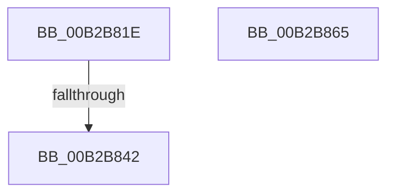

# sub_00B2B81E

- RVA: `0x00B2B81E`–`0x00B2B870` (길이 `82` bytes)
- VA: `0x0000000140B2B81E`
- 실행 섹션: `PAGE`
- PDB 이름 있음: `아니요`; PDB Function 태그: `아니요`
- unwind 정보 RVA: `0x00097FD8`
- 디코드: `21`개 명령, `82/82` bytes 표시
- 미해석 바이트: `0` (있으면 어셈블리에 `.byte`로 보존)

> 이 문서는 커널 이미지의 기계어와 PDB 기호를 분석해 생성했습니다. 4번과 5번은 함수 원형과 자료형을 바이너리 사용 방식에서 추정한 C 해석이며 원본 소스 복구 결과는 아닙니다.

## 1. Dependencies

- 직접 호출 지점: **3**; 고유 호출 대상: **2**
- 직접 호출자로 확인된 함수: **0**
- RIP 상대 이미지 참조: **0**

### Outgoing calls
- `0x00B2B831` → [MiSelectRelocationStartHint](../A4/MiSelectRelocationStartHint_function_00A448A8.md) (function, `0x00A448A8`)
- `0x00B2B84B` → [RtlSetBitsEx](../../text/3B/RtlSetBitsEx_function_003B6570.md) (function, `0x003B6570`)
- `0x00B2B85A` → [RtlSetBitsEx](../../text/3B/RtlSetBitsEx_function_003B6570.md) (function, `0x003B6570`)

### Direct callers
- 이 함수 시작 RVA로 연결되는 직접 call은 확인되지 않았습니다. 간접 호출은 완전히 역산할 수 없습니다.

### Static image references
- 디코드된 RIP-relative 메모리 참조가 없습니다.

## 2. Other-region calls and transfers

- 다른 실행 섹션으로 향하는 call: **2**
  - `0x00B2B84B` → [RtlSetBitsEx](../../text/3B/RtlSetBitsEx_function_003B6570.md) (`PAGE` → `.text`)
  - `0x00B2B85A` → [RtlSetBitsEx](../../text/3B/RtlSetBitsEx_function_003B6570.md) (`PAGE` → `.text`)
- call이 아닌 외부 분기/꼬리 이동: **3**
  - `0x00B2B83C` → [MiObtainRelocationBits + 0xA0](../98/MiObtainRelocationBits_function_0098997C.md) (`tail-transfer`)
  - `0x00B2B860` → [MiObtainRelocationBits + 0xA0](../98/MiObtainRelocationBits_function_0098997C.md) (`tail-transfer`)
  - `0x00B2B86B` → [MiObtainRelocationBits + 0xA0](../98/MiObtainRelocationBits_function_0098997C.md) (`tail-transfer`)

## 3. Assembly (complete function range)

```asm
00B2B81E  41 BF 01 00 00 00               mov r15d, 1
00B2B824  4D 8B C4                        mov r8, r12
00B2B827  45 8B CF                        mov r9d, r15d
00B2B82A  41 0F B7 D5                     movzx edx, r13w
00B2B82E  48 8B CE                        mov rcx, rsi
00B2B831  E8 72 90 F1 FF                  call 0x140a448a8
00B2B836  48 8B F8                        mov rdi, rax
00B2B839  48 3B C3                        cmp rax, rbx
00B2B83C  0F 84 DA E1 E5 FF               je 0x140989a1c
00B2B842  48 8B 0E                        mov rcx, qword ptr [rsi]
00B2B845  4D 8B C5                        mov r8, r13
00B2B848  48 8B D0                        mov rdx, rax
00B2B84B  E8 20 AD 88 FF                  call 0x1403b6570
00B2B850  48 8B 4E 08                     mov rcx, qword ptr [rsi + 8]
00B2B854  4D 8B C5                        mov r8, r13
00B2B857  48 8B D7                        mov rdx, rdi
00B2B85A  E8 11 AD 88 FF                  call 0x1403b6570
00B2B85F  90                              nop
00B2B860  E9 B7 E1 E5 FF                  jmp 0x140989a1c
00B2B865  41 BF 01 00 00 00               mov r15d, 1
00B2B86B  E9 AC E1 E5 FF                  jmp 0x140989a1c
```

## 4. C-style interpretation (structured pseudocode)

```c
__int64 __fastcall sub_00B2B81E(void)
{
    __int64 result;

    result = MiSelectRelocationStartHint(v_rsi, (unsigned __int16)(v_r13), v_r12, 1);
    result = RtlSetBitsEx(*(unsigned __int64 *)(v_rsi), result, v_r13, 1);
    result = RtlSetBitsEx(*(unsigned __int64 *)(v_rsi + 8), result, v_r13, 1);
}
```

## 5. (Beta) C Style

```c
void sub_00B2B81E(void)
{
    int64_t result;

    result = MiSelectRelocationStartHint(local_rsi, (uint16_t)(local_r13), local_r12, 1);
    result = RtlSetBitsEx(*(uint64_t *)(local_rsi), result, local_r13, 1);
    result = RtlSetBitsEx(*(uint64_t *)(local_rsi + 0x8), result, local_r13, 1);
}
```

## 6. Execution-region graph

[열기: 2D/3D 그래프와 함수 탐색 컨트롤 패널](../../../control-panel.html?section=page&rva=0x00B2B81E&view=graph)

- 2D 그래프는 위에서 아래로 흐르고, 3D 그래프는 빈 공간을 드래그해 회전합니다. Shift+드래그는 이동, 휠은 확대·축소, 함수 노드 선택은 대상 보고서 이동입니다.

### Static fallback


