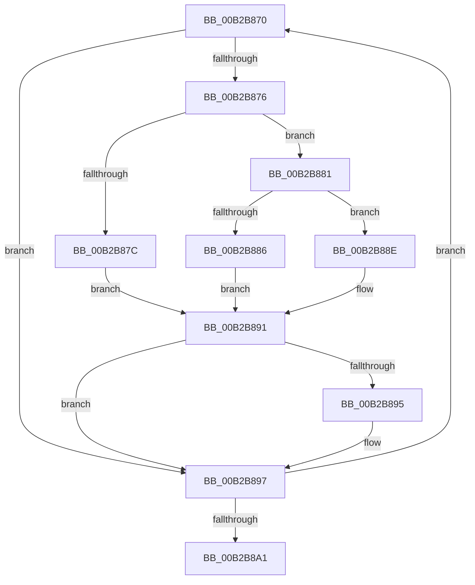

# sub_00B2B870

- RVA: `0x00B2B870`–`0x00B2B8A6` (길이 `54` bytes)
- VA: `0x0000000140B2B870`
- 실행 섹션: `PAGE`
- PDB 이름 있음: `아니요`; PDB Function 태그: `아니요`
- unwind 정보 RVA: `0x00098688`
- 디코드: `20`개 명령, `54/54` bytes 표시
- 미해석 바이트: `0` (있으면 어셈블리에 `.byte`로 보존)

> 이 문서는 커널 이미지의 기계어와 PDB 기호를 분석해 생성했습니다. 4번과 5번은 함수 원형과 자료형을 바이너리 사용 방식에서 추정한 C 해석이며 원본 소스 복구 결과는 아닙니다.

## 1. Dependencies

- 직접 호출 지점: **0**; 고유 호출 대상: **0**
- 직접 호출자로 확인된 함수: **0**
- RIP 상대 이미지 참조: **0**

### Outgoing calls
- 직접 디코드된 call 명령이 없습니다.

### Direct callers
- 이 함수 시작 RVA로 연결되는 직접 call은 확인되지 않았습니다. 간접 호출은 완전히 역산할 수 없습니다.

### Static image references
- 디코드된 RIP-relative 메모리 참조가 없습니다.

## 2. Other-region calls and transfers

- 다른 실행 섹션으로 향하는 call: **0**
- call이 아닌 외부 분기/꼬리 이동: **1**
  - `0x00B2B8A1` → [PopSnapSystemIdleContext + 0xC4](../98/PopSnapSystemIdleContext_function_0098A260.md) (`tail-transfer`)

## 3. Assembly (complete function range)

```asm
00B2B870  44 38 49 FC                     cmp byte ptr [rcx - 4], r9b
00B2B874  75 21                           jne 0x140b2b897
00B2B876  8B 01                           mov eax, dword ptr [rcx]
00B2B878  85 C0                           test eax, eax
00B2B87A  75 05                           jne 0x140b2b881
00B2B87C  41 8B D1                        mov edx, r9d
00B2B87F  EB 10                           jmp 0x140b2b891
00B2B881  83 F8 01                        cmp eax, 1
00B2B884  75 08                           jne 0x140b2b88e
00B2B886  8B 51 F4                        mov edx, dword ptr [rcx - 0xc]
00B2B889  2B 51 EC                        sub edx, dword ptr [rcx - 0x14]
00B2B88C  EB 03                           jmp 0x140b2b891
00B2B88E  83 CA FF                        or edx, 0xffffffff
00B2B891  3B 17                           cmp edx, dword ptr [rdi]
00B2B893  76 02                           jbe 0x140b2b897
00B2B895  89 17                           mov dword ptr [rdi], edx
00B2B897  48 83 C1 38                     add rcx, 0x38
00B2B89B  49 83 E8 01                     sub r8, 1
00B2B89F  75 CF                           jne 0x140b2b870
00B2B8A1  E9 7E EA E5 FF                  jmp 0x14098a324
```

## 4. C-style interpretation (structured pseudocode)

```c
__int64 __fastcall sub_00B2B870(__int64 a1, __int64 a2, __int64 a3, int a4)
{
    if ((*(unsigned __int8 *)(a1 - 4)) != ((unsigned __int8)(a4))) goto loc_00B2B897;
    if ((unsigned int)((unsigned int)(*(unsigned int *)(a1))) != 0) goto loc_00B2B881;
    goto loc_00B2B891;
loc_00B2B881:
    if (((unsigned int)((unsigned int)(*(unsigned int *)(a1)))) != 1) goto loc_00B2B88E;
    a2 = (unsigned int)(((unsigned int)(*(unsigned int *)(a1 - 12))) - (*(unsigned int *)(a1 - 20)));
    goto loc_00B2B891;
loc_00B2B88E:
    a2 = (unsigned int)((a2) | (0xFFFFFFFFULL));
loc_00B2B891:
    if (((unsigned int)(a2)) >= = (*(unsigned int *)(v_rdi))) {
        *(unsigned int *)(v_rdi) = (unsigned int)(a2);
    }
    a1 = (a1) + (56);
    a3 = (a3) - (1);
    if (condition_is_not_equal) goto loc_00B2B870;
}
```

## 5. (Beta) C Style

```c
int64_t sub_00B2B870(void *Arg1, int64_t Arg2, int64_t Arg3, int32_t Arg4)
{
    uint8_t *arg1 = (uint8_t *)Arg1;

    if ((*(uint8_t *)(arg1 - 0x4)) != ((uint8_t)(Arg4))) goto loc_00B2B897;
    if ((uint32_t)((uint32_t)(*(uint32_t *)(arg1))) != 0) goto loc_00B2B881;
    goto loc_00B2B891;
loc_00B2B881:
    if (((uint32_t)((uint32_t)(*(uint32_t *)(arg1)))) != 1) goto loc_00B2B88E;
    Arg2 = (uint32_t)(((uint32_t)(*(uint32_t *)(arg1 - 0xC))) - (*(uint32_t *)(arg1 - 0x14)));
    goto loc_00B2B891;
loc_00B2B88E:
    Arg2 = (uint32_t)((Arg2) | (0xFFFFFFFFULL));
loc_00B2B891:
    if (((uint32_t)(Arg2)) >= = (*(uint32_t *)(local_rdi))) {
        *(uint32_t *)(local_rdi) = (uint32_t)(Arg2);
    }
    Arg1 = (Arg1) + (56);
    Arg3 = (Arg3) - (1);
    if (condition_is_not_equal) goto loc_00B2B870;
}
```

### 관측된 메모리 오프셋

구조체 형식이 확인되지 않은 접근은 인자 기준의 오프셋으로만 기록했습니다.

| 기준 인자 | 오프셋 표현 | 폭 (bit) | 접근 |
|---|---:|---:|---|
| `Arg1` | `- 0x14` | `32` | `R` |
| `Arg1` | `- 0xC` | `32` | `R` |
| `Arg1` | `- 0x4` | `8` | `R` |
| `Arg1` | `+ 0x0` | `32` | `R` |

## 6. Execution-region graph

[열기: 2D/3D 그래프와 함수 탐색 컨트롤 패널](../../../control-panel.html?section=page&rva=0x00B2B870&view=graph)

- 2D 그래프는 위에서 아래로 흐르고, 3D 그래프는 빈 공간을 드래그해 회전합니다. Shift+드래그는 이동, 휠은 확대·축소, 함수 노드 선택은 대상 보고서 이동입니다.

### Static fallback


