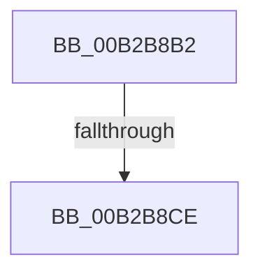

# sub_00B2B8B2

- RVA: `0x00B2B8B2`–`0x00B2B96B` (길이 `185` bytes)
- VA: `0x0000000140B2B8B2`
- 실행 섹션: `PAGE`
- PDB 이름 있음: `아니요`; PDB Function 태그: `아니요`
- unwind 정보 RVA: `0x000988D4`
- 디코드: `47`개 명령, `185/185` bytes 표시
- 미해석 바이트: `0` (있으면 어셈블리에 `.byte`로 보존)

> 이 문서는 커널 이미지의 기계어와 PDB 기호를 분석해 생성했습니다. 4번과 5번은 함수 원형과 자료형을 바이너리 사용 방식에서 추정한 C 해석이며 원본 소스 복구 결과는 아닙니다.

## 1. Dependencies

- 직접 호출 지점: **0**; 고유 호출 대상: **0**
- 직접 호출자로 확인된 함수: **0**
- RIP 상대 이미지 참조: **0**

### Outgoing calls
- 직접 디코드된 call 명령이 없습니다.

### Direct callers
- 이 함수 시작 RVA로 연결되는 직접 call은 확인되지 않았습니다. 간접 호출은 완전히 역산할 수 없습니다.

### Static image references
- 디코드된 RIP-relative 메모리 참조가 없습니다.

## 2. Other-region calls and transfers

- 다른 실행 섹션으로 향하는 call: **0**
- call이 아닌 외부 분기/꼬리 이동: **2**
  - `0x00B2B8C8` → [PopEtAggregateGet + 0x141](../98/PopEtAggregateGet_function_0098DEEC.md) (`tail-transfer`)
  - `0x00B2B966` → [PopEtAggregateGet + 0x13E](../98/PopEtAggregateGet_function_0098DEEC.md) (`tail-transfer`)

## 3. Assembly (complete function range)

```asm
00B2B8B2  FF 86 64 02 00 00               inc dword ptr [rsi + 0x264]
00B2B8B8  4C 8D 46 50                     lea r8, [rsi + 0x50]
00B2B8BC  8B 86 84 02 00 00               mov eax, dword ptr [rsi + 0x284]
00B2B8C2  4D 89 04 24                     mov qword ptr [r12], r8
00B2B8C6  84 C3                           test bl, al
00B2B8C8  0F 85 5F 27 E6 FF               jne 0x14098e02d
00B2B8CE  0B C3                           or eax, ebx
00B2B8D0  49 83 CF FF                     or r15, 0xffffffffffffffff
00B2B8D4  89 86 84 02 00 00               mov dword ptr [rsi + 0x284], eax
00B2B8DA  8B 4E 34                        mov ecx, dword ptr [rsi + 0x34]
00B2B8DD  8B F9                           mov edi, ecx
00B2B8DF  83 E1 1F                        and ecx, 0x1f
00B2B8E2  C1 EF 05                        shr edi, 5
00B2B8E5  49 D3 E7                        shl r15, cl
00B2B8E8  4D 23 78 08                     and r15, qword ptr [r8 + 8]
00B2B8EC  4C 89 7C 24 68                  mov qword ptr [rsp + 0x68], r15
00B2B8F1  41 0F B6 C7                     movzx eax, r15b
00B2B8F5  48 05 CB 5D B1 00               add rax, 0xb15dcb
00B2B8FB  48 6B C8 25                     imul rcx, rax, 0x25
00B2B8FF  0F B6 44 24 69                  movzx eax, byte ptr [rsp + 0x69]
00B2B904  48 03 C8                        add rcx, rax
00B2B907  0F B6 44 24 6A                  movzx eax, byte ptr [rsp + 0x6a]
00B2B90C  48 6B D1 25                     imul rdx, rcx, 0x25
00B2B910  48 03 D0                        add rdx, rax
00B2B913  0F B6 44 24 6B                  movzx eax, byte ptr [rsp + 0x6b]
00B2B918  48 6B CA 25                     imul rcx, rdx, 0x25
00B2B91C  48 03 C8                        add rcx, rax
00B2B91F  0F B6 44 24 6C                  movzx eax, byte ptr [rsp + 0x6c]
00B2B924  48 6B D1 25                     imul rdx, rcx, 0x25
00B2B928  48 03 D0                        add rdx, rax
00B2B92B  0F B6 44 24 6D                  movzx eax, byte ptr [rsp + 0x6d]
00B2B930  48 6B CA 25                     imul rcx, rdx, 0x25
00B2B934  48 03 C8                        add rcx, rax
00B2B937  0F B6 44 24 6E                  movzx eax, byte ptr [rsp + 0x6e]
00B2B93C  48 6B D1 25                     imul rdx, rcx, 0x25
00B2B940  48 03 D0                        add rdx, rax
00B2B943  0F B6 44 24 6F                  movzx eax, byte ptr [rsp + 0x6f]
00B2B948  48 6B CA 25                     imul rcx, rdx, 0x25
00B2B94C  8D 57 FF                        lea edx, [rdi - 1]
00B2B94F  48 03 C1                        add rax, rcx
00B2B952  48 8B 4E 38                     mov rcx, qword ptr [rsi + 0x38]
00B2B956  8B C0                           mov eax, eax
00B2B958  48 23 D0                        and rdx, rax
00B2B95B  48 8B 04 D1                     mov rax, qword ptr [rcx + rdx*8]
00B2B95F  49 89 00                        mov qword ptr [r8], rax
00B2B962  4C 89 04 D1                     mov qword ptr [rcx + rdx*8], r8
00B2B966  E9 BF 26 E6 FF                  jmp 0x14098e02a
```

## 4. C-style interpretation (structured pseudocode)

```c
__int64 __fastcall sub_00B2B8B2(void)
{
    __int64 result;
    __int64 v_r15;
    __int64 v_rdi;
    unsigned __int64 v_stack_p68;
    unsigned __int8 v_stack_p69;
    unsigned __int8 v_stack_p6A;
    unsigned __int8 v_stack_p6B;
    unsigned __int8 v_stack_p6C;
    unsigned __int8 v_stack_p6D;
    unsigned __int8 v_stack_p6E;
    unsigned __int8 v_stack_p6F;

    *(unsigned __int64 *)(v_r12) = v_rsi + 80;
    result = (unsigned int)(((unsigned int)(*(unsigned int *)(v_rsi + 644))) | ((unsigned int)(v_rbx)));
    v_r15 = (v_r15) | (-1);
    *(unsigned int *)(v_rsi + 644) = (unsigned int)(result);
    a1 = (unsigned int)(((unsigned int)(*(unsigned int *)(v_rsi + 52))) & (31));
    v_rdi = (unsigned int)(((unsigned int)((unsigned int)((unsigned int)(*(unsigned int *)(v_rsi + 52))))) >> (5));
    v_r15 = (v_r15) << ((unsigned __int8)(a1));
    v_r15 = (v_r15) & (*(unsigned __int64 *)(v_rsi + 80 + 8));
    v_stack_p68 = v_r15;
    result = ((unsigned __int8)(v_r15)) + (0xB15DCBULL);
    a1 = (a1) * (result);
    a1 = (a1) + (v_stack_p69);
    a2 = (a2) * (a1);
    a2 = (a2) + (v_stack_p6A);
    a1 = (a1) * (a2);
    a1 = (a1) + (v_stack_p6B);
    a2 = (a2) * (a1);
    a2 = (a2) + (v_stack_p6C);
    a1 = (a1) * (a2);
    a1 = (a1) + (v_stack_p6D);
    a2 = (a2) * (a1);
    a2 = (a2) + (v_stack_p6E);
    a1 = (a1) * (a2);
    result = (v_stack_p6F) + (a1);
    a2 = (v_rdi - 1) & ((unsigned int)((unsigned int)(result)));
    *(unsigned __int64 *)(v_rsi + 80) = *(unsigned __int64 *)(*(unsigned __int64 *)(v_rsi + 56) + a2 * 8);
    *(unsigned __int64 *)(*(unsigned __int64 *)(v_rsi + 56) + a2 * 8) = v_rsi + 80;
}
```

## 5. (Beta) C Style

```c
void sub_00B2B8B2(void)
{
    int64_t result;
    int64_t local_r15;
    int64_t local_rdi;
    uint64_t v_stack_p68;
    uint8_t v_stack_p69;
    uint8_t v_stack_p6A;
    uint8_t v_stack_p6B;
    uint8_t v_stack_p6C;
    uint8_t v_stack_p6D;
    uint8_t v_stack_p6E;
    uint8_t v_stack_p6F;

    *(uint64_t *)(local_r12) = local_rsi + 80;
    result = (uint32_t)(((uint32_t)(*(uint32_t *)(local_rsi + 0x284))) | ((uint32_t)(local_rbx)));
    local_r15 = (local_r15) | (-1);
    *(uint32_t *)(local_rsi + 0x284) = (uint32_t)(result);
    a1 = (uint32_t)(((uint32_t)(*(uint32_t *)(local_rsi + 0x34))) & (31));
    local_rdi = (uint32_t)(((uint32_t)((uint32_t)((uint32_t)(*(uint32_t *)(local_rsi + 0x34))))) >> (5));
    local_r15 = (local_r15) << ((uint8_t)(a1));
    local_r15 = (local_r15) & (*(uint64_t *)(local_rsi + 0x50 + 0x8));
    v_stack_p68 = local_r15;
    result = ((uint8_t)(local_r15)) + (0xB15DCBULL);
    a1 = (a1) * (result);
    a1 = (a1) + (v_stack_p69);
    a2 = (a2) * (a1);
    a2 = (a2) + (v_stack_p6A);
    a1 = (a1) * (a2);
    a1 = (a1) + (v_stack_p6B);
    a2 = (a2) * (a1);
    a2 = (a2) + (v_stack_p6C);
    a1 = (a1) * (a2);
    a1 = (a1) + (v_stack_p6D);
    a2 = (a2) * (a1);
    a2 = (a2) + (v_stack_p6E);
    a1 = (a1) * (a2);
    result = (v_stack_p6F) + (a1);
    a2 = (local_rdi - 1) & ((uint32_t)((uint32_t)(result)));
    *(uint64_t *)(local_rsi + 0x50) = *(uint64_t *)(*(uint64_t *)(local_rsi + 0x38) + a2 * 8);
    *(uint64_t *)(*(uint64_t *)(local_rsi + 0x38) + a2 * 8) = local_rsi + 80;
}
```

## 6. Execution-region graph

[열기: 2D/3D 그래프와 함수 탐색 컨트롤 패널](../../../control-panel.html?section=page&rva=0x00B2B8B2&view=graph)

- 2D 그래프는 위에서 아래로 흐르고, 3D 그래프는 빈 공간을 드래그해 회전합니다. Shift+드래그는 이동, 휠은 확대·축소, 함수 노드 선택은 대상 보고서 이동입니다.

### Static fallback


