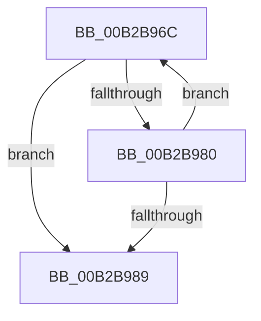

# sub_00B2B96C

- RVA: `0x00B2B96C`–`0x00B2B9AC` (길이 `64` bytes)
- VA: `0x0000000140B2B96C`
- 실행 섹션: `PAGE`
- PDB 이름 있음: `아니요`; PDB Function 태그: `아니요`
- unwind 정보 RVA: `0x000989B8`
- 디코드: `13`개 명령, `64/64` bytes 표시
- 미해석 바이트: `0` (있으면 어셈블리에 `.byte`로 보존)

> 이 문서는 커널 이미지의 기계어와 PDB 기호를 분석해 생성했습니다. 4번과 5번은 함수 원형과 자료형을 바이너리 사용 방식에서 추정한 C 해석이며 원본 소스 복구 결과는 아닙니다.

## 1. Dependencies

- 직접 호출 지점: **1**; 고유 호출 대상: **1**
- 직접 호출자로 확인된 함수: **0**
- RIP 상대 이미지 참조: **0**

### Outgoing calls
- `0x00B2B99D` → [RtlInitUnicodeString](../../text/42/RtlInitUnicodeString_function_0042A780.md) (function, `0x0042A780`)

### Direct callers
- 이 함수 시작 RVA로 연결되는 직접 call은 확인되지 않았습니다. 간접 호출은 완전히 역산할 수 없습니다.

### Static image references
- 디코드된 RIP-relative 메모리 참조가 없습니다.

## 2. Other-region calls and transfers

- 다른 실행 섹션으로 향하는 call: **1**
  - `0x00B2B99D` → [RtlInitUnicodeString](../../text/42/RtlInitUnicodeString_function_0042A780.md) (`PAGE` → `.text`)
- call이 아닌 외부 분기/꼬리 이동: **1**
  - `0x00B2B9A7` → [PopEtGetProcessAppId + 0x88](../98/PopEtGetProcessAppId_function_0098EBDC.md) (`tail-transfer`)

## 3. Assembly (complete function range)

```asm
00B2B96C  0F B6 84 0F 38 03 00 00         movzx eax, byte ptr [rdi + rcx + 0x338]
00B2B974  66 89 84 4D 90 01 00 00         mov word ptr [rbp + rcx*2 + 0x190], ax
00B2B97C  84 C0                           test al, al
00B2B97E  74 09                           je 0x140b2b989
00B2B980  48 FF C1                        inc rcx
00B2B983  48 83 F9 0F                     cmp rcx, 0xf
00B2B987  72 E3                           jb 0x140b2b96c
00B2B989  48 8D 95 90 01 00 00            lea rdx, [rbp + 0x190]
00B2B990  66 44 89 B5 AC 01 00 00         mov word ptr [rbp + 0x1ac], r14w
00B2B998  48 8D 4C 24 38                  lea rcx, [rsp + 0x38]
00B2B99D  E8 DE ED 8F FF                  call 0x14042a780
00B2B9A2  48 8D 5C 24 38                  lea rbx, [rsp + 0x38]
00B2B9A7  E9 B8 32 E6 FF                  jmp 0x14098ec64
```

## 4. C-style interpretation (structured pseudocode)

```c
__int64 __fastcall sub_00B2B96C(__int64 a1, __int64 a2, __int64 a3, __int64 a4, __int64 a5, __int64 a6, __int64 a7)
{
    __int64 result;

    *(unsigned __int16 *)(v_rbp + a1 * 2 + 400) = (unsigned __int16)(*(unsigned __int8 *)(v_rdi + a1 * 1 + 824));
    if ((unsigned __int8)(*(unsigned __int8 *)(v_rdi + a1 * 1 + 824)) == 0) goto loc_00B2B989;
    a1 = (a1) + 1;
    if (a1 < 15) goto loc_00B2B96C;
loc_00B2B989:
    *(unsigned __int16 *)(v_rbp + 428) = (unsigned __int16)(v_r14);
    result = RtlInitUnicodeString(a7, v_rbp + 400, a3, a4);
}
```

## 5. (Beta) C Style

```c
int64_t sub_00B2B96C(int64_t Arg1, int64_t Arg2, int64_t Arg3, int64_t Arg4, uint64_t Arg5, uint64_t Arg6, int64_t Arg7)
{
    int64_t result;

    *(uint16_t *)(local_rbp + Arg1 * 2 + 0x190) = (uint16_t)(*(uint8_t *)(local_rdi + Arg1 * 1 + 0x338));
    if ((uint8_t)(*(uint8_t *)(local_rdi + Arg1 * 1 + 0x338)) == 0) goto loc_00B2B989;
    Arg1 = (Arg1) + 1;
    if (Arg1 < 15) goto loc_00B2B96C;
loc_00B2B989:
    *(uint16_t *)(local_rbp + 0x1AC) = (uint16_t)(local_r14);
    result = RtlInitUnicodeString(Arg7, local_rbp + 400, Arg3, Arg4);
}
```

## 6. Execution-region graph

[열기: 2D/3D 그래프와 함수 탐색 컨트롤 패널](../../../control-panel.html?section=page&rva=0x00B2B96C&view=graph)

- 2D 그래프는 위에서 아래로 흐르고, 3D 그래프는 빈 공간을 드래그해 회전합니다. Shift+드래그는 이동, 휠은 확대·축소, 함수 노드 선택은 대상 보고서 이동입니다.

### Static fallback


