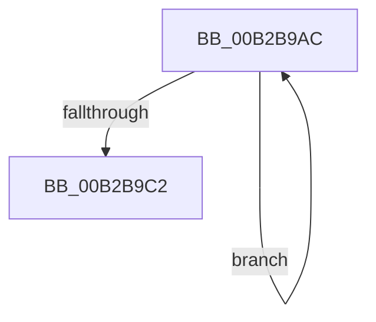

# sub_00B2B9AC

- RVA: `0x00B2B9AC`–`0x00B2B9CE` (길이 `34` bytes)
- VA: `0x0000000140B2B9AC`
- 실행 섹션: `PAGE`
- PDB 이름 있음: `아니요`; PDB Function 태그: `아니요`
- unwind 정보 RVA: `0x00098A0C`
- 디코드: `9`개 명령, `34/34` bytes 표시
- 미해석 바이트: `0` (있으면 어셈블리에 `.byte`로 보존)

> 이 문서는 커널 이미지의 기계어와 PDB 기호를 분석해 생성했습니다. 4번과 5번은 함수 원형과 자료형을 바이너리 사용 방식에서 추정한 C 해석이며 원본 소스 복구 결과는 아닙니다.

## 1. Dependencies

- 직접 호출 지점: **0**; 고유 호출 대상: **0**
- 직접 호출자로 확인된 함수: **0**
- RIP 상대 이미지 참조: **0**

### Outgoing calls
- 직접 디코드된 call 명령이 없습니다.

### Direct callers
- 이 함수 시작 RVA로 연결되는 직접 call은 확인되지 않았습니다. 간접 호출은 완전히 역산할 수 없습니다.

### Static image references
- 디코드된 RIP-relative 메모리 참조가 없습니다.

## 2. Other-region calls and transfers

- 다른 실행 섹션으로 향하는 call: **0**
- call이 아닌 외부 분기/꼬리 이동: **1**
  - `0x00B2B9C9` → [RtlInternTableIntern + 0x90](../98/RtlInternTableIntern_function_0098EEB4.md) (`tail-transfer`)

## 3. Assembly (complete function range)

```asm
00B2B9AC  48 8B 4D 08                     mov rcx, qword ptr [rbp + 8]
00B2B9B0  48 8D 40 20                     lea rax, [rax + 0x20]
00B2B9B4  48 FF C2                        inc rdx
00B2B9B7  4C 89 64 08 E8                  mov qword ptr [rax + rcx - 0x18], r12
00B2B9BC  48 3B 55 10                     cmp rdx, qword ptr [rbp + 0x10]
00B2B9C0  72 EA                           jb 0x140b2b9ac
00B2B9C2  48 8D 7D 18                     lea rdi, [rbp + 0x18]
00B2B9C6  83 27 FE                        and dword ptr [rdi], 0xfffffffe
00B2B9C9  E9 76 35 E6 FF                  jmp 0x14098ef44
```

## 4. C-style interpretation (structured pseudocode)

```c
__int64 __fastcall sub_00B2B9AC(__int64 a1, __int64 a2)
{
    a2 = (a2) + 1;
    *(unsigned __int64 *)(result + 32 + *(unsigned __int64 *)(v_rbp + 8) * 1 - 24) = v_r12;
    if (a2 < (*(unsigned __int64 *)(v_rbp + 16))) goto loc_00B2B9AC;
}
```

## 5. (Beta) C Style

```c
int64_t sub_00B2B9AC(int64_t Arg1, int64_t Arg2)
{
    Arg2 = (Arg2) + 1;
    *(uint64_t *)(result + 0x20 + *(uint64_t *)(local_rbp + 0x8) * 1 - 0x18) = local_r12;
    if (Arg2 < (*(uint64_t *)(local_rbp + 0x10))) goto loc_00B2B9AC;
}
```

## 6. Execution-region graph

[열기: 2D/3D 그래프와 함수 탐색 컨트롤 패널](../../../control-panel.html?section=page&rva=0x00B2B9AC&view=graph)

- 2D 그래프는 위에서 아래로 흐르고, 3D 그래프는 빈 공간을 드래그해 회전합니다. Shift+드래그는 이동, 휠은 확대·축소, 함수 노드 선택은 대상 보고서 이동입니다.

### Static fallback


