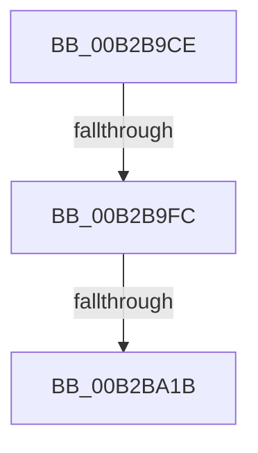

# sub_00B2B9CE

- RVA: `0x00B2B9CE`–`0x00B2BA5A` (길이 `140` bytes)
- VA: `0x0000000140B2B9CE`
- 실행 섹션: `PAGE`
- PDB 이름 있음: `아니요`; PDB Function 태그: `아니요`
- unwind 정보 RVA: `0x00098AF4`
- 디코드: `31`개 명령, `140/140` bytes 표시
- 미해석 바이트: `0` (있으면 어셈블리에 `.byte`로 보존)

> 이 문서는 커널 이미지의 기계어와 PDB 기호를 분석해 생성했습니다. 4번과 5번은 함수 원형과 자료형을 바이너리 사용 방식에서 추정한 C 해석이며 원본 소스 복구 결과는 아닙니다.

## 1. Dependencies

- 직접 호출 지점: **3**; 고유 호출 대상: **3**
- 직접 호출자로 확인된 함수: **0**
- RIP 상대 이미지 참조: **0**

### Outgoing calls
- `0x00B2B9EC` → [LdrLoadAlternateResourceModuleEx](../../text/45/LdrLoadAlternateResourceModuleEx_function_004557CC.md) (function, `0x004557CC`)
- `0x00B2BA0E` → [LdrpResGetMappingSize](../99/LdrpResGetMappingSize_function_00991614.md) (function, `0x00991614`)
- `0x00B2BA4E` → [LdrpResSearchResourceMappedFile](../../text/45/LdrpResSearchResourceMappedFile_function_00454C98.md) (function, `0x00454C98`)

### Direct callers
- 이 함수 시작 RVA로 연결되는 직접 call은 확인되지 않았습니다. 간접 호출은 완전히 역산할 수 없습니다.

### Static image references
- 디코드된 RIP-relative 메모리 참조가 없습니다.

## 2. Other-region calls and transfers

- 다른 실행 섹션으로 향하는 call: **2**
  - `0x00B2B9EC` → [LdrLoadAlternateResourceModuleEx](../../text/45/LdrLoadAlternateResourceModuleEx_function_004557CC.md) (`PAGE` → `.text`)
  - `0x00B2BA4E` → [LdrpResSearchResourceMappedFile](../../text/45/LdrpResSearchResourceMappedFile_function_00454C98.md) (`PAGE` → `.text`)
- call이 아닌 외부 분기/꼬리 이동: **3**
  - `0x00B2B9F6` → [LdrResSearchResource + 0x100](../98/LdrResSearchResource_function_0098F7A0.md) (`tail-transfer`)
  - `0x00B2BA15` → [LdrResSearchResource + 0x100](../98/LdrResSearchResource_function_0098F7A0.md) (`tail-transfer`)
  - `0x00B2BA55` → [LdrResSearchResource + 0x100](../98/LdrResSearchResource_function_0098F7A0.md) (`tail-transfer`)

## 3. Assembly (complete function range)

```asm
00B2B9CE  48 83 64 24 60 00               and qword ptr [rsp + 0x60], 0
00B2B9D4  BA EE F2 00 00                  mov edx, 0xf2ee
00B2B9D9  C7 44 24 20 00 00 00 01         mov dword ptr [rsp + 0x20], 0x1000000
00B2B9E1  45 33 C9                        xor r9d, r9d
00B2B9E4  4C 8D 44 24 60                  lea r8, [rsp + 0x60]
00B2B9E9  49 8B CE                        mov rcx, r14
00B2B9EC  E8 DB 9D 92 FF                  call 0x1404557cc
00B2B9F1  45 33 F6                        xor r14d, r14d
00B2B9F4  85 C0                           test eax, eax
00B2B9F6  0F 88 A4 3E E6 FF               js 0x14098f8a0
00B2B9FC  4C 89 74 24 58                  mov qword ptr [rsp + 0x58], r14
00B2BA01  44 8B C7                        mov r8d, edi
00B2BA04  48 8D 54 24 58                  lea rdx, [rsp + 0x58]
00B2BA09  48 8B 4C 24 60                  mov rcx, qword ptr [rsp + 0x60]
00B2BA0E  E8 01 5C E6 FF                  call 0x140991614
00B2BA13  85 C0                           test eax, eax
00B2BA15  0F 88 85 3E E6 FF               js 0x14098f8a0
00B2BA1B  0F BA EF 18                     bts edi, 0x18
00B2BA1F  4C 89 64 24 40                  mov qword ptr [rsp + 0x40], r12
00B2BA24  4C 89 6C 24 38                  mov qword ptr [rsp + 0x38], r13
00B2BA29  4C 89 7C 24 30                  mov qword ptr [rsp + 0x30], r15
00B2BA2E  48 8B 44 24 68                  mov rax, qword ptr [rsp + 0x68]
00B2BA33  48 89 44 24 28                  mov qword ptr [rsp + 0x28], rax
00B2BA38  89 74 24 20                     mov dword ptr [rsp + 0x20], esi
00B2BA3C  4C 8D 4C 24 78                  lea r9, [rsp + 0x78]
00B2BA41  44 8B C7                        mov r8d, edi
00B2BA44  48 8B 54 24 58                  mov rdx, qword ptr [rsp + 0x58]
00B2BA49  48 8B 4C 24 60                  mov rcx, qword ptr [rsp + 0x60]
00B2BA4E  E8 45 92 92 FF                  call 0x140454c98
00B2BA53  8B D8                           mov ebx, eax
00B2BA55  E9 46 3E E6 FF                  jmp 0x14098f8a0
```

## 4. C-style interpretation (structured pseudocode)

```c
__int64 __fastcall sub_00B2B9CE(__int64 a1, __int64 a2, __int64 a3, int a4, __int64 a5, __int64 a6, __int64 a7, __int64 a8, __int64 a9, __int64 a10, __int64 a11, __int64 a12, __int64 a13, __int64 a14, __int64 a15)
{
    __int64 result;
    __int64 v_r14;
    unsigned int v_stack_p20;
    unsigned __int64 v_stack_p28;
    unsigned __int64 v_stack_p30;
    unsigned __int64 v_stack_p38;
    unsigned __int64 v_stack_p40;
    unsigned __int64 v_stack_p58;

    v_stack_p20 = 0x1000000ULL;
    a4 = 0;
    result = LdrLoadAlternateResourceModuleEx(v_r14, (unsigned int)(0xF2EEULL), a12, a4);
    v_r14 = 0;
    v_stack_p58 = 0;
    result = LdrpResGetMappingSize(a12, a11, (unsigned int)((unsigned int)(v_rdi)), a4);
    v_stack_p40 = v_r12;
    v_stack_p38 = v_r13;
    v_stack_p30 = v_r15;
    v_stack_p28 = a13;
    v_stack_p20 = (unsigned int)(v_rsi);
    result = LdrpResSearchResourceMappedFile(a12, a11, (unsigned int)((unsigned int)(v_rdi)), a15);
}
```

## 5. (Beta) C Style

```c
int64_t sub_00B2B9CE(int64_t Arg1, int64_t Arg2, int64_t Arg3, int32_t Arg4, uint64_t Arg5, uint64_t Arg6, uint64_t Arg7, uint64_t Arg8, uint64_t Arg9, uint64_t Arg10, int64_t Arg11, int64_t Arg12, int64_t Arg13, uint64_t Arg14, int64_t Arg15)
{
    int64_t result;
    int64_t local_r14;
    uint32_t v_stack_p20;
    uint64_t v_stack_p28;
    uint64_t v_stack_p30;
    uint64_t v_stack_p38;
    uint64_t v_stack_p40;
    uint64_t v_stack_p58;

    v_stack_p20 = 0x1000000ULL;
    Arg4 = 0;
    result = LdrLoadAlternateResourceModuleEx(local_r14, (uint32_t)(0xF2EEULL), Arg12, Arg4);
    local_r14 = 0;
    v_stack_p58 = 0;
    result = LdrpResGetMappingSize(Arg12, Arg11, (uint32_t)((uint32_t)(local_rdi)), Arg4);
    v_stack_p40 = local_r12;
    v_stack_p38 = local_r13;
    v_stack_p30 = local_r15;
    v_stack_p28 = Arg13;
    v_stack_p20 = (uint32_t)(local_rsi);
    result = LdrpResSearchResourceMappedFile(Arg12, Arg11, (uint32_t)((uint32_t)(local_rdi)), Arg15);
}
```

## 6. Execution-region graph

[열기: 2D/3D 그래프와 함수 탐색 컨트롤 패널](../../../control-panel.html?section=page&rva=0x00B2B9CE&view=graph)

- 2D 그래프는 위에서 아래로 흐르고, 3D 그래프는 빈 공간을 드래그해 회전합니다. Shift+드래그는 이동, 휠은 확대·축소, 함수 노드 선택은 대상 보고서 이동입니다.

### Static fallback


