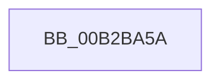

# sub_00B2BA5A

- RVA: `0x00B2BA5A`–`0x00B2BA81` (길이 `39` bytes)
- VA: `0x0000000140B2BA5A`
- 실행 섹션: `PAGE`
- PDB 이름 있음: `아니요`; PDB Function 태그: `아니요`
- unwind 정보 RVA: `0x00098C68`
- 디코드: `8`개 명령, `39/39` bytes 표시
- 미해석 바이트: `0` (있으면 어셈블리에 `.byte`로 보존)

> 이 문서는 커널 이미지의 기계어와 PDB 기호를 분석해 생성했습니다. 4번과 5번은 함수 원형과 자료형을 바이너리 사용 방식에서 추정한 C 해석이며 원본 소스 복구 결과는 아닙니다.

## 1. Dependencies

- 직접 호출 지점: **1**; 고유 호출 대상: **1**
- 직접 호출자로 확인된 함수: **0**
- RIP 상대 이미지 참조: **0**

### Outgoing calls
- `0x00B2BA76` → [CmGetDevicePanelRegKeyPath](../82/CmGetDevicePanelRegKeyPath_function_0082EE7C.md) (function, `0x0082EE7C`)

### Direct callers
- 이 함수 시작 RVA로 연결되는 직접 call은 확인되지 않았습니다. 간접 호출은 완전히 역산할 수 없습니다.

### Static image references
- 디코드된 RIP-relative 메모리 참조가 없습니다.

## 2. Other-region calls and transfers

- 다른 실행 섹션으로 향하는 call: **0**
- call이 아닌 외부 분기/꼬리 이동: **1**
  - `0x00B2BA7C` → [PiDqGetRelativeObjectRegPath + 0x6A](../99/PiDqGetRelativeObjectRegPath_function_00990B6C.md) (`tail-transfer`)

## 3. Assembly (complete function range)

```asm
00B2BA5A  48 83 64 24 38 00               and qword ptr [rsp + 0x38], 0
00B2BA60  41 B8 60 00 00 00               mov r8d, 0x60
00B2BA66  C7 44 24 30 00 04 00 00         mov dword ptr [rsp + 0x30], 0x400
00B2BA6E  48 8B D7                        mov rdx, rdi
00B2BA71  48 89 44 24 28                  mov qword ptr [rsp + 0x28], rax
00B2BA76  E8 01 34 D0 FF                  call 0x14082ee7c
00B2BA7B  90                              nop
00B2BA7C  E9 55 51 E6 FF                  jmp 0x140990bd6
```

## 4. C-style interpretation (structured pseudocode)

```c
__int64 __fastcall sub_00B2BA5A(__int64 a1, __int64 a2, __int64 a3, __int64 a4, __int64 a5, __int64 a6, __int64 a7)
{
    __int64 result;
    unsigned __int64 v_stack_p28;
    unsigned int v_stack_p30;

    v_stack_p30 = 0x400ULL;
    v_stack_p28 = result;
    result = CmGetDevicePanelRegKeyPath(a1, v_rdi, 96, a4);
}
```

## 5. (Beta) C Style

```c
int64_t sub_00B2BA5A(int64_t Arg1, int64_t Arg2, int64_t Arg3, int64_t Arg4, uint64_t Arg5, uint64_t Arg6, int64_t Arg7)
{
    int64_t result;
    uint64_t v_stack_p28;
    uint32_t v_stack_p30;

    v_stack_p30 = 0x400ULL;
    v_stack_p28 = result;
    result = CmGetDevicePanelRegKeyPath(Arg1, local_rdi, 96, Arg4);
}
```

## 6. Execution-region graph

[열기: 2D/3D 그래프와 함수 탐색 컨트롤 패널](../../../control-panel.html?section=page&rva=0x00B2BA5A&view=graph)

- 2D 그래프는 위에서 아래로 흐르고, 3D 그래프는 빈 공간을 드래그해 회전합니다. Shift+드래그는 이동, 휠은 확대·축소, 함수 노드 선택은 대상 보고서 이동입니다.

### Static fallback


