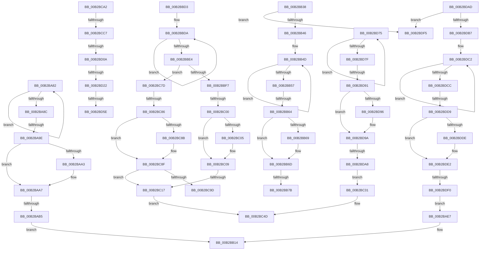

# sub_00B2BA82

- RVA: `0x00B2BA82`–`0x00B2BDFF` (길이 `893` bytes)
- VA: `0x0000000140B2BA82`
- 실행 섹션: `PAGE`
- PDB 이름 있음: `아니요`; PDB Function 태그: `아니요`
- unwind 정보 RVA: `0x00098CC4`
- 디코드: `204`개 명령, `893/893` bytes 표시
- 미해석 바이트: `0` (있으면 어셈블리에 `.byte`로 보존)

> 이 문서는 커널 이미지의 기계어와 PDB 기호를 분석해 생성했습니다. 4번과 5번은 함수 원형과 자료형을 바이너리 사용 방식에서 추정한 C 해석이며 원본 소스 복구 결과는 아닙니다.

## 1. Dependencies

- 직접 호출 지점: **8**; 고유 호출 대상: **5**
- 직접 호출자로 확인된 함수: **0**
- RIP 상대 이미지 참조: **10**

### Outgoing calls
- `0x00B2BB2D` → [RtlStringCchPrintfExW](../../text/42/RtlStringCchPrintfExW_function_0042B390.md) (function, `0x0042B390`)
- `0x00B2BBC8` → [RtlStringCchPrintfExW](../../text/42/RtlStringCchPrintfExW_function_0042B390.md) (function, `0x0042B390`)
- `0x00B2BC72` → [RtlStringCchPrintfExW](../../text/42/RtlStringCchPrintfExW_function_0042B390.md) (function, `0x0042B390`)
- `0x00B2BCB8` → [_CmCreateOrdinalInstanceKey](../A7/_CmCreateOrdinalInstanceKey_function_00A77838.md) (function, `0x00A77838`)
- `0x00B2BCFB` → [RtlStringCchPrintfExW](../../text/42/RtlStringCchPrintfExW_function_0042B390.md) (function, `0x0042B390`)
- `0x00B2BD13` → [RtlInitUnicodeStringEx](../../text/46/RtlInitUnicodeStringEx_function_00463960.md) (function, `0x00463960`)
- `0x00B2BD4F` → [CmSetDeviceRegProp](../8F/CmSetDeviceRegProp_function_008FD68C.md) (function, `0x008FD68C`)
- `0x00B2BD6A` → [PnpCtxRegDeleteKey](../96/PnpCtxRegDeleteKey_function_00965EC8.md) (function, `0x00965EC8`)

### Direct callers
- 이 함수 시작 RVA로 연결되는 직접 call은 확인되지 않았습니다. 간접 호출은 완전히 역산할 수 없습니다.

### Static image references
- `0x00B2BAB5` → RVA `0x00B0D520` (` ?? ::NNGAKEGL::`string'`; read)
- `0x00B2BAC1` → RVA `0x00B0D550` (` ?? ::NNGAKEGL::`string'`; read)
- `0x00B2BAD2` → RVA `0x00B0D590` (` ?? ::NNGAKEGL::`string'`; read)
- `0x00B2BADE` → RVA `0x00B0D600` (` ?? ::NNGAKEGL::`string'`; read)
- `0x00B2BAF0` → RVA `0x00B0D6B0` (` ?? ::NNGAKEGL::`string'`; read)
- `0x00B2BAFC` → RVA `0x00B0D620` (` ?? ::NNGAKEGL::`string'`; read)
- `0x00B2BB0D` → RVA `0x00B0D700` (` ?? ::NNGAKEGL::`string'`; read)
- `0x00B2BBB4` → RVA `0x00B0D680` (` ?? ::NNGAKEGL::`string'`; read)
- `0x00B2BC55` → RVA `0x00AFDE50` (` ?? ::NNGAKEGL::`string'`; read)
- `0x00B2BCE3` → RVA `0x00AFD430` (` ?? ::NNGAKEGL::`string'`; read)

## 2. Other-region calls and transfers

- 다른 실행 섹션으로 향하는 call: **5**
  - `0x00B2BB2D` → [RtlStringCchPrintfExW](../../text/42/RtlStringCchPrintfExW_function_0042B390.md) (`PAGE` → `.text`)
  - `0x00B2BBC8` → [RtlStringCchPrintfExW](../../text/42/RtlStringCchPrintfExW_function_0042B390.md) (`PAGE` → `.text`)
  - `0x00B2BC72` → [RtlStringCchPrintfExW](../../text/42/RtlStringCchPrintfExW_function_0042B390.md) (`PAGE` → `.text`)
  - `0x00B2BCFB` → [RtlStringCchPrintfExW](../../text/42/RtlStringCchPrintfExW_function_0042B390.md) (`PAGE` → `.text`)
  - `0x00B2BD13` → [RtlInitUnicodeStringEx](../../text/46/RtlInitUnicodeStringEx_function_00463960.md) (`PAGE` → `.text`)
- call이 아닌 외부 분기/꼬리 이동: **21**
  - `0x00B2BA98` → [_CmGetDeviceSoftwareKeyPath + 0xF8](../99/_CmGetDeviceSoftwareKeyPath_function_00991090.md) (`tail-transfer`)
  - `0x00B2BAAF` → [_CmGetDeviceSoftwareKeyPath + 0x170](../99/_CmGetDeviceSoftwareKeyPath_function_00991090.md) (`tail-transfer`)
  - `0x00B2BB33` → [_CmGetDeviceSoftwareKeyPath + 0x16C](../99/_CmGetDeviceSoftwareKeyPath_function_00991090.md) (`tail-transfer`)
  - `0x00B2BB5E` → [_CmGetDeviceSoftwareKeyPath + 0xF8](../99/_CmGetDeviceSoftwareKeyPath_function_00991090.md) (`tail-transfer`)
  - `0x00B2BB75` → [_CmGetDeviceSoftwareKeyPath + 0x170](../99/_CmGetDeviceSoftwareKeyPath_function_00991090.md) (`tail-transfer`)
  - `0x00B2BBCE` → [_CmGetDeviceSoftwareKeyPath + 0x16C](../99/_CmGetDeviceSoftwareKeyPath_function_00991090.md) (`tail-transfer`)
  - `0x00B2BBFA` → [_CmGetDeviceSoftwareKeyPath + 0xF8](../99/_CmGetDeviceSoftwareKeyPath_function_00991090.md) (`tail-transfer`)
  - `0x00B2BC11` → [_CmGetDeviceSoftwareKeyPath + 0x170](../99/_CmGetDeviceSoftwareKeyPath_function_00991090.md) (`tail-transfer`)
  - `0x00B2BC78` → [_CmGetDeviceSoftwareKeyPath + 0x16C](../99/_CmGetDeviceSoftwareKeyPath_function_00991090.md) (`tail-transfer`)
  - `0x00B2BC80` → [_CmGetDeviceSoftwareKeyPath + 0xF8](../99/_CmGetDeviceSoftwareKeyPath_function_00991090.md) (`tail-transfer`)
  - `0x00B2BC9D` → [_CmGetDeviceSoftwareKeyPath + 0x170](../99/_CmGetDeviceSoftwareKeyPath_function_00991090.md) (`tail-transfer`)
  - `0x00B2BCC1` → [_CmGetDeviceSoftwareKeyPath + 0x1ED](../99/_CmGetDeviceSoftwareKeyPath_function_00991090.md) (`tail-transfer`)
  - `0x00B2BD04` → [_CmGetDeviceSoftwareKeyPath + 0x1ED](../99/_CmGetDeviceSoftwareKeyPath_function_00991090.md) (`tail-transfer`)
  - `0x00B2BD1C` → [_CmGetDeviceSoftwareKeyPath + 0x1ED](../99/_CmGetDeviceSoftwareKeyPath_function_00991090.md) (`tail-transfer`)
  - `0x00B2BD58` → [_CmGetDeviceSoftwareKeyPath + 0x1ED](../99/_CmGetDeviceSoftwareKeyPath_function_00991090.md) (`tail-transfer`)
  - `0x00B2BD70` → [_CmGetDeviceSoftwareKeyPath + 0x1ED](../99/_CmGetDeviceSoftwareKeyPath_function_00991090.md) (`tail-transfer`)
  - `0x00B2BD8B` → [_CmGetDeviceSoftwareKeyPath + 0xF8](../99/_CmGetDeviceSoftwareKeyPath_function_00991090.md) (`tail-transfer`)
  - `0x00B2BDA2` → [_CmGetDeviceSoftwareKeyPath + 0x170](../99/_CmGetDeviceSoftwareKeyPath_function_00991090.md) (`tail-transfer`)
  - `0x00B2BDD3` → [_CmGetDeviceSoftwareKeyPath + 0xF8](../99/_CmGetDeviceSoftwareKeyPath_function_00991090.md) (`tail-transfer`)
  - `0x00B2BDEA` → [_CmGetDeviceSoftwareKeyPath + 0x170](../99/_CmGetDeviceSoftwareKeyPath_function_00991090.md) (`tail-transfer`)
  - `0x00B2BDFA` → [_CmGetDeviceSoftwareKeyPath + 0xFD](../99/_CmGetDeviceSoftwareKeyPath_function_00991090.md) (`tail-transfer`)

## 3. Assembly (complete function range)

```asm
00B2BA82  48 FF C0                        inc rax
00B2BA85  66 83 3C 42 00                  cmp word ptr [rdx + rax*2], 0
00B2BA8A  75 F6                           jne 0x140b2ba82
00B2BA8C  48 83 C0 64                     add rax, 0x64
00B2BA90  B9 FF FF FF FF                  mov ecx, 0xffffffff
00B2BA95  48 3B C1                        cmp rax, rcx
00B2BA98  0F 87 EA 56 E6 FF               ja 0x140991188
00B2BA9E  4D 85 E4                        test r12, r12
00B2BAA1  74 04                           je 0x140b2baa7
00B2BAA3  41 89 04 24                     mov dword ptr [r12], eax
00B2BAA7  8B 8D D0 00 00 00               mov ecx, dword ptr [rbp + 0xd0]
00B2BAAD  3B C1                           cmp eax, ecx
00B2BAAF  0F 87 4B 57 E6 FF               ja 0x140991200
00B2BAB5  48 8D 05 64 1A FE FF            lea rax, [rip - 0x1e59c]
00B2BABC  48 89 44 24 48                  mov qword ptr [rsp + 0x48], rax
00B2BAC1  48 8D 05 88 1A FE FF            lea rax, [rip - 0x1e578]
00B2BAC8  4C 89 74 24 40                  mov qword ptr [rsp + 0x40], r14
00B2BACD  48 89 44 24 38                  mov qword ptr [rsp + 0x38], rax
00B2BAD2  48 8D 05 B7 1A FE FF            lea rax, [rip - 0x1e549]
00B2BAD9  48 89 44 24 30                  mov qword ptr [rsp + 0x30], rax
00B2BADE  48 8D 05 1B 1B FE FF            lea rax, [rip - 0x1e4e5]
00B2BAE5  EB 2D                           jmp 0x140b2bb14
00B2BAE7  48 8D 45 A0                     lea rax, [rbp - 0x60]
00B2BAEB  48 89 44 24 48                  mov qword ptr [rsp + 0x48], rax
00B2BAF0  48 8D 05 B9 1B FE FF            lea rax, [rip - 0x1e447]
00B2BAF7  48 89 44 24 40                  mov qword ptr [rsp + 0x40], rax
00B2BAFC  48 8D 05 1D 1B FE FF            lea rax, [rip - 0x1e4e3]
00B2BB03  44 89 7C 24 38                  mov dword ptr [rsp + 0x38], r15d
00B2BB08  48 89 44 24 30                  mov qword ptr [rsp + 0x30], rax
00B2BB0D  48 8D 05 EC 1B FE FF            lea rax, [rip - 0x1e414]
00B2BB14  48 8B D1                        mov rdx, rcx
00B2BB17  48 89 44 24 28                  mov qword ptr [rsp + 0x28], rax
00B2BB1C  49 8B CD                        mov rcx, r13
00B2BB1F  C7 44 24 20 00 08 00 00         mov dword ptr [rsp + 0x20], 0x800
00B2BB27  45 33 C9                        xor r9d, r9d
00B2BB2A  45 33 C0                        xor r8d, r8d
00B2BB2D  E8 5E F8 8F FF                  call 0x14042b390
00B2BB32  90                              nop
00B2BB33  E9 C4 56 E6 FF                  jmp 0x1409911fc
00B2BB38  B9 FF FF FF FF                  mov ecx, 0xffffffff
00B2BB3D  44 3B F9                        cmp r15d, ecx
00B2BB40  0F 84 AF 02 00 00               je 0x140b2bdf5
00B2BB46  48 C7 C0 FF FF FF FF            mov rax, 0xffffffffffffffff
00B2BB4D  48 FF C0                        inc rax
00B2BB50  66 83 3C 42 00                  cmp word ptr [rdx + rax*2], 0
00B2BB55  75 F6                           jne 0x140b2bb4d
00B2BB57  48 83 C0 61                     add rax, 0x61
00B2BB5B  48 3B C1                        cmp rax, rcx
00B2BB5E  0F 87 24 56 E6 FF               ja 0x140991188
00B2BB64  4D 85 E4                        test r12, r12
00B2BB67  74 04                           je 0x140b2bb6d
00B2BB69  41 89 04 24                     mov dword ptr [r12], eax
00B2BB6D  8B 8D D0 00 00 00               mov ecx, dword ptr [rbp + 0xd0]
00B2BB73  3B C1                           cmp eax, ecx
00B2BB75  0F 87 85 56 E6 FF               ja 0x140991200
00B2BB7B  48 8D 05 9E 19 FE FF            lea rax, [rip - 0x1e662]
00B2BB82  8B D1                           mov edx, ecx
00B2BB84  48 89 44 24 50                  mov qword ptr [rsp + 0x50], rax
00B2BB89  45 33 C9                        xor r9d, r9d
00B2BB8C  4C 89 74 24 48                  mov qword ptr [rsp + 0x48], r14
00B2BB91  48 8D 05 B8 19 FE FF            lea rax, [rip - 0x1e648]
00B2BB98  48 89 44 24 40                  mov qword ptr [rsp + 0x40], rax
00B2BB9D  45 33 C0                        xor r8d, r8d
00B2BBA0  44 89 7C 24 38                  mov dword ptr [rsp + 0x38], r15d
00B2BBA5  48 8D 05 74 1A FE FF            lea rax, [rip - 0x1e58c]
00B2BBAC  48 89 44 24 30                  mov qword ptr [rsp + 0x30], rax
00B2BBB1  49 8B CD                        mov rcx, r13
00B2BBB4  48 8D 05 C5 1A FE FF            lea rax, [rip - 0x1e53b]
00B2BBBB  48 89 44 24 28                  mov qword ptr [rsp + 0x28], rax
00B2BBC0  C7 44 24 20 00 08 00 00         mov dword ptr [rsp + 0x20], 0x800
00B2BBC8  E8 C3 F7 8F FF                  call 0x14042b390
00B2BBCD  90                              nop
00B2BBCE  E9 29 56 E6 FF                  jmp 0x1409911fc
00B2BBD3  48 C7 C0 FF FF FF FF            mov rax, 0xffffffffffffffff
00B2BBDA  48 FF C0                        inc rax
00B2BBDD  66 83 3C 42 00                  cmp word ptr [rdx + rax*2], 0
00B2BBE2  75 F6                           jne 0x140b2bbda
00B2BBE4  48 83 C0 31                     add rax, 0x31
00B2BBE8  B9 FF FF FF FF                  mov ecx, 0xffffffff
00B2BBED  0F BA E6 08                     bt esi, 8
00B2BBF1  0F 83 86 00 00 00               jae 0x140b2bc7d
00B2BBF7  48 3B C1                        cmp rax, rcx
00B2BBFA  0F 87 88 55 E6 FF               ja 0x140991188
00B2BC00  4D 85 E4                        test r12, r12
00B2BC03  74 04                           je 0x140b2bc09
00B2BC05  41 89 04 24                     mov dword ptr [r12], eax
00B2BC09  8B 8D D0 00 00 00               mov ecx, dword ptr [rbp + 0xd0]
00B2BC0F  3B C1                           cmp eax, ecx
00B2BC11  0F 87 E9 55 E6 FF               ja 0x140991200
00B2BC17  48 8D 05 02 19 FE FF            lea rax, [rip - 0x1e6fe]
00B2BC1E  48 89 44 24 40                  mov qword ptr [rsp + 0x40], rax
00B2BC23  48 8D 05 26 19 FE FF            lea rax, [rip - 0x1e6da]
00B2BC2A  4C 89 74 24 38                  mov qword ptr [rsp + 0x38], r14
00B2BC2F  EB 1C                           jmp 0x140b2bc4d
00B2BC31  48 8D 45 A0                     lea rax, [rbp - 0x60]
00B2BC35  48 89 44 24 40                  mov qword ptr [rsp + 0x40], rax
00B2BC3A  48 8D 05 6F 1A FE FF            lea rax, [rip - 0x1e591]
00B2BC41  48 89 44 24 38                  mov qword ptr [rsp + 0x38], rax
00B2BC46  48 8D 05 43 19 FE FF            lea rax, [rip - 0x1e6bd]
00B2BC4D  48 89 44 24 30                  mov qword ptr [rsp + 0x30], rax
00B2BC52  48 8B D1                        mov rdx, rcx
00B2BC55  48 8D 05 F4 21 FD FF            lea rax, [rip - 0x2de0c]
00B2BC5C  45 33 C9                        xor r9d, r9d
00B2BC5F  48 89 44 24 28                  mov qword ptr [rsp + 0x28], rax
00B2BC64  45 33 C0                        xor r8d, r8d
00B2BC67  49 8B CD                        mov rcx, r13
00B2BC6A  C7 44 24 20 00 08 00 00         mov dword ptr [rsp + 0x20], 0x800
00B2BC72  E8 19 F7 8F FF                  call 0x14042b390
00B2BC77  90                              nop
00B2BC78  E9 7F 55 E6 FF                  jmp 0x1409911fc
00B2BC7D  48 3B C1                        cmp rax, rcx
00B2BC80  0F 87 02 55 E6 FF               ja 0x140991188
00B2BC86  4D 85 E4                        test r12, r12
00B2BC89  74 04                           je 0x140b2bc8f
00B2BC8B  41 89 04 24                     mov dword ptr [r12], eax
00B2BC8F  8B 8D D0 00 00 00               mov ecx, dword ptr [rbp + 0xd0]
00B2BC95  3B C1                           cmp eax, ecx
00B2BC97  0F 86 7A FF FF FF               jbe 0x140b2bc17
00B2BC9D  E9 5E 55 E6 FF                  jmp 0x140991200
00B2BCA2  48 8B 54 24 68                  mov rdx, qword ptr [rsp + 0x68]
00B2BCA7  48 8D 44 24 70                  lea rax, [rsp + 0x70]
00B2BCAC  4C 8D 45 88                     lea r8, [rbp - 0x78]
00B2BCB0  48 89 44 24 28                  mov qword ptr [rsp + 0x28], rax
00B2BCB5  48 8B CF                        mov rcx, rdi
00B2BCB8  E8 7B BB F4 FF                  call 0x140a77838
00B2BCBD  8B D8                           mov ebx, eax
00B2BCBF  85 C0                           test eax, eax
00B2BCC1  0F 88 B6 55 E6 FF               js 0x14099127d
00B2BCC7  48 8D 45 88                     lea rax, [rbp - 0x78]
00B2BCCB  45 33 C9                        xor r9d, r9d
00B2BCCE  48 89 44 24 38                  mov qword ptr [rsp + 0x38], rax
00B2BCD3  48 8D 4D A0                     lea rcx, [rbp - 0x60]
00B2BCD7  48 8D 45 00                     lea rax, [rbp]
00B2BCDB  45 33 C0                        xor r8d, r8d
00B2BCDE  48 89 44 24 30                  mov qword ptr [rsp + 0x30], rax
00B2BCE3  48 8D 05 46 17 FD FF            lea rax, [rip - 0x2e8ba]
00B2BCEA  48 89 44 24 28                  mov qword ptr [rsp + 0x28], rax
00B2BCEF  41 8D 51 2C                     lea edx, [r9 + 0x2c]
00B2BCF3  C7 44 24 20 00 08 00 00         mov dword ptr [rsp + 0x20], 0x800
00B2BCFB  E8 90 F6 8F FF                  call 0x14042b390
00B2BD00  8B D8                           mov ebx, eax
00B2BD02  85 C0                           test eax, eax
00B2BD04  0F 88 73 55 E6 FF               js 0x14099127d
00B2BD0A  48 8D 55 A0                     lea rdx, [rbp - 0x60]
00B2BD0E  48 8D 4C 24 78                  lea rcx, [rsp + 0x78]
00B2BD13  E8 48 7C 93 FF                  call 0x140463960
00B2BD18  8B D8                           mov ebx, eax
00B2BD1A  85 C0                           test eax, eax
00B2BD1C  0F 88 5B 55 E6 FF               js 0x14099127d
00B2BD22  0F B7 44 24 7A                  movzx eax, word ptr [rsp + 0x7a]
00B2BD27  33 C9                           xor ecx, ecx
00B2BD29  89 4C 24 38                     mov dword ptr [rsp + 0x38], ecx
00B2BD2D  45 33 C0                        xor r8d, r8d
00B2BD30  89 44 24 30                     mov dword ptr [rsp + 0x30], eax
00B2BD34  49 8B D6                        mov rdx, r14
00B2BD37  48 8B 45 80                     mov rax, qword ptr [rbp - 0x80]
00B2BD3B  44 8D 49 0A                     lea r9d, [rcx + 0xa]
00B2BD3F  48 89 44 24 28                  mov qword ptr [rsp + 0x28], rax
00B2BD44  48 8B CF                        mov rcx, rdi
00B2BD47  C7 44 24 20 01 00 00 00         mov dword ptr [rsp + 0x20], 1
00B2BD4F  E8 38 19 DD FF                  call 0x1408fd68c
00B2BD54  8B D8                           mov ebx, eax
00B2BD56  85 C0                           test eax, eax
00B2BD58  0F 89 1F 55 E6 FF               jns 0x14099127d
00B2BD5E  48 8B 54 24 68                  mov rdx, qword ptr [rsp + 0x68]
00B2BD63  4C 8D 45 88                     lea r8, [rbp - 0x78]
00B2BD67  48 8B CF                        mov rcx, rdi
00B2BD6A  E8 59 A1 E3 FF                  call 0x140965ec8
00B2BD6F  90                              nop
00B2BD70  E9 08 55 E6 FF                  jmp 0x14099127d
00B2BD75  48 FF C0                        inc rax
00B2BD78  66 83 3C 41 00                  cmp word ptr [rcx + rax*2], 0
00B2BD7D  75 F6                           jne 0x140b2bd75
00B2BD7F  48 83 C0 5B                     add rax, 0x5b
00B2BD83  B9 FF FF FF FF                  mov ecx, 0xffffffff
00B2BD88  48 3B C1                        cmp rax, rcx
00B2BD8B  0F 87 F7 53 E6 FF               ja 0x140991188
00B2BD91  4D 85 E4                        test r12, r12
00B2BD94  74 04                           je 0x140b2bd9a
00B2BD96  41 89 04 24                     mov dword ptr [r12], eax
00B2BD9A  8B 8D D0 00 00 00               mov ecx, dword ptr [rbp + 0xd0]
00B2BDA0  3B C1                           cmp eax, ecx
00B2BDA2  0F 87 58 54 E6 FF               ja 0x140991200
00B2BDA8  E9 84 FE FF FF                  jmp 0x140b2bc31
00B2BDAD  B9 FF FF FF FF                  mov ecx, 0xffffffff
00B2BDB2  44 3B F9                        cmp r15d, ecx
00B2BDB5  74 3E                           je 0x140b2bdf5
00B2BDB7  48 8D 55 A0                     lea rdx, [rbp - 0x60]
00B2BDBB  48 C7 C0 FF FF FF FF            mov rax, 0xffffffffffffffff
00B2BDC2  48 FF C0                        inc rax
00B2BDC5  66 83 3C 42 00                  cmp word ptr [rdx + rax*2], 0
00B2BDCA  75 F6                           jne 0x140b2bdc2
00B2BDCC  48 83 C0 58                     add rax, 0x58
00B2BDD0  48 3B C1                        cmp rax, rcx
00B2BDD3  0F 87 AF 53 E6 FF               ja 0x140991188
00B2BDD9  4D 85 E4                        test r12, r12
00B2BDDC  74 04                           je 0x140b2bde2
00B2BDDE  41 89 04 24                     mov dword ptr [r12], eax
00B2BDE2  8B 8D D0 00 00 00               mov ecx, dword ptr [rbp + 0xd0]
00B2BDE8  3B C1                           cmp eax, ecx
00B2BDEA  0F 87 10 54 E6 FF               ja 0x140991200
00B2BDF0  E9 F2 FC FF FF                  jmp 0x140b2bae7
00B2BDF5  BB 0D 00 00 C0                  mov ebx, 0xc000000d
00B2BDFA  E9 8E 53 E6 FF                  jmp 0x14099118d
```

## 4. C-style interpretation (structured pseudocode)

```c
__int64 __fastcall sub_00B2BA82(__int64 a1, __int64 a2, int a3, int a4)
{
    __int64 result;
    unsigned int v_stack_p20;
    unsigned __int64 v_stack_p28;
    unsigned __int64 v_stack_p30;
    unsigned __int64 v_stack_p38;
    unsigned __int64 v_stack_p40;
    unsigned __int64 v_stack_p48;
    unsigned __int64 v_stack_p50;
    unsigned __int64 v_stack_p68;
    unsigned __int64 v_stack_p70;
    unsigned __int64 v_stack_p78;
    unsigned __int16 v_stack_p7A;

    result = (result) + 1;
    if ((*(unsigned __int16 *)(a2 + result * 2)) != 0) goto loc_00B2BA82;
    result = (result) + (100);
    if (v_r12 != 0) {
        *(unsigned int *)(v_r12) = (unsigned int)(result);
    }
    v_stack_p48 = v_rip - 124316;
    v_stack_p40 = v_r14;
    v_stack_p38 = v_rip - 124280;
    v_stack_p30 = v_rip - 124233;
    goto loc_00B2BB14;
loc_00B2BB14:
    v_stack_p28 = v_rip - 124133;
    v_stack_p20 = 0x800ULL;
    a4 = 0;
    a3 = 0;
    result = RtlStringCchPrintfExW(v_r13, (unsigned int)(*(unsigned int *)(v_rbp + 208)), a3, a4);
}
```

## 5. (Beta) C Style

```c
int64_t sub_00B2BA82(int64_t Arg1, void *Arg2, int32_t Arg3, int32_t Arg4)
{
    uint8_t *arg2 = (uint8_t *)Arg2;

    int64_t result;
    uint32_t v_stack_p20;
    uint64_t v_stack_p28;
    uint64_t v_stack_p30;
    uint64_t v_stack_p38;
    uint64_t v_stack_p40;
    uint64_t v_stack_p48;
    uint64_t v_stack_p50;
    uint64_t v_stack_p68;
    uint64_t v_stack_p70;
    uint64_t v_stack_p78;
    uint16_t v_stack_p7A;

    result = (result) + 1;
    if ((*(uint16_t *)(arg2 + result * 2)) != 0) goto loc_00B2BA82;
    result = (result) + (100);
    if (local_r12 != 0) {
        *(uint32_t *)(local_r12) = (uint32_t)(result);
    }
    v_stack_p48 = v_rip - 124316;
    v_stack_p40 = local_r14;
    v_stack_p38 = v_rip - 124280;
    v_stack_p30 = v_rip - 124233;
    goto loc_00B2BB14;
loc_00B2BB14:
    v_stack_p28 = v_rip - 124133;
    v_stack_p20 = 0x800ULL;
    Arg4 = 0;
    Arg3 = 0;
    result = RtlStringCchPrintfExW(local_r13, (uint32_t)(*(uint32_t *)(local_rbp + 0xD0)), Arg3, Arg4);
}
```

### 관측된 메모리 오프셋

구조체 형식이 확인되지 않은 접근은 인자 기준의 오프셋으로만 기록했습니다.

| 기준 인자 | 오프셋 표현 | 폭 (bit) | 접근 |
|---|---:|---:|---|
| `Arg2` | `+ 0x0 + rax*2` | `16` | `R` |

## 6. Execution-region graph

[열기: 2D/3D 그래프와 함수 탐색 컨트롤 패널](../../../control-panel.html?section=page&rva=0x00B2BA82&view=graph)

- 2D 그래프는 위에서 아래로 흐르고, 3D 그래프는 빈 공간을 드래그해 회전합니다. Shift+드래그는 이동, 휠은 확대·축소, 함수 노드 선택은 대상 보고서 이동입니다.

### Static fallback


