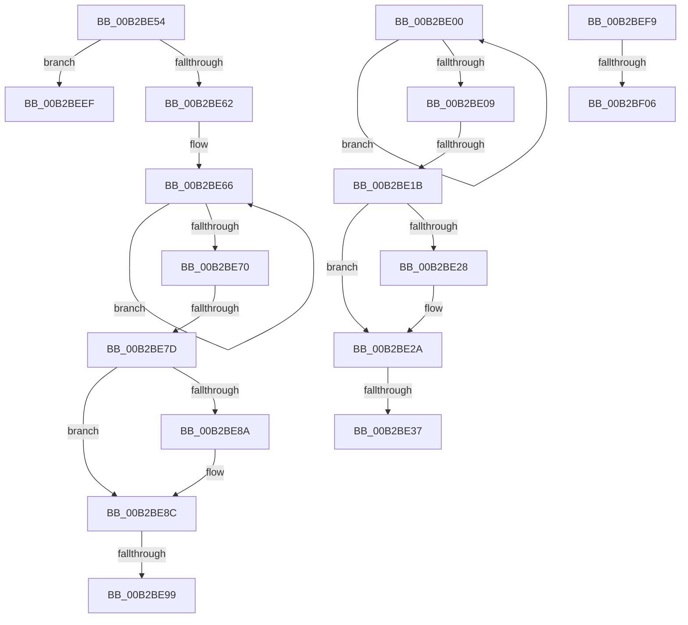

# sub_00B2BE00

- RVA: `0x00B2BE00`–`0x00B2BF4B` (길이 `331` bytes)
- VA: `0x0000000140B2BE00`
- 실행 섹션: `PAGE`
- PDB 이름 있음: `아니요`; PDB Function 태그: `아니요`
- unwind 정보 RVA: `0x00098CEC`
- 디코드: `67`개 명령, `331/331` bytes 표시
- 미해석 바이트: `0` (있으면 어셈블리에 `.byte`로 보존)

> 이 문서는 커널 이미지의 기계어와 PDB 기호를 분석해 생성했습니다. 4번과 5번은 함수 원형과 자료형을 바이너리 사용 방식에서 추정한 C 해석이며 원본 소스 복구 결과는 아닙니다.

## 1. Dependencies

- 직접 호출 지점: **2**; 고유 호출 대상: **1**
- 직접 호출자로 확인된 함수: **0**
- RIP 상대 이미지 참조: **5**

### Outgoing calls
- `0x00B2BEE4` → [RtlStringCchPrintfExW](../../text/42/RtlStringCchPrintfExW_function_0042B390.md) (function, `0x0042B390`)
- `0x00B2BF40` → [RtlStringCchPrintfExW](../../text/42/RtlStringCchPrintfExW_function_0042B390.md) (function, `0x0042B390`)

### Direct callers
- 이 함수 시작 RVA로 연결되는 직접 call은 확인되지 않았습니다. 간접 호출은 완전히 역산할 수 없습니다.

### Static image references
- `0x00B2BE37` → RVA `0x00B0D550` (` ?? ::NNGAKEGL::`string'`; read)
- `0x00B2BE48` → RVA `0x00B0D590` (` ?? ::NNGAKEGL::`string'`; read)
- `0x00B2BEBC` → RVA `0x00B0D620` (` ?? ::NNGAKEGL::`string'`; read)
- `0x00B2BED0` → RVA `0x00B0D700` (` ?? ::NNGAKEGL::`string'`; read)
- `0x00B2BF2C` → RVA `0x00AFD430` (` ?? ::NNGAKEGL::`string'`; read)

## 2. Other-region calls and transfers

- 다른 실행 섹션으로 향하는 call: **2**
  - `0x00B2BEE4` → [RtlStringCchPrintfExW](../../text/42/RtlStringCchPrintfExW_function_0042B390.md) (`PAGE` → `.text`)
  - `0x00B2BF40` → [RtlStringCchPrintfExW](../../text/42/RtlStringCchPrintfExW_function_0042B390.md) (`PAGE` → `.text`)
- call이 아닌 외부 분기/꼬리 이동: **9**
  - `0x00B2BE15` → [_CmGetDeviceHardwareKeyPath + 0x36](../99/_CmGetDeviceHardwareKeyPath_function_00991528.md) (`tail-transfer`)
  - `0x00B2BE31` → [_CmGetDeviceHardwareKeyPath + 0xC7](../99/_CmGetDeviceHardwareKeyPath_function_00991528.md) (`tail-transfer`)
  - `0x00B2BE4F` → [_CmGetDeviceHardwareKeyPath + 0x71](../99/_CmGetDeviceHardwareKeyPath_function_00991528.md) (`tail-transfer`)
  - `0x00B2BE77` → [_CmGetDeviceHardwareKeyPath + 0x36](../99/_CmGetDeviceHardwareKeyPath_function_00991528.md) (`tail-transfer`)
  - `0x00B2BE93` → [_CmGetDeviceHardwareKeyPath + 0xC7](../99/_CmGetDeviceHardwareKeyPath_function_00991528.md) (`tail-transfer`)
  - `0x00B2BEEA` → [_CmGetDeviceHardwareKeyPath + 0x3B](../99/_CmGetDeviceHardwareKeyPath_function_00991528.md) (`tail-transfer`)
  - `0x00B2BEF4` → [_CmGetDeviceHardwareKeyPath + 0x3B](../99/_CmGetDeviceHardwareKeyPath_function_00991528.md) (`tail-transfer`)
  - `0x00B2BF00` → [_CmGetDeviceHardwareKeyPath + 0xC7](../99/_CmGetDeviceHardwareKeyPath_function_00991528.md) (`tail-transfer`)
  - `0x00B2BF46` → [_CmGetDeviceHardwareKeyPath + 0x3B](../99/_CmGetDeviceHardwareKeyPath_function_00991528.md) (`tail-transfer`)

## 3. Assembly (complete function range)

```asm
00B2BE00  48 FF C0                        inc rax
00B2BE03  66 39 0C 42                     cmp word ptr [rdx + rax*2], cx
00B2BE07  75 F7                           jne 0x140b2be00
00B2BE09  48 83 C0 52                     add rax, 0x52
00B2BE0D  BA FF FF FF FF                  mov edx, 0xffffffff
00B2BE12  48 3B C2                        cmp rax, rdx
00B2BE15  0F 87 43 57 E6 FF               ja 0x14099155e
00B2BE1B  48 8B 94 24 98 00 00 00         mov rdx, qword ptr [rsp + 0x98]
00B2BE23  48 85 D2                        test rdx, rdx
00B2BE26  74 02                           je 0x140b2be2a
00B2BE28  89 02                           mov dword ptr [rdx], eax
00B2BE2A  3B 84 24 90 00 00 00            cmp eax, dword ptr [rsp + 0x90]
00B2BE31  0F 87 B8 57 E6 FF               ja 0x1409915ef
00B2BE37  48 8D 05 12 17 FE FF            lea rax, [rip - 0x1e8ee]
00B2BE3E  4C 89 54 24 40                  mov qword ptr [rsp + 0x40], r10
00B2BE43  48 89 44 24 38                  mov qword ptr [rsp + 0x38], rax
00B2BE48  48 8D 05 41 17 FE FF            lea rax, [rip - 0x1e8bf]
00B2BE4F  E9 45 57 E6 FF                  jmp 0x140991599
00B2BE54  BA FF FF FF FF                  mov edx, 0xffffffff
00B2BE59  44 3B CA                        cmp r9d, edx
00B2BE5C  0F 84 8D 00 00 00               je 0x140b2beef
00B2BE62  48 83 C8 FF                     or rax, 0xffffffffffffffff
00B2BE66  48 FF C0                        inc rax
00B2BE69  66 41 39 0C 42                  cmp word ptr [r10 + rax*2], cx
00B2BE6E  75 F6                           jne 0x140b2be66
00B2BE70  48 83 C0 4F                     add rax, 0x4f
00B2BE74  48 3B C2                        cmp rax, rdx
00B2BE77  0F 87 E1 56 E6 FF               ja 0x14099155e
00B2BE7D  48 8B 94 24 98 00 00 00         mov rdx, qword ptr [rsp + 0x98]
00B2BE85  48 85 D2                        test rdx, rdx
00B2BE88  74 02                           je 0x140b2be8c
00B2BE8A  89 02                           mov dword ptr [rdx], eax
00B2BE8C  3B 84 24 90 00 00 00            cmp eax, dword ptr [rsp + 0x90]
00B2BE93  0F 87 56 57 E6 FF               ja 0x1409915ef
00B2BE99  8B 94 24 90 00 00 00            mov edx, dword ptr [rsp + 0x90]
00B2BEA0  48 8D 05 A9 16 FE FF            lea rax, [rip - 0x1e957]
00B2BEA7  48 8B 8C 24 88 00 00 00         mov rcx, qword ptr [rsp + 0x88]
00B2BEAF  45 33 C0                        xor r8d, r8d
00B2BEB2  4C 89 54 24 48                  mov qword ptr [rsp + 0x48], r10
00B2BEB7  48 89 44 24 40                  mov qword ptr [rsp + 0x40], rax
00B2BEBC  48 8D 05 5D 17 FE FF            lea rax, [rip - 0x1e8a3]
00B2BEC3  44 89 4C 24 38                  mov dword ptr [rsp + 0x38], r9d
00B2BEC8  45 33 C9                        xor r9d, r9d
00B2BECB  48 89 44 24 30                  mov qword ptr [rsp + 0x30], rax
00B2BED0  48 8D 05 29 18 FE FF            lea rax, [rip - 0x1e7d7]
00B2BED7  48 89 44 24 28                  mov qword ptr [rsp + 0x28], rax
00B2BEDC  C7 44 24 20 00 08 00 00         mov dword ptr [rsp + 0x20], 0x800
00B2BEE4  E8 A7 F4 8F FF                  call 0x14042b390
00B2BEE9  90                              nop
00B2BEEA  E9 74 56 E6 FF                  jmp 0x140991563
00B2BEEF  B8 0D 00 00 C0                  mov eax, 0xc000000d
00B2BEF4  E9 6A 56 E6 FF                  jmp 0x140991563
00B2BEF9  3B 84 24 90 00 00 00            cmp eax, dword ptr [rsp + 0x90]
00B2BF00  0F 87 E9 56 E6 FF               ja 0x1409915ef
00B2BF06  8B 94 24 90 00 00 00            mov edx, dword ptr [rsp + 0x90]
00B2BF0D  48 8D 05 3C 16 FE FF            lea rax, [rip - 0x1e9c4]
00B2BF14  48 8B 8C 24 88 00 00 00         mov rcx, qword ptr [rsp + 0x88]
00B2BF1C  45 33 C9                        xor r9d, r9d
00B2BF1F  4C 89 54 24 38                  mov qword ptr [rsp + 0x38], r10
00B2BF24  45 33 C0                        xor r8d, r8d
00B2BF27  48 89 44 24 30                  mov qword ptr [rsp + 0x30], rax
00B2BF2C  48 8D 05 FD 14 FD FF            lea rax, [rip - 0x2eb03]
00B2BF33  48 89 44 24 28                  mov qword ptr [rsp + 0x28], rax
00B2BF38  C7 44 24 20 00 08 00 00         mov dword ptr [rsp + 0x20], 0x800
00B2BF40  E8 4B F4 8F FF                  call 0x14042b390
00B2BF45  90                              nop
00B2BF46  E9 18 56 E6 FF                  jmp 0x140991563
```

## 4. C-style interpretation (structured pseudocode)

```c
__int64 __fastcall sub_00B2BE00(unsigned __int16 a1, __int64 a2, int a3, int a4, __int64 a5, __int64 a6, __int64 a7, __int64 a8, __int64 a9, __int64 a10, __int64 a11, __int64 a12, __int64 a13, __int64 a14, __int64 a15, __int64 a16, __int64 a17, unsigned int a18, __int64 a19)
{
    __int64 result;
    unsigned int v_stack_p20;
    unsigned __int64 v_stack_p28;
    unsigned __int64 v_stack_p30;
    unsigned __int64 v_stack_p38;
    unsigned __int64 v_stack_p40;
    unsigned __int64 v_stack_p48;
    unsigned __int64 v_stack_p88;
    unsigned int v_stack_p90;
    unsigned __int64 v_stack_p98;

    result = (result) + 1;
    if ((*(unsigned __int16 *)(a2 + result * 2)) != a1) goto loc_00B2BE00;
    result = (result) + (82);
    if (a19 != 0) {
        *(unsigned int *)(a19) = (unsigned int)(result);
    }
    v_stack_p40 = v_r10;
    v_stack_p38 = v_rip - 125166;
}
```

## 5. (Beta) C Style

```c
int64_t sub_00B2BE00(uint16_t Arg1, void *Arg2, int32_t Arg3, int32_t Arg4, uint64_t Arg5, uint64_t Arg6, uint64_t Arg7, uint64_t Arg8, uint64_t Arg9, uint64_t Arg10, uint64_t Arg11, uint64_t Arg12, uint64_t Arg13, uint64_t Arg14, uint64_t Arg15, uint64_t Arg16, uint64_t Arg17, uint32_t Arg18, int64_t Arg19)
{
    uint8_t *arg2 = (uint8_t *)Arg2;

    int64_t result;
    uint32_t v_stack_p20;
    uint64_t v_stack_p28;
    uint64_t v_stack_p30;
    uint64_t v_stack_p38;
    uint64_t v_stack_p40;
    uint64_t v_stack_p48;
    uint64_t v_stack_p88;
    uint32_t v_stack_p90;
    uint64_t v_stack_p98;

    result = (result) + 1;
    if ((*(uint16_t *)(arg2 + result * 2)) != Arg1) goto loc_00B2BE00;
    result = (result) + (82);
    if (Arg19 != 0) {
        *(uint32_t *)(Arg19) = (uint32_t)(result);
    }
    v_stack_p40 = local_r10;
    v_stack_p38 = v_rip - 125166;
}
```

### 관측된 메모리 오프셋

구조체 형식이 확인되지 않은 접근은 인자 기준의 오프셋으로만 기록했습니다.

| 기준 인자 | 오프셋 표현 | 폭 (bit) | 접근 |
|---|---:|---:|---|
| `Arg2` | `+ 0x0 + rax*2` | `16` | `R` |

## 6. Execution-region graph

[열기: 2D/3D 그래프와 함수 탐색 컨트롤 패널](../../../control-panel.html?section=page&rva=0x00B2BE00&view=graph)

- 2D 그래프는 위에서 아래로 흐르고, 3D 그래프는 빈 공간을 드래그해 회전합니다. Shift+드래그는 이동, 휠은 확대·축소, 함수 노드 선택은 대상 보고서 이동입니다.

### Static fallback


