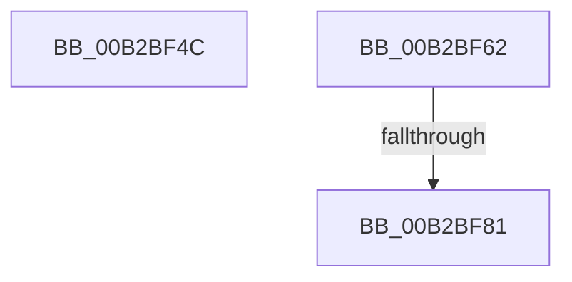

# sub_00B2BF4C

- RVA: `0x00B2BF4C`–`0x00B2BFA3` (길이 `87` bytes)
- VA: `0x0000000140B2BF4C`
- 실행 섹션: `PAGE`
- PDB 이름 있음: `아니요`; PDB Function 태그: `아니요`
- unwind 정보 RVA: `0x00098E10`
- 디코드: `21`개 명령, `87/87` bytes 표시
- 미해석 바이트: `0` (있으면 어셈블리에 `.byte`로 보존)

> 이 문서는 커널 이미지의 기계어와 PDB 기호를 분석해 생성했습니다. 4번과 5번은 함수 원형과 자료형을 바이너리 사용 방식에서 추정한 C 해석이며 원본 소스 복구 결과는 아닙니다.

## 1. Dependencies

- 직접 호출 지점: **3**; 고유 호출 대상: **2**
- 직접 호출자로 확인된 함수: **0**
- RIP 상대 이미지 참조: **1**

### Outgoing calls
- `0x00B2BF57` → [_PnpCtxGetCachedContextBaseKey](../8E/_PnpCtxGetCachedContextBaseKey_function_008EFB2C.md) (function, `0x008EFB2C`)
- `0x00B2BF72` → [_PnpCtxGetCachedContextBaseKey](../8E/_PnpCtxGetCachedContextBaseKey_function_008EFB2C.md) (function, `0x008EFB2C`)
- `0x00B2BF97` → [PnpCtxRegEnumKey](../99/PnpCtxRegEnumKey_function_009929C0.md) (function, `0x009929C0`)

### Direct callers
- 이 함수 시작 RVA로 연결되는 직접 call은 확인되지 않았습니다. 간접 호출은 완전히 역산할 수 없습니다.

### Static image references
- `0x00B2BF4C` → RVA `0x00E66398` (`.data`; read)

## 2. Other-region calls and transfers

- 다른 실행 섹션으로 향하는 call: **0**
- call이 아닌 외부 분기/꼬리 이동: **3**
  - `0x00B2BF5D` → [PiCMEnumerateSubKeys + 0xE2](../99/PiCMEnumerateSubKeys_function_009926E8.md) (`tail-transfer`)
  - `0x00B2BF7B` → [PiCMEnumerateSubKeys + 0x112](../99/PiCMEnumerateSubKeys_function_009926E8.md) (`tail-transfer`)
  - `0x00B2BF9E` → [PiCMEnumerateSubKeys + 0x10A](../99/PiCMEnumerateSubKeys_function_009926E8.md) (`tail-transfer`)

## 3. Assembly (complete function range)

```asm
00B2BF4C  48 8B 0D 45 A4 33 00            mov rcx, qword ptr [rip + 0x33a445]
00B2BF53  4C 8D 45 E0                     lea r8, [rbp - 0x20]
00B2BF57  E8 D0 3B DC FF                  call 0x1408efb2c
00B2BF5C  90                              nop
00B2BF5D  E9 68 68 E6 FF                  jmp 0x1409927ca
00B2BF62  48 8B 0D 2F A4 33 00            mov rcx, qword ptr [rip + 0x33a42f]
00B2BF69  4C 8D 45 E0                     lea r8, [rbp - 0x20]
00B2BF6D  BA 09 00 00 00                  mov edx, 9
00B2BF72  E8 B5 3B DC FF                  call 0x1408efb2c
00B2BF77  8B C8                           mov ecx, eax
00B2BF79  85 C0                           test eax, eax
00B2BF7B  0F 88 79 68 E6 FF               js 0x1409927fa
00B2BF81  2B 5D 48                        sub ebx, dword ptr [rbp + 0x48]
00B2BF84  48 8D 45 40                     lea rax, [rbp + 0x40]
00B2BF88  48 8B 55 E0                     mov rdx, qword ptr [rbp - 0x20]
00B2BF8C  44 8B C3                        mov r8d, ebx
00B2BF8F  4C 8B CF                        mov r9, rdi
00B2BF92  48 89 44 24 20                  mov qword ptr [rsp + 0x20], rax
00B2BF97  E8 24 6A E6 FF                  call 0x1409929c0
00B2BF9C  8B C8                           mov ecx, eax
00B2BF9E  E9 4F 68 E6 FF                  jmp 0x1409927f2
```

## 4. C-style interpretation (structured pseudocode)

```c
__int64 __fastcall sub_00B2BF4C(void)
{
    __int64 result;
    unsigned __int64 v_stack_p20;

    result = _PnpCtxGetCachedContextBaseKey(*(unsigned __int64 *)(v_rip + 3384389), a2, v_rbp - 32, a4);
}
```

## 5. (Beta) C Style

```c
void sub_00B2BF4C(void)
{
    int64_t result;
    uint64_t v_stack_p20;

    result = _PnpCtxGetCachedContextBaseKey(*(uint64_t *)(v_rip + 0x33A445), a2, local_rbp - 32, a4);
}
```

## 6. Execution-region graph

[열기: 2D/3D 그래프와 함수 탐색 컨트롤 패널](../../../control-panel.html?section=page&rva=0x00B2BF4C&view=graph)

- 2D 그래프는 위에서 아래로 흐르고, 3D 그래프는 빈 공간을 드래그해 회전합니다. Shift+드래그는 이동, 휠은 확대·축소, 함수 노드 선택은 대상 보고서 이동입니다.

### Static fallback


