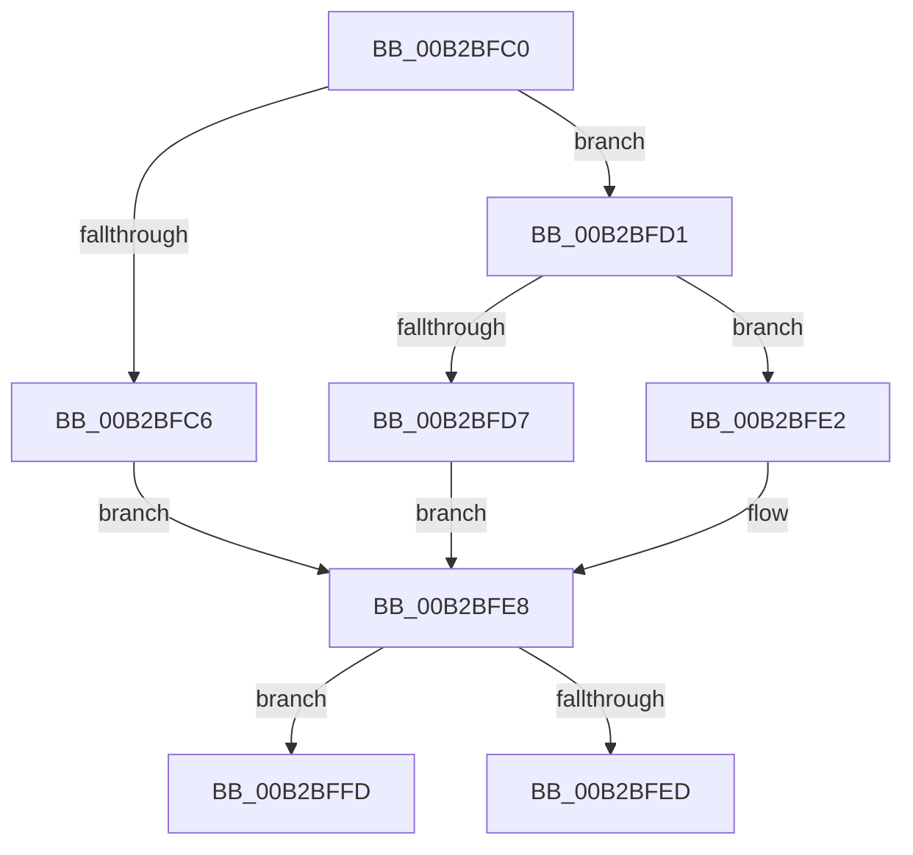

# sub_00B2BFC0

- RVA: `0x00B2BFC0`–`0x00B2C006` (길이 `70` bytes)
- VA: `0x0000000140B2BFC0`
- 실행 섹션: `PAGE`
- PDB 이름 있음: `아니요`; PDB Function 태그: `아니요`
- unwind 정보 RVA: `0x00098F28`
- 디코드: `20`개 명령, `70/70` bytes 표시
- 미해석 바이트: `0` (있으면 어셈블리에 `.byte`로 보존)

> 이 문서는 커널 이미지의 기계어와 PDB 기호를 분석해 생성했습니다. 4번과 5번은 함수 원형과 자료형을 바이너리 사용 방식에서 추정한 C 해석이며 원본 소스 복구 결과는 아닙니다.

## 1. Dependencies

- 직접 호출 지점: **0**; 고유 호출 대상: **0**
- 직접 호출자로 확인된 함수: **0**
- RIP 상대 이미지 참조: **0**

### Outgoing calls
- 직접 디코드된 call 명령이 없습니다.

### Direct callers
- 이 함수 시작 RVA로 연결되는 직접 call은 확인되지 않았습니다. 간접 호출은 완전히 역산할 수 없습니다.

### Static image references
- 디코드된 RIP-relative 메모리 참조가 없습니다.

## 2. Other-region calls and transfers

- 다른 실행 섹션으로 향하는 call: **0**
- call이 아닌 외부 분기/꼬리 이동: **2**
  - `0x00B2BFF8` → [RtlUnicodeStringToInteger + 0x8C](../99/RtlUnicodeStringToInteger_function_00993480.md) (`tail-transfer`)
  - `0x00B2C001` → [RtlUnicodeStringToInteger + 0x8C](../99/RtlUnicodeStringToInteger_function_00993480.md) (`tail-transfer`)

## 3. Assembly (complete function range)

```asm
00B2BFC0  66 83 F8 6F                     cmp ax, 0x6f
00B2BFC4  75 0B                           jne 0x140b2bfd1
00B2BFC6  BB 08 00 00 00                  mov ebx, 8
00B2BFCB  44 8D 5B FB                     lea r11d, [rbx - 5]
00B2BFCF  EB 17                           jmp 0x140b2bfe8
00B2BFD1  66 83 F8 62                     cmp ax, 0x62
00B2BFD5  75 0B                           jne 0x140b2bfe2
00B2BFD7  BB 02 00 00 00                  mov ebx, 2
00B2BFDC  44 8D 5B FF                     lea r11d, [rbx - 1]
00B2BFE0  EB 06                           jmp 0x140b2bfe8
00B2BFE2  44 8B C2                        mov r8d, edx
00B2BFE5  4C 8B D1                        mov r10, rcx
00B2BFE8  45 85 C0                        test r8d, r8d
00B2BFEB  74 10                           je 0x140b2bffd
00B2BFED  41 FF C8                        dec r8d
00B2BFF0  41 0F B7 02                     movzx eax, word ptr [r10]
00B2BFF4  49 83 C2 02                     add r10, 2
00B2BFF8  E9 0F 75 E6 FF                  jmp 0x14099350c
00B2BFFD  41 0F B7 C1                     movzx eax, r9w
00B2C001  E9 06 75 E6 FF                  jmp 0x14099350c
```

## 4. C-style interpretation (structured pseudocode)

```c
__int64 __fastcall sub_00B2BFC0(__int64 a1, int a2, __int64 a3, unsigned __int16 a4)
{
    __int64 v_r10;

    if (((unsigned __int16)(result)) != 111) goto loc_00B2BFD1;
    goto loc_00B2BFE8;
loc_00B2BFD1:
    if (((unsigned __int16)(result)) != 98) goto loc_00B2BFE2;
    goto loc_00B2BFE8;
loc_00B2BFE2:
loc_00B2BFE8:
    if ((unsigned int)((unsigned int)(a2)) == 0) goto loc_00B2BFFD;
    a3 = (unsigned int)(((unsigned int)(a2)) - 1);
    v_r10 = (a1) + (2);
loc_00B2BFFD:
}
```

## 5. (Beta) C Style

```c
int64_t sub_00B2BFC0(int64_t Arg1, int32_t Arg2, int64_t Arg3, uint16_t Arg4)
{
    int64_t local_r10;

    if (((uint16_t)(result)) != 111) goto loc_00B2BFD1;
    goto loc_00B2BFE8;
loc_00B2BFD1:
    if (((uint16_t)(result)) != 98) goto loc_00B2BFE2;
    goto loc_00B2BFE8;
loc_00B2BFE2:
loc_00B2BFE8:
    if ((uint32_t)((uint32_t)(Arg2)) == 0) goto loc_00B2BFFD;
    Arg3 = (uint32_t)(((uint32_t)(Arg2)) - 1);
    local_r10 = (Arg1) + (2);
loc_00B2BFFD:
}
```

## 6. Execution-region graph

[열기: 2D/3D 그래프와 함수 탐색 컨트롤 패널](../../../control-panel.html?section=page&rva=0x00B2BFC0&view=graph)

- 2D 그래프는 위에서 아래로 흐르고, 3D 그래프는 빈 공간을 드래그해 회전합니다. Shift+드래그는 이동, 휠은 확대·축소, 함수 노드 선택은 대상 보고서 이동입니다.

### Static fallback


