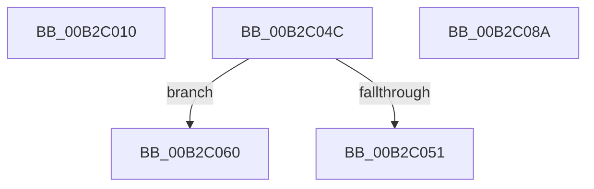

# sub_00B2C010

- RVA: `0x00B2C010`–`0x00B2C0CC` (길이 `188` bytes)
- VA: `0x0000000140B2C010`
- 실행 섹션: `PAGE`
- PDB 이름 있음: `아니요`; PDB Function 태그: `아니요`
- unwind 정보 RVA: `0x00098FAC`
- 디코드: `46`개 명령, `188/188` bytes 표시
- 미해석 바이트: `0` (있으면 어셈블리에 `.byte`로 보존)

> 이 문서는 커널 이미지의 기계어와 PDB 기호를 분석해 생성했습니다. 4번과 5번은 함수 원형과 자료형을 바이너리 사용 방식에서 추정한 C 해석이며 원본 소스 복구 결과는 아닙니다.

## 1. Dependencies

- 직접 호출 지점: **3**; 고유 호출 대상: **3**
- 직접 호출자로 확인된 함수: **0**
- RIP 상대 이미지 참조: **1**

### Outgoing calls
- `0x00B2C041` → [CmSetInterfaceClassMappedProperty](../83/CmSetInterfaceClassMappedProperty_function_00831500.md) (function, `0x00831500`)
- `0x00B2C07F` → [CmGetInterfaceClassMappedPropertyFromComposite](../83/CmGetInterfaceClassMappedPropertyFromComposite_function_00830B68.md) (function, `0x00830B68`)
- `0x00B2C0C1` → [CmGetMatchingCommonClassList](../82/CmGetMatchingCommonClassList_function_0082D120.md) (function, `0x0082D120`)

### Direct callers
- 이 함수 시작 RVA로 연결되는 직접 call은 확인되지 않았습니다. 간접 호출은 완전히 역산할 수 없습니다.

### Static image references
- `0x00B2C051` → RVA `0x00000000` (`image boundary/outside`; read)

## 2. Other-region calls and transfers

- 다른 실행 섹션으로 향하는 call: **0**
- call이 아닌 외부 분기/꼬리 이동: **4**
  - `0x00B2C047` → [_PnpDispatchInterfaceClass + 0x15B](../99/_PnpDispatchInterfaceClass_function_00993BD0.md) (`tail-transfer`)
  - `0x00B2C05B` → [_PnpDispatchInterfaceClass + 0x162](../99/_PnpDispatchInterfaceClass_function_00993BD0.md) (`tail-transfer`)
  - `0x00B2C085` → [_PnpDispatchInterfaceClass + 0x15B](../99/_PnpDispatchInterfaceClass_function_00993BD0.md) (`tail-transfer`)
  - `0x00B2C0C7` → [_PnpDispatchInterfaceClass + 0x15B](../99/_PnpDispatchInterfaceClass_function_00993BD0.md) (`tail-transfer`)

## 3. Assembly (complete function range)

```asm
00B2C010  4C 8B 84 24 B0 00 00 00         mov r8, qword ptr [rsp + 0xb0]
00B2C018  41 8B 40 28                     mov eax, dword ptr [r8 + 0x28]
00B2C01C  4D 8B 48 08                     mov r9, qword ptr [r8 + 8]
00B2C020  89 44 24 38                     mov dword ptr [rsp + 0x38], eax
00B2C024  49 8B 40 20                     mov rax, qword ptr [r8 + 0x20]
00B2C028  48 89 44 24 30                  mov qword ptr [rsp + 0x30], rax
00B2C02D  41 8B 40 18                     mov eax, dword ptr [r8 + 0x18]
00B2C031  89 44 24 28                     mov dword ptr [rsp + 0x28], eax
00B2C035  49 8B 40 10                     mov rax, qword ptr [r8 + 0x10]
00B2C039  4D 8B 00                        mov r8, qword ptr [r8]
00B2C03C  48 89 44 24 20                  mov qword ptr [rsp + 0x20], rax
00B2C041  E8 BA 54 D0 FF                  call 0x140831500
00B2C046  90                              nop
00B2C047  E9 DF 7C E6 FF                  jmp 0x140993d2b
00B2C04C  48 85 D2                        test rdx, rdx
00B2C04F  74 0F                           je 0x140b2c060
00B2C051  48 8D 15 A8 3F 4D FF            lea rdx, [rip - 0xb2c058]
00B2C058  41 FF C0                        inc r8d
00B2C05B  E9 D2 7C E6 FF                  jmp 0x140993d32
00B2C060  4C 89 7C 24 38                  mov qword ptr [rsp + 0x38], r15
00B2C065  4D 8B CE                        mov r9, r14
00B2C068  89 6C 24 30                     mov dword ptr [rsp + 0x30], ebp
00B2C06C  4D 8B C2                        mov r8, r10
00B2C06F  4C 89 64 24 28                  mov qword ptr [rsp + 0x28], r12
00B2C074  48 8B D7                        mov rdx, rdi
00B2C077  48 8B CE                        mov rcx, rsi
00B2C07A  4C 89 6C 24 20                  mov qword ptr [rsp + 0x20], r13
00B2C07F  E8 E4 4A D0 FF                  call 0x140830b68
00B2C084  90                              nop
00B2C085  E9 A1 7C E6 FF                  jmp 0x140993d2b
00B2C08A  8B 4A 18                        mov ecx, dword ptr [rdx + 0x18]
00B2C08D  4D 8B C8                        mov r9, r8
00B2C090  44 8B 52 28                     mov r10d, dword ptr [rdx + 0x28]
00B2C094  4C 8B C3                        mov r8, rbx
00B2C097  48 8B 42 20                     mov rax, qword ptr [rdx + 0x20]
00B2C09B  41 81 E2 00 00 FF FF            and r10d, 0xffff0000
00B2C0A2  48 8B 52 10                     mov rdx, qword ptr [rdx + 0x10]
00B2C0A6  44 89 54 24 38                  mov dword ptr [rsp + 0x38], r10d
00B2C0AB  48 89 44 24 30                  mov qword ptr [rsp + 0x30], rax
00B2C0B0  89 4C 24 28                     mov dword ptr [rsp + 0x28], ecx
00B2C0B4  48 8B CE                        mov rcx, rsi
00B2C0B7  48 89 54 24 20                  mov qword ptr [rsp + 0x20], rdx
00B2C0BC  BA 04 00 00 00                  mov edx, 4
00B2C0C1  E8 5A 10 D0 FF                  call 0x14082d120
00B2C0C6  90                              nop
00B2C0C7  E9 5F 7C E6 FF                  jmp 0x140993d2b
```

## 4. C-style interpretation (structured pseudocode)

```c
__int64 __fastcall sub_00B2C010(__int64 a1, __int64 a2, __int64 a3, __int64 a4, __int64 a5, __int64 a6, __int64 a7, __int64 a8, __int64 a9, __int64 a10, __int64 a11, __int64 a12, __int64 a13, __int64 a14, __int64 a15, __int64 a16, __int64 a17, __int64 a18, __int64 a19, __int64 a20, __int64 a21, __int64 a22)
{
    __int64 result;
    unsigned __int64 v_stack_p20;
    unsigned int v_stack_p28;
    unsigned __int64 v_stack_p30;
    unsigned int v_stack_p38;

    v_stack_p38 = (unsigned int)((unsigned int)(*(unsigned int *)(a22 + 40)));
    v_stack_p30 = *(unsigned __int64 *)(a22 + 32);
    v_stack_p28 = (unsigned int)((unsigned int)(*(unsigned int *)(a22 + 24)));
    v_stack_p20 = *(unsigned __int64 *)(a22 + 16);
    result = CmSetInterfaceClassMappedProperty(a1, a2, *(unsigned __int64 *)(a22), *(unsigned __int64 *)(a22 + 8));
}
```

## 5. (Beta) C Style

```c
int64_t sub_00B2C010(int64_t Arg1, int64_t Arg2, int64_t Arg3, int64_t Arg4, uint64_t Arg5, uint64_t Arg6, uint64_t Arg7, uint64_t Arg8, uint64_t Arg9, uint64_t Arg10, uint64_t Arg11, uint64_t Arg12, uint64_t Arg13, uint64_t Arg14, uint64_t Arg15, uint64_t Arg16, uint64_t Arg17, uint64_t Arg18, uint64_t Arg19, uint64_t Arg20, uint64_t Arg21, void *Arg22)
{
    uint8_t *arg22 = (uint8_t *)Arg22;

    int64_t result;
    uint64_t v_stack_p20;
    uint32_t v_stack_p28;
    uint64_t v_stack_p30;
    uint32_t v_stack_p38;

    v_stack_p38 = (uint32_t)((uint32_t)(*(uint32_t *)(arg22 + 0x28)));
    v_stack_p30 = *(uint64_t *)(arg22 + 0x20);
    v_stack_p28 = (uint32_t)((uint32_t)(*(uint32_t *)(arg22 + 0x18)));
    v_stack_p20 = *(uint64_t *)(arg22 + 0x10);
    result = CmSetInterfaceClassMappedProperty(Arg1, Arg2, *(uint64_t *)(arg22), *(uint64_t *)(arg22 + 0x8));
}
```

### 관측된 메모리 오프셋

구조체 형식이 확인되지 않은 접근은 인자 기준의 오프셋으로만 기록했습니다.

| 기준 인자 | 오프셋 표현 | 폭 (bit) | 접근 |
|---|---:|---:|---|
| `Arg22` | `+ 0x0` | `64` | `R` |
| `Arg22` | `+ 0x8` | `64` | `R` |
| `Arg22` | `+ 0x10` | `64` | `R` |
| `Arg22` | `+ 0x18` | `32` | `R` |
| `Arg22` | `+ 0x20` | `64` | `R` |
| `Arg22` | `+ 0x28` | `32` | `R` |

## 6. Execution-region graph

[열기: 2D/3D 그래프와 함수 탐색 컨트롤 패널](../../../control-panel.html?section=page&rva=0x00B2C010&view=graph)

- 2D 그래프는 위에서 아래로 흐르고, 3D 그래프는 빈 공간을 드래그해 회전합니다. Shift+드래그는 이동, 휠은 확대·축소, 함수 노드 선택은 대상 보고서 이동입니다.

### Static fallback


