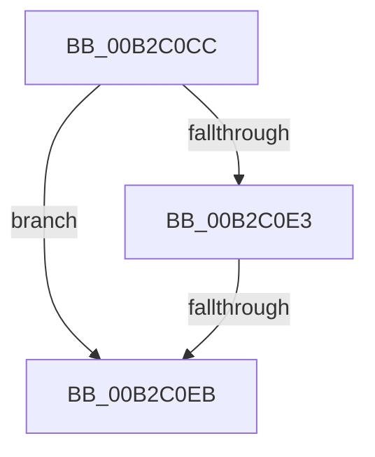

# sub_00B2C0CC

- RVA: `0x00B2C0CC`–`0x00B2C0F2` (길이 `38` bytes)
- VA: `0x0000000140B2C0CC`
- 실행 섹션: `PAGE`
- PDB 이름 있음: `아니요`; PDB Function 태그: `아니요`
- unwind 정보 RVA: `0x00098FD8`
- 디코드: `11`개 명령, `38/38` bytes 표시
- 미해석 바이트: `0` (있으면 어셈블리에 `.byte`로 보존)

> 이 문서는 커널 이미지의 기계어와 PDB 기호를 분석해 생성했습니다. 4번과 5번은 함수 원형과 자료형을 바이너리 사용 방식에서 추정한 C 해석이며 원본 소스 복구 결과는 아닙니다.

## 1. Dependencies

- 직접 호출 지점: **0**; 고유 호출 대상: **0**
- 직접 호출자로 확인된 함수: **0**
- RIP 상대 이미지 참조: **0**

### Outgoing calls
- 직접 디코드된 call 명령이 없습니다.

### Direct callers
- 이 함수 시작 RVA로 연결되는 직접 call은 확인되지 않았습니다. 간접 호출은 완전히 역산할 수 없습니다.

### Static image references
- 디코드된 RIP-relative 메모리 참조가 없습니다.

## 2. Other-region calls and transfers

- 다른 실행 섹션으로 향하는 call: **0**
- call이 아닌 외부 분기/꼬리 이동: **2**
  - `0x00B2C0E5` → [_CmGetInterfaceClassMappedPropertyFromRegValue + 0x138](../99/_CmGetInterfaceClassMappedPropertyFromRegValue_function_00993EB8.md) (`tail-transfer`)
  - `0x00B2C0ED` → [_CmGetInterfaceClassMappedPropertyFromRegValue + 0x138](../99/_CmGetInterfaceClassMappedPropertyFromRegValue_function_00993EB8.md) (`tail-transfer`)

## 3. Assembly (complete function range)

```asm
00B2C0CC  8B 45 D0                        mov eax, dword ptr [rbp - 0x30]
00B2C0CF  48 8B 4D E8                     mov rcx, qword ptr [rbp - 0x18]
00B2C0D3  89 01                           mov dword ptr [rcx], eax
00B2C0D5  48 8B 45 F0                     mov rax, qword ptr [rbp - 0x10]
00B2C0D9  C7 00 12 00 00 00               mov dword ptr [rax], 0x12
00B2C0DF  85 FF                           test edi, edi
00B2C0E1  75 08                           jne 0x140b2c0eb
00B2C0E3  85 F6                           test esi, esi
00B2C0E5  0F 85 05 7F E6 FF               jne 0x140993ff0
00B2C0EB  8B DA                           mov ebx, edx
00B2C0ED  E9 FE 7E E6 FF                  jmp 0x140993ff0
```

## 4. C-style interpretation (structured pseudocode)

```c
__int64 __fastcall sub_00B2C0CC(__int64 a1, int a2)
{
    *(unsigned int *)(*(unsigned __int64 *)(v_rbp - 24)) = (unsigned int)((unsigned int)(*(unsigned int *)(v_rbp - 48)));
    *(unsigned int *)(*(unsigned __int64 *)(v_rbp - 16)) = 18;
    if ((unsigned int)(v_rdi) != 0) goto loc_00B2C0EB;
loc_00B2C0EB:
}
```

## 5. (Beta) C Style

```c
int64_t sub_00B2C0CC(int64_t Arg1, int32_t Arg2)
{
    *(uint32_t *)(*(uint64_t *)(local_rbp - 0x18)) = (uint32_t)((uint32_t)(*(uint32_t *)(local_rbp - 0x30)));
    *(uint32_t *)(*(uint64_t *)(local_rbp - 0x10)) = 18;
    if ((uint32_t)(local_rdi) != 0) goto loc_00B2C0EB;
loc_00B2C0EB:
}
```

## 6. Execution-region graph

[열기: 2D/3D 그래프와 함수 탐색 컨트롤 패널](../../../control-panel.html?section=page&rva=0x00B2C0CC&view=graph)

- 2D 그래프는 위에서 아래로 흐르고, 3D 그래프는 빈 공간을 드래그해 회전합니다. Shift+드래그는 이동, 휠은 확대·축소, 함수 노드 선택은 대상 보고서 이동입니다.

### Static fallback


