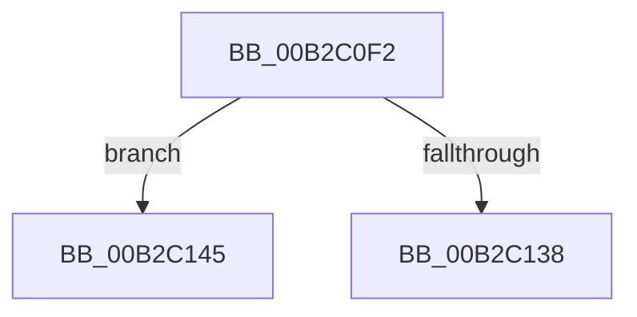

# sub_00B2C0F2

- RVA: `0x00B2C0F2`–`0x00B2C153` (길이 `97` bytes)
- VA: `0x0000000140B2C0F2`
- 실행 섹션: `PAGE`
- PDB 이름 있음: `아니요`; PDB Function 태그: `아니요`
- unwind 정보 RVA: `0x000990FC`
- 디코드: `25`개 명령, `97/97` bytes 표시
- 미해석 바이트: `0` (있으면 어셈블리에 `.byte`로 보존)

> 이 문서는 커널 이미지의 기계어와 PDB 기호를 분석해 생성했습니다. 4번과 5번은 함수 원형과 자료형을 바이너리 사용 방식에서 추정한 C 해석이며 원본 소스 복구 결과는 아닙니다.

## 1. Dependencies

- 직접 호출 지점: **1**; 고유 호출 대상: **1**
- 직접 호출자로 확인된 함수: **0**
- RIP 상대 이미지 참조: **0**

### Outgoing calls
- `0x00B2C128` → [IopCreateDefaultDeviceSecurityDescriptor](../9A/IopCreateDefaultDeviceSecurityDescriptor_function_009A5008.md) (function, `0x009A5008`)

### Direct callers
- 이 함수 시작 RVA로 연결되는 직접 call은 확인되지 않았습니다. 간접 호출은 완전히 역산할 수 없습니다.

### Static image references
- 디코드된 RIP-relative 메모리 참조가 없습니다.

## 2. Other-region calls and transfers

- 다른 실행 섹션으로 향하는 call: **0**
- call이 아닌 외부 분기/꼬리 이동: **2**
  - `0x00B2C140` → [PipChangeDeviceObjectFromRegistryProperties + 0x1E4](../99/PipChangeDeviceObjectFromRegistryProperties_function_00994FD0.md) (`tail-transfer`)
  - `0x00B2C14E` → [PipChangeDeviceObjectFromRegistryProperties + 0x262](../99/PipChangeDeviceObjectFromRegistryProperties_function_00994FD0.md) (`tail-transfer`)

## 3. Assembly (complete function range)

```asm
00B2C0F2  33 C0                           xor eax, eax
00B2C0F4  4C 8D 4D D7                     lea r9, [rbp - 0x29]
00B2C0F8  48 89 45 F7                     mov qword ptr [rbp - 9], rax
00B2C0FC  0F 57 C0                        xorps xmm0, xmm0
00B2C0FF  48 8D 45 A3                     lea rax, [rbp - 0x5d]
00B2C103  41 8B D7                        mov edx, r15d
00B2C106  48 89 44 24 30                  mov qword ptr [rsp + 0x30], rax
00B2C10B  41 8B CC                        mov ecx, r12d
00B2C10E  48 8D 45 B7                     lea rax, [rbp - 0x49]
00B2C112  48 89 44 24 28                  mov qword ptr [rsp + 0x28], rax
00B2C117  48 8D 45 BF                     lea rax, [rbp - 0x41]
00B2C11B  48 89 44 24 20                  mov qword ptr [rsp + 0x20], rax
00B2C120  0F 11 45 D7                     movups xmmword ptr [rbp - 0x29], xmm0
00B2C124  0F 11 45 E7                     movups xmmword ptr [rbp - 0x19], xmm0
00B2C128  E8 DB 8E E7 FF                  call 0x1409a5008
00B2C12D  45 33 C0                        xor r8d, r8d
00B2C130  48 8B F8                        mov rdi, rax
00B2C133  48 85 C0                        test rax, rax
00B2C136  74 0D                           je 0x140b2c145
00B2C138  44 8B 75 A3                     mov r14d, dword ptr [rbp - 0x5d]
00B2C13C  C6 45 9F 01                     mov byte ptr [rbp - 0x61], 1
00B2C140  E9 6F 90 E6 FF                  jmp 0x1409951b4
00B2C145  4C 8B 6D B7                     mov r13, qword ptr [rbp - 0x49]
00B2C149  BE 01 00 00 C0                  mov esi, 0xc0000001
00B2C14E  E9 DF 90 E6 FF                  jmp 0x140995232
```

## 4. C-style interpretation (structured pseudocode)

```c
__int64 __fastcall sub_00B2C0F2(__int64 a1, __int64 a2, int a3)
{
    __int64 result;
    unsigned __int64 v_stack_p20;
    unsigned __int64 v_stack_p28;
    unsigned __int64 v_stack_p30;

    result = 0;
    *(unsigned __int64 *)(v_rbp - 9) = 0;
    v_stack_p30 = v_rbp - 93;
    v_stack_p28 = v_rbp - 73;
    v_stack_p20 = v_rbp - 65;
    *(unsigned __int64 *)(v_rbp - 41) = v_xmm0;
    *(unsigned __int64 *)(v_rbp - 25) = v_xmm0;
    result = IopCreateDefaultDeviceSecurityDescriptor((unsigned int)((unsigned int)(v_r12)), (unsigned int)((unsigned int)(v_r15)), a3, v_rbp - 41);
    a3 = 0;
    if (result == 0) goto loc_00B2C145;
    *(unsigned __int8 *)(v_rbp - 97) = 1;
loc_00B2C145:
}
```

## 5. (Beta) C Style

```c
int64_t sub_00B2C0F2(int64_t Arg1, int64_t Arg2, int32_t Arg3)
{
    int64_t result;
    uint64_t v_stack_p20;
    uint64_t v_stack_p28;
    uint64_t v_stack_p30;

    result = 0;
    *(uint64_t *)(local_rbp - 0x9) = 0;
    v_stack_p30 = local_rbp - 93;
    v_stack_p28 = local_rbp - 73;
    v_stack_p20 = local_rbp - 65;
    *(uint64_t *)(local_rbp - 0x29) = v_xmm0;
    *(uint64_t *)(local_rbp - 0x19) = v_xmm0;
    result = IopCreateDefaultDeviceSecurityDescriptor((uint32_t)((uint32_t)(local_r12)), (uint32_t)((uint32_t)(local_r15)), Arg3, local_rbp - 41);
    Arg3 = 0;
    if (result == 0) goto loc_00B2C145;
    *(uint8_t *)(local_rbp - 0x61) = 1;
loc_00B2C145:
}
```

## 6. Execution-region graph

[열기: 2D/3D 그래프와 함수 탐색 컨트롤 패널](../../../control-panel.html?section=page&rva=0x00B2C0F2&view=graph)

- 2D 그래프는 위에서 아래로 흐르고, 3D 그래프는 빈 공간을 드래그해 회전합니다. Shift+드래그는 이동, 휠은 확대·축소, 함수 노드 선택은 대상 보고서 이동입니다.

### Static fallback


