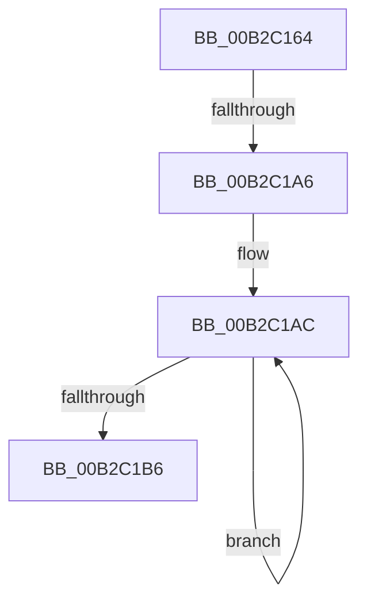

# sub_00B2C164

- RVA: `0x00B2C164`–`0x00B2C1C3` (길이 `95` bytes)
- VA: `0x0000000140B2C164`
- 실행 섹션: `PAGE`
- PDB 이름 있음: `아니요`; PDB Function 태그: `아니요`
- unwind 정보 RVA: `0x0009916C`
- 디코드: `26`개 명령, `95/95` bytes 표시
- 미해석 바이트: `0` (있으면 어셈블리에 `.byte`로 보존)

> 이 문서는 커널 이미지의 기계어와 PDB 기호를 분석해 생성했습니다. 4번과 5번은 함수 원형과 자료형을 바이너리 사용 방식에서 추정한 C 해석이며 원본 소스 복구 결과는 아닙니다.

## 1. Dependencies

- 직접 호출 지점: **1**; 고유 호출 대상: **1**
- 직접 호출자로 확인된 함수: **0**
- RIP 상대 이미지 참조: **0**

### Outgoing calls
- `0x00B2C195` → [PiDqPnPGetObjectProperty](../8D/PiDqPnPGetObjectProperty_function_008DFD90.md) (function, `0x008DFD90`)

### Direct callers
- 이 함수 시작 RVA로 연결되는 직접 call은 확인되지 않았습니다. 간접 호출은 완전히 역산할 수 없습니다.

### Static image references
- 디코드된 RIP-relative 메모리 참조가 없습니다.

## 2. Other-region calls and transfers

- 다른 실행 섹션으로 향하는 call: **0**
- call이 아닌 외부 분기/꼬리 이동: **2**
  - `0x00B2C1A0` → [PiDqActionDataGetAllPropertiesInAllLanguages + 0x186](../99/PiDqActionDataGetAllPropertiesInAllLanguages_function_0099569C.md) (`tail-transfer`)
  - `0x00B2C1BE` → [PiDqActionDataGetAllPropertiesInAllLanguages + 0x100](../99/PiDqActionDataGetAllPropertiesInAllLanguages_function_0099569C.md) (`tail-transfer`)

## 3. Assembly (complete function range)

```asm
00B2C164  8B 06                           mov eax, dword ptr [rsi]
00B2C166  4C 8B 4D F8                     mov r9, qword ptr [rbp - 8]
00B2C16A  4C 8B 45 E8                     mov r8, qword ptr [rbp - 0x18]
00B2C16E  8B 55 E0                        mov edx, dword ptr [rbp - 0x20]
00B2C171  48 8D 0C 40                     lea rcx, [rax + rax*2]
00B2C175  48 8B 45 60                     mov rax, qword ptr [rbp + 0x60]
00B2C179  48 C1 E1 04                     shl rcx, 4
00B2C17D  48 03 08                        add rcx, qword ptr [rax]
00B2C180  8B 45 48                        mov eax, dword ptr [rbp + 0x48]
00B2C183  48 89 4C 24 30                  mov qword ptr [rsp + 0x30], rcx
00B2C188  48 8B 4D 58                     mov rcx, qword ptr [rbp + 0x58]
00B2C18C  4C 89 7C 24 28                  mov qword ptr [rsp + 0x28], r15
00B2C191  89 44 24 20                     mov dword ptr [rsp + 0x20], eax
00B2C195  E8 F6 3B DB FF                  call 0x1408dfd90
00B2C19A  33 C9                           xor ecx, ecx
00B2C19C  8B D8                           mov ebx, eax
00B2C19E  85 C0                           test eax, eax
00B2C1A0  0F 88 7C 96 E6 FF               js 0x140995822
00B2C1A6  FF 06                           inc dword ptr [rsi]
00B2C1A8  48 83 C8 FF                     or rax, 0xffffffffffffffff
00B2C1AC  48 FF C0                        inc rax
00B2C1AF  66 41 39 0C 47                  cmp word ptr [r15 + rax*2], cx
00B2C1B4  75 F6                           jne 0x140b2c1ac
00B2C1B6  4D 8D 3C 47                     lea r15, [r15 + rax*2]
00B2C1BA  49 83 C7 02                     add r15, 2
00B2C1BE  E9 D9 95 E6 FF                  jmp 0x14099579c
```

## 4. C-style interpretation (structured pseudocode)

```c
__int64 __fastcall sub_00B2C164(void)
{
    __int64 result;
    __int64 v_r15;
    unsigned int v_stack_p20;
    unsigned __int64 v_stack_p28;
    unsigned __int64 v_stack_p30;

    a1 = ((unsigned int)(*(unsigned int *)(v_rsi)) + (unsigned int)(*(unsigned int *)(v_rsi)) * 2) << (4);
    a1 = (a1) + (*(unsigned __int64 *)(*(unsigned __int64 *)(v_rbp + 96)));
    v_stack_p30 = a1;
    v_stack_p28 = v_r15;
    v_stack_p20 = (unsigned int)((unsigned int)(*(unsigned int *)(v_rbp + 72)));
    result = PiDqPnPGetObjectProperty(*(unsigned __int64 *)(v_rbp + 88), (unsigned int)(*(unsigned int *)(v_rbp - 32)), *(unsigned __int64 *)(v_rbp - 24), *(unsigned __int64 *)(v_rbp - 8));
    a1 = 0;
    result = (result) | (-1);
loc_00B2C1AC:
    result = (result) + 1;
    if ((*(unsigned __int16 *)(v_r15 + result * 2)) != 0) goto loc_00B2C1AC;
    v_r15 = (v_r15 + result * 2) + (2);
}
```

## 5. (Beta) C Style

```c
void sub_00B2C164(void)
{
    int64_t result;
    int64_t local_r15;
    uint32_t v_stack_p20;
    uint64_t v_stack_p28;
    uint64_t v_stack_p30;

    a1 = ((uint32_t)(*(uint32_t *)(local_rsi)) + (uint32_t)(*(uint32_t *)(local_rsi)) * 2) << (4);
    a1 = (a1) + (*(uint64_t *)(*(uint64_t *)(local_rbp + 0x60)));
    v_stack_p30 = a1;
    v_stack_p28 = local_r15;
    v_stack_p20 = (uint32_t)((uint32_t)(*(uint32_t *)(local_rbp + 0x48)));
    result = PiDqPnPGetObjectProperty(*(uint64_t *)(local_rbp + 0x58), (uint32_t)(*(uint32_t *)(local_rbp - 0x20)), *(uint64_t *)(local_rbp - 0x18), *(uint64_t *)(local_rbp - 0x8));
    a1 = 0;
    result = (result) | (-1);
loc_00B2C1AC:
    result = (result) + 1;
    if ((*(uint16_t *)(local_r15 + result * 2)) != 0) goto loc_00B2C1AC;
    local_r15 = (local_r15 + result * 2) + (2);
}
```

## 6. Execution-region graph

[열기: 2D/3D 그래프와 함수 탐색 컨트롤 패널](../../../control-panel.html?section=page&rva=0x00B2C164&view=graph)

- 2D 그래프는 위에서 아래로 흐르고, 3D 그래프는 빈 공간을 드래그해 회전합니다. Shift+드래그는 이동, 휠은 확대·축소, 함수 노드 선택은 대상 보고서 이동입니다.

### Static fallback


