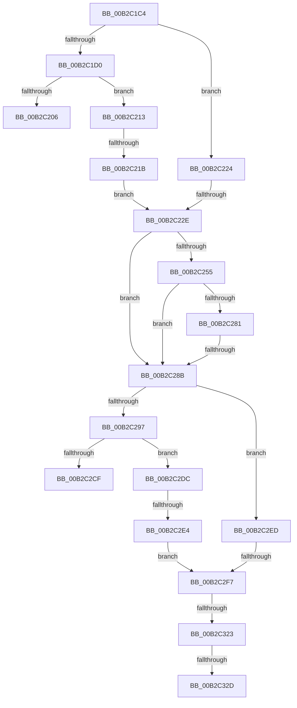

# sub_00B2C1C4

- RVA: `0x00B2C1C4`–`0x00B2C332` (길이 `366` bytes)
- VA: `0x0000000140B2C1C4`
- 실행 섹션: `PAGE`
- PDB 이름 있음: `아니요`; PDB Function 태그: `아니요`
- unwind 정보 RVA: `0x000991DC`
- 디코드: `77`개 명령, `366/366` bytes 표시
- 미해석 바이트: `0` (있으면 어셈블리에 `.byte`로 보존)

> 이 문서는 커널 이미지의 기계어와 PDB 기호를 분석해 생성했습니다. 4번과 5번은 함수 원형과 자료형을 바이너리 사용 방식에서 추정한 C 해석이며 원본 소스 복구 결과는 아닙니다.

## 1. Dependencies

- 직접 호출 지점: **5**; 고유 호출 대상: **2**
- 직접 호출자로 확인된 함수: **0**
- RIP 상대 이미지 참조: **8**

### Outgoing calls
- `0x00B2C1FA` → [PnpCtxRegOpenKey](../8E/PnpCtxRegOpenKey_function_008EF7B8.md) (function, `0x008EF7B8`)
- `0x00B2C24C` → [PnpCtxRegOpenKey](../8E/PnpCtxRegOpenKey_function_008EF7B8.md) (function, `0x008EF7B8`)
- `0x00B2C276` → [PnpCtxRegQueryValue](../99/PnpCtxRegQueryValue_function_009940FC.md) (function, `0x009940FC`)
- `0x00B2C2C3` → [PnpCtxRegOpenKey](../8E/PnpCtxRegOpenKey_function_008EF7B8.md) (function, `0x008EF7B8`)
- `0x00B2C314` → [PnpCtxRegQueryValue](../99/PnpCtxRegQueryValue_function_009940FC.md) (function, `0x009940FC`)

### Direct callers
- 이 함수 시작 RVA로 연결되는 직접 call은 확인되지 않았습니다. 간접 호출은 완전히 역산할 수 없습니다.

### Static image references
- `0x00B2C1C4` → RVA `0x00E66308` (`.data`; read)
- `0x00B2C1D0` → RVA `0x00E66398` (`.data`; read)
- `0x00B2C1E3` → RVA `0x00AFDEC0` (` ?? ::NNGAKEGL::`string'`; read)
- `0x00B2C206` → RVA `0x00E66308` (`.data`; read/write)
- `0x00B2C266` → RVA `0x00AFDF50` (` ?? ::NNGAKEGL::`string'`; read)
- `0x00B2C28B` → RVA `0x00E66310` (`.data`; read)
- `0x00B2C2AC` → RVA `0x00AFDF60` (` ?? ::NNGAKEGL::`string'`; read)
- `0x00B2C2CF` → RVA `0x00E66310` (`.data`; read/write)

## 2. Other-region calls and transfers

- 다른 실행 섹션으로 향하는 call: **0**
- call이 아닌 외부 분기/꼬리 이동: **10**
  - `0x00B2C20E` → [PnpGetServiceStartType + 0x3D](../99/PnpGetServiceStartType_function_00995D78.md) (`tail-transfer`)
  - `0x00B2C215` → [PnpGetServiceStartType + 0x3D](../99/PnpGetServiceStartType_function_00995D78.md) (`tail-transfer`)
  - `0x00B2C228` → [PnpGetServiceStartType + 0x3D](../99/PnpGetServiceStartType_function_00995D78.md) (`tail-transfer`)
  - `0x00B2C285` → [PnpGetServiceStartType + 0x6E](../99/PnpGetServiceStartType_function_00995D78.md) (`tail-transfer`)
  - `0x00B2C2D7` → [PnpGetServiceStartType + 0x3D](../99/PnpGetServiceStartType_function_00995D78.md) (`tail-transfer`)
  - `0x00B2C2DE` → [PnpGetServiceStartType + 0x3D](../99/PnpGetServiceStartType_function_00995D78.md) (`tail-transfer`)
  - `0x00B2C2F1` → [PnpGetServiceStartType + 0x3D](../99/PnpGetServiceStartType_function_00995D78.md) (`tail-transfer`)
  - `0x00B2C31D` → [PnpGetServiceStartType + 0x3D](../99/PnpGetServiceStartType_function_00995D78.md) (`tail-transfer`)
  - `0x00B2C327` → [PnpGetServiceStartType + 0x6E](../99/PnpGetServiceStartType_function_00995D78.md) (`tail-transfer`)
  - `0x00B2C32D` → [PnpGetServiceStartType + 0x3D](../99/PnpGetServiceStartType_function_00995D78.md) (`tail-transfer`)

## 3. Assembly (complete function range)

```asm
00B2C1C4  48 8B 15 3D A1 33 00            mov rdx, qword ptr [rip + 0x33a13d]
00B2C1CB  48 85 D2                        test rdx, rdx
00B2C1CE  75 54                           jne 0x140b2c224
00B2C1D0  48 8B 0D C1 A1 33 00            mov rcx, qword ptr [rip + 0x33a1c1]
00B2C1D7  48 8D 05 2A A1 33 00            lea rax, [rip + 0x33a12a]
00B2C1DE  48 89 44 24 28                  mov qword ptr [rsp + 0x28], rax
00B2C1E3  4C 8D 05 D6 1C FD FF            lea r8, [rip - 0x2e32a]
00B2C1EA  45 33 C9                        xor r9d, r9d
00B2C1ED  C7 44 24 20 19 00 02 00         mov dword ptr [rsp + 0x20], 0x20019
00B2C1F5  BA 02 00 00 80                  mov edx, 0x80000002
00B2C1FA  E8 B9 35 DC FF                  call 0x1408ef7b8
00B2C1FF  3D 34 00 00 C0                  cmp eax, 0xc0000034
00B2C204  75 0D                           jne 0x140b2c213
00B2C206  48 83 0D FA A0 33 00 FF         or qword ptr [rip + 0x33a0fa], 0xffffffffffffffff
00B2C20E  E9 A2 9B E6 FF                  jmp 0x140995db5
00B2C213  85 C0                           test eax, eax
00B2C215  0F 88 9A 9B E6 FF               js 0x140995db5
00B2C21B  48 8B 15 E6 A0 33 00            mov rdx, qword ptr [rip + 0x33a0e6]
00B2C222  EB 0A                           jmp 0x140b2c22e
00B2C224  48 83 FA FF                     cmp rdx, -1
00B2C228  0F 84 87 9B E6 FF               je 0x140995db5
00B2C22E  48 8B 0D 63 A1 33 00            mov rcx, qword ptr [rip + 0x33a163]
00B2C235  48 8D 45 F0                     lea rax, [rbp - 0x10]
00B2C239  48 89 44 24 28                  mov qword ptr [rsp + 0x28], rax
00B2C23E  45 33 C9                        xor r9d, r9d
00B2C241  4C 8B C3                        mov r8, rbx
00B2C244  C7 44 24 20 19 00 02 00         mov dword ptr [rsp + 0x20], 0x20019
00B2C24C  E8 67 35 DC FF                  call 0x1408ef7b8
00B2C251  85 C0                           test eax, eax
00B2C253  78 36                           js 0x140b2c28b
00B2C255  48 8B 55 F0                     mov rdx, qword ptr [rbp - 0x10]
00B2C259  48 8D 45 38                     lea rax, [rbp + 0x38]
00B2C25D  48 89 44 24 28                  mov qword ptr [rsp + 0x28], rax
00B2C262  4C 8D 4D 30                     lea r9, [rbp + 0x30]
00B2C266  4C 8D 05 E3 1C FD FF            lea r8, [rip - 0x2e31d]
00B2C26D  48 89 7C 24 20                  mov qword ptr [rsp + 0x20], rdi
00B2C272  44 89 75 38                     mov dword ptr [rbp + 0x38], r14d
00B2C276  E8 81 7E E6 FF                  call 0x1409940fc
00B2C27B  8B D8                           mov ebx, eax
00B2C27D  85 C0                           test eax, eax
00B2C27F  78 0A                           js 0x140b2c28b
00B2C281  44 39 75 30                     cmp dword ptr [rbp + 0x30], r14d
00B2C285  0F 84 5B 9B E6 FF               je 0x140995de6
00B2C28B  48 8B 15 7E A0 33 00            mov rdx, qword ptr [rip + 0x33a07e]
00B2C292  48 85 D2                        test rdx, rdx
00B2C295  75 56                           jne 0x140b2c2ed
00B2C297  48 8B 15 6A A0 33 00            mov rdx, qword ptr [rip + 0x33a06a]
00B2C29E  48 8D 05 6B A0 33 00            lea rax, [rip + 0x33a06b]
00B2C2A5  48 8B 0D EC A0 33 00            mov rcx, qword ptr [rip + 0x33a0ec]
00B2C2AC  4C 8D 05 AD 1C FD FF            lea r8, [rip - 0x2e353]
00B2C2B3  48 89 44 24 28                  mov qword ptr [rsp + 0x28], rax
00B2C2B8  45 33 C9                        xor r9d, r9d
00B2C2BB  C7 44 24 20 19 00 02 00         mov dword ptr [rsp + 0x20], 0x20019
00B2C2C3  E8 F0 34 DC FF                  call 0x1408ef7b8
00B2C2C8  3D 34 00 00 C0                  cmp eax, 0xc0000034
00B2C2CD  75 0D                           jne 0x140b2c2dc
00B2C2CF  48 83 0D 39 A0 33 00 FF         or qword ptr [rip + 0x33a039], 0xffffffffffffffff
00B2C2D7  E9 D9 9A E6 FF                  jmp 0x140995db5
00B2C2DC  85 C0                           test eax, eax
00B2C2DE  0F 88 D1 9A E6 FF               js 0x140995db5
00B2C2E4  48 8B 15 25 A0 33 00            mov rdx, qword ptr [rip + 0x33a025]
00B2C2EB  EB 0A                           jmp 0x140b2c2f7
00B2C2ED  48 83 FA FF                     cmp rdx, -1
00B2C2F1  0F 84 BE 9A E6 FF               je 0x140995db5
00B2C2F7  48 8D 45 38                     lea rax, [rbp + 0x38]
00B2C2FB  44 89 75 38                     mov dword ptr [rbp + 0x38], r14d
00B2C2FF  48 89 44 24 28                  mov qword ptr [rsp + 0x28], rax
00B2C304  4C 8D 4D 30                     lea r9, [rbp + 0x30]
00B2C308  4C 8D 05 41 1C FD FF            lea r8, [rip - 0x2e3bf]
00B2C30F  48 89 7C 24 20                  mov qword ptr [rsp + 0x20], rdi
00B2C314  E8 E3 7D E6 FF                  call 0x1409940fc
00B2C319  8B D8                           mov ebx, eax
00B2C31B  85 C0                           test eax, eax
00B2C31D  0F 88 92 9A E6 FF               js 0x140995db5
00B2C323  44 39 75 30                     cmp dword ptr [rbp + 0x30], r14d
00B2C327  0F 84 B9 9A E6 FF               je 0x140995de6
00B2C32D  E9 83 9A E6 FF                  jmp 0x140995db5
```

## 4. C-style interpretation (structured pseudocode)

```c
__int64 __fastcall sub_00B2C1C4(__int64 a1, __int64 a2, __int64 a3, int a4)
{
    __int64 result;
    unsigned int v_stack_p20;
    unsigned __int64 v_stack_p28;

    if (*(unsigned __int64 *)(v_rip + 3383613) != 0) goto loc_00B2C224;
    v_stack_p28 = v_rip + 3383594;
    a4 = 0;
    v_stack_p20 = 0x20019ULL;
    result = PnpCtxRegOpenKey(*(unsigned __int64 *)(v_rip + 3383745), (unsigned int)(0x80000002ULL), v_rip - 189226, a4);
    if (((unsigned int)(result)) != 0xC0000034ULL) goto loc_00B2C213;
loc_00B2C213:
    goto loc_00B2C22E;
loc_00B2C224:
loc_00B2C22E:
    v_stack_p28 = v_rbp - 16;
    a4 = 0;
    v_stack_p20 = 0x20019ULL;
    result = PnpCtxRegOpenKey(*(unsigned __int64 *)(v_rip + 3383651), *(unsigned __int64 *)(v_rip + 3383526), v_rbx, a4);
    if (sign_flag) goto loc_00B2C28B;
    v_stack_p28 = v_rbp + 56;
    v_stack_p20 = v_rdi;
    *(unsigned int *)(v_rbp + 56) = (unsigned int)(v_r14);
    result = PnpCtxRegQueryValue(*(unsigned __int64 *)(v_rip + 3383651), *(unsigned __int64 *)(v_rbp - 16), v_rip - 189213, v_rbp + 48);
    if (sign_flag) goto loc_00B2C28B;
loc_00B2C28B:
    if (*(unsigned __int64 *)(v_rip + 3383422) != 0) goto loc_00B2C2ED;
    v_stack_p28 = v_rip + 3383403;
    a4 = 0;
    v_stack_p20 = 0x20019ULL;
    result = PnpCtxRegOpenKey(*(unsigned __int64 *)(v_rip + 3383532), *(unsigned __int64 *)(v_rip + 3383402), v_rip - 189267, a4);
    if (((unsigned int)(result)) != 0xC0000034ULL) goto loc_00B2C2DC;
loc_00B2C2DC:
    goto loc_00B2C2F7;
loc_00B2C2ED:
loc_00B2C2F7:
    *(unsigned int *)(v_rbp + 56) = (unsigned int)(v_r14);
    v_stack_p28 = v_rbp + 56;
    v_stack_p20 = v_rdi;
    result = PnpCtxRegQueryValue(*(unsigned __int64 *)(v_rip + 3383532), *(unsigned __int64 *)(v_rip + 3383333), v_rip - 189375, v_rbp + 48);
}
```

## 5. (Beta) C Style

```c
int64_t sub_00B2C1C4(int64_t Arg1, int64_t Arg2, int64_t Arg3, int32_t Arg4)
{
    int64_t result;
    uint32_t v_stack_p20;
    uint64_t v_stack_p28;

    if (*(uint64_t *)(v_rip + 0x33A13D) != 0) goto loc_00B2C224;
    v_stack_p28 = v_rip + 3383594;
    Arg4 = 0;
    v_stack_p20 = 0x20019ULL;
    result = PnpCtxRegOpenKey(*(uint64_t *)(v_rip + 0x33A1C1), (uint32_t)(0x80000002ULL), v_rip - 189226, Arg4);
    if (((uint32_t)(result)) != 0xC0000034ULL) goto loc_00B2C213;
loc_00B2C213:
    goto loc_00B2C22E;
loc_00B2C224:
loc_00B2C22E:
    v_stack_p28 = local_rbp - 16;
    Arg4 = 0;
    v_stack_p20 = 0x20019ULL;
    result = PnpCtxRegOpenKey(*(uint64_t *)(v_rip + 0x33A163), *(uint64_t *)(v_rip + 0x33A0E6), local_rbx, Arg4);
    if (sign_flag) goto loc_00B2C28B;
    v_stack_p28 = local_rbp + 56;
    v_stack_p20 = local_rdi;
    *(uint32_t *)(local_rbp + 0x38) = (uint32_t)(local_r14);
    result = PnpCtxRegQueryValue(*(uint64_t *)(v_rip + 0x33A163), *(uint64_t *)(local_rbp - 0x10), v_rip - 189213, local_rbp + 48);
    if (sign_flag) goto loc_00B2C28B;
loc_00B2C28B:
    if (*(uint64_t *)(v_rip + 0x33A07E) != 0) goto loc_00B2C2ED;
    v_stack_p28 = v_rip + 3383403;
    Arg4 = 0;
    v_stack_p20 = 0x20019ULL;
    result = PnpCtxRegOpenKey(*(uint64_t *)(v_rip + 0x33A0EC), *(uint64_t *)(v_rip + 0x33A06A), v_rip - 189267, Arg4);
    if (((uint32_t)(result)) != 0xC0000034ULL) goto loc_00B2C2DC;
loc_00B2C2DC:
    goto loc_00B2C2F7;
loc_00B2C2ED:
loc_00B2C2F7:
    *(uint32_t *)(local_rbp + 0x38) = (uint32_t)(local_r14);
    v_stack_p28 = local_rbp + 56;
    v_stack_p20 = local_rdi;
    result = PnpCtxRegQueryValue(*(uint64_t *)(v_rip + 0x33A0EC), *(uint64_t *)(v_rip + 0x33A025), v_rip - 189375, local_rbp + 48);
}
```

## 6. Execution-region graph

[열기: 2D/3D 그래프와 함수 탐색 컨트롤 패널](../../../control-panel.html?section=page&rva=0x00B2C1C4&view=graph)

- 2D 그래프는 위에서 아래로 흐르고, 3D 그래프는 빈 공간을 드래그해 회전합니다. Shift+드래그는 이동, 휠은 확대·축소, 함수 노드 선택은 대상 보고서 이동입니다.

### Static fallback


