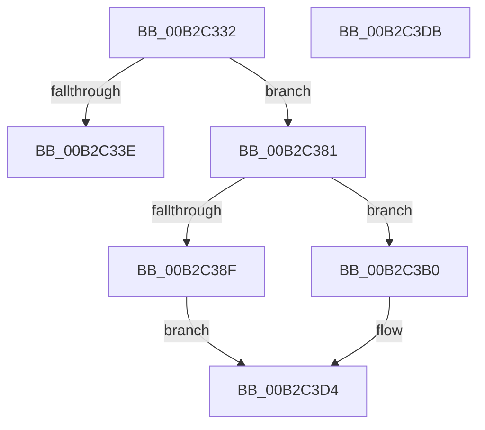

# sub_00B2C332

- RVA: `0x00B2C332`–`0x00B2C3E7` (길이 `181` bytes)
- VA: `0x0000000140B2C332`
- 실행 섹션: `PAGE`
- PDB 이름 있음: `아니요`; PDB Function 태그: `아니요`
- unwind 정보 RVA: `0x00099224`
- 디코드: `42`개 명령, `181/181` bytes 표시
- 미해석 바이트: `0` (있으면 어셈블리에 `.byte`로 보존)

> 이 문서는 커널 이미지의 기계어와 PDB 기호를 분석해 생성했습니다. 4번과 5번은 함수 원형과 자료형을 바이너리 사용 방식에서 추정한 C 해석이며 원본 소스 복구 결과는 아닙니다.

## 1. Dependencies

- 직접 호출 지점: **3**; 고유 호출 대상: **3**
- 직접 호출자로 확인된 함수: **0**
- RIP 상대 이미지 참조: **1**

### Outgoing calls
- `0x00B2C375` → [PnpGetObjectProperty](../8E/PnpGetObjectProperty_function_008E2180.md) (function, `0x008E2180`)
- `0x00B2C3A9` → [CmGetInstallerClassRegProp](../99/CmGetInstallerClassRegProp_function_00994940.md) (function, `0x00994940`)
- `0x00B2C3CF` → [CmGetDeviceRegProp](../8E/CmGetDeviceRegProp_function_008ED870.md) (function, `0x008ED870`)

### Direct callers
- 이 함수 시작 RVA로 연결되는 직접 call은 확인되지 않았습니다. 간접 호출은 완전히 역산할 수 없습니다.

### Static image references
- `0x00B2C35E` → RVA `0x00E66398` (`.data`; read)

## 2. Other-region calls and transfers

- 다른 실행 섹션으로 향하는 call: **0**
- call이 아닌 외부 분기/꼬리 이동: **3**
  - `0x00B2C37C` → [PnpCallDriverQueryServiceHelper + 0xA6](../99/PnpCallDriverQueryServiceHelper_function_00995FB0.md) (`tail-transfer`)
  - `0x00B2C3D6` → [PnpCallDriverQueryServiceHelper + 0xA9](../99/PnpCallDriverQueryServiceHelper_function_00995FB0.md) (`tail-transfer`)
  - `0x00B2C3E2` → [PnpCallDriverQueryServiceHelper + 0x140](../99/PnpCallDriverQueryServiceHelper_function_00995FB0.md) (`tail-transfer`)

## 3. Assembly (complete function range)

```asm
00B2C332  48 8D 45 58                     lea rax, [rbp + 0x58]
00B2C336  48 8B D6                        mov rdx, rsi
00B2C339  48 85 DB                        test rbx, rbx
00B2C33C  74 43                           je 0x140b2c381
00B2C33E  83 64 24 50 00                  and dword ptr [rsp + 0x50], 0
00B2C343  4C 8B CF                        mov r9, rdi
00B2C346  48 89 44 24 48                  mov qword ptr [rsp + 0x48], rax
00B2C34B  45 8B C5                        mov r8d, r13d
00B2C34E  8B 45 58                        mov eax, dword ptr [rbp + 0x58]
00B2C351  89 44 24 40                     mov dword ptr [rsp + 0x40], eax
00B2C355  48 8D 45 F4                     lea rax, [rbp - 0xc]
00B2C359  48 89 4C 24 38                  mov qword ptr [rsp + 0x38], rcx
00B2C35E  48 8B 0D 33 A0 33 00            mov rcx, qword ptr [rip + 0x33a033]
00B2C365  48 89 44 24 30                  mov qword ptr [rsp + 0x30], rax
00B2C36A  48 89 5C 24 28                  mov qword ptr [rsp + 0x28], rbx
00B2C36F  48 83 64 24 20 00               and qword ptr [rsp + 0x20], 0
00B2C375  E8 06 5E DB FF                  call 0x1408e2180
00B2C37A  8B C8                           mov ecx, eax
00B2C37C  E9 D5 9C E6 FF                  jmp 0x140996056
00B2C381  45 33 ED                        xor r13d, r13d
00B2C384  45 8B CC                        mov r9d, r12d
00B2C387  4C 8B C7                        mov r8, rdi
00B2C38A  45 84 F6                        test r14b, r14b
00B2C38D  74 21                           je 0x140b2c3b0
00B2C38F  48 89 44 24 30                  mov qword ptr [rsp + 0x30], rax
00B2C394  48 8D 45 F0                     lea rax, [rbp - 0x10]
00B2C398  48 89 4C 24 28                  mov qword ptr [rsp + 0x28], rcx
00B2C39D  48 8B 0D F4 9F 33 00            mov rcx, qword ptr [rip + 0x339ff4]
00B2C3A4  48 89 44 24 20                  mov qword ptr [rsp + 0x20], rax
00B2C3A9  E8 92 85 E6 FF                  call 0x140994940
00B2C3AE  EB 24                           jmp 0x140b2c3d4
00B2C3B0  44 89 6C 24 38                  mov dword ptr [rsp + 0x38], r13d
00B2C3B5  48 89 44 24 30                  mov qword ptr [rsp + 0x30], rax
00B2C3BA  48 8D 45 F0                     lea rax, [rbp - 0x10]
00B2C3BE  48 89 4C 24 28                  mov qword ptr [rsp + 0x28], rcx
00B2C3C3  48 8B 0D CE 9F 33 00            mov rcx, qword ptr [rip + 0x339fce]
00B2C3CA  48 89 44 24 20                  mov qword ptr [rsp + 0x20], rax
00B2C3CF  E8 9C 14 DC FF                  call 0x1408ed870
00B2C3D4  8B C8                           mov ecx, eax
00B2C3D6  E9 7E 9C E6 FF                  jmp 0x140996059
00B2C3DB  C7 45 F0 07 00 00 00            mov dword ptr [rbp - 0x10], 7
00B2C3E2  E9 09 9D E6 FF                  jmp 0x1409960f0
```

## 4. C-style interpretation (structured pseudocode)

```c
__int64 __fastcall sub_00B2C332(__int64 a1, __int64 a2, __int64 a3, __int64 a4, __int64 a5, __int64 a6, __int64 a7, __int64 a8, __int64 a9, unsigned int a10)
{
    __int64 result;
    __int64 v_r13;
    unsigned __int64 v_stack_p20;
    unsigned __int64 v_stack_p28;
    unsigned __int64 v_stack_p30;
    unsigned __int64 v_stack_p38;
    unsigned int v_stack_p40;
    unsigned __int64 v_stack_p48;

    if (v_rbx == 0) goto loc_00B2C381;
    v_stack_p48 = v_rbp + 88;
    v_stack_p40 = (unsigned int)((unsigned int)(*(unsigned int *)(v_rbp + 88)));
    v_stack_p38 = a1;
    v_stack_p30 = v_rbp - 12;
    v_stack_p28 = v_rbx;
    result = PnpGetObjectProperty(*(unsigned __int64 *)(v_rip + 3383347), v_rsi, (unsigned int)((unsigned int)(v_r13)), v_rdi);
loc_00B2C381:
    v_r13 = 0;
    if ((unsigned __int8)(v_r14) == 0) goto loc_00B2C3B0;
    v_stack_p30 = result;
    v_stack_p28 = (unsigned int)((unsigned int)(result));
    v_stack_p20 = v_rbp - 16;
    result = CmGetInstallerClassRegProp(*(unsigned __int64 *)(v_rip + 3383284), v_rsi, v_rdi, (unsigned int)((unsigned int)(v_r12)));
    goto loc_00B2C3D4;
loc_00B2C3B0:
    v_stack_p38 = 0;
    v_stack_p30 = result;
    v_stack_p28 = *(unsigned __int64 *)(v_rip + 3383284);
    v_stack_p20 = v_rbp - 16;
    result = CmGetDeviceRegProp(*(unsigned __int64 *)(v_rip + 3383246), v_rsi, v_rdi, (unsigned int)((unsigned int)(v_r12)));
loc_00B2C3D4:
}
```

## 5. (Beta) C Style

```c
int64_t sub_00B2C332(int64_t Arg1, int64_t Arg2, int64_t Arg3, int64_t Arg4, uint64_t Arg5, uint64_t Arg6, uint64_t Arg7, uint64_t Arg8, uint64_t Arg9, uint32_t Arg10)
{
    int64_t result;
    int64_t local_r13;
    uint64_t v_stack_p20;
    uint64_t v_stack_p28;
    uint64_t v_stack_p30;
    uint64_t v_stack_p38;
    uint32_t v_stack_p40;
    uint64_t v_stack_p48;

    if (local_rbx == 0) goto loc_00B2C381;
    v_stack_p48 = local_rbp + 88;
    v_stack_p40 = (uint32_t)((uint32_t)(*(uint32_t *)(local_rbp + 0x58)));
    v_stack_p38 = Arg1;
    v_stack_p30 = local_rbp - 12;
    v_stack_p28 = local_rbx;
    result = PnpGetObjectProperty(*(uint64_t *)(v_rip + 0x33A033), local_rsi, (uint32_t)((uint32_t)(local_r13)), local_rdi);
loc_00B2C381:
    local_r13 = 0;
    if ((uint8_t)(local_r14) == 0) goto loc_00B2C3B0;
    v_stack_p30 = result;
    v_stack_p28 = (uint32_t)((uint32_t)(result));
    v_stack_p20 = local_rbp - 16;
    result = CmGetInstallerClassRegProp(*(uint64_t *)(v_rip + 0x339FF4), local_rsi, local_rdi, (uint32_t)((uint32_t)(local_r12)));
    goto loc_00B2C3D4;
loc_00B2C3B0:
    v_stack_p38 = 0;
    v_stack_p30 = result;
    v_stack_p28 = *(uint64_t *)(v_rip + 0x339FF4);
    v_stack_p20 = local_rbp - 16;
    result = CmGetDeviceRegProp(*(uint64_t *)(v_rip + 0x339FCE), local_rsi, local_rdi, (uint32_t)((uint32_t)(local_r12)));
loc_00B2C3D4:
}
```

## 6. Execution-region graph

[열기: 2D/3D 그래프와 함수 탐색 컨트롤 패널](../../../control-panel.html?section=page&rva=0x00B2C332&view=graph)

- 2D 그래프는 위에서 아래로 흐르고, 3D 그래프는 빈 공간을 드래그해 회전합니다. Shift+드래그는 이동, 휠은 확대·축소, 함수 노드 선택은 대상 보고서 이동입니다.

### Static fallback


