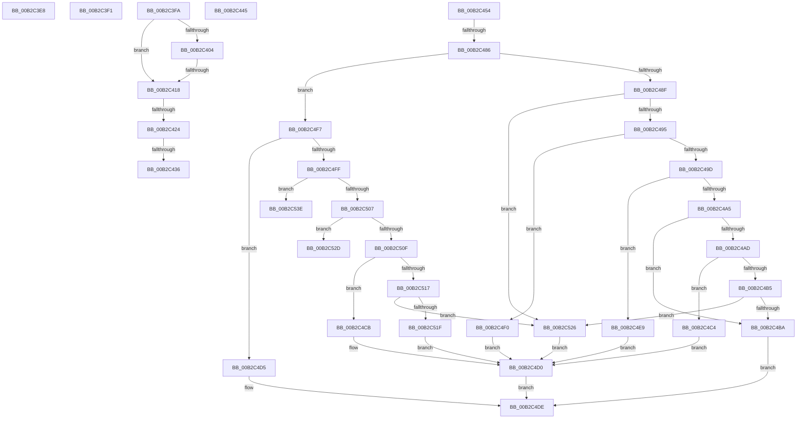

# sub_00B2C3E8

- RVA: `0x00B2C3E8`–`0x00B2C55E` (길이 `374` bytes)
- VA: `0x0000000140B2C3E8`
- 실행 섹션: `PAGE`
- PDB 이름 있음: `아니요`; PDB Function 태그: `아니요`
- unwind 정보 RVA: `0x0009927C`
- 디코드: `88`개 명령, `374/374` bytes 표시
- 미해석 바이트: `0` (있으면 어셈블리에 `.byte`로 보존)

> 이 문서는 커널 이미지의 기계어와 PDB 기호를 분석해 생성했습니다. 4번과 5번은 함수 원형과 자료형을 바이너리 사용 방식에서 추정한 C 해석이며 원본 소스 복구 결과는 아닙니다.

## 1. Dependencies

- 직접 호출 지점: **5**; 고유 호출 대상: **3**
- 직접 호출자로 확인된 함수: **0**
- RIP 상대 이미지 참조: **1**

### Outgoing calls
- `0x00B2C46E` → [PnpDiagnosticTraceDeviceOperation](../../text/26/PnpDiagnosticTraceDeviceOperation_function_0026E1B8.md) (function, `0x0026E1B8`)
- `0x00B2C4DE` → [PipSetDevNodeProblem](../8F/PipSetDevNodeProblem_function_008FDE0C.md) (function, `0x008FDE0C`)
- `0x00B2C532` → [PipSetDevNodeFlags](../8F/PipSetDevNodeFlags_function_008FC048.md) (function, `0x008FC048`)
- `0x00B2C546` → [PipSetDevNodeProblem](../8F/PipSetDevNodeProblem_function_008FDE0C.md) (function, `0x008FDE0C`)
- `0x00B2C553` → [PipSetDevNodeFlags](../8F/PipSetDevNodeFlags_function_008FC048.md) (function, `0x008FC048`)

### Direct callers
- 이 함수 시작 RVA로 연결되는 직접 call은 확인되지 않았습니다. 간접 호출은 완전히 역산할 수 없습니다.

### Static image references
- `0x00B2C460` → RVA `0x00027480` (`.rdata`; read)

## 2. Other-region calls and transfers

- 다른 실행 섹션으로 향하는 call: **1**
  - `0x00B2C46E` → [PnpDiagnosticTraceDeviceOperation](../../text/26/PnpDiagnosticTraceDeviceOperation_function_0026E1B8.md) (`PAGE` → `.text`)
- call이 아닌 외부 분기/꼬리 이동: **11**
  - `0x00B2C3EC` → [PipCallDriverAddDeviceQueryRoutine + 0xBC](../99/PipCallDriverAddDeviceQueryRoutine_function_00996604.md) (`tail-transfer`)
  - `0x00B2C3F5` → [PipCallDriverAddDeviceQueryRoutine + 0x10D](../99/PipCallDriverAddDeviceQueryRoutine_function_00996604.md) (`tail-transfer`)
  - `0x00B2C412` → [PipCallDriverAddDeviceQueryRoutine + 0x2B4](../99/PipCallDriverAddDeviceQueryRoutine_function_00996604.md) (`tail-transfer`)
  - `0x00B2C41E` → [PipCallDriverAddDeviceQueryRoutine + 0x2B4](../99/PipCallDriverAddDeviceQueryRoutine_function_00996604.md) (`tail-transfer`)
  - `0x00B2C430` → [PipCallDriverAddDeviceQueryRoutine + 0x2BA](../99/PipCallDriverAddDeviceQueryRoutine_function_00996604.md) (`tail-transfer`)
  - `0x00B2C440` → [PipCallDriverAddDeviceQueryRoutine + 0x2BA](../99/PipCallDriverAddDeviceQueryRoutine_function_00996604.md) (`tail-transfer`)
  - `0x00B2C44F` → [PipCallDriverAddDeviceQueryRoutine + 0x113](../99/PipCallDriverAddDeviceQueryRoutine_function_00996604.md) (`tail-transfer`)
  - `0x00B2C480` → [PipCallDriverAddDeviceQueryRoutine + 0xBC](../99/PipCallDriverAddDeviceQueryRoutine_function_00996604.md) (`tail-transfer`)
  - `0x00B2C4E4` → [PipCallDriverAddDeviceQueryRoutine + 0xBC](../99/PipCallDriverAddDeviceQueryRoutine_function_00996604.md) (`tail-transfer`)
  - `0x00B2C539` → [PipCallDriverAddDeviceQueryRoutine + 0xBC](../99/PipCallDriverAddDeviceQueryRoutine_function_00996604.md) (`tail-transfer`)
  - `0x00B2C559` → [PipCallDriverAddDeviceQueryRoutine + 0xBC](../99/PipCallDriverAddDeviceQueryRoutine_function_00996604.md) (`tail-transfer`)

## 3. Assembly (complete function range)

```asm
00B2C3E8  48 8B 75 D8                     mov rsi, qword ptr [rbp - 0x28]
00B2C3EC  E9 CF A2 E6 FF                  jmp 0x1409966c0
00B2C3F1  48 8B 75 D8                     mov rsi, qword ptr [rbp - 0x28]
00B2C3F5  E9 17 A3 E6 FF                  jmp 0x140996711
00B2C3FA  05 A1 FC FF 3F                  add eax, 0x3ffffca1
00B2C3FF  83 F8 2F                        cmp eax, 0x2f
00B2C402  77 14                           ja 0x140b2c418
00B2C404  48 B9 01 30 00 00 00 80 00 00   movabs rcx, 0x800000003001
00B2C40E  48 0F A3 C1                     bt rcx, rax
00B2C412  0F 82 A0 A4 E6 FF               jb 0x1409968b8
00B2C418  81 FB 5E 02 00 C0               cmp ebx, 0xc000025e
00B2C41E  0F 84 94 A4 E6 FF               je 0x1409968b8
00B2C424  41 BF 6C 02 00 C0               mov r15d, 0xc000026c
00B2C42A  81 FB 9A 00 00 C0               cmp ebx, 0xc000009a
00B2C430  0F 84 88 A4 E6 FF               je 0x1409968be
00B2C436  81 FB 28 04 00 C0               cmp ebx, 0xc0000428
00B2C43C  41 0F 45 DF                     cmovne ebx, r15d
00B2C440  E9 79 A4 E6 FF                  jmp 0x1409968be
00B2C445  81 FB 28 04 00 C0               cmp ebx, 0xc0000428
00B2C44B  41 0F 45 DF                     cmovne ebx, r15d
00B2C44F  E9 C3 A2 E6 FF                  jmp 0x140996717
00B2C454  48 8B 17                        mov rdx, qword ptr [rdi]
00B2C457  4C 8D 4D F0                     lea r9, [rbp - 0x10]
00B2C45B  83 64 24 20 00                  and dword ptr [rsp + 0x20], 0
00B2C460  48 8D 0D 19 B0 4F FF            lea rcx, [rip - 0xb04fe7]
00B2C467  48 83 C2 28                     add rdx, 0x28
00B2C46B  44 8B C3                        mov r8d, ebx
00B2C46E  E8 45 1D 74 FF                  call 0x14026e1b8
00B2C473  48 8B 0F                        mov rcx, qword ptr [rdi]
00B2C476  F7 81 8C 01 00 00 00 60 00 00   test dword ptr [rcx + 0x18c], 0x6000
00B2C480  0F 85 3A A2 E6 FF               jne 0x1409966c0
00B2C486  B8 5F 03 00 C0                  mov eax, 0xc000035f
00B2C48B  3B D8                           cmp ebx, eax
00B2C48D  7F 68                           jg 0x140b2c4f7
00B2C48F  0F 84 91 00 00 00               je 0x140b2c526
00B2C495  81 FB 9A 00 00 C0               cmp ebx, 0xc000009a
00B2C49B  74 53                           je 0x140b2c4f0
00B2C49D  81 FB 60 01 00 C0               cmp ebx, 0xc0000160
00B2C4A3  74 44                           je 0x140b2c4e9
00B2C4A5  81 FB 9D 01 00 C0               cmp ebx, 0xc000019d
00B2C4AB  74 0D                           je 0x140b2c4ba
00B2C4AD  81 FB 5E 02 00 C0               cmp ebx, 0xc000025e
00B2C4B3  74 0F                           je 0x140b2c4c4
00B2C4B5  41 3B DF                        cmp ebx, r15d
00B2C4B8  75 6C                           jne 0x140b2c526
00B2C4BA  45 8B C5                        mov r8d, r13d
00B2C4BD  BA 27 00 00 00                  mov edx, 0x27
00B2C4C2  EB 1A                           jmp 0x140b2c4de
00B2C4C4  BA 29 00 00 00                  mov edx, 0x29
00B2C4C9  EB 05                           jmp 0x140b2c4d0
00B2C4CB  BA 26 00 00 00                  mov edx, 0x26
00B2C4D0  44 8B C3                        mov r8d, ebx
00B2C4D3  EB 09                           jmp 0x140b2c4de
00B2C4D5  44 8B 45 D0                     mov r8d, dword ptr [rbp - 0x30]
00B2C4D9  BA 25 00 00 00                  mov edx, 0x25
00B2C4DE  E8 29 19 DD FF                  call 0x1408fde0c
00B2C4E3  90                              nop
00B2C4E4  E9 D7 A1 E6 FF                  jmp 0x1409966c0
00B2C4E9  BA 28 00 00 00                  mov edx, 0x28
00B2C4EE  EB E0                           jmp 0x140b2c4d0
00B2C4F0  BA 03 00 00 00                  mov edx, 3
00B2C4F5  EB D9                           jmp 0x140b2c4d0
00B2C4F7  81 FB 65 03 00 C0               cmp ebx, 0xc0000365
00B2C4FD  74 D6                           je 0x140b2c4d5
00B2C4FF  81 FB 6B 03 00 C0               cmp ebx, 0xc000036b
00B2C505  74 37                           je 0x140b2c53e
00B2C507  81 FB 6C 03 00 C0               cmp ebx, 0xc000036c
00B2C50D  74 1E                           je 0x140b2c52d
00B2C50F  81 FB 8E 03 00 C0               cmp ebx, 0xc000038e
00B2C515  74 B4                           je 0x140b2c4cb
00B2C517  81 FB 28 04 00 C0               cmp ebx, 0xc0000428
00B2C51D  75 07                           jne 0x140b2c526
00B2C51F  BA 34 00 00 00                  mov edx, 0x34
00B2C524  EB AA                           jmp 0x140b2c4d0
00B2C526  BA 1F 00 00 00                  mov edx, 0x1f
00B2C52B  EB A3                           jmp 0x140b2c4d0
00B2C52D  BA 00 00 10 00                  mov edx, 0x100000
00B2C532  E8 11 FB DC FF                  call 0x1408fc048
00B2C537  33 DB                           xor ebx, ebx
00B2C539  E9 82 A1 E6 FF                  jmp 0x1409966c0
00B2C53E  44 8B C3                        mov r8d, ebx
00B2C541  BA 30 00 00 00                  mov edx, 0x30
00B2C546  E8 C1 18 DD FF                  call 0x1408fde0c
00B2C54B  48 8B 0F                        mov rcx, qword ptr [rdi]
00B2C54E  BA 00 00 10 00                  mov edx, 0x100000
00B2C553  E8 F0 FA DC FF                  call 0x1408fc048
00B2C558  90                              nop
00B2C559  E9 62 A1 E6 FF                  jmp 0x1409966c0
```

## 4. C-style interpretation (structured pseudocode)

```c
__int64 __fastcall sub_00B2C3E8(void)
{
    unsigned int v_stack_p20;
}
```

## 5. (Beta) C Style

```c
void sub_00B2C3E8(void)
{
    uint32_t v_stack_p20;
}
```

## 6. Execution-region graph

[열기: 2D/3D 그래프와 함수 탐색 컨트롤 패널](../../../control-panel.html?section=page&rva=0x00B2C3E8&view=graph)

- 2D 그래프는 위에서 아래로 흐르고, 3D 그래프는 빈 공간을 드래그해 회전합니다. Shift+드래그는 이동, 휠은 확대·축소, 함수 노드 선택은 대상 보고서 이동입니다.

### Static fallback


