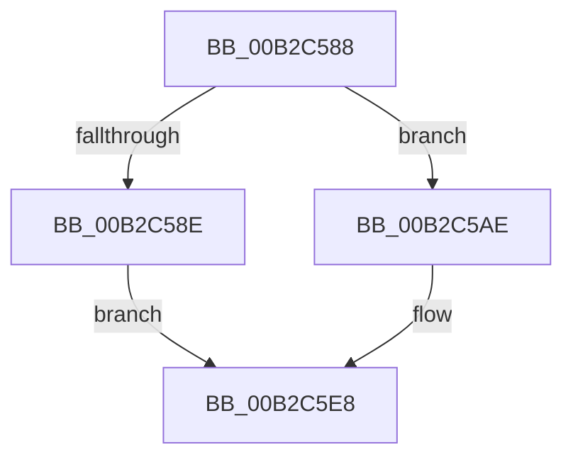

# sub_00B2C588

- RVA: `0x00B2C588`–`0x00B2C5F3` (길이 `107` bytes)
- VA: `0x0000000140B2C588`
- 실행 섹션: `PAGE`
- PDB 이름 있음: `아니요`; PDB Function 태그: `아니요`
- unwind 정보 RVA: `0x00099334`
- 디코드: `27`개 명령, `107/107` bytes 표시
- 미해석 바이트: `0` (있으면 어셈블리에 `.byte`로 보존)

> 이 문서는 커널 이미지의 기계어와 PDB 기호를 분석해 생성했습니다. 4번과 5번은 함수 원형과 자료형을 바이너리 사용 방식에서 추정한 C 해석이며 원본 소스 복구 결과는 아닙니다.

## 1. Dependencies

- 직접 호출 지점: **2**; 고유 호출 대상: **2**
- 직접 호출자로 확인된 함수: **0**
- RIP 상대 이미지 참조: **0**

### Outgoing calls
- `0x00B2C5A7` → [pIoQueryDeviceDescription](../71/pIoQueryDeviceDescription_function_0071F10C.md) (function, `0x0071F10C`)
- `0x00B2C5E3` → [guard_dispatch_icall](../../text/6B/guard_dispatch_icall_function_006BAAD0.md) (function, `0x006BAAD0`)

### Direct callers
- 이 함수 시작 RVA로 연결되는 직접 call은 확인되지 않았습니다. 간접 호출은 완전히 역산할 수 없습니다.

### Static image references
- 디코드된 RIP-relative 메모리 참조가 없습니다.

## 2. Other-region calls and transfers

- 다른 실행 섹션으로 향하는 call: **1**
  - `0x00B2C5E3` → [guard_dispatch_icall](../../text/6B/guard_dispatch_icall_function_006BAAD0.md) (`PAGE` → `.text`)
- call이 아닌 외부 분기/꼬리 이동: **1**
  - `0x00B2C5EE` → [pIoQueryBusDescription + 0x1B0](../99/pIoQueryBusDescription_function_00996F58.md) (`tail-transfer`)

## 3. Assembly (complete function range)

```asm
00B2C588  48 39 5E 10                     cmp qword ptr [rsi + 0x10], rbx
00B2C58C  74 20                           je 0x140b2c5ae
00B2C58E  0F 28 45 80                     movaps xmm0, xmmword ptr [rbp - 0x80]
00B2C592  48 8D 45 F0                     lea rax, [rbp - 0x10]
00B2C596  48 8D 55 B0                     lea rdx, [rbp - 0x50]
00B2C59A  66 0F 7F 45 B0                  movdqa xmmword ptr [rbp - 0x50], xmm0
00B2C59F  48 8B CE                        mov rcx, rsi
00B2C5A2  48 89 44 24 20                  mov qword ptr [rsp + 0x20], rax
00B2C5A7  E8 60 2B BF FF                  call 0x14071f10c
00B2C5AC  EB 3A                           jmp 0x140b2c5e8
00B2C5AE  4C 8B 06                        mov r8, qword ptr [rsi]
00B2C5B1  48 8D 4D F0                     lea rcx, [rbp - 0x10]
00B2C5B5  48 8B 46 30                     mov rax, qword ptr [rsi + 0x30]
00B2C5B9  48 8D 55 80                     lea rdx, [rbp - 0x80]
00B2C5BD  48 89 5C 24 50                  mov qword ptr [rsp + 0x50], rbx
00B2C5C2  89 5C 24 48                     mov dword ptr [rsp + 0x48], ebx
00B2C5C6  45 8B 00                        mov r8d, dword ptr [r8]
00B2C5C9  89 5C 24 40                     mov dword ptr [rsp + 0x40], ebx
00B2C5CD  48 89 5C 24 38                  mov qword ptr [rsp + 0x38], rbx
00B2C5D2  89 5C 24 30                     mov dword ptr [rsp + 0x30], ebx
00B2C5D6  89 5C 24 28                     mov dword ptr [rsp + 0x28], ebx
00B2C5DA  48 89 4C 24 20                  mov qword ptr [rsp + 0x20], rcx
00B2C5DF  48 8B 4E 38                     mov rcx, qword ptr [rsi + 0x38]
00B2C5E3  E8 E8 E4 B8 FF                  call 0x1406baad0
00B2C5E8  4C 8B 45 F8                     mov r8, qword ptr [rbp - 8]
00B2C5EC  8B F8                           mov edi, eax
00B2C5EE  E9 15 AB E6 FF                  jmp 0x140997108
```

## 4. C-style interpretation (structured pseudocode)

```c
__int64 __fastcall sub_00B2C588(void)
{
    __int64 result;
    unsigned __int64 v_stack_p20;
    unsigned int v_stack_p28;
    unsigned int v_stack_p30;
    unsigned __int64 v_stack_p38;
    unsigned int v_stack_p40;
    unsigned int v_stack_p48;
    unsigned __int64 v_stack_p50;

    if ((*(unsigned __int64 *)(v_rsi + 16)) == v_rbx) goto loc_00B2C5AE;
    *(unsigned __int64 *)(v_rbp - 80) = v_xmm0;
    v_stack_p20 = v_rbp - 16;
    result = pIoQueryDeviceDescription(v_rsi, v_rbp - 80, a3, a4);
    goto loc_00B2C5E8;
loc_00B2C5AE:
    v_stack_p50 = v_rbx;
    v_stack_p48 = (unsigned int)(v_rbx);
    v_stack_p40 = (unsigned int)(v_rbx);
    v_stack_p38 = v_rbx;
    v_stack_p30 = (unsigned int)(v_rbx);
    v_stack_p28 = (unsigned int)(v_rbx);
    v_stack_p20 = v_rbp - 16;
    result = guard_dispatch_icall(*(unsigned __int64 *)(v_rsi + 56), v_rbp - 128, (unsigned int)(*(unsigned int *)(*(unsigned __int64 *)(v_rsi))), a4);
loc_00B2C5E8:
}
```

## 5. (Beta) C Style

```c
void sub_00B2C588(void)
{
    int64_t result;
    uint64_t v_stack_p20;
    uint32_t v_stack_p28;
    uint32_t v_stack_p30;
    uint64_t v_stack_p38;
    uint32_t v_stack_p40;
    uint32_t v_stack_p48;
    uint64_t v_stack_p50;

    if ((*(uint64_t *)(local_rsi + 0x10)) == local_rbx) goto loc_00B2C5AE;
    *(uint64_t *)(local_rbp - 0x50) = v_xmm0;
    v_stack_p20 = local_rbp - 16;
    result = pIoQueryDeviceDescription(local_rsi, local_rbp - 80, a3, a4);
    goto loc_00B2C5E8;
loc_00B2C5AE:
    v_stack_p50 = local_rbx;
    v_stack_p48 = (uint32_t)(local_rbx);
    v_stack_p40 = (uint32_t)(local_rbx);
    v_stack_p38 = local_rbx;
    v_stack_p30 = (uint32_t)(local_rbx);
    v_stack_p28 = (uint32_t)(local_rbx);
    v_stack_p20 = local_rbp - 16;
    result = guard_dispatch_icall(*(uint64_t *)(local_rsi + 0x38), local_rbp - 128, (uint32_t)(*(uint32_t *)(*(uint64_t *)(local_rsi))), a4);
loc_00B2C5E8:
}
```

## 6. Execution-region graph

[열기: 2D/3D 그래프와 함수 탐색 컨트롤 패널](../../../control-panel.html?section=page&rva=0x00B2C588&view=graph)

- 2D 그래프는 위에서 아래로 흐르고, 3D 그래프는 빈 공간을 드래그해 회전합니다. Shift+드래그는 이동, 휠은 확대·축소, 함수 노드 선택은 대상 보고서 이동입니다.

### Static fallback


