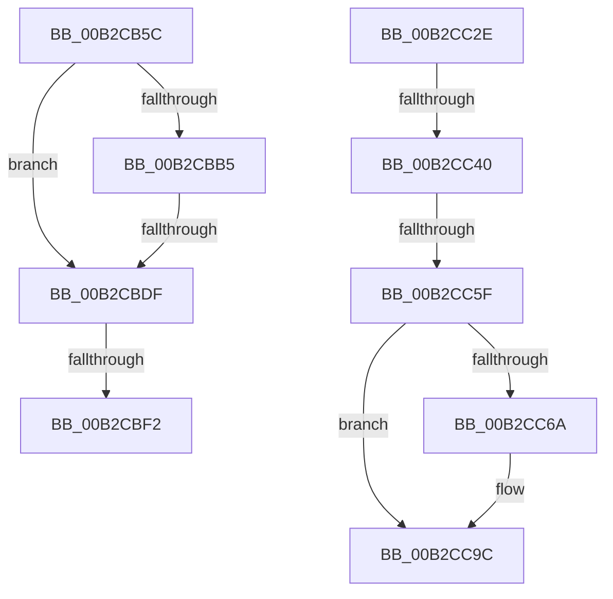

# sub_00B2CB5C

- RVA: `0x00B2CB5C`–`0x00B2CCAC` (길이 `336` bytes)
- VA: `0x0000000140B2CB5C`
- 실행 섹션: `PAGE`
- PDB 이름 있음: `아니요`; PDB Function 태그: `아니요`
- unwind 정보 RVA: `0x000993B4`
- 디코드: `87`개 명령, `336/336` bytes 표시
- 미해석 바이트: `0` (있으면 어셈블리에 `.byte`로 보존)

> 이 문서는 커널 이미지의 기계어와 PDB 기호를 분석해 생성했습니다. 4번과 5번은 함수 원형과 자료형을 바이너리 사용 방식에서 추정한 C 해석이며 원본 소스 복구 결과는 아닙니다.

## 1. Dependencies

- 직접 호출 지점: **13**; 고유 호출 대상: **12**
- 직접 호출자로 확인된 함수: **0**
- RIP 상대 이미지 참조: **3**

### Outgoing calls
- `0x00B2CB73` → [RtlInitUnicodeString](../../text/42/RtlInitUnicodeString_function_0042A780.md) (function, `0x0042A780`)
- `0x00B2CB86` → [memset](../../text/6C/memset_function_006C6C40.md) (function, `0x006C6C40`)
- `0x00B2CBAC` → [NtQueryValueKey](../8B/NtQueryValueKey_function_008B2A00.md) (function, `0x008B2A00`)
- `0x00B2CBD2` → [IopSafebootDriverLoad](../AD/IopSafebootDriverLoad_function_00AD2880.md) (function, `0x00AD2880`)
- `0x00B2CBE5` → [IopSafebootDriverLoad](../AD/IopSafebootDriverLoad_function_00AD2880.md) (function, `0x00AD2880`)
- `0x00B2CBF8` → [IopBootLog](../A9/IopBootLog_function_00A90998.md) (function, `0x00A90998`)
- `0x00B2CC0C` → [DbgPrint](../../text/35/DbgPrint_function_00358CB0.md) (function, `0x00358CB0`)
- `0x00B2CC15` → [HeadlessKernelAddLogEntry](../../text/4B/HeadlessKernelAddLogEntry_function_004B7DEC.md) (function, `0x004B7DEC`)
- `0x00B2CC1F` → [ObCloseHandle](../8A/ObCloseHandle_function_008A1870.md) (function, `0x008A1870`)
- `0x00B2CC33` → [PnpDriverLoadingFailed](../AB/PnpDriverLoadingFailed_function_00AB8928.md) (function, `0x00AB8928`)
- `0x00B2CC52` → [IopGetRegistryValue](../99/IopGetRegistryValue_function_009990EC.md) (function, `0x009990EC`)
- `0x00B2CC97` → [CmBootLastKnownGood](../7D/CmBootLastKnownGood_function_007D9EA8.md) (function, `0x007D9EA8`)
- `0x00B2CCA1` → [ExFreePoolWithTag](../../poolcode/B8/ExFreePoolWithTag_function_00B82870.md) (function, `0x00B82870`)

### Direct callers
- 이 함수 시작 RVA로 연결되는 직접 call은 확인되지 않았습니다. 간접 호출은 완전히 역산할 수 없습니다.

### Static image references
- `0x00B2CB64` → RVA `0x00AFC980` (` ?? ::NNGAKEGL::`string'`; read)
- `0x00B2CC05` → RVA `0x00AFC950` (` ?? ::NNGAKEGL::`string'`; read)
- `0x00B2CC48` → RVA `0x00AFC930` (` ?? ::NNGAKEGL::`string'`; read)

## 2. Other-region calls and transfers

- 다른 실행 섹션으로 향하는 call: **5**
  - `0x00B2CB73` → [RtlInitUnicodeString](../../text/42/RtlInitUnicodeString_function_0042A780.md) (`PAGE` → `.text`)
  - `0x00B2CB86` → [memset](../../text/6C/memset_function_006C6C40.md) (`PAGE` → `.text`)
  - `0x00B2CC0C` → [DbgPrint](../../text/35/DbgPrint_function_00358CB0.md) (`PAGE` → `.text`)
  - `0x00B2CC15` → [HeadlessKernelAddLogEntry](../../text/4B/HeadlessKernelAddLogEntry_function_004B7DEC.md) (`PAGE` → `.text`)
  - `0x00B2CCA1` → [ExFreePoolWithTag](../../poolcode/B8/ExFreePoolWithTag_function_00B82870.md) (`PAGE` → `POOLCODE`)
- call이 아닌 외부 분기/꼬리 이동: **6**
  - `0x00B2CBD9` → [IopLoadDriver + 0x1E0](../99/IopLoadDriver_function_00997B54.md) (`tail-transfer`)
  - `0x00B2CBEC` → [IopLoadDriver + 0x1E0](../99/IopLoadDriver_function_00997B54.md) (`tail-transfer`)
  - `0x00B2CC29` → [IopLoadDriver + 0x467](../99/IopLoadDriver_function_00997B54.md) (`tail-transfer`)
  - `0x00B2CC3A` → [IopLoadDriver + 0x345](../99/IopLoadDriver_function_00997B54.md) (`tail-transfer`)
  - `0x00B2CC59` → [IopLoadDriver + 0x345](../99/IopLoadDriver_function_00997B54.md) (`tail-transfer`)
  - `0x00B2CCA7` → [IopLoadDriver + 0x345](../99/IopLoadDriver_function_00997B54.md) (`tail-transfer`)

## 3. Assembly (complete function range)

```asm
00B2CB5C  0F 57 C0                        xorps xmm0, xmm0
00B2CB5F  44 89 74 24 60                  mov dword ptr [rsp + 0x60], r14d
00B2CB64  48 8D 15 15 FE FC FF            lea rdx, [rip - 0x301eb]
00B2CB6B  48 8D 4D D0                     lea rcx, [rbp - 0x30]
00B2CB6F  0F 11 45 D0                     movups xmmword ptr [rbp - 0x30], xmm0
00B2CB73  E8 08 DC 8F FF                  call 0x14042a780
00B2CB78  BB 4C 00 00 00                  mov ebx, 0x4c
00B2CB7D  48 8D 4D 20                     lea rcx, [rbp + 0x20]
00B2CB81  44 8B C3                        mov r8d, ebx
00B2CB84  33 D2                           xor edx, edx
00B2CB86  E8 B5 A0 B9 FF                  call 0x1406c6c40
00B2CB8B  48 8D 44 24 60                  lea rax, [rsp + 0x60]
00B2CB90  49 8B CF                        mov rcx, r15
00B2CB93  48 89 44 24 28                  mov qword ptr [rsp + 0x28], rax
00B2CB98  4C 8D 4D 20                     lea r9, [rbp + 0x20]
00B2CB9C  89 5C 24 20                     mov dword ptr [rsp + 0x20], ebx
00B2CBA0  48 8D 55 D0                     lea rdx, [rbp - 0x30]
00B2CBA4  BB 02 00 00 00                  mov ebx, 2
00B2CBA9  44 8B C3                        mov r8d, ebx
00B2CBAC  E8 4F 5E D8 FF                  call 0x1408b2a00
00B2CBB1  85 C0                           test eax, eax
00B2CBB3  78 2A                           js 0x140b2cbdf
00B2CBB5  0F B7 45 28                     movzx eax, word ptr [rbp + 0x28]
00B2CBB9  48 8D 4D D0                     lea rcx, [rbp - 0x30]
00B2CBBD  66 2B C3                        sub ax, bx
00B2CBC0  33 D2                           xor edx, edx
00B2CBC2  66 89 45 D0                     mov word ptr [rbp - 0x30], ax
00B2CBC6  66 89 45 D2                     mov word ptr [rbp - 0x2e], ax
00B2CBCA  48 8D 45 2C                     lea rax, [rbp + 0x2c]
00B2CBCE  48 89 45 D8                     mov qword ptr [rbp - 0x28], rax
00B2CBD2  E8 A9 5C FA FF                  call 0x140ad2880
00B2CBD7  84 C0                           test al, al
00B2CBD9  0F 85 55 B1 E6 FF               jne 0x140997d34
00B2CBDF  33 D2                           xor edx, edx
00B2CBE1  48 8D 4D B8                     lea rcx, [rbp - 0x48]
00B2CBE5  E8 96 5C FA FF                  call 0x140ad2880
00B2CBEA  84 C0                           test al, al
00B2CBEC  0F 85 42 B1 E6 FF               jne 0x140997d34
00B2CBF2  33 D2                           xor edx, edx
00B2CBF4  48 8D 4D B8                     lea rcx, [rbp - 0x48]
00B2CBF8  E8 9B 3D F6 FF                  call 0x140a90998
00B2CBFD  4C 8D 45 D0                     lea r8, [rbp - 0x30]
00B2CC01  48 8D 55 B8                     lea rdx, [rbp - 0x48]
00B2CC05  48 8D 0D 44 FD FC FF            lea rcx, [rip - 0x302bc]
00B2CC0C  E8 9F C0 82 FF                  call 0x140358cb0
00B2CC11  33 D2                           xor edx, edx
00B2CC13  8B CB                           mov ecx, ebx
00B2CC15  E8 D2 B1 98 FF                  call 0x1404b7dec
00B2CC1A  33 D2                           xor edx, edx
00B2CC1C  49 8B CF                        mov rcx, r15
00B2CC1F  E8 4C 4C D7 FF                  call 0x1408a1870
00B2CC24  B8 5F 03 00 C0                  mov eax, 0xc000035f
00B2CC29  E9 8D B3 E6 FF                  jmp 0x140997fbb
00B2CC2E  33 D2                           xor edx, edx
00B2CC30  49 8B CF                        mov rcx, r15
00B2CC33  E8 F0 BC F8 FF                  call 0x140ab8928
00B2CC38  3B DE                           cmp ebx, esi
00B2CC3A  0F 84 59 B2 E6 FF               je 0x140997e99
00B2CC40  4C 8D 4C 24 58                  lea r9, [rsp + 0x58]
00B2CC45  45 33 C0                        xor r8d, r8d
00B2CC48  48 8D 15 E1 FC FC FF            lea rdx, [rip - 0x3031f]
00B2CC4F  49 8B CF                        mov rcx, r15
00B2CC52  E8 95 C4 E6 FF                  call 0x1409990ec
00B2CC57  85 C0                           test eax, eax
00B2CC59  0F 88 3A B2 E6 FF               js 0x140997e99
00B2CC5F  48 8B 7C 24 58                  mov rdi, qword ptr [rsp + 0x58]
00B2CC64  44 39 77 0C                     cmp dword ptr [rdi + 0xc], r14d
00B2CC68  74 32                           je 0x140b2cc9c
00B2CC6A  48 8B 44 24 70                  mov rax, qword ptr [rsp + 0x70]
00B2CC6F  44 8B CB                        mov r9d, ebx
00B2CC72  8B 4F 08                        mov ecx, dword ptr [rdi + 8]
00B2CC75  48 F7 D8                        neg rax
00B2CC78  48 8D 44 24 68                  lea rax, [rsp + 0x68]
00B2CC7D  4D 1B C0                        sbb r8, r8
00B2CC80  4C 23 C0                        and r8, rax
00B2CC83  48 8B 45 B0                     mov rax, qword ptr [rbp - 0x50]
00B2CC87  8B 0C 39                        mov ecx, dword ptr [rcx + rdi]
00B2CC8A  48 F7 D8                        neg rax
00B2CC8D  48 8D 45 A8                     lea rax, [rbp - 0x58]
00B2CC91  48 1B D2                        sbb rdx, rdx
00B2CC94  48 23 D0                        and rdx, rax
00B2CC97  E8 0C D2 CA FF                  call 0x1407d9ea8
00B2CC9C  33 D2                           xor edx, edx
00B2CC9E  48 8B CF                        mov rcx, rdi
00B2CCA1  E8 CA 5B 05 00                  call 0x140b82870
00B2CCA6  90                              nop
00B2CCA7  E9 ED B1 E6 FF                  jmp 0x140997e99
```

## 4. C-style interpretation (structured pseudocode)

```c
__int64 __fastcall sub_00B2CB5C(__int64 a1, __int64 a2, __int64 a3, __int64 a4, __int64 a5, __int64 a6, __int64 a7, __int64 a8, __int64 a9, __int64 a10, __int64 a11, __int64 a12)
{
    __int64 result;
    unsigned int v_stack_p20;
    unsigned __int64 v_stack_p28;
    unsigned __int64 v_stack_p58;
    unsigned int v_stack_p60;
    unsigned __int64 v_stack_p68;
    unsigned __int64 v_stack_p70;

    v_stack_p60 = (unsigned int)(v_r14);
    *(unsigned __int64 *)(v_rbp - 48) = v_xmm0;
    result = RtlInitUnicodeString(v_rbp - 48, v_rip - 197099, a3, a4);
    a2 = 0;
    result = memset(v_rbp + 32, a2, 76, a4);
    v_stack_p28 = a12;
    v_stack_p20 = 76;
    result = NtQueryValueKey(v_r15, v_rbp - 48, 2, v_rbp + 32);
    if (sign_flag) goto loc_00B2CBDF;
    result = (unsigned __int16)((*(unsigned __int16 *)(v_rbp + 40)) - (2));
    a2 = 0;
    *(unsigned __int16 *)(v_rbp - 48) = (unsigned __int16)(result);
    *(unsigned __int16 *)(v_rbp - 46) = (unsigned __int16)(result);
    *(unsigned __int64 *)(v_rbp - 40) = v_rbp + 44;
    result = IopSafebootDriverLoad(v_rbp - 48, a2, 2, v_rbp + 32);
loc_00B2CBDF:
    a2 = 0;
    result = IopSafebootDriverLoad(v_rbp - 72, a2, 2, v_rbp + 32);
    a2 = 0;
    result = IopBootLog(v_rbp - 72, a2, 2, v_rbp + 32);
    result = DbgPrint(v_rip - 197308, v_rbp - 72, v_rbp - 48, v_rbp + 32);
    a2 = 0;
    result = HeadlessKernelAddLogEntry(2, a2, v_rbp - 48, v_rbp + 32);
    a2 = 0;
    result = ObCloseHandle(v_r15, a2, v_rbp - 48, v_rbp + 32);
}
```

## 5. (Beta) C Style

```c
int64_t sub_00B2CB5C(int64_t Arg1, int64_t Arg2, int64_t Arg3, int64_t Arg4, uint64_t Arg5, uint64_t Arg6, uint64_t Arg7, uint64_t Arg8, uint64_t Arg9, uint64_t Arg10, uint64_t Arg11, int64_t Arg12)
{
    int64_t result;
    uint32_t v_stack_p20;
    uint64_t v_stack_p28;
    uint64_t v_stack_p58;
    uint32_t v_stack_p60;
    uint64_t v_stack_p68;
    uint64_t v_stack_p70;

    v_stack_p60 = (uint32_t)(local_r14);
    *(uint64_t *)(local_rbp - 0x30) = v_xmm0;
    result = RtlInitUnicodeString(local_rbp - 48, v_rip - 197099, Arg3, Arg4);
    Arg2 = 0;
    result = memset(local_rbp + 32, Arg2, 76, Arg4);
    v_stack_p28 = Arg12;
    v_stack_p20 = 76;
    result = NtQueryValueKey(local_r15, local_rbp - 48, 2, local_rbp + 32);
    if (sign_flag) goto loc_00B2CBDF;
    result = (uint16_t)((*(uint16_t *)(local_rbp + 0x28)) - (2));
    Arg2 = 0;
    *(uint16_t *)(local_rbp - 0x30) = (uint16_t)(result);
    *(uint16_t *)(local_rbp - 0x2E) = (uint16_t)(result);
    *(uint64_t *)(local_rbp - 0x28) = local_rbp + 44;
    result = IopSafebootDriverLoad(local_rbp - 48, Arg2, 2, local_rbp + 32);
loc_00B2CBDF:
    Arg2 = 0;
    result = IopSafebootDriverLoad(local_rbp - 72, Arg2, 2, local_rbp + 32);
    Arg2 = 0;
    result = IopBootLog(local_rbp - 72, Arg2, 2, local_rbp + 32);
    result = DbgPrint(v_rip - 197308, local_rbp - 72, local_rbp - 48, local_rbp + 32);
    Arg2 = 0;
    result = HeadlessKernelAddLogEntry(2, Arg2, local_rbp - 48, local_rbp + 32);
    Arg2 = 0;
    result = ObCloseHandle(local_r15, Arg2, local_rbp - 48, local_rbp + 32);
}
```

## 6. Execution-region graph

[열기: 2D/3D 그래프와 함수 탐색 컨트롤 패널](../../../control-panel.html?section=page&rva=0x00B2CB5C&view=graph)

- 2D 그래프는 위에서 아래로 흐르고, 3D 그래프는 빈 공간을 드래그해 회전합니다. Shift+드래그는 이동, 휠은 확대·축소, 함수 노드 선택은 대상 보고서 이동입니다.

### Static fallback


