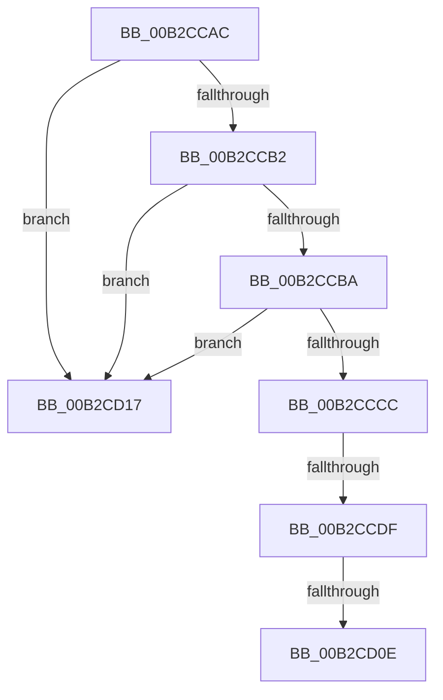

# sub_00B2CCAC

- RVA: `0x00B2CCAC`–`0x00B2CD21` (길이 `117` bytes)
- VA: `0x0000000140B2CCAC`
- 실행 섹션: `PAGE`
- PDB 이름 있음: `아니요`; PDB Function 태그: `아니요`
- unwind 정보 RVA: `0x00099424`
- 디코드: `32`개 명령, `117/117` bytes 표시
- 미해석 바이트: `0` (있으면 어셈블리에 `.byte`로 보존)

> 이 문서는 커널 이미지의 기계어와 PDB 기호를 분석해 생성했습니다. 4번과 5번은 함수 원형과 자료형을 바이너리 사용 방식에서 추정한 C 해석이며 원본 소스 복구 결과는 아닙니다.

## 1. Dependencies

- 직접 호출 지점: **2**; 고유 호출 대상: **2**
- 직접 호출자로 확인된 함수: **0**
- RIP 상대 이미지 참조: **0**

### Outgoing calls
- `0x00B2CCD0` → [RtlInitUnicodeStringEx](../../text/46/RtlInitUnicodeStringEx_function_00463960.md) (function, `0x00463960`)
- `0x00B2CCFF` → [RtlCompareUnicodeStrings](../97/RtlCompareUnicodeStrings_function_009727E0.md) (function, `0x009727E0`)

### Direct callers
- 이 함수 시작 RVA로 연결되는 직접 call은 확인되지 않았습니다. 간접 호출은 완전히 역산할 수 없습니다.

### Static image references
- 디코드된 RIP-relative 메모리 참조가 없습니다.

## 2. Other-region calls and transfers

- 다른 실행 섹션으로 향하는 call: **1**
  - `0x00B2CCD0` → [RtlInitUnicodeStringEx](../../text/46/RtlInitUnicodeStringEx_function_00463960.md) (`PAGE` → `.text`)
- call이 아닌 외부 분기/꼬리 이동: **4**
  - `0x00B2CCD9` → [PiGetServiceNameInfo + 0xAF](../99/PiGetServiceNameInfo_function_00998AA8.md) (`tail-transfer`)
  - `0x00B2CD08` → [PiGetServiceNameInfo + 0x8D](../99/PiGetServiceNameInfo_function_00998AA8.md) (`tail-transfer`)
  - `0x00B2CD12` → [PiGetServiceNameInfo + 0x98](../99/PiGetServiceNameInfo_function_00998AA8.md) (`tail-transfer`)
  - `0x00B2CD1C` → [PiGetServiceNameInfo + 0xAF](../99/PiGetServiceNameInfo_function_00998AA8.md) (`tail-transfer`)

## 3. Assembly (complete function range)

```asm
00B2CCAC  83 7F 04 01                     cmp dword ptr [rdi + 4], 1
00B2CCB0  75 65                           jne 0x140b2cd17
00B2CCB2  8B 47 0C                        mov eax, dword ptr [rdi + 0xc]
00B2CCB5  83 F8 02                        cmp eax, 2
00B2CCB8  72 5D                           jb 0x140b2cd17
00B2CCBA  8B 57 08                        mov edx, dword ptr [rdi + 8]
00B2CCBD  33 DB                           xor ebx, ebx
00B2CCBF  48 03 D7                        add rdx, rdi
00B2CCC2  48 D1 E8                        shr rax, 1
00B2CCC5  66 39 5C 42 FE                  cmp word ptr [rdx + rax*2 - 2], bx
00B2CCCA  75 4B                           jne 0x140b2cd17
00B2CCCC  48 8D 4D F0                     lea rcx, [rbp - 0x10]
00B2CCD0  E8 8B 6C 93 FF                  call 0x140463960
00B2CCD5  8B D8                           mov ebx, eax
00B2CCD7  85 C0                           test eax, eax
00B2CCD9  0F 88 78 BE E6 FF               js 0x140998b57
00B2CCDF  49 8B 4F 30                     mov rcx, qword ptr [r15 + 0x30]
00B2CCE3  44 0F B7 4D F0                  movzx r9d, word ptr [rbp - 0x10]
00B2CCE8  4C 8B 45 F8                     mov r8, qword ptr [rbp - 8]
00B2CCEC  49 D1 E9                        shr r9, 1
00B2CCEF  0F B7 51 18                     movzx edx, word ptr [rcx + 0x18]
00B2CCF3  48 8B 49 20                     mov rcx, qword ptr [rcx + 0x20]
00B2CCF7  48 D1 EA                        shr rdx, 1
00B2CCFA  40 88 74 24 20                  mov byte ptr [rsp + 0x20], sil
00B2CCFF  E8 DC 5A E4 FF                  call 0x1409727e0
00B2CD04  33 C9                           xor ecx, ecx
00B2CD06  85 C0                           test eax, eax
00B2CD08  0F 84 27 BE E6 FF               je 0x140998b35
00B2CD0E  48 8D 55 F0                     lea rdx, [rbp - 0x10]
00B2CD12  E9 29 BE E6 FF                  jmp 0x140998b40
00B2CD17  BB 4C 01 00 C0                  mov ebx, 0xc000014c
00B2CD1C  E9 36 BE E6 FF                  jmp 0x140998b57
```

## 4. C-style interpretation (structured pseudocode)

```c
__int64 __fastcall sub_00B2CCAC(void)
{
    __int64 result;
    __int64 v_rbx;
    unsigned __int8 v_stack_p20;

    if ((*(unsigned int *)(v_rdi + 4)) != 1) goto loc_00B2CD17;
    if (((unsigned int)((unsigned int)(*(unsigned int *)(v_rdi + 12)))) < 2) goto loc_00B2CD17;
    v_rbx = 0;
    a2 = ((unsigned int)(*(unsigned int *)(v_rdi + 8))) + (v_rdi);
    result = ((unsigned int)(*(unsigned int *)(v_rdi + 12))) >> (1);
    if ((*(unsigned __int16 *)(a2 + result * 2 - 2)) != 0) goto loc_00B2CD17;
    result = RtlInitUnicodeStringEx(v_rbp - 16, a2, a3, a4);
    a4 = (*(unsigned __int16 *)(v_rbp - 16)) >> (1);
    a2 = (*(unsigned __int16 *)(*(unsigned __int64 *)(v_r15 + 48) + 24)) >> (1);
    v_stack_p20 = (unsigned __int8)(v_rsi);
    result = RtlCompareUnicodeStrings(*(unsigned __int64 *)(*(unsigned __int64 *)(v_r15 + 48) + 32), a2, *(unsigned __int64 *)(v_rbp - 8), a4);
    a1 = 0;
loc_00B2CD17:
}
```

## 5. (Beta) C Style

```c
void sub_00B2CCAC(void)
{
    int64_t result;
    int64_t local_rbx;
    uint8_t v_stack_p20;

    if ((*(uint32_t *)(local_rdi + 0x4)) != 1) goto loc_00B2CD17;
    if (((uint32_t)((uint32_t)(*(uint32_t *)(local_rdi + 0xC)))) < 2) goto loc_00B2CD17;
    local_rbx = 0;
    a2 = ((uint32_t)(*(uint32_t *)(local_rdi + 0x8))) + (local_rdi);
    result = ((uint32_t)(*(uint32_t *)(local_rdi + 0xC))) >> (1);
    if ((*(uint16_t *)(a2 + result * 2 - 0x2)) != 0) goto loc_00B2CD17;
    result = RtlInitUnicodeStringEx(local_rbp - 16, a2, a3, a4);
    a4 = (*(uint16_t *)(local_rbp - 0x10)) >> (1);
    a2 = (*(uint16_t *)(*(uint64_t *)(local_r15 + 0x30) + 0x18)) >> (1);
    v_stack_p20 = (uint8_t)(local_rsi);
    result = RtlCompareUnicodeStrings(*(uint64_t *)(*(uint64_t *)(local_r15 + 0x30) + 0x20), a2, *(uint64_t *)(local_rbp - 0x8), a4);
    a1 = 0;
loc_00B2CD17:
}
```

## 6. Execution-region graph

[열기: 2D/3D 그래프와 함수 탐색 컨트롤 패널](../../../control-panel.html?section=page&rva=0x00B2CCAC&view=graph)

- 2D 그래프는 위에서 아래로 흐르고, 3D 그래프는 빈 공간을 드래그해 회전합니다. Shift+드래그는 이동, 휠은 확대·축소, 함수 노드 선택은 대상 보고서 이동입니다.

### Static fallback


