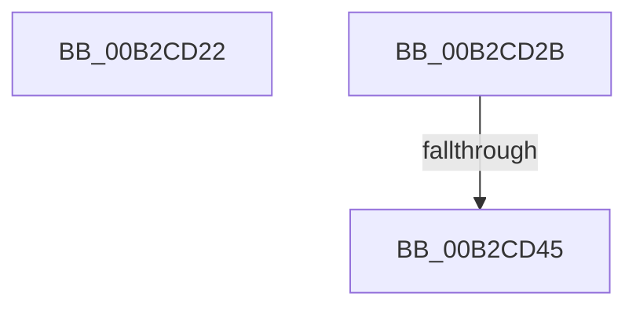

# sub_00B2CD22

- RVA: `0x00B2CD22`–`0x00B2CD8C` (길이 `106` bytes)
- VA: `0x0000000140B2CD22`
- 실행 섹션: `PAGE`
- PDB 이름 있음: `아니요`; PDB Function 태그: `아니요`
- unwind 정보 RVA: `0x000994B8`
- 디코드: `25`개 명령, `106/106` bytes 표시
- 미해석 바이트: `0` (있으면 어셈블리에 `.byte`로 보존)

> 이 문서는 커널 이미지의 기계어와 PDB 기호를 분석해 생성했습니다. 4번과 5번은 함수 원형과 자료형을 바이너리 사용 방식에서 추정한 C 해석이며 원본 소스 복구 결과는 아닙니다.

## 1. Dependencies

- 직접 호출 지점: **2**; 고유 호출 대상: **2**
- 직접 호출자로 확인된 함수: **0**
- RIP 상대 이미지 참조: **0**

### Outgoing calls
- `0x00B2CD32` → [PiAuGetServiceStateSecurityObject](../73/PiAuGetServiceStateSecurityObject_function_007314F0.md) (function, `0x007314F0`)
- `0x00B2CD80` → [ZwCreateKey](../../text/6A/ZwCreateKey_function_006AD470.md) (function, `0x006AD470`)

### Direct callers
- 이 함수 시작 RVA로 연결되는 직접 call은 확인되지 않았습니다. 간접 호출은 완전히 역산할 수 없습니다.

### Static image references
- 디코드된 RIP-relative 메모리 참조가 없습니다.

## 2. Other-region calls and transfers

- 다른 실행 섹션으로 향하는 call: **1**
  - `0x00B2CD80` → [ZwCreateKey](../../text/6A/ZwCreateKey_function_006AD470.md) (`PAGE` → `.text`)
- call이 아닌 외부 분기/꼬리 이동: **3**
  - `0x00B2CD26` → [PiCreateServiceStateKey + 0x12B](../99/PiCreateServiceStateKey_function_009993E0.md) (`tail-transfer`)
  - `0x00B2CD3F` → [PiCreateServiceStateKey + 0xC5](../99/PiCreateServiceStateKey_function_009993E0.md) (`tail-transfer`)
  - `0x00B2CD87` → [PiCreateServiceStateKey + 0xB1](../99/PiCreateServiceStateKey_function_009993E0.md) (`tail-transfer`)

## 3. Assembly (complete function range)

```asm
00B2CD22  48 8B 4D EF                     mov rcx, qword ptr [rbp - 0x11]
00B2CD26  E9 E0 C7 E6 FF                  jmp 0x14099950b
00B2CD2B  8A 4D 77                        mov cl, byte ptr [rbp + 0x77]
00B2CD2E  48 8D 55 F7                     lea rdx, [rbp - 9]
00B2CD32  E8 B9 47 C0 FF                  call 0x1407314f0
00B2CD37  48 8B 75 F7                     mov rsi, qword ptr [rbp - 9]
00B2CD3B  8B D8                           mov ebx, eax
00B2CD3D  85 C0                           test eax, eax
00B2CD3F  0F 88 60 C7 E6 FF               js 0x1409994a5
00B2CD45  48 83 64 24 30 00               and qword ptr [rsp + 0x30], 0
00B2CD4B  4C 8D 45 FF                     lea r8, [rbp - 1]
00B2CD4F  83 64 24 28 00                  and dword ptr [rsp + 0x28], 0
00B2CD54  48 8D 4D DF                     lea rcx, [rbp - 0x21]
00B2CD58  48 83 64 24 20 00               and qword ptr [rsp + 0x20], 0
00B2CD5E  45 33 C9                        xor r9d, r9d
00B2CD61  48 83 65 27 00                  and qword ptr [rbp + 0x27], 0
00B2CD66  8B 55 6F                        mov edx, dword ptr [rbp + 0x6f]
00B2CD69  44 89 75 FF                     mov dword ptr [rbp - 1], r14d
00B2CD6D  48 89 7D 07                     mov qword ptr [rbp + 7], rdi
00B2CD71  C7 45 17 40 02 00 00            mov dword ptr [rbp + 0x17], 0x240
00B2CD78  4C 89 65 0F                     mov qword ptr [rbp + 0xf], r12
00B2CD7C  48 89 75 1F                     mov qword ptr [rbp + 0x1f], rsi
00B2CD80  E8 EB 06 B8 FF                  call 0x1406ad470
00B2CD85  8B D8                           mov ebx, eax
00B2CD87  E9 05 C7 E6 FF                  jmp 0x140999491
```

## 4. C-style interpretation (structured pseudocode)

```c
__int64 __fastcall sub_00B2CD22(__int64 a1, __int64 a2, __int64 a3, int a4)
{
    unsigned __int64 v_stack_p20;
    unsigned int v_stack_p28;
    unsigned __int64 v_stack_p30;
}
```

## 5. (Beta) C Style

```c
int64_t sub_00B2CD22(int64_t Arg1, int64_t Arg2, int64_t Arg3, int32_t Arg4)
{
    uint64_t v_stack_p20;
    uint32_t v_stack_p28;
    uint64_t v_stack_p30;
}
```

## 6. Execution-region graph

[열기: 2D/3D 그래프와 함수 탐색 컨트롤 패널](../../../control-panel.html?section=page&rva=0x00B2CD22&view=graph)

- 2D 그래프는 위에서 아래로 흐르고, 3D 그래프는 빈 공간을 드래그해 회전합니다. Shift+드래그는 이동, 휠은 확대·축소, 함수 노드 선택은 대상 보고서 이동입니다.

### Static fallback


