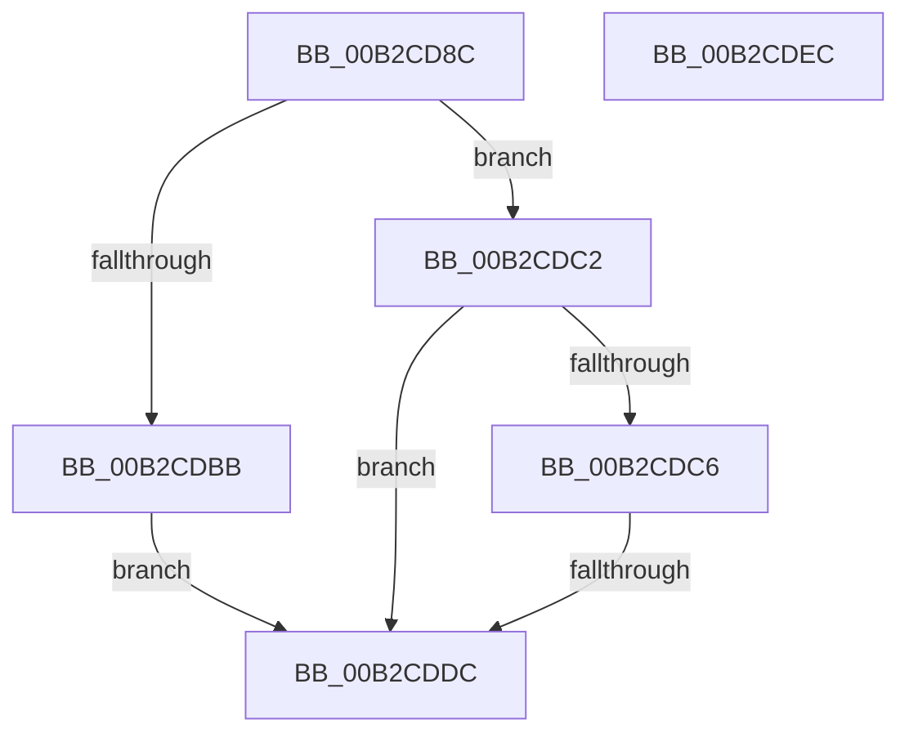

# sub_00B2CD8C

- RVA: `0x00B2CD8C`–`0x00B2CDF5` (길이 `105` bytes)
- VA: `0x0000000140B2CD8C`
- 실행 섹션: `PAGE`
- PDB 이름 있음: `아니요`; PDB Function 태그: `아니요`
- unwind 정보 RVA: `0x000994E0`
- 디코드: `29`개 명령, `105/105` bytes 표시
- 미해석 바이트: `0` (있으면 어셈블리에 `.byte`로 보존)

> 이 문서는 커널 이미지의 기계어와 PDB 기호를 분석해 생성했습니다. 4번과 5번은 함수 원형과 자료형을 바이너리 사용 방식에서 추정한 C 해석이며 원본 소스 복구 결과는 아닙니다.

## 1. Dependencies

- 직접 호출 지점: **3**; 고유 호출 대상: **3**
- 직접 호출자로 확인된 함수: **0**
- RIP 상대 이미지 참조: **1**

### Outgoing calls
- `0x00B2CDAD` → [RtlGetPersistedStateLocation](../8C/RtlGetPersistedStateLocation_function_008C8DE0.md) (function, `0x008C8DE0`)
- `0x00B2CDCD` → [RtlInitUnicodeStringEx](../../text/46/RtlInitUnicodeStringEx_function_00463960.md) (function, `0x00463960`)
- `0x00B2CDE1` → [ExFreePoolWithTag](../../poolcode/B8/ExFreePoolWithTag_function_00B82870.md) (function, `0x00B82870`)

### Direct callers
- 이 함수 시작 RVA로 연결되는 직접 call은 확인되지 않았습니다. 간접 호출은 완전히 역산할 수 없습니다.

### Static image references
- `0x00B2CD98` → RVA `0x00AFD690` (` ?? ::NNGAKEGL::`string'`; read)

## 2. Other-region calls and transfers

- 다른 실행 섹션으로 향하는 call: **2**
  - `0x00B2CDCD` → [RtlInitUnicodeStringEx](../../text/46/RtlInitUnicodeStringEx_function_00463960.md) (`PAGE` → `.text`)
  - `0x00B2CDE1` → [ExFreePoolWithTag](../../poolcode/B8/ExFreePoolWithTag_function_00B82870.md) (`PAGE` → `POOLCODE`)
- call이 아닌 외부 분기/꼬리 이동: **3**
  - `0x00B2CDD6` → [PiCreateDriverRedirectedStateKey + 0xEC](../99/PiCreateDriverRedirectedStateKey_function_0099957C.md) (`tail-transfer`)
  - `0x00B2CDE7` → [PiCreateDriverRedirectedStateKey + 0x81](../99/PiCreateDriverRedirectedStateKey_function_0099957C.md) (`tail-transfer`)
  - `0x00B2CDF0` → [PiCreateDriverRedirectedStateKey + 0x85](../99/PiCreateDriverRedirectedStateKey_function_0099957C.md) (`tail-transfer`)

## 3. Assembly (complete function range)

```asm
00B2CD8C  48 8D 45 38                     lea rax, [rbp + 0x38]
00B2CD90  45 33 C9                        xor r9d, r9d
00B2CD93  48 89 44 24 30                  mov qword ptr [rsp + 0x30], rax
00B2CD98  48 8D 0D F1 08 FD FF            lea rcx, [rip - 0x2f70f]
00B2CD9F  89 5C 24 28                     mov dword ptr [rsp + 0x28], ebx
00B2CDA3  45 33 C0                        xor r8d, r8d
00B2CDA6  33 D2                           xor edx, edx
00B2CDA8  4C 89 74 24 20                  mov qword ptr [rsp + 0x20], r14
00B2CDAD  E8 2E C0 D9 FF                  call 0x1408c8de0
00B2CDB2  8B D8                           mov ebx, eax
00B2CDB4  3D 34 00 00 C0                  cmp eax, 0xc0000034
00B2CDB9  75 07                           jne 0x140b2cdc2
00B2CDBB  BB E5 00 00 C0                  mov ebx, 0xc00000e5
00B2CDC0  EB 1A                           jmp 0x140b2cddc
00B2CDC2  85 C0                           test eax, eax
00B2CDC4  78 16                           js 0x140b2cddc
00B2CDC6  49 8B D6                        mov rdx, r14
00B2CDC9  48 8D 4D F0                     lea rcx, [rbp - 0x10]
00B2CDCD  E8 8E 6B 93 FF                  call 0x140463960
00B2CDD2  8B D8                           mov ebx, eax
00B2CDD4  85 C0                           test eax, eax
00B2CDD6  0F 89 8C C8 E6 FF               jns 0x140999668
00B2CDDC  33 D2                           xor edx, edx
00B2CDDE  49 8B CE                        mov rcx, r14
00B2CDE1  E8 8A 5A 05 00                  call 0x140b82870
00B2CDE6  90                              nop
00B2CDE7  E9 11 C8 E6 FF                  jmp 0x1409995fd
00B2CDEC  48 8B 7D 30                     mov rdi, qword ptr [rbp + 0x30]
00B2CDF0  E9 0C C8 E6 FF                  jmp 0x140999601
```

## 4. C-style interpretation (structured pseudocode)

```c
__int64 __fastcall sub_00B2CD8C(__int64 a1, int a2, int a3, int a4)
{
    __int64 result;
    unsigned __int64 v_stack_p20;
    unsigned int v_stack_p28;
    unsigned __int64 v_stack_p30;

    a4 = 0;
    v_stack_p30 = v_rbp + 56;
    v_stack_p28 = (unsigned int)(v_rbx);
    a3 = 0;
    a2 = 0;
    v_stack_p20 = v_r14;
    result = RtlGetPersistedStateLocation(v_rip - 194319, a2, a3, a4);
    if (((unsigned int)(result)) != 0xC0000034ULL) goto loc_00B2CDC2;
    goto loc_00B2CDDC;
loc_00B2CDC2:
    if (sign_flag) goto loc_00B2CDDC;
    result = RtlInitUnicodeStringEx(v_rbp - 16, v_r14, a3, a4);
loc_00B2CDDC:
    a2 = 0;
    result = ExFreePoolWithTag(v_r14, a2, a3, a4);
}
```

## 5. (Beta) C Style

```c
int64_t sub_00B2CD8C(int64_t Arg1, int32_t Arg2, int32_t Arg3, int32_t Arg4)
{
    int64_t result;
    uint64_t v_stack_p20;
    uint32_t v_stack_p28;
    uint64_t v_stack_p30;

    Arg4 = 0;
    v_stack_p30 = local_rbp + 56;
    v_stack_p28 = (uint32_t)(local_rbx);
    Arg3 = 0;
    Arg2 = 0;
    v_stack_p20 = local_r14;
    result = RtlGetPersistedStateLocation(v_rip - 194319, Arg2, Arg3, Arg4);
    if (((uint32_t)(result)) != 0xC0000034ULL) goto loc_00B2CDC2;
    goto loc_00B2CDDC;
loc_00B2CDC2:
    if (sign_flag) goto loc_00B2CDDC;
    result = RtlInitUnicodeStringEx(local_rbp - 16, local_r14, Arg3, Arg4);
loc_00B2CDDC:
    Arg2 = 0;
    result = ExFreePoolWithTag(local_r14, Arg2, Arg3, Arg4);
}
```

## 6. Execution-region graph

[열기: 2D/3D 그래프와 함수 탐색 컨트롤 패널](../../../control-panel.html?section=page&rva=0x00B2CD8C&view=graph)

- 2D 그래프는 위에서 아래로 흐르고, 3D 그래프는 빈 공간을 드래그해 회전합니다. Shift+드래그는 이동, 휠은 확대·축소, 함수 노드 선택은 대상 보고서 이동입니다.

### Static fallback


