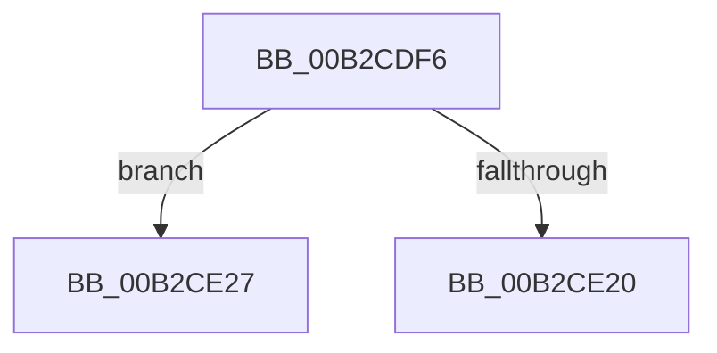

# sub_00B2CDF6

- RVA: `0x00B2CDF6`–`0x00B2CE2F` (길이 `57` bytes)
- VA: `0x0000000140B2CDF6`
- 실행 섹션: `PAGE`
- PDB 이름 있음: `아니요`; PDB Function 태그: `아니요`
- unwind 정보 RVA: `0x0009950C`
- 디코드: `16`개 명령, `57/57` bytes 표시
- 미해석 바이트: `0` (있으면 어셈블리에 `.byte`로 보존)

> 이 문서는 커널 이미지의 기계어와 PDB 기호를 분석해 생성했습니다. 4번과 5번은 함수 원형과 자료형을 바이너리 사용 방식에서 추정한 C 해석이며 원본 소스 복구 결과는 아닙니다.

## 1. Dependencies

- 직접 호출 지점: **2**; 고유 호출 대상: **2**
- 직접 호출자로 확인된 함수: **0**
- RIP 상대 이미지 참조: **0**

### Outgoing calls
- `0x00B2CDFB` → [ExFreePoolWithTag](../../poolcode/B8/ExFreePoolWithTag_function_00B82870.md) (function, `0x00B82870`)
- `0x00B2CE13` → [ExAllocatePool2](../../poolcode/B8/ExAllocatePool2_function_00B820F0.md) (function, `0x00B820F0`)

### Direct callers
- 이 함수 시작 RVA로 연결되는 직접 call은 확인되지 않았습니다. 간접 호출은 완전히 역산할 수 없습니다.

### Static image references
- 디코드된 RIP-relative 메모리 참조가 없습니다.

## 2. Other-region calls and transfers

- 다른 실행 섹션으로 향하는 call: **2**
  - `0x00B2CDFB` → [ExFreePoolWithTag](../../poolcode/B8/ExFreePoolWithTag_function_00B82870.md) (`PAGE` → `POOLCODE`)
  - `0x00B2CE13` → [ExAllocatePool2](../../poolcode/B8/ExAllocatePool2_function_00B820F0.md) (`PAGE` → `POOLCODE`)
- call이 아닌 외부 분기/꼬리 이동: **2**
  - `0x00B2CE22` → [PiFindDevInstMatch + 0x1B8](../99/PiFindDevInstMatch_function_009996A0.md) (`tail-transfer`)
  - `0x00B2CE2A` → [PiFindDevInstMatch + 0x20B](../99/PiFindDevInstMatch_function_009996A0.md) (`tail-transfer`)

## 3. Assembly (complete function range)

```asm
00B2CDF6  33 D2                           xor edx, edx
00B2CDF8  48 8B CF                        mov rcx, rdi
00B2CDFB  E8 70 5A 05 00                  call 0x140b82870
00B2CE00  8B 45 58                        mov eax, dword ptr [rbp + 0x58]
00B2CE03  B9 00 01 00 00                  mov ecx, 0x100
00B2CE08  8B D0                           mov edx, eax
00B2CE0A  89 45 60                        mov dword ptr [rbp + 0x60], eax
00B2CE0D  41 B8 50 70 20 20               mov r8d, 0x20207050
00B2CE13  E8 D8 52 05 00                  call 0x140b820f0
00B2CE18  48 8B F8                        mov rdi, rax
00B2CE1B  48 85 C0                        test rax, rax
00B2CE1E  74 07                           je 0x140b2ce27
00B2CE20  FF CE                           dec esi
00B2CE22  E9 31 CA E6 FF                  jmp 0x140999858
00B2CE27  49 8B CE                        mov rcx, r14
00B2CE2A  E9 7C CA E6 FF                  jmp 0x1409998ab
```

## 4. C-style interpretation (structured pseudocode)

```c
__int64 __fastcall sub_00B2CDF6(__int64 a1, int a2)
{
    __int64 result;
    __int64 v_rsi;

    a2 = 0;
    result = ExFreePoolWithTag(v_rdi, a2, a3, a4);
    *(unsigned int *)(v_rbp + 96) = (unsigned int)((unsigned int)(*(unsigned int *)(v_rbp + 88)));
    result = ExAllocatePool2(256, (unsigned int)((unsigned int)((unsigned int)(*(unsigned int *)(v_rbp + 88)))), (unsigned int)(0x20207050ULL), a4);
    if (result == 0) goto loc_00B2CE27;
    v_rsi = (unsigned int)((v_rsi) - 1);
loc_00B2CE27:
}
```

## 5. (Beta) C Style

```c
int64_t sub_00B2CDF6(int64_t Arg1, int32_t Arg2)
{
    int64_t result;
    int64_t local_rsi;

    Arg2 = 0;
    result = ExFreePoolWithTag(local_rdi, Arg2, a3, a4);
    *(uint32_t *)(local_rbp + 0x60) = (uint32_t)((uint32_t)(*(uint32_t *)(local_rbp + 0x58)));
    result = ExAllocatePool2(256, (uint32_t)((uint32_t)((uint32_t)(*(uint32_t *)(local_rbp + 0x58)))), (uint32_t)(0x20207050ULL), a4);
    if (result == 0) goto loc_00B2CE27;
    local_rsi = (uint32_t)((local_rsi) - 1);
loc_00B2CE27:
}
```

## 6. Execution-region graph

[열기: 2D/3D 그래프와 함수 탐색 컨트롤 패널](../../../control-panel.html?section=page&rva=0x00B2CDF6&view=graph)

- 2D 그래프는 위에서 아래로 흐르고, 3D 그래프는 빈 공간을 드래그해 회전합니다. Shift+드래그는 이동, 휠은 확대·축소, 함수 노드 선택은 대상 보고서 이동입니다.

### Static fallback


