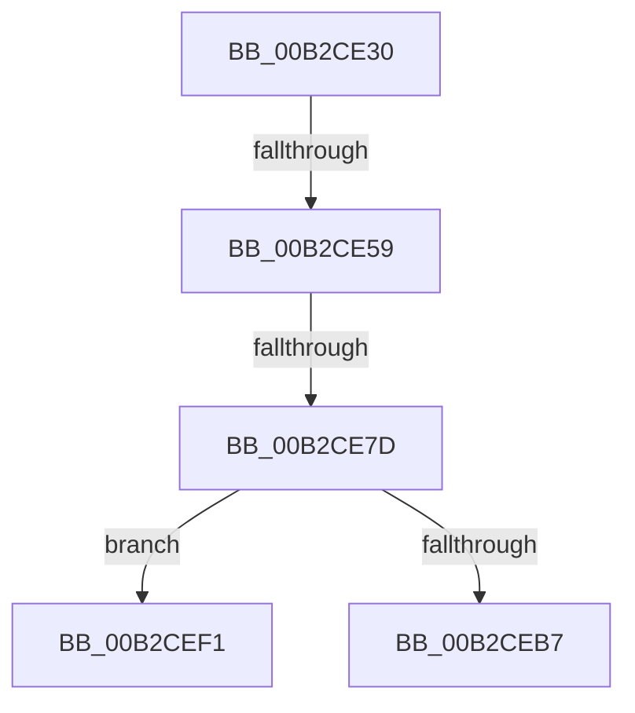

# sub_00B2CE30

- RVA: `0x00B2CE30`–`0x00B2CEFB` (길이 `203` bytes)
- VA: `0x0000000140B2CE30`
- 실행 섹션: `PAGE`
- PDB 이름 있음: `아니요`; PDB Function 태그: `아니요`
- unwind 정보 RVA: `0x00099580`
- 디코드: `48`개 명령, `203/203` bytes 표시
- 미해석 바이트: `0` (있으면 어셈블리에 `.byte`로 보존)

> 이 문서는 커널 이미지의 기계어와 PDB 기호를 분석해 생성했습니다. 4번과 5번은 함수 원형과 자료형을 바이너리 사용 방식에서 추정한 C 해석이며 원본 소스 복구 결과는 아닙니다.

## 1. Dependencies

- 직접 호출 지점: **5**; 고유 호출 대상: **5**
- 직접 호출자로 확인된 함수: **0**
- RIP 상대 이미지 참조: **0**

### Outgoing calls
- `0x00B2CE47` → [ExAllocatePool2](../../poolcode/B8/ExAllocatePool2_function_00B820F0.md) (function, `0x00B820F0`)
- `0x00B2CE61` → [RtlCopyUnicodeString](../../text/3F/RtlCopyUnicodeString_function_003FEF30.md) (function, `0x003FEF30`)
- `0x00B2CE6E` → [RtlAppendUnicodeStringToString](../../text/40/RtlAppendUnicodeStringToString_function_0040FA50.md) (function, `0x0040FA50`)
- `0x00B2CEAC` → [ZwOpenSymbolicLinkObject](../../text/6A/ZwOpenSymbolicLinkObject_function_006AF7F0.md) (function, `0x006AF7F0`)
- `0x00B2CEBB` → [ZwClose](../../text/6A/ZwClose_function_006AD2B0.md) (function, `0x006AD2B0`)

### Direct callers
- 이 함수 시작 RVA로 연결되는 직접 call은 확인되지 않았습니다. 간접 호출은 완전히 역산할 수 없습니다.

### Static image references
- 디코드된 RIP-relative 메모리 참조가 없습니다.

## 2. Other-region calls and transfers

- 다른 실행 섹션으로 향하는 call: **5**
  - `0x00B2CE47` → [ExAllocatePool2](../../poolcode/B8/ExAllocatePool2_function_00B820F0.md) (`PAGE` → `POOLCODE`)
  - `0x00B2CE61` → [RtlCopyUnicodeString](../../text/3F/RtlCopyUnicodeString_function_003FEF30.md) (`PAGE` → `.text`)
  - `0x00B2CE6E` → [RtlAppendUnicodeStringToString](../../text/40/RtlAppendUnicodeStringToString_function_0040FA50.md) (`PAGE` → `.text`)
  - `0x00B2CEAC` → [ZwOpenSymbolicLinkObject](../../text/6A/ZwOpenSymbolicLinkObject_function_006AF7F0.md) (`PAGE` → `.text`)
  - `0x00B2CEBB` → [ZwClose](../../text/6A/ZwClose_function_006AD2B0.md) (`PAGE` → `.text`)
- call이 아닌 외부 분기/꼬리 이동: **4**
  - `0x00B2CE53` → [IopQueryRegistryKeySystemPath + 0x1CE](../99/IopQueryRegistryKeySystemPath_function_0099A1CC.md) (`tail-transfer`)
  - `0x00B2CE77` → [IopQueryRegistryKeySystemPath + 0x1D3](../99/IopQueryRegistryKeySystemPath_function_0099A1CC.md) (`tail-transfer`)
  - `0x00B2CEEC` → [IopQueryRegistryKeySystemPath + 0x18B](../99/IopQueryRegistryKeySystemPath_function_0099A1CC.md) (`tail-transfer`)
  - `0x00B2CEF6` → [IopQueryRegistryKeySystemPath + 0x18B](../99/IopQueryRegistryKeySystemPath_function_0099A1CC.md) (`tail-transfer`)

## 3. Assembly (complete function range)

```asm
00B2CE30  66 89 55 B9                     mov word ptr [rbp - 0x47], dx
00B2CE34  B9 00 01 00 00                  mov ecx, 0x100
00B2CE39  0F B7 D2                        movzx edx, dx
00B2CE3C  41 B8 49 6F 20 20               mov r8d, 0x20206f49
00B2CE42  66 44 89 7D B7                  mov word ptr [rbp - 0x49], r15w
00B2CE47  E8 A4 52 05 00                  call 0x140b820f0
00B2CE4C  48 89 45 BF                     mov qword ptr [rbp - 0x41], rax
00B2CE50  48 85 C0                        test rax, rax
00B2CE53  0F 84 41 D5 E6 FF               je 0x14099a39a
00B2CE59  48 8D 55 E7                     lea rdx, [rbp - 0x19]
00B2CE5D  48 8D 4D B7                     lea rcx, [rbp - 0x49]
00B2CE61  E8 CA 20 8D FF                  call 0x1403fef30
00B2CE66  48 8D 55 C7                     lea rdx, [rbp - 0x39]
00B2CE6A  48 8D 4D B7                     lea rcx, [rbp - 0x49]
00B2CE6E  E8 DD 2B 8E FF                  call 0x14040fa50
00B2CE73  8B D8                           mov ebx, eax
00B2CE75  85 C0                           test eax, eax
00B2CE77  0F 88 22 D5 E6 FF               js 0x14099a39f
00B2CE7D  48 8D 45 B7                     lea rax, [rbp - 0x49]
00B2CE81  C7 45 07 30 00 00 00            mov dword ptr [rbp + 7], 0x30
00B2CE88  0F 57 C0                        xorps xmm0, xmm0
00B2CE8B  48 89 45 17                     mov qword ptr [rbp + 0x17], rax
00B2CE8F  4C 8D 45 07                     lea r8, [rbp + 7]
00B2CE93  4C 89 7D 0F                     mov qword ptr [rbp + 0xf], r15
00B2CE97  BA 01 00 00 00                  mov edx, 1
00B2CE9C  C7 45 1F 40 02 00 00            mov dword ptr [rbp + 0x1f], 0x240
00B2CEA3  48 8D 4D 7F                     lea rcx, [rbp + 0x7f]
00B2CEA7  F3 0F 7F 45 27                  movdqu xmmword ptr [rbp + 0x27], xmm0
00B2CEAC  E8 3F 29 B8 FF                  call 0x1406af7f0
00B2CEB1  8B D8                           mov ebx, eax
00B2CEB3  85 C0                           test eax, eax
00B2CEB5  78 3A                           js 0x140b2cef1
00B2CEB7  48 8B 4D 7F                     mov rcx, qword ptr [rbp + 0x7f]
00B2CEBB  E8 F0 03 B8 FF                  call 0x1406ad2b0
00B2CEC0  0F B7 4D B7                     movzx ecx, word ptr [rbp - 0x49]
00B2CEC4  48 8B 45 BF                     mov rax, qword ptr [rbp - 0x41]
00B2CEC8  48 D1 E9                        shr rcx, 1
00B2CECB  66 C7 04 48 5C 00               mov word ptr [rax + rcx*2], 0x5c
00B2CED1  0F B7 45 B7                     movzx eax, word ptr [rbp - 0x49]
00B2CED5  66 41 03 C5                     add ax, r13w
00B2CED9  0F B7 C8                        movzx ecx, ax
00B2CEDC  66 89 45 B7                     mov word ptr [rbp - 0x49], ax
00B2CEE0  48 8B 45 BF                     mov rax, qword ptr [rbp - 0x41]
00B2CEE4  48 D1 E9                        shr rcx, 1
00B2CEE7  66 44 89 3C 48                  mov word ptr [rax + rcx*2], r15w
00B2CEEC  E9 66 D4 E6 FF                  jmp 0x14099a357
00B2CEF1  66 44 89 7D B7                  mov word ptr [rbp - 0x49], r15w
00B2CEF6  E9 5C D4 E6 FF                  jmp 0x14099a357
```

## 4. C-style interpretation (structured pseudocode)

```c
__int64 __fastcall sub_00B2CE30(__int64 a1, unsigned __int16 a2)
{
    __int64 result;

    *(unsigned __int16 *)(v_rbp - 71) = a2;
    *(unsigned __int16 *)(v_rbp - 73) = (unsigned __int16)(v_r15);
    result = ExAllocatePool2(256, a2, (unsigned int)(0x20206F49ULL), a4);
    *(unsigned __int64 *)(v_rbp - 65) = result;
    result = RtlCopyUnicodeString(v_rbp - 73, v_rbp - 25, (unsigned int)(0x20206F49ULL), a4);
    result = RtlAppendUnicodeStringToString(v_rbp - 73, v_rbp - 57, (unsigned int)(0x20206F49ULL), a4);
    *(unsigned int *)(v_rbp + 7) = 48;
    *(unsigned __int64 *)(v_rbp + 23) = v_rbp - 73;
    *(unsigned __int64 *)(v_rbp + 15) = v_r15;
    *(unsigned int *)(v_rbp + 31) = 576;
    *(unsigned __int64 *)(v_rbp + 39) = v_xmm0;
    result = ZwOpenSymbolicLinkObject(v_rbp + 127, 1, v_rbp + 7, a4);
    if (sign_flag) goto loc_00B2CEF1;
    result = ZwClose(*(unsigned __int64 *)(v_rbp + 127), 1, v_rbp + 7, a4);
    a1 = (*(unsigned __int16 *)(v_rbp - 73)) >> (1);
    *(unsigned __int16 *)(*(unsigned __int64 *)(v_rbp - 65) + a1 * 2) = 92;
    result = (unsigned __int16)((*(unsigned __int16 *)(v_rbp - 73)) + ((unsigned __int16)(v_r13)));
    *(unsigned __int16 *)(v_rbp - 73) = (unsigned __int16)(result);
    a1 = ((unsigned __int16)(result)) >> (1);
    *(unsigned __int16 *)(*(unsigned __int64 *)(v_rbp - 65) + a1 * 2) = (unsigned __int16)(v_r15);
loc_00B2CEF1:
    *(unsigned __int16 *)(v_rbp - 73) = (unsigned __int16)(v_r15);
}
```

## 5. (Beta) C Style

```c
int64_t sub_00B2CE30(int64_t Arg1, uint16_t Arg2)
{
    int64_t result;

    *(uint16_t *)(local_rbp - 0x47) = Arg2;
    *(uint16_t *)(local_rbp - 0x49) = (uint16_t)(local_r15);
    result = ExAllocatePool2(256, Arg2, (uint32_t)(0x20206F49ULL), a4);
    *(uint64_t *)(local_rbp - 0x41) = result;
    result = RtlCopyUnicodeString(local_rbp - 73, local_rbp - 25, (uint32_t)(0x20206F49ULL), a4);
    result = RtlAppendUnicodeStringToString(local_rbp - 73, local_rbp - 57, (uint32_t)(0x20206F49ULL), a4);
    *(uint32_t *)(local_rbp + 0x7) = 48;
    *(uint64_t *)(local_rbp + 0x17) = local_rbp - 73;
    *(uint64_t *)(local_rbp + 0xF) = local_r15;
    *(uint32_t *)(local_rbp + 0x1F) = 576;
    *(uint64_t *)(local_rbp + 0x27) = v_xmm0;
    result = ZwOpenSymbolicLinkObject(local_rbp + 127, 1, local_rbp + 7, a4);
    if (sign_flag) goto loc_00B2CEF1;
    result = ZwClose(*(uint64_t *)(local_rbp + 0x7F), 1, local_rbp + 7, a4);
    Arg1 = (*(uint16_t *)(local_rbp - 0x49)) >> (1);
    *(uint16_t *)(*(uint64_t *)(local_rbp - 0x41) + Arg1 * 2) = 92;
    result = (uint16_t)((*(uint16_t *)(local_rbp - 0x49)) + ((uint16_t)(local_r13)));
    *(uint16_t *)(local_rbp - 0x49) = (uint16_t)(result);
    Arg1 = ((uint16_t)(result)) >> (1);
    *(uint16_t *)(*(uint64_t *)(local_rbp - 0x41) + Arg1 * 2) = (uint16_t)(local_r15);
loc_00B2CEF1:
    *(uint16_t *)(local_rbp - 0x49) = (uint16_t)(local_r15);
}
```

## 6. Execution-region graph

[열기: 2D/3D 그래프와 함수 탐색 컨트롤 패널](../../../control-panel.html?section=page&rva=0x00B2CE30&view=graph)

- 2D 그래프는 위에서 아래로 흐르고, 3D 그래프는 빈 공간을 드래그해 회전합니다. Shift+드래그는 이동, 휠은 확대·축소, 함수 노드 선택은 대상 보고서 이동입니다.

### Static fallback


