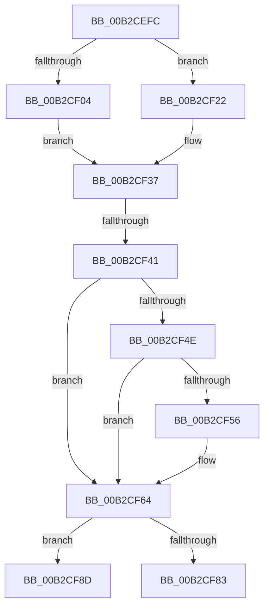

# sub_00B2CEFC

- RVA: `0x00B2CEFC`–`0x00B2CFAE` (길이 `178` bytes)
- VA: `0x0000000140B2CEFC`
- 실행 섹션: `PAGE`
- PDB 이름 있음: `아니요`; PDB Function 태그: `아니요`
- unwind 정보 RVA: `0x000995CC`
- 디코드: `47`개 명령, `178/178` bytes 표시
- 미해석 바이트: `0` (있으면 어셈블리에 `.byte`로 보존)

> 이 문서는 커널 이미지의 기계어와 PDB 기호를 분석해 생성했습니다. 4번과 5번은 함수 원형과 자료형을 바이너리 사용 방식에서 추정한 C 해석이며 원본 소스 복구 결과는 아닙니다.

## 1. Dependencies

- 직접 호출 지점: **6**; 고유 호출 대상: **6**
- 직접 호출자로 확인된 함수: **0**
- RIP 상대 이미지 참조: **0**

### Outgoing calls
- `0x00B2CF0B` → [RtlInitUTF8String](../../text/47/RtlInitUTF8String_function_00470F90.md) (function, `0x00470F90`)
- `0x00B2CF1B` → [RtlUTF8StringToUnicodeString](../79/RtlUTF8StringToUnicodeString_function_00794B80.md) (function, `0x00794B80`)
- `0x00B2CF22` → [RtlInitAnsiString](../../text/47/RtlInitAnsiString_function_00470F40.md) (function, `0x00470F40`)
- `0x00B2CF32` → [RtlAnsiStringToUnicodeString](../90/RtlAnsiStringToUnicodeString_function_0090BEA0.md) (function, `0x0090BEA0`)
- `0x00B2CF76` → [ExAllocatePool2](../../poolcode/B8/ExAllocatePool2_function_00B820F0.md) (function, `0x00B820F0`)
- `0x00B2CF96` → [memcpy](../../text/6C/memcpy_function_006C6840.md) (function, `0x006C6840`)

### Direct callers
- 이 함수 시작 RVA로 연결되는 직접 call은 확인되지 않았습니다. 간접 호출은 완전히 역산할 수 없습니다.

### Static image references
- 디코드된 RIP-relative 메모리 참조가 없습니다.

## 2. Other-region calls and transfers

- 다른 실행 섹션으로 향하는 call: **4**
  - `0x00B2CF0B` → [RtlInitUTF8String](../../text/47/RtlInitUTF8String_function_00470F90.md) (`PAGE` → `.text`)
  - `0x00B2CF22` → [RtlInitAnsiString](../../text/47/RtlInitAnsiString_function_00470F40.md) (`PAGE` → `.text`)
  - `0x00B2CF76` → [ExAllocatePool2](../../poolcode/B8/ExAllocatePool2_function_00B820F0.md) (`PAGE` → `POOLCODE`)
  - `0x00B2CF96` → [memcpy](../../text/6C/memcpy_function_006C6840.md) (`PAGE` → `.text`)
- call이 아닌 외부 분기/꼬리 이동: **3**
  - `0x00B2CF3B` → [PiGetDefaultMessageString + 0x99](../99/PiGetDefaultMessageString_function_0099A87C.md) (`tail-transfer`)
  - `0x00B2CF88` → [PiGetDefaultMessageString + 0x9D](../99/PiGetDefaultMessageString_function_0099A87C.md) (`tail-transfer`)
  - `0x00B2CFA9` → [PiGetDefaultMessageString + 0x9D](../99/PiGetDefaultMessageString_function_0099A87C.md) (`tail-transfer`)

## 3. Assembly (complete function range)

```asm
00B2CEFC  48 8D 4D F0                     lea rcx, [rbp - 0x10]
00B2CF00  A8 02                           test al, 2
00B2CF02  74 1E                           je 0x140b2cf22
00B2CF04  0F 57 C0                        xorps xmm0, xmm0
00B2CF07  0F 11 45 F0                     movups xmmword ptr [rbp - 0x10], xmm0
00B2CF0B  E8 80 40 94 FF                  call 0x140470f90
00B2CF10  41 B0 01                        mov r8b, 1
00B2CF13  48 8D 55 F0                     lea rdx, [rbp - 0x10]
00B2CF17  48 8D 4D D0                     lea rcx, [rbp - 0x30]
00B2CF1B  E8 60 7C C6 FF                  call 0x140794b80
00B2CF20  EB 15                           jmp 0x140b2cf37
00B2CF22  E8 19 40 94 FF                  call 0x140470f40
00B2CF27  41 B0 01                        mov r8b, 1
00B2CF2A  48 8D 55 F0                     lea rdx, [rbp - 0x10]
00B2CF2E  48 8D 4D D0                     lea rcx, [rbp - 0x30]
00B2CF32  E8 69 EF DD FF                  call 0x14090bea0
00B2CF37  8B D8                           mov ebx, eax
00B2CF39  85 C0                           test eax, eax
00B2CF3B  0F 88 D4 D9 E6 FF               js 0x14099a915
00B2CF41  0F B7 45 D0                     movzx eax, word ptr [rbp - 0x30]
00B2CF45  48 8B 7D D8                     mov rdi, qword ptr [rbp - 0x28]
00B2CF49  83 F8 04                        cmp eax, 4
00B2CF4C  72 16                           jb 0x140b2cf64
00B2CF4E  66 83 7C 38 FC 0D               cmp word ptr [rax + rdi - 4], 0xd
00B2CF54  75 0E                           jne 0x140b2cf64
00B2CF56  B9 FC FF 00 00                  mov ecx, 0xfffc
00B2CF5B  66 44 89 64 38 FC               mov word ptr [rax + rdi - 4], r12w
00B2CF61  66 03 C1                        add ax, cx
00B2CF64  0F B7 D8                        movzx ebx, ax
00B2CF67  B9 00 01 00 00                  mov ecx, 0x100
00B2CF6C  41 B8 50 70 20 20               mov r8d, 0x20207050
00B2CF72  48 8D 53 02                     lea rdx, [rbx + 2]
00B2CF76  E8 75 51 05 00                  call 0x140b820f0
00B2CF7B  4C 8B F0                        mov r14, rax
00B2CF7E  48 85 C0                        test rax, rax
00B2CF81  75 0A                           jne 0x140b2cf8d
00B2CF83  BB 9A 00 00 C0                  mov ebx, 0xc000009a
00B2CF88  E9 8C D9 E6 FF                  jmp 0x14099a919
00B2CF8D  4C 8B C3                        mov r8, rbx
00B2CF90  48 8B D7                        mov rdx, rdi
00B2CF93  49 8B CE                        mov rcx, r14
00B2CF96  E8 A5 98 B9 FF                  call 0x1406c6840
00B2CF9B  48 D1 EB                        shr rbx, 1
00B2CF9E  4D 89 37                        mov qword ptr [r15], r14
00B2CFA1  66 45 89 24 5E                  mov word ptr [r14 + rbx*2], r12w
00B2CFA6  41 8B DC                        mov ebx, r12d
00B2CFA9  E9 6B D9 E6 FF                  jmp 0x14099a919
```

## 4. C-style interpretation (structured pseudocode)

```c
__int64 __fastcall sub_00B2CEFC(void)
{
    __int64 result;
    __int64 v_rbx;

    if ((((unsigned __int8)(result)) & (2)) == 0) goto loc_00B2CF22;
    *(unsigned __int64 *)(v_rbp - 16) = v_xmm0;
    result = RtlInitUTF8String(v_rbp - 16, a2, a3, a4);
    result = RtlUTF8StringToUnicodeString(v_rbp - 48, v_rbp - 16, 1, a4);
    goto loc_00B2CF37;
loc_00B2CF22:
    result = RtlInitAnsiString(v_rbp - 48, v_rbp - 16, 1, a4);
    result = RtlAnsiStringToUnicodeString(v_rbp - 48, v_rbp - 16, 1, a4);
loc_00B2CF37:
    if (((unsigned int)(*(unsigned __int16 *)(v_rbp - 48))) < 4) goto loc_00B2CF64;
    result = *(unsigned __int16 *)(v_rbp - 48);
    if ((*(unsigned __int16 *)(*(unsigned __int16 *)(v_rbp - 48) + *(unsigned __int64 *)(v_rbp - 40) * 1 - 4)) == 13) {
        a1 = 0xFFFCULL;
        *(unsigned __int16 *)(*(unsigned __int16 *)(v_rbp - 48) + *(unsigned __int64 *)(v_rbp - 40) * 1 - 4) = (unsigned __int16)(v_r12);
        result = (unsigned __int16)((*(unsigned __int16 *)(v_rbp - 48)) + ((unsigned __int16)(a1)));
    }
    result = ExAllocatePool2(256, (unsigned __int16)(result) + 2, (unsigned int)(0x20207050ULL), a4);
    if (result != 0) goto loc_00B2CF8D;
loc_00B2CF8D:
    result = memcpy(result, *(unsigned __int64 *)(v_rbp - 40), (unsigned int)(0xC000009AULL), a4);
    v_rbx = ((unsigned int)(0xC000009AULL)) >> (1);
    *(unsigned __int64 *)(v_r15) = result;
    *(unsigned __int16 *)(result + v_rbx * 2) = (unsigned __int16)(v_r12);
}
```

## 5. (Beta) C Style

```c
void sub_00B2CEFC(void)
{
    int64_t result;
    int64_t local_rbx;

    if ((((uint8_t)(result)) & (2)) == 0) goto loc_00B2CF22;
    *(uint64_t *)(local_rbp - 0x10) = v_xmm0;
    result = RtlInitUTF8String(local_rbp - 16, a2, a3, a4);
    result = RtlUTF8StringToUnicodeString(local_rbp - 48, local_rbp - 16, 1, a4);
    goto loc_00B2CF37;
loc_00B2CF22:
    result = RtlInitAnsiString(local_rbp - 48, local_rbp - 16, 1, a4);
    result = RtlAnsiStringToUnicodeString(local_rbp - 48, local_rbp - 16, 1, a4);
loc_00B2CF37:
    if (((uint32_t)(*(uint16_t *)(local_rbp - 0x30))) < 4) goto loc_00B2CF64;
    result = *(uint16_t *)(local_rbp - 0x30);
    if ((*(uint16_t *)(*(uint16_t *)(local_rbp - 0x30) + *(uint64_t *)(local_rbp - 0x28) * 1 - 0x4)) == 13) {
        a1 = 0xFFFCULL;
        *(uint16_t *)(*(uint16_t *)(local_rbp - 0x30) + *(uint64_t *)(local_rbp - 0x28) * 1 - 0x4) = (uint16_t)(local_r12);
        result = (uint16_t)((*(uint16_t *)(local_rbp - 0x30)) + ((uint16_t)(a1)));
    }
    result = ExAllocatePool2(256, (uint16_t)(result) + 2, (uint32_t)(0x20207050ULL), a4);
    if (result != 0) goto loc_00B2CF8D;
loc_00B2CF8D:
    result = memcpy(result, *(uint64_t *)(local_rbp - 0x28), (uint32_t)(0xC000009AULL), a4);
    local_rbx = ((uint32_t)(0xC000009AULL)) >> (1);
    *(uint64_t *)(local_r15) = result;
    *(uint16_t *)(result + local_rbx * 2) = (uint16_t)(local_r12);
}
```

## 6. Execution-region graph

[열기: 2D/3D 그래프와 함수 탐색 컨트롤 패널](../../../control-panel.html?section=page&rva=0x00B2CEFC&view=graph)

- 2D 그래프는 위에서 아래로 흐르고, 3D 그래프는 빈 공간을 드래그해 회전합니다. Shift+드래그는 이동, 휠은 확대·축소, 함수 노드 선택은 대상 보고서 이동입니다.

### Static fallback


