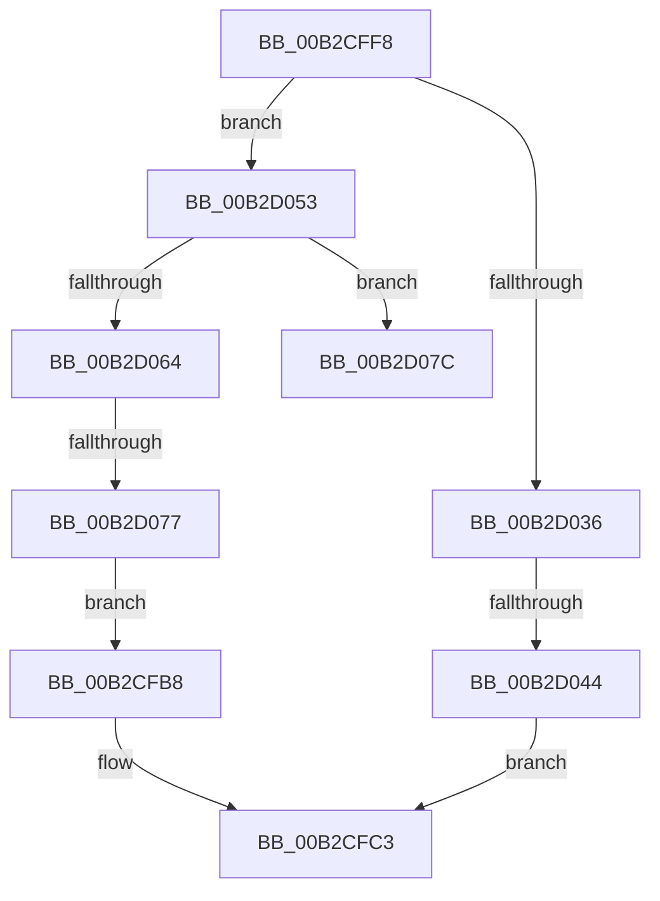

# sub_00B2CFB8

- RVA: `0x00B2CFB8`–`0x00B2D0A8` (길이 `240` bytes)
- VA: `0x0000000140B2CFB8`
- 실행 섹션: `PAGE`
- PDB 이름 있음: `아니요`; PDB Function 태그: `아니요`
- unwind 정보 RVA: `0x00099658`
- 디코드: `57`개 명령, `240/240` bytes 표시
- 미해석 바이트: `0` (있으면 어셈블리에 `.byte`로 보존)

> 이 문서는 커널 이미지의 기계어와 PDB 기호를 분석해 생성했습니다. 4번과 5번은 함수 원형과 자료형을 바이너리 사용 방식에서 추정한 C 해석이며 원본 소스 복구 결과는 아닙니다.

## 1. Dependencies

- 직접 호출 지점: **4**; 고유 호출 대상: **4**
- 직접 호출자로 확인된 함수: **0**
- RIP 상대 이미지 참조: **4**

### Outgoing calls
- `0x00B2CFD4` → [RtlInitUnicodeString](../../text/42/RtlInitUnicodeString_function_0042A780.md) (function, `0x0042A780`)
- `0x00B2CFED` → [PnpLogEvent](../72/PnpLogEvent_function_0072C8FC.md) (function, `0x0072C8FC`)
- `0x00B2D02B` → [ZwMapViewOfSection](../../text/6A/ZwMapViewOfSection_function_006AD5D0.md) (function, `0x006AD5D0`)
- `0x00B2D05A` → [SdbInitDatabaseInMemory](../95/SdbInitDatabaseInMemory_function_0095BC5C.md) (function, `0x0095BC5C`)

### Direct callers
- 이 함수 시작 RVA로 연결되는 직접 call은 확인되지 않았습니다. 간접 호출은 완전히 역산할 수 없습니다.

### Static image references
- `0x00B2CFBC` → RVA `0x00AFE0F0` (` ?? ::NNGAKEGL::`string'`; read)
- `0x00B2CFC6` → RVA `0x00FD9A8C` (`PAGEDATA`; write)
- `0x00B2D036` → RVA `0x00FD9A8C` (`PAGEDATA`; read)
- `0x00B2D047` → RVA `0x00AFE090` (` ?? ::NNGAKEGL::`string'`; read)

## 2. Other-region calls and transfers

- 다른 실행 섹션으로 향하는 call: **2**
  - `0x00B2CFD4` → [RtlInitUnicodeString](../../text/42/RtlInitUnicodeString_function_0042A780.md) (`PAGE` → `.text`)
  - `0x00B2D02B` → [ZwMapViewOfSection](../../text/6A/ZwMapViewOfSection_function_006AD5D0.md) (`PAGE` → `.text`)
- call이 아닌 외부 분기/꼬리 이동: **4**
  - `0x00B2CFF3` → [PiInitializeDDB + 0xB3](../99/PiInitializeDDB_function_0099ADE4.md) (`tail-transfer`)
  - `0x00B2D03E` → [PiInitializeDDB + 0xB3](../99/PiInitializeDDB_function_0099ADE4.md) (`tail-transfer`)
  - `0x00B2D071` → [PiInitializeDDB + 0xB3](../99/PiInitializeDDB_function_0099ADE4.md) (`tail-transfer`)
  - `0x00B2D0A3` → [PiInitializeDDB + 0xB3](../99/PiInitializeDDB_function_0099ADE4.md) (`tail-transfer`)

## 3. Assembly (complete function range)

```asm
00B2CFB8  0F BA E8 07                     bts eax, 7
00B2CFBC  48 8D 15 2D 11 FD FF            lea rdx, [rip - 0x2eed3]
00B2CFC3  0F 57 C0                        xorps xmm0, xmm0
00B2CFC6  89 05 C0 CA 4A 00               mov dword ptr [rip + 0x4acac0], eax
00B2CFCC  48 8D 4D D7                     lea rcx, [rbp - 0x29]
00B2CFD0  0F 11 45 D7                     movups xmmword ptr [rbp - 0x29], xmm0
00B2CFD4  E8 A7 D7 8F FF                  call 0x14042a780
00B2CFD9  45 33 C9                        xor r9d, r9d
00B2CFDC  44 89 74 24 20                  mov dword ptr [rsp + 0x20], r14d
00B2CFE1  33 D2                           xor edx, edx
00B2CFE3  48 8D 4D D7                     lea rcx, [rbp - 0x29]
00B2CFE7  41 B8 6D 03 00 C0               mov r8d, 0xc000036d
00B2CFED  E8 0A F9 BF FF                  call 0x14072c8fc
00B2CFF2  90                              nop
00B2CFF3  E9 9F DE E6 FF                  jmp 0x14099ae97
00B2CFF8  48 8B 4D C7                     mov rcx, qword ptr [rbp - 0x39]
00B2CFFC  48 8D 45 E7                     lea rax, [rbp - 0x19]
00B2D000  89 74 24 48                     mov dword ptr [rsp + 0x48], esi
00B2D004  4C 8D 45 7F                     lea r8, [rbp + 0x7f]
00B2D008  44 89 74 24 40                  mov dword ptr [rsp + 0x40], r14d
00B2D00D  45 33 C9                        xor r9d, r9d
00B2D010  C7 44 24 38 01 00 00 00         mov dword ptr [rsp + 0x38], 1
00B2D018  48 83 CA FF                     or rdx, 0xffffffffffffffff
00B2D01C  48 89 44 24 30                  mov qword ptr [rsp + 0x30], rax
00B2D021  4C 89 74 24 28                  mov qword ptr [rsp + 0x28], r14
00B2D026  4C 89 74 24 20                  mov qword ptr [rsp + 0x20], r14
00B2D02B  E8 A0 05 B8 FF                  call 0x1406ad5d0
00B2D030  8B D8                           mov ebx, eax
00B2D032  85 C0                           test eax, eax
00B2D034  79 1D                           jns 0x140b2d053
00B2D036  8B 05 50 CA 4A 00               mov eax, dword ptr [rip + 0x4aca50]
00B2D03C  A8 40                           test al, 0x40
00B2D03E  0F 85 53 DE E6 FF               jne 0x14099ae97
00B2D044  83 C8 40                        or eax, 0x40
00B2D047  48 8D 15 42 10 FD FF            lea rdx, [rip - 0x2efbe]
00B2D04E  E9 70 FF FF FF                  jmp 0x140b2cfc3
00B2D053  8B 55 E7                        mov edx, dword ptr [rbp - 0x19]
00B2D056  48 8B 4D 7F                     mov rcx, qword ptr [rbp + 0x7f]
00B2D05A  E8 FD EB E2 FF                  call 0x14095bc5c
00B2D05F  48 85 C0                        test rax, rax
00B2D062  75 18                           jne 0x140b2d07c
00B2D064  8B 05 22 CA 4A 00               mov eax, dword ptr [rip + 0x4aca22]
00B2D06A  BB 01 00 00 C0                  mov ebx, 0xc0000001
00B2D06F  84 C0                           test al, al
00B2D071  0F 88 20 DE E6 FF               js 0x14099ae97
00B2D077  E9 3C FF FF FF                  jmp 0x140b2cfb8
00B2D07C  48 89 07                        mov qword ptr [rdi], rax
00B2D07F  48 8B 45 CF                     mov rax, qword ptr [rbp - 0x31]
00B2D083  48 89 47 18                     mov qword ptr [rdi + 0x18], rax
00B2D087  48 8B 45 C7                     mov rax, qword ptr [rbp - 0x39]
00B2D08B  48 89 47 10                     mov qword ptr [rdi + 0x10], rax
00B2D08F  48 8B 45 7F                     mov rax, qword ptr [rbp + 0x7f]
00B2D093  48 89 47 08                     mov qword ptr [rdi + 8], rax
00B2D097  4C 89 75 7F                     mov qword ptr [rbp + 0x7f], r14
00B2D09B  4C 89 75 C7                     mov qword ptr [rbp - 0x39], r14
00B2D09F  4C 89 75 CF                     mov qword ptr [rbp - 0x31], r14
00B2D0A3  E9 EF DD E6 FF                  jmp 0x14099ae97
```

## 4. C-style interpretation (structured pseudocode)

```c
__int64 __fastcall sub_00B2CFB8(__int64 a1, __int64 a2, __int64 a3, int a4)
{
    __int64 result;
    unsigned int v_stack_p20;
    unsigned __int64 v_stack_p28;
    unsigned __int64 v_stack_p30;
    unsigned int v_stack_p38;
    unsigned int v_stack_p40;
    unsigned int v_stack_p48;

loc_00B2CFC3:
    *(unsigned int *)(v_rip + 4901568) = (unsigned int)(result);
    *(unsigned __int64 *)(v_rbp - 41) = v_xmm0;
    result = RtlInitUnicodeString(v_rbp - 41, v_rip - 192211, a3, a4);
    a4 = 0;
    v_stack_p20 = (unsigned int)(v_r14);
    a2 = 0;
    result = PnpLogEvent(v_rbp - 41, a2, (unsigned int)(0xC000036DULL), a4);
}
```

## 5. (Beta) C Style

```c
int64_t sub_00B2CFB8(int64_t Arg1, int64_t Arg2, int64_t Arg3, int32_t Arg4)
{
    int64_t result;
    uint32_t v_stack_p20;
    uint64_t v_stack_p28;
    uint64_t v_stack_p30;
    uint32_t v_stack_p38;
    uint32_t v_stack_p40;
    uint32_t v_stack_p48;

loc_00B2CFC3:
    *(uint32_t *)(v_rip + 0x4ACAC0) = (uint32_t)(result);
    *(uint64_t *)(local_rbp - 0x29) = v_xmm0;
    result = RtlInitUnicodeString(local_rbp - 41, v_rip - 192211, Arg3, Arg4);
    Arg4 = 0;
    v_stack_p20 = (uint32_t)(local_r14);
    Arg2 = 0;
    result = PnpLogEvent(local_rbp - 41, Arg2, (uint32_t)(0xC000036DULL), Arg4);
}
```

## 6. Execution-region graph

[열기: 2D/3D 그래프와 함수 탐색 컨트롤 패널](../../../control-panel.html?section=page&rva=0x00B2CFB8&view=graph)

- 2D 그래프는 위에서 아래로 흐르고, 3D 그래프는 빈 공간을 드래그해 회전합니다. Shift+드래그는 이동, 휠은 확대·축소, 함수 노드 선택은 대상 보고서 이동입니다.

### Static fallback


